# Apuntes completos — Bases de Datos (1º DAW)

> Descargado el 13/11/2026 del código fuente de la web https://dexpositofp.github.io/docencia/BDA/ (repo público `dexpositofp/docencia`, rama `main`). Cada tema está también por separado en esta carpeta.

---

<!-- Guía de la asignatura -->
# Bases de Datos — Guía de la asignatura (1º DAW)

En esta página encontrarás una visión global del módulo: objetivos, contenidos, metodología de trabajo y criterios de evaluación. Desde aquí enlazamos a cada tema (diseño lógico, modelo relacional, SQL y NoSQL).

## Objetivos de la asignatura

El objetivo principal de este módulo es proporcionar al alumnado los conocimientos y habilidades necesarios para diseñar, implementar y gestionar bases de datos en el contexto del desarrollo de aplicaciones web, con un **enfoque integrador** que conecta todos los módulos de 1º DAW.

Los contenidos están **muy orientados al campo de la programación**, priorizando el desarrollo de competencias prácticas que permitan al alumnado trabajar en proyectos reales desde el inicio del curso, integrando bases de datos con programación, lenguajes de marcas, entornos de desarrollo y sistemas informáticos.

**Enfoque integrador:** Este módulo no se trabaja de forma aislada. Cada concepto, proyecto y práctica se diseña para complementar y reforzar el aprendizaje de los demás módulos del ciclo, preparándote para desarrollar aplicaciones web completas y funcionales.

## 1. Competencias

Al finalizar este módulo, serás capaz de:

- **Diseñar modelos de datos** a partir de requisitos funcionales de aplicaciones web reales.
- **Aplicar el modelo relacional** en el diseño lógico y normalizarlo adecuadamente.
- **Implementar bases de datos** usando SQL en sus distintas vertientes (DDL, DML, DCL, TCL).
- **Desarrollar procedimientos almacenados y triggers** en PL/SQL para automatizar lógica de negocio.
- **Integrar bases de datos relacionales y NoSQL** en aplicaciones web completas.
- **Trabajar con diferentes SGBD** (MySQL, PostgreSQL, MongoDB, Redis) según las necesidades del proyecto.
- **Conectar bases de datos con aplicaciones Java**, desarrollando habilidades de integración entre persistencia y lógica de negocio.
- **Colaborar en proyectos integradores** que combinan bases de datos con los demás módulos del ciclo.

## 2. Contenidos

El módulo se estructura en los siguientes bloques temáticos, que se trabajan de forma **iterativa y progresiva** a lo largo de todo el curso:

1.  **Almacenamiento de la información**
    - Ficheros vs Bases de Datos
    - Sistemas Gestores de Bases de Datos (SGBD)
    - Tipos de SGBD: relacionales y NoSQL
2.  **Diseño conceptual**
    - Modelo Entidad-Relación (E/R) - Notación Chen
    - Diagrama de Clases UML
    - Cardinalidades y multiplicidades
3.  **Diseño lógico**
    - Modelo relacional
    - Transformación E/R → Tablas
    - Normalización (1FN, 2FN, 3FN, BCNF)
4.  **SQL: Lenguaje de consulta estructurado**
    - DDL: Definición de datos (CREATE, ALTER, DROP)
    - DML: Manipulación de datos (SELECT, INSERT, UPDATE, DELETE)
    - DCL: Control de acceso (GRANT, REVOKE)
    - TCL: Transacciones (COMMIT, ROLLBACK)
5.  **PL/SQL: Programación en base de datos**
    - Procedimientos almacenados
    - Funciones
    - Triggers (disparadores)
    - Cursores y excepciones
6.  **Bases de datos NoSQL**
    - Bases de datos documentales (MongoDB)
    - Bases de datos clave-valor (Redis)
    - Bases de datos columnares (Cassandra)
    - Bases de datos de grafos (Neo4j)
    - Arquitecturas híbridas (Polyglot Persistence)

**Nota importante:** Estos contenidos no se imparten de forma secuencial y aislada. Desde la **primera evaluación**, se trabajan **conceptos básicos de todos los Resultados de Aprendizaje (RAs)** para que puedas comenzar a desarrollar proyectos completos cuanto antes, integrando bases de datos con las tecnologías que estás aprendiendo en los demás módulos.

## 3. Metodología

### Enfoque práctico y orientado a proyectos

Este módulo sigue una metodología **eminentemente práctica**, donde la teoría se introduce de forma progresiva y siempre aplicada a casos reales de desarrollo web. El objetivo es que puedas trabajar en proyectos funcionales desde el inicio del curso.

### Estructura temporal por evaluaciones

#### Primera Evaluación: Fundamentos y base para proyectos

Durante la primera evaluación se presentarán **contenidos mínimos de todos los Resultados de Aprendizaje (RAs)** del módulo. Esto significa que verás:

- Conceptos básicos de diseño de bases de datos (E/R y modelo relacional)
- SQL fundamental (CREATE, SELECT, INSERT, UPDATE, DELETE, JOIN)
- Introducción a PL/SQL (procedimientos básicos)
- Primeros pasos con NoSQL (MongoDB básico)
- Conexión desde lenguajes de programación

**El objetivo** es que, al finalizar la primera evaluación, dispongas de las herramientas necesarias para **comenzar a trabajar en proyectos integradores** con todos los módulos del curso.

#### Segunda Evaluación: Profundización y primer proyecto

Se profundiza en todos los RAs trabajados en la primera evaluación, añadiendo:

- Diseño avanzado (normalización, restricciones complejas)
- SQL avanzado (subconsultas, vistas, transacciones)
- PL/SQL completo (triggers, funciones, cursores)
- NoSQL: diferentes tipos de bases de datos
- Optimización y rendimiento

Desarrollarás un **proyecto práctico** que integra bases de datos con programación y tecnologías web.

#### Tercera Evaluación: Proyecto integrador final

La tercera evaluación se centra exclusivamente en el desarrollo de un **proyecto integrador completo** que combina todos los módulos de 1º DAW:

- Bases de Datos (diseño, implementación, optimización)
- Programación (Java)
- Lenguajes de Marcas (HTML, CSS, XML, JSON)
- Entornos de Desarrollo (Git, testing, documentación)
- Sistemas Informáticos (despliegue, configuración)

### Trabajo con proyectos

**Validación con el equipo educativo:** Todos los proyectos deberán ser **presentados y validados con el equipo educativo completo** antes de su entrega final. Esto asegura que el proyecto cumple con los requisitos de todos los módulos y permite detectar y corregir problemas de forma temprana.

### Todos los RAs en todas las evaluaciones

A diferencia de un enfoque secuencial tradicional, en este módulo se trabajan **todos los Resultados de Aprendizaje en todas las evaluaciones**, pero con diferentes niveles de profundidad:

- **1ª Eval:** Conceptos básicos de todos los RAs
- **2ª Eval:** Profundización en todos los RAs + proyecto
- **3ª Eval:** Dominio avanzado aplicado al proyecto integrador

Esta metodología espiral permite consolidar conocimientos, detectar carencias de forma temprana y mantener la motivación al trabajar en proyectos reales desde el principio.

### Actividades de aprendizaje

- **Sesiones prácticas:** Ejercicios guiados y laboratorio con SGBD reales
- **Desarrollo de proyectos:** Individuales y en equipo
- **Presentaciones:** Exposición de proyectos ante el equipo educativo
- **Resolución de problemas:** Casos reales de diseño y optimización
- **Trabajo colaborativo:** Uso de Git y metodologías ágiles

## 4. Evaluación

La evaluación está diseñada para ser **progresiva y acumulativa**, valorando tanto los conocimientos teóricos como las competencias prácticas adquiridas a lo largo del curso.

### Criterios de evaluación por evaluación

<table>
<colgroup>
<col style="width: 25%" />
<col style="width: 25%" />
<col style="width: 25%" />
<col style="width: 25%" />
</colgroup>
<thead>
<tr class="header">
<th>Evaluación</th>
<th>Instrumentos</th>
<th>Peso</th>
<th>Descripción</th>
</tr>
</thead>
<tbody>
<tr class="odd">
<td><strong>1ª Evaluación</strong></td>
<td>Prueba objetiva</td>
<td><strong>100%</strong></td>
<td>Examen que evalúa los <strong>contenidos mínimos de todos los RAs</strong> trabajados durante el trimestre: diseño básico, SQL fundamental, introducción a PL/SQL y NoSQL, conexión desde código.</td>
</tr>
<tr class="even">
<td><strong>2ª Evaluación</strong></td>
<td>• Prueba objetiva 
• Proyecto práctico</td>
<td><strong>20%</strong> 
<strong>80%</strong></td>
<td><strong>Prueba objetiva (20%):</strong> Examen de conocimientos teórico-prácticos sobre los contenidos profundizados. 
 
<strong>Proyecto (80%):</strong> Desarrollo de una aplicación web completa que integra base de datos (diseño, implementación, consultas, procedimientos) con programación y tecnologías web. Presentación y validación con el equipo educativo.</td>
</tr>
<tr class="odd">
<td><strong>3ª Evaluación</strong></td>
<td>Proyecto integrador</td>
<td><strong>100%</strong></td>
<td>Proyecto final que integra <strong>todos los módulos de 1º DAW</strong>. La nota de Bases de Datos depende del diseño, implementación y gestión de la base de datos del proyecto, así como de su correcta integración con el resto de componentes. Requiere presentación y defensa ante el equipo educativo completo.</td>
</tr>
</tbody>
</table>

### Cálculo de la nota final del módulo

La **nota final del curso** se calculará de la siguiente manera:

- **20% - Media de las pruebas objetivas:** Se hará la media aritmética de todas las pruebas objetivas realizadas a lo largo del curso (1ª evaluación + 2ª evaluación).
- **80% - Proyecto final:** El proyecto integrador de la 3ª evaluación, que incluye el proyecto de la 2ª evaluación mejorado y ampliado con la integración de todos los módulos.

**Fórmula:** Nota Final = (Media Pruebas Objetivas × 0.20) + (Proyecto Final × 0.80)

Este sistema de evaluación refuerza el enfoque práctico del módulo, dando mayor peso al desarrollo de competencias aplicadas en proyectos reales, mientras se mantiene la verificación de conocimientos teóricos a través de las pruebas objetivas.

**⚠️ ¡A tener en cuenta!**  
Para cada prueba que se realice (tanto pruebas objetivas como proyectos), se os puede pedir **en cualquier momento una prueba de validación** para verificar el trabajo realizado. Si no se supera dicha prueba de validación, la prueba o proyecto correspondiente se calificará con **0**.  
  
Esta medida garantiza que el trabajo presentado es realmente vuestro y que habéis adquirido las competencias evaluadas.

**Consejo:** El proyecto integrador de la 3ª evaluación es la culminación de todo el aprendizaje del curso. Comienza a planificarlo desde la 1ª evaluación y solicita validaciones periódicas con el equipo educativo para asegurar que vas por buen camino.

### Resultados de Aprendizaje (RAs) evaluados

Todos los RAs del módulo se trabajan y evalúan en las tres evaluaciones, con diferente nivel de profundidad. La evaluación verifica el logro de estos RAs de forma progresiva a lo largo del curso.

<a href="#top" class="backtotop" aria-label="Volver arriba">↑</a>

---

<!-- Almacenamiento de la información -->
# Almacenamiento de la información — fundamentos y evolución

Esta unidad introduce los conceptos fundamentales del almacenamiento de información: desde la distinción entre **dato e información**, pasando por las limitaciones de los **ficheros tradicionales**, hasta llegar a los **Sistemas Gestores de Bases de Datos (SGBD)** tanto relacionales como NoSQL. Comprenderemos cómo han evolucionado las tecnologías de almacenamiento para adaptarse a las necesidades de escalabilidad, rendimiento y flexibilidad que demandan las aplicaciones modernas.

## 1. Datos e Información

Antes de introducirnos en el mundo de las bases de datos, resulta fundamental distinguir entre dos conceptos básicos: **dato** e **información**. Aunque en el lenguaje cotidiano se utilizan como sinónimos, en el ámbito de la informática no significan lo mismo. Un *dato* es simplemente un valor aislado que por sí solo carece de un significado completo: puede ser un número, una fecha o una palabra. Por ejemplo, valores como *25*, *2024-06-10* o *"Juan"* son solo datos en bruto; no sabemos si se trata de una edad, una temperatura, una fecha de nacimiento o el nombre de un cliente. Por sí mismos, los datos no resuelven ninguna necesidad ni responden a ninguna pregunta.

La **información**, en cambio, surge cuando esos datos se organizan y se interpretan dentro de un contexto. Es el resultado de darles un significado que aporte conocimiento. Así, si decimos:

> "El día 15 de junio de 2024 en Valencia se registraron **25 grados centígrados**."

Ahora ya no hablamos de un simple número: hemos transformado el dato en una información útil, que nos dice qué ocurrió, dónde y cuándo. Este ejemplo muestra cómo la diferencia entre dato e información radica en el contexto y la interpretación que se les da.

### Ejemplos prácticos adicionales

Para entender mejor esta distinción, veamos más ejemplos cotidianos:

| Dato aislado | Información contextualizada                                                       |
|--------------|-----------------------------------------------------------------------------------|
| 42           | El estudiante Juan García ha obtenido un 42% en el examen de matemáticas          |
| 2024-12-25   | La entrega del proyecto final está programada para el 25 de diciembre de 2024     |
| 120/80       | La presión arterial del paciente Pedro López es de 120/80 mmHg (valores normales) |
| EUR 1500     | El salario mensual neto del empleado ES-1234 es de 1500 euros                     |

Para entender mejor esta distinción conviene recordar algunos puntos clave:

- Los datos son la **materia prima**, la información es el **producto procesado**.
- Un mismo dato puede generar informaciones muy distintas según el contexto en el que se utilice.
- En informática, lo importante no es acumular datos sin más, sino convertirlos en información que sirva para tomar decisiones.
- El **conocimiento** va un paso más allá: es la capacidad de aplicar la información de forma práctica.
- La **sabiduría** representa el nivel más alto: usar el conocimiento con juicio y criterio.

**Consejo:** Siempre que trabajes con un conjunto de datos, pregúntate: *¿qué información útil puedo extraer de aquí?* Esa reflexión te ayudará a diferenciar entre almacenar datos sin valor y gestionar conocimiento real.

En resumen, los datos aislados carecen de valor práctico, mientras que la información organizada y contextualizada es la que verdaderamente aporta utilidad. Esta distinción es el punto de partida que justifica la necesidad de sistemas de almacenamiento y gestión eficientes, que veremos materializados en los **Sistemas de Bases de Datos**. A lo largo del curso, profundizaremos en cómo los SGBD permiten realizar esa transformación de manera estructurada, fiable y accesible.

## 2. Ficheros

Antes de la popularización de las bases de datos, las organizaciones utilizaban ficheros para almacenar la información. Esta estrategia resultaba relativamente sencilla y económica: bastaba con definir un conjunto de archivos de texto o binarios en los que registrar datos de clientes, empleados, ventas o cualquier otro aspecto del negocio. De hecho, en entornos reducidos todavía hoy se encuentran sistemas de gestión que dependen de hojas de cálculo o ficheros planos.

Sin embargo, a medida que los sistemas crecieron en tamaño y en complejidad, las limitaciones de este enfoque se hicieron evidentes. La gestión basada únicamente en ficheros genera problemas de redundancia, falta de integridad y dificultades a la hora de acceder de manera eficiente a la información. Estos inconvenientes suponen un freno considerable para el desarrollo de aplicaciones seguras y escalables.

### 2.1 Principales problemas del almacenamiento en ficheros

- **Redundancia de datos:** la misma información se guarda en múltiples ficheros, lo que provoca duplicidad innecesaria.
- **Inconsistencia:** si se actualiza un dato en un fichero y no en los demás, aparecen contradicciones.
- **Dificultad de acceso:** recuperar información requiere recorrer el fichero completo, lo que supone operaciones lentas.
- **Escasa seguridad:** el control de accesos es limitado y no suele existir gestión de permisos granular.
- **Problemas de integridad:** no hay mecanismos que aseguren que los datos cumplen reglas básicas (ejemplo: no admitir edades negativas).
- **Mantenimiento costoso:** cualquier cambio en la estructura de un fichero puede obligar a reprogramar todas las aplicaciones asociadas.
- **Concurrencia limitada:** cuando varios usuarios intentan modificar el mismo fichero simultáneamente, surgen conflictos.
- **Falta de copias de seguridad automatizadas:** no existe un mecanismo centralizado de backup y recuperación.

### 2.2 Ejemplo práctico de problemas con ficheros

Imaginemos una pequeña empresa que gestiona sus clientes con ficheros CSV. Tiene tres departamentos:

    // Fichero: ventas_clientes.csv
    ID,Nombre,Telefono,Email
    1,María López,600111222,maria@example.com
    2,Juan García,600333444,juan@example.com

    // Fichero: soporte_clientes.csv
    ClienteID,Nombre,Email,Incidencias
    1,María López,maria@example.com,3
    2,Juan García,juan@example.com,1

    // Fichero: contabilidad_clientes.csv
    ID,Cliente,Facturacion
    1,María López,15000
    2,Juan García,8500
      

**Problemas que surgen:**

- Si María cambia su email, hay que actualizar 3 ficheros distintos (redundancia e inconsistencia)
- No hay forma de asegurar que el ID 1 siempre es la misma persona en los 3 ficheros
- Si dos usuarios editan simultáneamente, uno puede sobrescribir los cambios del otro
- No se puede validar que el teléfono tenga 9 dígitos o que el email contenga @
- Para obtener un informe completo de un cliente, hay que leer y cruzar manualmente los 3 ficheros

Aunque los ficheros pueden ser útiles en proyectos pequeños o para almacenamiento temporal, **no son adecuados cuando el volumen de datos crece** o cuando la información debe compartirse entre distintos usuarios y aplicaciones. En estas situaciones, las bases de datos resultan imprescindibles.

## 3. Bases de datos

Para superar las limitaciones de los sistemas basados en ficheros, surge el concepto de **base de datos**. Una base de datos no es simplemente un conjunto de ficheros: es un *almacén estructurado de información*, diseñado para garantizar la consistencia, integridad y disponibilidad de los datos. Además, las bases de datos están gestionadas por un software especializado que centraliza el control y ofrece un conjunto de herramientas para manipular la información de forma eficiente.

### 3.1 Características principales

- **Centralización:** los datos se almacenan en un sistema único, accesible para distintas aplicaciones y usuarios.
- **Reducción de redundancia:** la información se organiza de manera que se minimiza la duplicidad.
- **Integridad:** se pueden definir reglas que aseguren que los datos cumplen restricciones lógicas y de negocio.
- **Seguridad:** se gestionan permisos de acceso diferenciados para usuarios y grupos.
- **Escalabilidad:** permiten manejar grandes volúmenes de información sin degradar el rendimiento.
- **Flexibilidad en las consultas:** gracias a lenguajes especializados como SQL, es posible recuperar información compleja de forma rápida.
- **Copias de seguridad y recuperación:** mecanismos automatizados de backup y restore.
- **Control de concurrencia:** múltiples usuarios pueden trabajar simultáneamente sin conflictos.

### 3.2 Ejemplo comparativo

Retomando el ejemplo anterior de la empresa con ficheros CSV, con una base de datos tendríamos:

    -- Una única tabla Clientes
    CREATE TABLE Clientes (
        id INT PRIMARY KEY,
        nombre VARCHAR(100) NOT NULL,
        telefono VARCHAR(9) CHECK (LENGTH(telefono) = 9),
        email VARCHAR(150) UNIQUE CHECK (email LIKE '%@%'),
        incidencias INT DEFAULT 0,
        facturacion DECIMAL(10,2) DEFAULT 0.00
    );

    -- Todos los departamentos consultan la misma información centralizada
    -- Si María cambia su email, se actualiza una sola vez
    -- Las restricciones CHECK garantizan integridad
    -- Múltiples usuarios pueden trabajar simultáneamente
      

Gracias a estas características, las bases de datos se convierten en la solución natural para empresas, administraciones y organizaciones de todo tipo que necesiten almacenar y gestionar su información de manera fiable.

Piensa en una base de datos como en la infraestructura central de información de una organización. Igual que un sistema eléctrico distribuye la energía de forma segura y controlada a todos los dispositivos, la base de datos distribuye la información de manera estructurada, garantizando su integridad y accesibilidad.

## 4. Sistemas Gestores de Bases de Datos (SGBD)

Una **base de datos** por sí sola no es suficiente para garantizar un uso eficiente y seguro de la información. Es necesario un sistema que proporcione mecanismos para crear, organizar, consultar, modificar y proteger los datos de forma estructurada. Aquí entran en juego los **Sistemas Gestores de Bases de Datos (SGBD)**, que son el conjunto de programas diseñados para facilitar todas estas operaciones. Gracias a ellos, los usuarios no necesitan preocuparse por la implementación técnica ni por los detalles del almacenamiento físico: basta con interactuar a través de lenguajes de consulta o de aplicaciones que se apoyan en el SGBD.

Las funciones principales de un SGBD incluyen la **definición** de estructuras de datos, la **inserción y modificación** de registros, la **gestión de transacciones** que aseguren propiedades como la consistencia, el control de **seguridad y accesos**, y la **recuperación ante fallos**. En la práctica, esto significa que un SGBD no solo organiza información, sino que también garantiza su integridad y la disponibilidad en todo momento.

### 4.1 Tipos de SGBD

A lo largo de la historia de la informática han surgido distintos tipos de SGBD, cada uno con características específicas y con ventajas en diferentes contextos. Conocerlos ayuda a entender por qué los sistemas actuales están diseñados de la manera en que lo están:

- **SGBD jerárquicos:** organizan los datos en estructuras de árbol, con relaciones de tipo padre–hijo. Fueron muy usados en los años 60 y 70, sobre todo en sistemas bancarios y gubernamentales. Ejemplo: IBM IMS (Information Management System).
- **SGBD en red:** permiten relaciones más flexibles entre registros, representando los datos en forma de grafo. Fueron una evolución de los jerárquicos para soportar estructuras más complejas. Ejemplo: IDMS (Integrated Database Management System).
- **SGBD relacionales:** organizan los datos en tablas y son el estándar dominante desde los años 80 hasta hoy. Se basan en el álgebra relacional y lenguajes como SQL. Ejemplos: Oracle, MySQL, PostgreSQL, Microsoft SQL Server, MariaDB.
- **SGBD orientados a objetos:** incorporan conceptos de la programación orientada a objetos para almacenar datos junto con su comportamiento. Aunque no llegaron a ser masivos, son útiles en aplicaciones muy específicas. Ejemplos: ObjectDB, db4o.
- **SGBD NoSQL:** pensados para grandes volúmenes de datos y alta escalabilidad. Aquí encontramos sistemas de tipo clave–valor, orientados a documentos (como MongoDB), a grafos (como Neo4j) o a columnas (como Cassandra). Veremos estos sistemas en detalle en la sección 6.

### 4.2 Componentes de un SGBD

Un SGBD no es un único programa, sino un conjunto de módulos especializados que trabajan en conjunto para ofrecer todas las funcionalidades. Entre los principales componentes destacan:

- **Motor de almacenamiento:** se encarga de guardar y recuperar los datos en memoria secundaria (discos). Gestiona aspectos como índices, páginas de datos, buffers y cachés.
- **Procesador de consultas:** traduce las sentencias SQL en instrucciones ejecutables, optimizando la forma en que se accede a los datos. Incluye el parser (analizador sintáctico), el optimizador de consultas y el ejecutor.
- **Gestor de transacciones:** asegura las propiedades ACID (Atomicidad, Consistencia, Aislamiento y Durabilidad). Maneja el control de concurrencia y la recuperación ante fallos.
- **Gestor de seguridad:** controla accesos, permisos y autenticación de usuarios. Implementa roles, privilegios y políticas de seguridad.
- **Catálogo del sistema:** también conocido como diccionario de datos, guarda metainformación sobre tablas, vistas, índices y permisos. Es el "mapa" que describe toda la estructura de la base de datos.
- **Gestor de copias de seguridad:** permite realizar backups completos, incrementales y diferenciales, así como restaurar la base de datos a un punto en el tiempo.

No existe un único tipo de SGBD que sea perfecto para todo. La elección depende del tipo de datos, del volumen, de las consultas que se vayan a realizar y de la escalabilidad necesaria. En la práctica, muchas organizaciones combinan varias tecnologías: por ejemplo, PostgreSQL para datos transaccionales y MongoDB para datos no estructurados.

## 5. Bases de Datos Relacionales

Los **Sistemas de Bases de Datos Relacionales** (RDBMS, por sus siglas en inglés) son el tipo de SGBD más utilizado en la actualidad. Su éxito se debe a que ofrecen un modelo sencillo y potente a la vez: los **datos se organizan en tablas** (también llamadas relaciones), compuestas por filas y columnas. Cada fila representa un registro único y cada columna un atributo o característica del mismo.

El modelo relacional fue propuesto por **Edgar F. Codd** en 1970 en su artículo "A Relational Model of Data for Large Shared Data Banks" y revolucionó la manera de entender las bases de datos. Gracias a él, la información puede gestionarse mediante operaciones matemáticas del *álgebra relacional*, lo que proporciona una base formal para la manipulación y consulta de datos.

### 5.1 Conceptos clave

- **Relaciones (tablas):** cada tabla contiene información sobre una entidad, como `Clientes` o `Pedidos`. El nombre técnico es "relación".
- **Filas (tuplas):** representan instancias concretas, como un cliente en particular o un pedido específico. Cada fila debe ser única.
- **Columnas (atributos):** definen las características de la entidad, como `nombre`, `apellido` o `fecha_pedido`. Cada columna tiene un tipo de dato.
- **Claves primarias (Primary Key):** identifican de forma única cada fila dentro de una tabla. No puede haber duplicados ni valores nulos en una clave primaria.
- **Claves foráneas (Foreign Key):** permiten establecer vínculos entre tablas, garantizando la integridad referencial de los datos. Una clave foránea en una tabla hace referencia a la clave primaria de otra tabla.
- **Índices:** estructuras auxiliares que aceleran las búsquedas en las tablas, similar a un índice de un libro.
- **Vistas:** consultas predefinidas que se comportan como tablas virtuales, útiles para simplificar consultas complejas o restringir acceso a ciertos datos.

### 5.2 Ejemplo práctico completo

Supongamos una base de datos para gestionar pedidos en una tienda online. Necesitamos representar clientes, productos, pedidos y los detalles de cada pedido (qué productos contiene cada pedido).

    -- Tabla de Clientes
    CREATE TABLE Clientes (
        cliente_id INT PRIMARY KEY AUTO_INCREMENT,
        nombre VARCHAR(100) NOT NULL,
        apellido VARCHAR(100) NOT NULL,
        email VARCHAR(150) UNIQUE NOT NULL,
        telefono VARCHAR(15),
        fecha_registro DATE DEFAULT CURRENT_DATE,
        activo BOOLEAN DEFAULT TRUE
    );

    -- Tabla de Productos
    CREATE TABLE Productos (
        producto_id INT PRIMARY KEY AUTO_INCREMENT,
        nombre VARCHAR(200) NOT NULL,
        descripcion TEXT,
        precio DECIMAL(10,2) NOT NULL CHECK (precio >= 0),
        stock INT DEFAULT 0 CHECK (stock >= 0),
        categoria VARCHAR(50)
    );

    -- Tabla de Pedidos
    CREATE TABLE Pedidos (
        pedido_id INT PRIMARY KEY AUTO_INCREMENT,
        fecha TIMESTAMP DEFAULT CURRENT_TIMESTAMP,
        cliente_id INT NOT NULL,
        estado ENUM('pendiente', 'procesando', 'enviado', 'entregado', 'cancelado'),
        total DECIMAL(10,2),
        FOREIGN KEY (cliente_id) REFERENCES Clientes(cliente_id)
            ON DELETE RESTRICT
            ON UPDATE CASCADE
    );

    -- Tabla de Detalles de Pedido (relación muchos a muchos entre Pedidos y Productos)
    CREATE TABLE DetallesPedido (
        detalle_id INT PRIMARY KEY AUTO_INCREMENT,
        pedido_id INT NOT NULL,
        producto_id INT NOT NULL,
        cantidad INT NOT NULL CHECK (cantidad > 0),
        precio_unitario DECIMAL(10,2) NOT NULL,
        FOREIGN KEY (pedido_id) REFERENCES Pedidos(pedido_id)
            ON DELETE CASCADE,
        FOREIGN KEY (producto_id) REFERENCES Productos(producto_id)
            ON DELETE RESTRICT
    );

    -- Ejemplo de inserción de datos
    INSERT INTO Clientes (nombre, apellido, email, telefono)
    VALUES ('María', 'López', 'maria.lopez@example.com', '600111222');

    INSERT INTO Productos (nombre, descripcion, precio, stock, categoria)
    VALUES ('Laptop Dell XPS 13', 'Portátil ultraligero 13 pulgadas', 1299.99, 15, 'Informática');

    INSERT INTO Pedidos (cliente_id, estado, total)
    VALUES (1, 'pendiente', 1299.99);

    INSERT INTO DetallesPedido (pedido_id, producto_id, cantidad, precio_unitario)
    VALUES (1, 1, 1, 1299.99);

    -- Consulta para ver todos los pedidos de un cliente con sus productos
    SELECT
        c.nombre,
        c.apellido,
        p.pedido_id,
        p.fecha,
        p.estado,
        pr.nombre AS producto,
        dp.cantidad,
        dp.precio_unitario
    FROM Clientes c
    JOIN Pedidos p ON c.cliente_id = p.cliente_id
    JOIN DetallesPedido dp ON p.pedido_id = dp.pedido_id
    JOIN Productos pr ON dp.producto_id = pr.producto_id
    WHERE c.cliente_id = 1;
      

En este ejemplo podemos observar:

- Cada tabla tiene una clave primaria que identifica únicamente cada registro
- Las claves foráneas establecen relaciones entre tablas (un pedido pertenece a un cliente)
- Las restricciones CHECK aseguran la integridad (no puede haber precios o stocks negativos)
- Las restricciones UNIQUE evitan duplicados (no puede haber dos clientes con el mismo email)
- Las opciones ON DELETE y ON UPDATE definen el comportamiento en cascada
- La tabla DetallesPedido resuelve la relación muchos a muchos entre Pedidos y Productos

### 5.3 Ventajas del modelo relacional

- **Facilidad de comprensión:** las tablas son una forma intuitiva de organizar datos.
- **Potencia en las consultas:** gracias a SQL se pueden realizar búsquedas muy complejas con JOINs, subconsultas y agregaciones.
- **Integridad referencial:** asegura que los datos mantengan coherencia entre sí mediante claves foráneas.
- **Escalabilidad vertical:** se adapta tanto a aplicaciones pequeñas como a sistemas empresariales masivos.
- **Madurez y estandarización:** el lenguaje SQL está estandarizado y la tecnología lleva más de 40 años refinándose.
- **Transacciones ACID:** garantiza consistencia y fiabilidad en operaciones críticas.
- **Amplio ecosistema:** herramientas de administración, monitorización, backup y desarrollo muy maduras.

### 5.4 Propiedades ACID

Una de las características más importantes de las bases de datos relacionales es que garantizan las propiedades **ACID** en las transacciones:

| Propiedad        | Significado                                                          | Ejemplo                                                                       |
|------------------|----------------------------------------------------------------------|-------------------------------------------------------------------------------|
| **Atomicidad**   | Una transacción se ejecuta completamente o no se ejecuta en absoluto | En una transferencia bancaria, si falla el cargo, tampoco se realiza el abono |
| **Consistencia** | La base de datos pasa de un estado válido a otro estado válido       | La suma de saldos antes y después de transferencias debe ser la misma         |
| **Aislamiento**  | Las transacciones concurrentes no interfieren entre sí               | Dos usuarios comprando el último artículo no pueden comprarlo ambos           |
| **Durabilidad**  | Una vez confirmada, la transacción persiste incluso ante fallos      | Si el sistema se cae tras confirmar un pago, este no se pierde                |

    -- Ejemplo de transacción ACID: transferencia bancaria
    START TRANSACTION;

    -- Restar dinero de la cuenta origen
    UPDATE Cuentas
    SET saldo = saldo - 100
    WHERE cuenta_id = 1;

    -- Verificar que el saldo no quede negativo
    -- Si queda negativo, hacer ROLLBACK automáticamente
    -- (esto se haría con un CHECK constraint o trigger)

    -- Sumar dinero a la cuenta destino
    UPDATE Cuentas
    SET saldo = saldo + 100
    WHERE cuenta_id = 2;

    -- Si todo está correcto, confirmar la transacción
    COMMIT;

    -- Si algo falla, deshacer todos los cambios
    -- ROLLBACK;
      

Una buena práctica en bases de datos relacionales es *normalizar* las tablas. La normalización consiste en aplicar reglas (formas normales) que eliminan redundancias y aseguran una mejor organización de los datos. Las principales formas normales son: 1FN (atributos atómicos), 2FN (dependencia total de la clave), 3FN (sin dependencias transitivas). Sin embargo, en algunos sistemas de alto rendimiento se aplican técnicas contrarias (desnormalización) para acelerar las consultas, aceptando cierta redundancia a cambio de velocidad.

## 6. Bases de Datos NoSQL

### 6.1 Introducción a NoSQL

El término **NoSQL** (originalmente "No SQL", ahora también interpretado como "Not Only SQL") surgió a finales de la década de 2000 para describir una nueva generación de sistemas de bases de datos que rompen con el modelo relacional tradicional. Estas bases de datos nacieron como respuesta a las necesidades de empresas tecnológicas (Google, Amazon, Facebook) que debían manejar volúmenes masivos de datos distribuidos en múltiples servidores.

Las bases de datos NoSQL están diseñadas principalmente para:

- **Escalabilidad horizontal:** distribuir datos entre cientos o miles de servidores
- **Alto rendimiento:** procesar millones de operaciones por segundo
- **Flexibilidad de esquema:** almacenar datos sin estructura fija predefinida
- **Disponibilidad:** mantener el servicio activo incluso ante fallos de servidores
- **Grandes volúmenes:** manejar petabytes de información distribuida

**¿Cuándo usar NoSQL?** Considera NoSQL cuando necesites escalabilidad horizontal masiva, cuando los datos no tengan una estructura fija, cuando priorices disponibilidad sobre consistencia estricta, o cuando trabajes con datos no relacionales (documentos JSON, grafos de relaciones sociales, series temporales).

### 6.2 Tipos de Bases de Datos NoSQL

A diferencia de las bases de datos relacionales que comparten un modelo común (tablas), las bases de datos NoSQL se dividen en varios tipos fundamentalmente diferentes:

| Tipo             | Modelo de datos           | Casos de uso típicos                                 | Ejemplos                          |
|------------------|---------------------------|------------------------------------------------------|-----------------------------------|
| **Documentales** | Documentos JSON/BSON      | Aplicaciones web, CMS, catálogos de productos        | MongoDB, CouchDB, RavenDB         |
| **Clave-Valor**  | Pares clave-valor simples | Cachés, sesiones, carritos de compra                 | Redis, Amazon DynamoDB, Riak      |
| **Columnares**   | Familias de columnas      | Big Data, análisis, series temporales                | Apache Cassandra, HBase, ScyllaDB |
| **Grafos**       | Nodos y relaciones        | Redes sociales, recomendaciones, detección de fraude | Neo4j, ArangoDB, Amazon Neptune   |

### 6.3 Bases de Datos Documentales

Las bases de datos documentales almacenan la información en documentos (normalmente JSON o BSON), donde cada documento puede tener una estructura diferente. No requieren un esquema fijo, lo que proporciona gran flexibilidad.

#### Características principales

- Los documentos son autocontenidos y pueden incluir subdocumentos y arrays
- No necesitan definir la estructura de antemano (schema-less o schema-flexible)
- Permiten consultas complejas sobre los campos del documento
- Soportan índices para acelerar búsquedas
- Ideal para datos que naturalmente se representan como documentos (perfiles de usuario, artículos, productos)

#### Ejemplo práctico con MongoDB

    // Colección de usuarios en MongoDB (equivalente a una tabla)
    // Cada documento puede tener campos diferentes

    // Usuario 1: perfil básico
    {
      "_id": ObjectId("507f1f77bcf86cd799439011"),
      "nombre": "María López",
      "email": "maria@example.com",
      "edad": 28,
      "ciudad": "Valencia",
      "intereses": ["programación", "diseño", "yoga"]
    }

    // Usuario 2: perfil completo con subdocumentos
    {
      "_id": ObjectId("507f1f77bcf86cd799439012"),
      "nombre": "Juan García",
      "email": "juan@example.com",
      "edad": 35,
      "direccion": {
        "calle": "Gran Vía 123",
        "ciudad": "Madrid",
        "cp": "28013"
      },
      "pedidos": [
        {
          "pedido_id": 1001,
          "fecha": "2024-01-15",
          "total": 299.99,
          "productos": [
            {"nombre": "Teclado mecánico", "precio": 129.99},
            {"nombre": "Ratón inalámbrico", "precio": 49.99}
          ]
        },
        {
          "pedido_id": 1002,
          "fecha": "2024-02-20",
          "total": 899.99
        }
      ],
      "verificado": true,
      "fecha_registro": ISODate("2023-06-10T00:00:00Z")
    }

    // Insertar un documento
    db.usuarios.insertOne({
      nombre: "Ana Martínez",
      email: "ana@example.com",
      edad: 31,
      skills: ["JavaScript", "React", "Node.js"],
      experiencia_años: 7
    });

    // Consultas en MongoDB
    // Buscar usuarios mayores de 30 años en Valencia
    db.usuarios.find({
      edad: { $gt: 30 },
      ciudad: "Valencia"
    });

    // Buscar usuarios con un interés específico
    db.usuarios.find({
      intereses: "programación"
    });

    // Actualizar un documento añadiendo un nuevo interés
    db.usuarios.updateOne(
      { email: "maria@example.com" },
      { $push: { intereses: "machine learning" } }
    );

    // Buscar usuarios que hayan hecho pedidos superiores a 500€
    db.usuarios.find({
      "pedidos.total": { $gt: 500 }
    });

    // Crear índice para acelerar búsquedas por email
    db.usuarios.createIndex({ email: 1 }, { unique: true });
      

#### Ventajas de bases de datos documentales

- Gran flexibilidad: cada documento puede tener campos diferentes
- Evita JOINs: los datos relacionados se pueden incluir en el mismo documento
- Desarrollo ágil: no requiere migraciones de esquema complejas
- Rendimiento en lecturas: recuperar un documento completo es muy rápido
- Natural para aplicaciones web: JSON es el formato nativo de JavaScript

#### Principales sistemas: MongoDB vs CouchDB

| Característica | MongoDB                              | CouchDB                             |
|----------------|--------------------------------------|-------------------------------------|
| Formato        | BSON (Binary JSON)                   | JSON nativo                         |
| Consultas      | Lenguaje propio rico y potente       | MapReduce y vistas                  |
| Consistencia   | Eventual o fuerte (configurable)     | Eventual                            |
| Caso de uso    | Aplicaciones web generales, Big Data | Aplicaciones offline-first, móviles |

### 6.4 Bases de Datos Clave-Valor

Las bases de datos clave-valor son las más simples de todas las NoSQL. Funcionan como un gran diccionario o mapa hash distribuido: cada valor se almacena asociado a una clave única, y solo se puede recuperar conociendo esa clave.

#### Características principales

- Modelo extremadamente simple: solo GET (leer) y PUT (escribir)
- Altísimo rendimiento: operaciones en microsegundos
- Escalabilidad masiva: pueden manejar millones de operaciones por segundo
- El valor puede ser cualquier cosa: string, JSON, binario, objeto serializado
- No hay consultas complejas: solo recuperación por clave exacta

#### Ejemplo práctico con Redis

    // Redis es una BD clave-valor en memoria (muy rápida)

    // Operaciones básicas
    SET usuario:1001:nombre "María López"
    GET usuario:1001:nombre
    // Resultado: "María López"

    // Almacenar objetos JSON como valores
    SET usuario:1001:perfil '{"email":"maria@example.com","edad":28,"ciudad":"Valencia"}'
    GET usuario:1001:perfil

    // Establecer tiempo de expiración (útil para cachés y sesiones)
    SETEX sesion:abc123 3600 '{"user_id":1001,"login_time":"2024-01-15T10:00:00Z"}'
    // Expira en 3600 segundos (1 hora)

    // Contadores (atómicos, muy rápidos)
    SET producto:1234:vistas 0
    INCR producto:1234:vistas
    INCR producto:1234:vistas
    GET producto:1234:vistas
    // Resultado: "2"

    // Listas (útil para colas, notificaciones)
    LPUSH cola:tareas "procesar_pedido_1001"
    LPUSH cola:tareas "enviar_email_2002"
    RPOP cola:tareas
    // Resultado: "procesar_pedido_1001"

    // Sets (conjuntos únicos)
    SADD usuario:1001:intereses "programación"
    SADD usuario:1001:intereses "diseño"
    SADD usuario:1001:intereses "programación"  // No se añade (duplicado)
    SMEMBERS usuario:1001:intereses
    // Resultado: ["programación", "diseño"]

    // Hashes (útil para objetos con campos)
    HSET usuario:1002 nombre "Juan García"
    HSET usuario:1002 email "juan@example.com"
    HSET usuario:1002 edad 35
    HGETALL usuario:1002
    // Resultado: {"nombre":"Juan García","email":"juan@example.com","edad":"35"}

    // Uso típico: caché de consultas SQL
    SET cache:consulta:productos:categoria:laptops '[{"id":1,"nombre":"Dell XPS"},{"id":2,"nombre":"MacBook"}]'
    EXPIRE cache:consulta:productos:categoria:laptops 300
    // Caché expira en 5 minutos
      

#### Casos de uso típicos

- **Cachés:** almacenar resultados de consultas costosas para acelerar lecturas
- **Sesiones de usuario:** almacenar información temporal de usuarios autenticados
- **Carritos de compra:** datos temporales que no necesitan persistencia compleja
- **Contadores en tiempo real:** vistas, likes, estadísticas que se actualizan constantemente
- **Colas de tareas:** sistemas de procesamiento asíncrono
- **Límites de tasa (rate limiting):** controlar número de peticiones por usuario

#### Principales sistemas: Redis vs DynamoDB

| Característica | Redis                                      | Amazon DynamoDB                           |
|----------------|--------------------------------------------|-------------------------------------------|
| Almacenamiento | En memoria (con persistencia opcional)     | Disco (SSD)                               |
| Velocidad      | Extremadamente rápido (microsegundos)      | Muy rápido (milisegundos)                 |
| Estructuras    | Strings, listas, sets, hashes, sorted sets | Solo items con atributos                  |
| Escalabilidad  | Vertical + clustering                      | Horizontal ilimitada (gestionada por AWS) |
| Caso de uso    | Caché, sesiones, pub/sub, colas            | Aplicaciones serverless, IoT, gaming      |

### 6.5 Bases de Datos Columnares

Las bases de datos columnares (también llamadas "wide-column stores") organizan los datos en familias de columnas en lugar de en filas. A diferencia de las bases relacionales que almacenan filas completas juntas, estas almacenan cada columna separadamente, lo que las hace extremadamente eficientes para análisis de grandes volúmenes de datos.

#### Características principales

- Optimizadas para escrituras y lecturas masivas distribuidas
- Cada fila puede tener diferentes columnas (esquema flexible)
- Excelente compresión de datos (columnas similares se comprimen bien)
- Particionamiento automático de datos entre múltiples nodos
- Alta disponibilidad sin punto único de fallo
- Ideal para series temporales y análisis de Big Data

#### Ejemplo práctico con Apache Cassandra

    // Cassandra usa CQL (Cassandra Query Language), similar a SQL

    -- Crear un keyspace (equivalente a una base de datos)
    CREATE KEYSPACE tienda
    WITH replication = {
      'class': 'SimpleStrategy',
      'replication_factor': 3
    };

    USE tienda;

    -- Crear una tabla (familia de columnas)
    CREATE TABLE sensores_temperatura (
      sensor_id text,
      timestamp timestamp,
      temperatura decimal,
      humedad decimal,
      ubicacion text,
      PRIMARY KEY (sensor_id, timestamp)
    ) WITH CLUSTERING ORDER BY (timestamp DESC);

    -- Insertar datos
    INSERT INTO sensores_temperatura (sensor_id, timestamp, temperatura, humedad, ubicacion)
    VALUES ('sensor_001', '2024-01-15 10:00:00', 22.5, 65.0, 'Sala A');

    INSERT INTO sensores_temperatura (sensor_id, timestamp, temperatura, humedad, ubicacion)
    VALUES ('sensor_001', '2024-01-15 10:01:00', 22.7, 64.5, 'Sala A');

    INSERT INTO sensores_temperatura (sensor_id, timestamp, temperatura, humedad, ubicacion)
    VALUES ('sensor_002', '2024-01-15 10:00:00', 21.3, 70.0, 'Sala B');

    -- Consultar últimas lecturas de un sensor (muy eficiente)
    SELECT * FROM sensores_temperatura
    WHERE sensor_id = 'sensor_001'
    ORDER BY timestamp DESC
    LIMIT 10;

    -- Consultar rango temporal
    SELECT * FROM sensores_temperatura
    WHERE sensor_id = 'sensor_001'
    AND timestamp >= '2024-01-15 10:00:00'
    AND timestamp < '2024-01-15 11:00:00';

    -- Tabla para eventos de usuarios (diferente estructura)
    CREATE TABLE eventos_usuario (
      usuario_id text,
      evento_id timeuuid,
      tipo_evento text,
      datos text,
      PRIMARY KEY (usuario_id, evento_id)
    ) WITH CLUSTERING ORDER BY (evento_id DESC);

    -- Cassandra permite diferentes columnas en diferentes filas
    INSERT INTO eventos_usuario (usuario_id, evento_id, tipo_evento, datos)
    VALUES ('user_001', now(), 'login', '{"ip":"192.168.1.1","navegador":"Chrome"}');

    INSERT INTO eventos_usuario (usuario_id, evento_id, tipo_evento, datos)
    VALUES ('user_001', now(), 'compra', '{"producto_id":1234,"precio":99.99}');

    -- Agregaciones con contadores
    CREATE TABLE estadisticas_producto (
      producto_id int,
      mes text,
      vistas counter,
      compras counter,
      PRIMARY KEY (producto_id, mes)
    );

    UPDATE estadisticas_producto
    SET vistas = vistas + 1
    WHERE producto_id = 1234 AND mes = '2024-01';

    UPDATE estadisticas_producto
    SET compras = compras + 1
    WHERE producto_id = 1234 AND mes = '2024-01';
      

#### Ventajas de bases de datos columnares

- Escalabilidad horizontal lineal: añadir más nodos aumenta la capacidad proporcionalmente
- Alta disponibilidad: sin punto único de fallo (arquitectura descentralizada)
- Rendimiento predecible incluso con petabytes de datos
- Escrituras extremadamente rápidas (optimizadas con LSM trees)
- Ideal para series temporales, logs, métricas y eventos

#### Principales sistemas: Cassandra vs HBase

| Característica | Apache Cassandra                   | Apache HBase                         |
|----------------|------------------------------------|--------------------------------------|
| Arquitectura   | Descentralizada (peer-to-peer)     | Master-slave (depende de HDFS)       |
| Lenguaje       | CQL (similar a SQL)                | API Java, REST                       |
| Consistencia   | Configurable (eventual o fuerte)   | Fuerte                               |
| Ecosistema     | Independiente                      | Integrado con Hadoop                 |
| Caso de uso    | IoT, series temporales, mensajería | Big Data analytics, Hadoop ecosystem |

### 6.6 Bases de Datos de Grafos

Las bases de datos de grafos almacenan datos como nodos (entidades) y aristas (relaciones entre entidades). Este modelo es ideal cuando las relaciones entre datos son tan importantes como los datos mismos. Son especialmente potentes para consultas que requieren recorrer múltiples niveles de relaciones.

#### Características principales

- Los nodos representan entidades (personas, productos, lugares, etc.)
- Las aristas representan relaciones con dirección y propiedades
- Tanto nodos como aristas pueden tener propiedades (clave-valor)
- Optimizadas para consultas de recorrido (traversal queries)
- Excelentes para detectar patrones y caminos entre nodos

#### Ejemplo práctico con Neo4j

    // Neo4j usa Cypher, un lenguaje declarativo para grafos

    // Crear nodos (personas)
    CREATE (maria:Persona {
      nombre: 'María López',
      edad: 28,
      ciudad: 'Valencia',
      profesion: 'Desarrolladora'
    });

    CREATE (juan:Persona {
      nombre: 'Juan García',
      edad: 35,
      ciudad: 'Madrid',
      profesion: 'Diseñador'
    });

    CREATE (ana:Persona {
      nombre: 'Ana Martínez',
      edad: 31,
      ciudad: 'Barcelona',
      profesion: 'Project Manager'
    });

    CREATE (carlos:Persona {
      nombre: 'Carlos Ruiz',
      edad: 29,
      ciudad: 'Valencia',
      profesion: 'Data Scientist'
    });

    // Crear relaciones entre personas
    MATCH (maria:Persona {nombre: 'María López'})
    MATCH (juan:Persona {nombre: 'Juan García'})
    CREATE (maria)-[:CONOCE {desde: '2020-03-15', relacion: 'amigos'}]->(juan);

    MATCH (juan:Persona {nombre: 'Juan García'})
    MATCH (ana:Persona {nombre: 'Ana Martínez'})
    CREATE (juan)-[:TRABAJA_CON {proyecto: 'WebApp2024', rol: 'colaborador'}]->(ana);

    MATCH (maria:Persona {nombre: 'María López'})
    MATCH (carlos:Persona {nombre: 'Carlos Ruiz'})
    CREATE (maria)-[:CONOCE {desde: '2019-06-01', relacion: 'compañeros'}]->(carlos);

    MATCH (ana:Persona {nombre: 'Ana Martínez'})
    MATCH (carlos:Persona {nombre: 'Carlos Ruiz'})
    CREATE (ana)-[:MENTORIZA {area: 'Machine Learning'}]->(carlos);

    // Crear nodos de empresas y proyectos
    CREATE (empresa1:Empresa {
      nombre: 'TechCorp',
      sector: 'Tecnología',
      empleados: 500
    });

    CREATE (proyecto1:Proyecto {
      nombre: 'WebApp2024',
      presupuesto: 50000,
      estado: 'en_desarrollo'
    });

    // Relacionar personas con empresas y proyectos
    MATCH (maria:Persona {nombre: 'María López'})
    MATCH (empresa1:Empresa {nombre: 'TechCorp'})
    CREATE (maria)-[:TRABAJA_EN {puesto: 'Senior Developer', desde: '2021-01-15'}]->(empresa1);

    MATCH (juan:Persona {nombre: 'Juan García'})
    MATCH (proyecto1:Proyecto {nombre: 'WebApp2024'})
    CREATE (juan)-[:PARTICIPA_EN {rol: 'Lead Designer', horas_semanales: 30}]->(proyecto1);

    // CONSULTAS POTENTES

    // 1. Encontrar amigos de amigos (2 niveles de profundidad)
    MATCH (maria:Persona {nombre: 'María López'})-[:CONOCE*1..2]-(amigo)
    RETURN DISTINCT amigo.nombre;

    // 2. Encontrar el camino más corto entre dos personas
    MATCH camino = shortestPath(
      (maria:Persona {nombre: 'María López'})-[*]-(ana:Persona {nombre: 'Ana Martínez'})
    )
    RETURN camino;

    // 3. Recomendar personas que María podría conocer
    // (amigos de amigos que María aún no conoce)
    MATCH (maria:Persona {nombre: 'María López'})-[:CONOCE]-(amigo)-[:CONOCE]-(recomendacion)
    WHERE NOT (maria)-[:CONOCE]-(recomendacion)
    AND maria <> recomendacion
    RETURN recomendacion.nombre, COUNT(*) AS conexiones_comunes
    ORDER BY conexiones_comunes DESC;

    // 4. Encontrar expertos en un área mediante la red
    MATCH (persona:Persona)-[:MENTORIZA {area: 'Machine Learning'}]->(aprendiz)
    RETURN persona.nombre AS mentor, COUNT(aprendiz) AS num_mentorados
    ORDER BY num_mentorados DESC;

    // 5. Análisis de comunidades: personas en la misma ciudad que se conocen
    MATCH (p1:Persona)-[:CONOCE]-(p2:Persona)
    WHERE p1.ciudad = p2.ciudad
    RETURN p1.ciudad, COUNT(*) AS conexiones_locales
    ORDER BY conexiones_locales DESC;

    // 6. Detectar influencers (personas con más conexiones)
    MATCH (persona:Persona)-[rel]-(conectado)
    RETURN persona.nombre, COUNT(rel) AS num_conexiones
    ORDER BY num_conexiones DESC
    LIMIT 5;

    // 7. Proyectos en los que colaboran personas que se conocen
    MATCH (p1:Persona)-[:CONOCE]-(p2:Persona),
          (p1)-[:PARTICIPA_EN]->(proyecto:Proyecto)<-[:PARTICIPA_EN]-(p2)
    RETURN proyecto.nombre, p1.nombre, p2.nombre;
      

#### Casos de uso típicos

- **Redes sociales:** modelar conexiones, sugerencias de amistad, feed de noticias
- **Sistemas de recomendación:** productos, contenidos, contactos basados en grafo social
- **Detección de fraude:** identificar patrones sospechosos en transacciones
- **Gestión del conocimiento:** wikis, ontologías, relaciones entre conceptos
- **Redes de logística:** optimización de rutas, cadenas de suministro
- **Análisis de impacto:** cómo un cambio afecta a elementos relacionados

#### Ventajas de bases de datos de grafos

- Consultas de relaciones complejas son extremadamente rápidas
- Modelo natural para datos altamente conectados
- Flexibilidad: fácil añadir nuevos tipos de nodos y relaciones
- Excelente rendimiento en consultas de profundidad variable
- Visualización intuitiva de los datos y sus relaciones

#### Principales sistemas: Neo4j vs ArangoDB

| Característica | Neo4j                                  | ArangoDB                                       |
|----------------|----------------------------------------|------------------------------------------------|
| Tipo           | Solo grafos                            | Multi-modelo (grafos, documentos, clave-valor) |
| Lenguaje       | Cypher (muy expresivo para grafos)     | AQL (similar a SQL)                            |
| Rendimiento    | Optimizado para traversals complejos   | Bueno en general, flexible                     |
| Ecosistema     | Muy maduro, amplia comunidad           | Creciente, moderna                             |
| Caso de uso    | Cuando el grafo es el modelo principal | Cuando necesitas grafos + otros modelos        |

### 6.7 Teorema CAP

El **Teorema CAP**, formulado por Eric Brewer en 2000, es fundamental para entender los compromisos que hacen las bases de datos distribuidas (incluyendo NoSQL). Establece que en un sistema distribuido es imposible garantizar simultáneamente las tres propiedades siguientes:

| Propiedad                                          | Descripción                                                                | Ejemplo                                                                    |
|----------------------------------------------------|----------------------------------------------------------------------------|----------------------------------------------------------------------------|
| **Consistency (Consistencia)**                     | Todos los nodos ven los mismos datos al mismo tiempo                       | Después de actualizar un dato, todas las lecturas devuelven el nuevo valor |
| **Availability (Disponibilidad)**                  | El sistema siempre responde a las peticiones (aunque algunos nodos fallen) | La aplicación sigue funcionando aunque fallen servidores                   |
| **Partition tolerance (Tolerancia a particiones)** | El sistema sigue operando aunque se pierda comunicación entre nodos        | Si se corta la red entre data centers, ambos siguen sirviendo peticiones   |

Según el teorema CAP, solo se pueden garantizar **dos de estas tres propiedades**. Esto lleva a tres tipos de sistemas:

**CP (Consistency + Partition tolerance):** Sacrifica disponibilidad. Si hay una partición de red, algunos nodos dejan de responder hasta que se resuelva, garantizando que todos los datos sean consistentes.  
*Ejemplos: HBase, MongoDB (configurado en modo strong consistency), Redis (en modo cluster)*

**AP (Availability + Partition tolerance):** Sacrifica consistencia fuerte. El sistema siempre responde, pero puede devolver datos temporalmente inconsistentes entre nodos. Utiliza consistencia eventual: los datos convergen con el tiempo.  
*Ejemplos: Cassandra, DynamoDB, CouchDB, Riak*

**CA (Consistency + Availability):** No tolera particiones de red. En la práctica, esto solo es viable en sistemas no distribuidos o en redes extremadamente fiables.  
*Ejemplos: Bases de datos relacionales tradicionales en un solo servidor (PostgreSQL, MySQL)*

#### Ejemplo práctico del teorema CAP

Imaginemos un sistema de comercio electrónico con dos data centers (España y EE.UU.) para dar servicio global:

    // Escenario: Un cliente actualiza su dirección de envío

    // Sistema CP (MongoDB en strong consistency)
    // 1. Cliente actualiza dirección en servidor España
    // 2. Sistema espera a que se replique a EE.UU.
    // 3. Si hay partición de red, el sistema rechaza la escritura
    // 4. Ventaja: Garantiza que todos leen la dirección correcta
    // 5. Desventaja: Si se cae la conexión, no se pueden hacer actualizaciones

    // Sistema AP (Cassandra)
    // 1. Cliente actualiza dirección en servidor España
    // 2. Sistema acepta inmediatamente (sin esperar replicación)
    // 3. Si hay partición de red, cada data center acepta cambios independientes
    // 4. Ventaja: El sistema siempre está disponible para escrituras
    // 5. Desventaja: Temporalmente, España y EE.UU. pueden tener direcciones diferentes
    // 6. Resolución: Tras restaurarse la red, se aplica una política de reconciliación
    //    (por ejemplo, "last write wins" - gana la última escritura)
      

| Base de datos | Tipo CAP                         | Trade-off                                                             |
|---------------|----------------------------------|-----------------------------------------------------------------------|
| MongoDB       | CP (configurable)                | Puede sacrificar disponibilidad para garantizar consistencia          |
| Cassandra     | AP                               | Siempre disponible, pero con consistencia eventual                    |
| Redis         | CP (cluster) / CA (single)       | En cluster sacrifica disponibilidad ante particiones                  |
| CouchDB       | AP                               | Diseñado para consistencia eventual                                   |
| Neo4j         | CA (causal cluster puede ser CP) | Tradicionalmente no distribuido, versiones nuevas soportan clustering |
| PostgreSQL    | CA                               | No diseñado para particiones de red (sistema centralizado)            |

### 6.8 Comparativa SQL vs NoSQL

Ahora que conocemos tanto las bases de datos relacionales como las NoSQL, es importante entender cuándo usar cada una. No son tecnologías competidoras, sino complementarias: cada una sobresale en diferentes escenarios.

| Aspecto             | SQL (Relacional)                                         | NoSQL                                                                  |
|---------------------|----------------------------------------------------------|------------------------------------------------------------------------|
| **Modelo de datos** | Tablas con esquema fijo                                  | Flexible: documentos, clave-valor, columnas, grafos                    |
| **Esquema**         | Definido antes de insertar datos (schema-on-write)       | Flexible, puede cambiar (schema-on-read)                               |
| **Escalabilidad**   | Vertical (más potencia al servidor)                      | Horizontal (más servidores)                                            |
| **Transacciones**   | ACID completo, ideal para transacciones complejas        | Varía: algunas solo eventual consistency, otras soportan transacciones |
| **Consistencia**    | Fuerte (strong consistency)                              | Generalmente eventual (configurable en algunos casos)                  |
| **Consultas**       | SQL muy expresivo, JOINs complejos                       | APIs específicas, limitadas en JOINs                                   |
| **Relaciones**      | Excelente con claves foráneas y JOINs                    | Limitadas (excepto BD de grafos)                                       |
| **Madurez**         | 40+ años, muy estable y probado                          | Más reciente (10-15 años), en evolución                                |
| **Casos de uso**    | Transacciones financieras, ERP, CRM, datos estructurados | Big Data, IoT, analytics, catálogos, redes sociales, cachés            |

#### ¿Cuándo usar SQL?

- Los datos tienen estructura clara y estable
- Necesitas transacciones ACID complejas (bancos, comercio, contabilidad)
- Las relaciones entre datos son críticas (muchos JOINs)
- Requieres consultas complejas ad-hoc
- La integridad referencial es imprescindible
- El volumen de datos cabe en escalado vertical
- Ejemplos: sistemas de facturación, gestión de pedidos, CRM

#### ¿Cuándo usar NoSQL?

- Los datos no tienen estructura fija o cambian frecuentemente
- Necesitas escalar horizontalmente a muchos servidores
- Priorizas disponibilidad sobre consistencia inmediata
- Manejas volúmenes masivos de datos (petabytes)
- Trabajas con datos semi-estructurados (JSON, logs, eventos)
- Necesitas muy alto rendimiento en lecturas/escrituras
- Ejemplos: catálogos de productos, perfiles de usuario, métricas, logs, mensajería

#### Arquitecturas híbridas (Polyglot Persistence)

En la práctica, muchas aplicaciones modernas usan **múltiples bases de datos** en función de las necesidades de cada componente:

    // Ejemplo de arquitectura de comercio electrónico

    PostgreSQL (SQL):
      - Gestión de pedidos y transacciones (ACID crítico)
      - Gestión de usuarios y autenticación
      - Facturación y contabilidad

    MongoDB (Documental):
      - Catálogo de productos (esquema flexible)
      - Contenido del CMS
      - Perfiles de usuario enriquecidos

    Redis (Clave-Valor):
      - Caché de consultas frecuentes
      - Sesiones de usuario
      - Carritos de compra temporales
      - Rate limiting

    Elasticsearch (Motor de búsqueda):
      - Búsqueda de productos
      - Búsqueda de texto completo
      - Logs y analytics

    Cassandra (Columnar):
      - Eventos de usuario (clickstream)
      - Métricas y analytics en tiempo real
      - Historial de navegación

    Neo4j (Grafos):
      - Recomendaciones de productos
      - "Usuarios que compraron esto también compraron..."
      - Detección de fraude
      

**Advertencia:** Usar múltiples bases de datos aumenta la complejidad operacional. Solo hazlo cuando los beneficios (rendimiento, escalabilidad, flexibilidad) justifiquen el coste adicional de mantenimiento, monitorización y conocimiento técnico requerido.

### 6.9 Ventajas y Desventajas de NoSQL

#### Ventajas principales

- **Escalabilidad horizontal:** fácil añadir más servidores para aumentar capacidad
- **Flexibilidad de esquema:** no necesitas definir estructura rígida de antemano
- **Alto rendimiento:** optimizadas para casos de uso específicos (lecturas, escrituras, grafos)
- **Disponibilidad:** arquitecturas diseñadas para funcionar 24/7 sin downtime
- **Manejo de Big Data:** capaces de procesar petabytes de información distribuida
- **Desarrollo ágil:** cambios de esquema no requieren migraciones complejas
- **Coste:** muchas opciones open source y pueden usar hardware commodity
- **Especialización:** cada tipo está optimizado para casos de uso específicos

#### Desventajas y limitaciones

- **Falta de estandarización:** cada sistema tiene su propio lenguaje de consulta
- **Consistencia eventual:** puede haber lecturas temporalmente inconsistentes
- **JOINs limitados:** operaciones entre "tablas" son complejas o imposibles
- **Madurez:** menos años de desarrollo que sistemas SQL
- **Menos herramientas:** ecosistema de administración y monitorización menos maduro
- **Curva de aprendizaje:** cada tipo de NoSQL requiere aprender conceptos nuevos
- **Transacciones limitadas:** muchos no soportan transacciones multi-documento/multi-tabla
- **Complejidad operacional:** gestionar clusters distribuidos es complejo

**Recomendación:** Para empezar tu carrera como desarrollador, domina primero las bases de datos relacionales (SQL). Son la base de la mayoría de aplicaciones empresariales y te darán fundamentos sólidos. Después, aprende NoSQL según lo necesites: MongoDB si trabajas con APIs REST/JSON, Redis para cachés, Neo4j para grafos sociales, etc. No necesitas saberlo todo desde el principio.

## 7. Ejercicios de refuerzo

Para consolidar los conceptos aprendidos sobre datos, información, sistemas de gestión de bases de datos relacionales y NoSQL, se proponen los siguientes ejercicios. Algunos son prácticos, otros requieren reflexión e investigación adicional.

### 7.1 Ejercicios de investigación

1.  Investiga un caso real en el que la gestión de la información en simples ficheros haya causado problemas de coherencia o pérdida de datos. Explica cómo una base de datos podría haber solucionado el problema.
2.  Busca qué empresas tecnológicas utilizan bases de datos relacionales a gran escala y qué características de estos sistemas les resultan imprescindibles. Haz lo mismo con bases de datos NoSQL.
3.  Investiga el caso de Instagram: ¿por qué migraron de PostgreSQL a Cassandra para ciertos tipos de datos? ¿Qué les llevó a tomar esa decisión?
4.  Busca información sobre el término "NewSQL". ¿Qué problemas intenta resolver? ¿Cómo combina ventajas de SQL y NoSQL?

### 7.2 Ejercicios de reflexión

1.  Explica, con tus propias palabras, la diferencia entre **dato** e **información**. Pon un ejemplo de tu vida cotidiana.
2.  ¿Por qué es importante que un SGBD asegure las propiedades **ACID** en las transacciones? Imagina qué pasaría si una transferencia bancaria no cumpliera estas propiedades.
3.  Diseña un pequeño escenario de base de datos para una biblioteca usando únicamente *ficheros de texto*. Luego, identifica los problemas que surgirían y describe cómo los resolverías usando un SGBD relacional.
4.  Explica el Teorema CAP con tus propias palabras. ¿Por qué es imposible garantizar las tres propiedades simultáneamente en un sistema distribuido?
5.  Si tuvieras que diseñar una red social (como Twitter), ¿qué tipo de base de datos usarías para cada componente? (usuarios, tweets, timeline, trending topics, mensajes directos). Justifica tu respuesta.

### 7.3 Ejercicios prácticos - SQL

1.  Dibuja un pequeño diagrama relacional (tablas + relaciones) para un sistema de gestión de una tienda online que maneja **Clientes**, **Pedidos**, **Productos** y **Categorías**.
2.  Identifica las claves primarias y foráneas en tu diagrama del ejercicio anterior y explica qué restricciones aseguran la integridad referencial.
3.  Escribe sentencias SQL para crear las tablas de tu diseño, incluyendo restricciones CHECK, UNIQUE, NOT NULL y claves foráneas.
4.  Plantea al menos 5 consultas SQL que podrían hacerse sobre tu diseño relacional:
    - Listar productos de una categoría específica
    - Mostrar todos los pedidos de un cliente con el total de cada pedido
    - Encontrar los 10 productos más vendidos
    - Calcular el total de ventas del último mes
    - Listar clientes que nunca han hecho un pedido

### 7.4 Ejercicios prácticos - NoSQL

1.  Diseña el modelo de datos para un blog usando MongoDB. Decide si incrustar comentarios dentro del documento del post o crear una colección separada. Justifica tu decisión.
2.  Imagina que estás diseñando una aplicación de fitness que registra entrenamientos diarios. ¿Usarías una BD relacional o Cassandra? ¿Por qué? Diseña el esquema que usarías.
3.  Diseña un grafo para representar una red de recomendaciones de películas. Define:
    - Tipos de nodos (Película, Usuario, Actor, Director, Género)
    - Tipos de relaciones (VISTO, LE_GUSTA, ACTUA_EN, DIRIGE, PERTENECE_A)
    - Propiedades de nodos y relaciones
    - Tres consultas Cypher útiles (recomendaciones, actores más prolíficos, etc.)
4.  Para cada uno de los siguientes escenarios, decide qué tipo de base de datos usarías (SQL, documental, clave-valor, columnar o grafos) y justifica:
    - Sistema de reservas de hotel
    - Aplicación de mensajería instantánea (tipo WhatsApp)
    - Plataforma de streaming de música (tipo Spotify)
    - Sistema de gestión de inventario para supermercado
    - Red social profesional (tipo LinkedIn)
    - Plataforma de monitorización de sensores IoT (millones de lecturas/segundo)

### 7.5 Ejercicio integrador

Diseña la arquitectura de bases de datos completa para una plataforma de e-learning (tipo Udemy/Coursera):

1.  Identifica los diferentes tipos de datos que necesitas almacenar
2.  Decide qué base de datos usar para cada tipo (puedes usar múltiples tecnologías)
3.  Justifica cada elección basándote en: volumen, estructura, consultas, consistencia, escalabilidad
4.  Dibuja un diagrama de arquitectura mostrando cómo interactúan los diferentes sistemas
5.  Identifica los puntos críticos donde necesitas transacciones ACID
6.  Diseña el esquema de datos para al menos dos de las bases de datos que elegiste

**Tip:** Al resolver los ejercicios prácticos, intenta pensar en cómo organizarías la información y qué tipo de consultas se harán más frecuentemente. Esta habilidad de análisis es clave para convertirte en un buen arquitecto de datos. No hay una única respuesta correcta: lo importante es que justifiques tus decisiones técnicas.

<a href="#top" class="backtotop" aria-label="Volver arriba">↑</a>

---

<!-- Diseño conceptual (E/R y UML) -->
# Modelado Conceptual de Datos

En esta unidad aprendemos a describir el *dominio de información* de un sistema utilizando diferentes enfoques de modelado conceptual: el **modelo Entidad–Relación (E/R)** orientado a bases de datos y el **diagrama de clases UML** orientado a programación. Ambos permiten especificar qué objetos existen, qué propiedades tienen y cómo se relacionan, estableciendo las bases del [diseño lógico](logico.md) y, más adelante, de la implementación en [SQL](sql.md).

**Estructura del tema.** Introducción general ⟶ PARTE I: E/R (Bases de Datos) ⟶ PARTE II: UML (Programación) ⟶ Equivalencias.

## 1) Introducción General

### 1.1 ¿Qué es el modelado conceptual?

El **modelado conceptual** es la representación abstracta y precisa del *dominio de información* de un sistema, independientemente de cómo se vaya a implementar técnicamente. Su objetivo es *entender y acordar* con las partes interesadas:

- Qué **objetos o conceptos** existen en el sistema (Cliente, Pedido, Producto, Usuario...)
- Qué **propiedades** tiene cada concepto (nombre, email, fecha, precio...)
- Cómo se **relacionan** entre sí (un Cliente realiza Pedidos, un Pedido incluye Productos...)
- Qué **reglas** deben cumplirse (todo Pedido debe tener Cliente, un Cliente puede no tener Pedidos...)

**Idea clave.** En el modelado conceptual hablamos de *cosas del mundo real*, no de tablas ni de código. Las decisiones de implementación vendrán después: aquí nos centramos en el *qué* y el *por qué*, no en el *cómo*.

### 1.2 Dos enfoques complementarios

Existen diferentes notaciones para el modelado conceptual, cada una con su origen y ámbito de aplicación preferente. En este curso trabajaremos con las dos más importantes:

<table>
<colgroup>
<col style="width: 25%" />
<col style="width: 25%" />
<col style="width: 25%" />
<col style="width: 25%" />
</colgroup>
<thead>
<tr class="header">
<th>Enfoque</th>
<th>Notación</th>
<th>Origen</th>
<th>Ámbito principal</th>
</tr>
</thead>
<tbody>
<tr class="odd">
<td><strong>Bases de Datos</strong></td>
<td><strong>Modelo Entidad–Relación (E/R)</strong> 
Notación Chen y (min,max)</td>
<td>Peter Chen, 1976 
Diseño de bases de datos</td>
<td>Diseño conceptual de BD relacionales, análisis de requisitos de datos, documentación técnica de BD</td>
</tr>
<tr class="even">
<td><strong>Programación</strong></td>
<td><strong>Diagrama de Clases UML</strong></td>
<td>UML (Unified Modeling Language) 
Ingeniería del software OO</td>
<td>Análisis y diseño orientado a objetos, arquitectura de software, desarrollo en lenguajes OO (Java, Python, C#...)</td>
</tr>
</tbody>
</table>

### 1.3 ¿Por qué estudiar ambas notaciones?

- **Versatilidad profesional**: Diferentes equipos y proyectos prefieren diferentes notaciones. Dominar ambas te hace más empleable.
- **Complementariedad**: E/R es más preciso para cardinalidades y restricciones de BD; UML es más natural cuando el sistema tiene implementación OO.
- **Comunicación eficaz**: Podrás hablar el lenguaje de los diseñadores de BD (E/R) y de los programadores (UML).
- **Integración de conocimientos**: El módulo de Bases de Datos y el de Programación comparten los mismos conceptos; aprenderás a conectarlos.

**Estructura de este tema.**

- **PARTE I (E/R)**: Aprenderás el modelo Entidad-Relación con notación Chen y (min,max), enfocado al diseño de bases de datos relacionales.
- **PARTE II (UML)**: Aprenderás el diagrama de clases UML, enfocado al análisis y diseño orientado a objetos.
- **Tabla de equivalencias**: Al final verás cómo traducir entre ambas notaciones y hacia el modelo relacional (SQL).

### 1.4 Ruta completa del diseño de una BD

El diseño es *iterativo*: podemos volver atrás si descubrimos nuevos requisitos. Este es el camino recomendado, con entregables y relación con el resto de páginas del curso.

| Fase                              | Objetivo                                                                               | Entregables                                                          |
|-----------------------------------|----------------------------------------------------------------------------------------|----------------------------------------------------------------------|
| **0) Idea y contexto**            | Definir el problema, alcance y objetivos (qué se pretende resolver).                   | "Elevator pitch", lista de actores, supuestos y restricciones.       |
| **1) Requisitos y vocabulario**   | Recopilar términos del negocio y reglas clave.                                         | Glosario, casos de uso, ejemplos de datos (pequeño set).             |
| **2) Modelo conceptual (E/R)**    | Identificar *entidades*, *atributos* y *relaciones* con **(min,max)** y participación. | Diagrama E/R, diccionario de datos, reglas de negocio.               |
| **3) Revisión del E/R**           | Validar con ejemplos/contraejemplos y detectar casos especiales.                       | Ajustes de cardinalidades, *entidades débiles*, *ISA*, *agregación*. |
| **4) Diseño lógico (relacional)** | Transformar el E/R a tablas: PK, UK, FK y tablas intermedias.                          | Notación de marco, esquema preliminar.                               |
| **5) Normalización**              | Eliminar redundancias y anomalías (1FN, 2FN, 3FN/BCNF).                                | Esquema normalizado y justificación de (des)normalizaciones.         |
| **6) Implementación (DDL)**       | Crear BD/tablas, tipos y restricciones en el SGBD.                                     | Scripts `CREATE DATABASE/TABLE`, índices y comentarios.              |
| **7) Carga y manipulación (DML)** | Insertar datos, consultar, actualizar y borrar de forma segura.                        | Scripts `INSERT`/`SELECT`/`UPDATE`/`DELETE`, casos de prueba.        |
| **8) Seguridad (DCL)**            | Definir usuarios, roles y privilegios mínimos necesarios.                              | `GRANT/REVOKE`, vistas de seguridad, `SHOW GRANTS`.                  |
| **9) Transacciones (TCL)**        | Garantizar atomicidad y consistencia bajo concurrencia.                                | `START TRANSACTION`, `COMMIT`, `ROLLBACK`, `SAVEPOINT`.              |
| **10) Pruebas y rendimiento**     | Verificar integridad y ajustar tiempos de respuesta.                                   | Datos de prueba, `EXPLAIN`, plan de índices, checklist final.        |

### 1.5 Qué esperamos al terminar esta unidad

- Un **diagrama E/R final** con *(min,max)* y participación (total/parcial) en cada relación.
- Un **diccionario** de entidades y atributos (nombre, significado, dominio y ejemplos).
- Una **lista de restricciones** (dominio, entidad, referencia y semánticas) validada con el “cliente”.

## 2) ¿Por qué modelar? Objetivos y alcance

Modelar con **E/R** no es “dibujar por dibujar”: es *entender* el dominio, acordar el significado de los datos y fijar reglas antes de pasar a tablas y SQL. Un buen modelo reduce la ambigüedad, evita decisiones improvisadas y sirve de contrato entre quienes conocen el negocio y quienes lo implementan.

### 2.1 Objetivos del modelado conceptual

- **Comunicación**: crear un lenguaje común (glosario + diagrama) entendible por perfiles técnicos y no técnicos.
- **Precisión**: explicitar *cardinalidades (min,max)*, *participación*, identificadores y reglas de negocio.
- **Calidad de datos**: detectar redundancias y dependencias antes de que existan tablas o datos productivos.
- **Trazabilidad**: justificar por qué luego habrá ciertas PK/FK, tablas intermedias o jerarquías en el diseño lógico.
- **Independencia**: separar el *qué* y el *por qué* (conceptual) del *cómo* (relacional/SQL/SGBD).

**Lo que *no* es el E/R:** no define pantallas, ni consultas concretas, ni el almacenamiento físico. Tampoco es un diagrama de procesos. Es un *modelo de información*.

### 2.2 ¿Qué pasa si no modelamos?

| Fallo típico                   | Consecuencia                                                     | Cómo lo evita el E/R                                          |
|--------------------------------|------------------------------------------------------------------|---------------------------------------------------------------|
| Omitir mínimos (participación) | FKs opcionales donde deberían ser obligatorias (datos huérfanos) | (min,max) obliga a decidir si es *total* u *opcional*         |
| Confundir N:M con dos 1:N      | Pérdida de atributos de la relación, duplicidades                | Relación N:M con tabla intermedia planificada desde el modelo |
| Meter listas en un atributo    | Imposible consultar/validar por elemento                         | Detecta multivalorados → entidad/relación específica          |
| Elegir mal el identificador    | Duplicados, dificultades para referenciar                        | Lista de identificadores candidatos y criterio de estabilidad |

### 2.3 Criterios de “hecho” (Definition of Done) para el E/R

- Todas las **entidades** tienen un **identificador** claro (natural o surrogate justificado).
- Cada **relación** tiene pares **(min,max)** y **participación** documentados en ambos extremos.
- Los **atributos multivalorados/compuestos** se han tratado adecuadamente (no como listas en una sola celda).
- Se han identificado **entidades débiles**, posibles **ISA** y casos de **agregación**.
- Existe un **glosario** con nombres definidos y ejemplos de valores.
- El modelo ha sido **validado** con 3–5 escenarios de negocio (incluye contraejemplos).

## PARTE I

### Enfoque de Bases de Datos: Modelo Entidad-Relación (Chen)

En esta parte aprenderás el **modelo Entidad-Relación (E/R)** con **notación Chen** y la variante **(min,max)**, que es la notación tradicional y más utilizada en el diseño conceptual de bases de datos relacionales. Se centra en especificar con precisión las entidades, atributos, relaciones, cardinalidades y restricciones que luego se traducirán a tablas SQL.

## 3) Modelo Entidad-Relación (Chen)

### 3.1 Notación Chen y (min,max)

El **modelo Entidad-Relación (E/R)** fue propuesto por Peter Chen en 1976 como herramienta para el diseño conceptual de bases de datos. La **notación Chen** utiliza figuras geométricas específicas para cada elemento:

- **Rectángulos** para entidades (conceptos del dominio)
- **Óvalos** para atributos (propiedades de las entidades)
- **Rombos** para relaciones (asociaciones entre entidades)
- **Líneas** para conectar los elementos
- **Pares (min,max)** en cada extremo de las relaciones para especificar cardinalidades

En este curso utilizaremos la variante **(min,max)** porque nos obliga a decidir explícitamente tanto los *mínimos* (participación total o parcial) como los *máximos* (cardinalidad) en cada extremo de una relación. Esta notación es más precisa y menos ambigua que otras variantes del modelo E/R.

#### Ejemplo de notación Chen con (min,max)

A continuación ves un ejemplo —*Cliente realiza Pedido*— en notación Chen. La semántica es: cada **Pedido** pertenece a **exactamente un** Cliente (participación *total* con cardinalidad (1,1)), y un **Cliente** puede tener **cero o muchos** Pedidos (participación *parcial* con cardinalidad (0,N)).

<figure>

<figcaption>Chen — participación total en <em>Pedido</em> y (0,N) en <em>Cliente</em>.</figcaption>
</figure>

<figure>

<figcaption>Crow’s foot — <code>0..N</code> en Cliente, <code>1</code> (obligatorio) en Pedido.</figcaption>
</figure>

<figure>

<figcaption>Min–max — etiquetas explícitas en cada extremo.</figcaption>
</figure>

## 4) Componentes del E/R

### 4.1 Entidades

Una **entidad** es un conjunto de objetos distinguibles del mundo real (Alumno, Asignatura, Pedido…). Modelar bien una entidad implica *delimitar su significado*, elegir un **identificador** estable y decidir qué propiedades (atributos) le pertenecen realmente (y cuáles deben convertirse en entidades/relaciones aparte).

#### 4.1.1 ¿Cuándo algo es una entidad?

- **Nombre propio y estable:** podemos hablar de “un X” individual (p. ej., “un Pedido”).
- **Identificable:** existe al menos un *candidato a identificador* (natural o surrogate).
- **Propiedades propias:** tiene atributos que no dependen de otra entidad “dueña”.
- **Relaciones naturales:** se asocia con otras entidades con reglas claras (cardinalidades, participación).

#### 4.1.2 Identificadores (claves) y candidatos

Un **identificador** distingue de forma única cada instancia (p. ej., `ISBN` en Libro). Puede ser *natural* (significativo en el negocio) o *surrogate* (artificial, p. ej. `id`). Si hay varios, hablamos de *claves candidatas*; elegimos una como *principal* y el resto quedan como *alternativas*.

**Criterio práctico:** usa clave natural si es *estable* y sin ambigüedad; en caso contrario, crea un surrogate y mantén la natural como `UNIQUE` (para detectar duplicados).

#### 4.1.3 Entidad fuerte vs. entidad débil

- **Fuerte:** se identifica por sí misma (p. ej., *Libro* por `ISBN`).
- **Débil:** no tiene identificador propio y se identifica por una *relación identificadora* con una entidad fuerte + una *clave parcial* (p. ej., *Línea* de pedido por `id_pedido` + `pos`). La participación de la débil en esa relación es **total** (mínimo=1).

<figure class="media-box">

<figcaption><strong>Entidad fuerte:</strong> <em>Libro</em> se identifica por <code>ISBN</code> (clave subrayada).</figcaption>
</figure>

<figure class="media-box">

<figcaption><strong>Entidad débil:</strong> <em>Línea</em> se identifica con <code>id_pedido</code> (desde <em>Pedido</em>) + clave parcial <code>pos</code>. Relación <em>contiene</em> es <em>identificadora</em> (doble rombo) y la participación de <em>Línea</em> es <strong>total</strong>.</figcaption>
</figure>

### 4.2 Atributos

Los **atributos** describen propiedades de las entidades. En notación Chen se representan como *óvalos* conectados a la entidad. Es crucial elegir bien qué es atributo y qué debe modelarse como *entidad/relación* (por ejemplo, una “lista de teléfonos” no es un texto con comas, sino un conjunto de ocurrencias → atributo multivalorado).

#### 4.2.1 Tipos principales

- **Simples**: no se descomponen (p. ej., *nombre*).
- **Compuestos**: se descomponen en subatributos (p. ej., *dirección* → calle, número, CP).
- **Monovalorados**: una sola ocurrencia por entidad (p. ej., *email*).
- **Multivalorados**: varias ocurrencias (p. ej., *teléfono*); en Chen se dibujan con *doble óvalo*.
- **Derivados**: calculados a partir de otros (p. ej., *edad* desde *fecha_nacimiento*); se dibujan con *óvalo discontinuo*.

**Convenciones visuales:** clave *subrayada* (subrayado justo bajo la línea base del texto); *clave parcial* con subrayado *discontinuo*; multivalorado con *doble óvalo*; derivado con *contorno discontinuo*.

#### 4.2.2 Simples y compuestos

Un atributo es **compuesto** si sus partes tienen significado propio y pueden usarse de forma independiente en reglas o consultas (buscar por *CP*, ordenar por *calle*…). En el ejemplo, *dirección* se descompone en *calle*, *número* y *CP*. La clave del ejemplo es *dni* (subrayada).

<figure class="media-box">

<figcaption>Simples vs. compuestos: el subrayado de <em>dni</em> marca la <strong>clave</strong>; <em>dirección</em> se descompone en subatributos.</figcaption>
</figure>

#### 4.2.3 Monovalorados y multivalorados

Usa **multivalorado** cuando exista un conjunto de valores (varios *teléfonos* por cliente). En notación Chen lo representamos con *doble óvalo*. Si *email* es único por cliente, será **monovalorado** (óvalo simple).

<figure class="media-box">
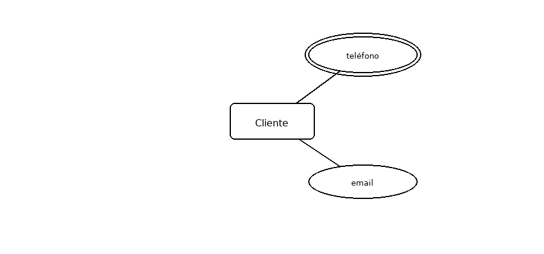
<figcaption>Multivalorado: <em>teléfono</em> (doble óvalo) frente a monovalorado: <em>email</em> (óvalo simple).</figcaption>
</figure>

#### 4.2.4 Derivados

Un atributo es **derivado** si puede calcularse a partir de otros (p. ej., *edad* desde *fecha_nacimiento* y la fecha actual). Ventajas: evita inconsistencias; Inconveniente: cálculos en consulta. Recomendación: *no almacenar* el derivado salvo justificación de rendimiento.

<figure class="media-box">

<figcaption>Derivado: <em>edad</em> con contorno discontinuo. Se sugiere su relación con <em>fecha_nacimiento</em>.</figcaption>
</figure>

#### 4.2.5 Decidir: ¿atributo o entidad?

- **Es atributo** si no necesitas identificarlo por separado ni referenciarlo desde otros conceptos (p. ej., *nombre* de cliente).
- **Es entidad** si tiene vida propia, múltiples propiedades o relaciones (p. ej., un *Teléfono* con tipo, extensión, validaciones, histórico).
- **Regla de la lista:** si esperas “varios valores” (lista), piensa en *multivalorado* o en una entidad/relación específica.

### 4.3 Identificadores (claves)

Un **identificador** distingue de forma *única* a cada instancia de una entidad. Puede ser: *natural* (tiene significado de negocio, p. ej., `ISBN`), *surrogate* (artificial, p. ej., `id`), *compuesto* (varios atributos juntos) o *parcial* (en entidades débiles, combinado con la clave de la fuerte). Si existen varios candidatos posibles, hablamos de **claves candidatas**; se elige una como **principal** y el resto quedan como *alternativas* (normalmente con restricción `UNIQUE` al implementar).

**Convenciones visuales (Chen):** clave *subrayada* (subrayado justo bajo el texto); *clave parcial* con subrayado *discontinuo*.

#### 4.3.1 Clave natural vs. clave surrogate (ampliación)

Una **clave natural** es un identificador con *significado de negocio* que ya distingue a una instancia fuera del sistema (p. ej., `ISBN` de un libro, `DNI` de una persona). Una **clave surrogate** (también llamada *artificial* o *sustituta*) la *crea el sistema* solo para identificar filas (p. ej., `id_libro` `INT AUTO_INCREMENT` o un `UUID`); no tiene significado en el dominio.

**Idea clave.** La surrogate *no sustituye* a las reglas de negocio: si existe un identificador natural relevante, **protégelo con `UNIQUE`** aunque la PK sea surrogate.

##### ¿Cuándo elegir cada una?

| Situación                                                                | Mejor opción                                         | Motivo                                                                          |
|--------------------------------------------------------------------------|------------------------------------------------------|---------------------------------------------------------------------------------|
| El identificador natural es *estable, corto y único* (p. ej., ISBN real) | Natural como PK                                      | Evita columnas extra y mantiene trazabilidad semántica directa                  |
| La “natural” puede *cambiar* (email, username) o es *larga/compuesta*    | Surrogate como PK + `UNIQUE` en la natural           | FKs más cortas y estables; evita cascadas por cambios de negocio                |
| Muchas FKs hacia la entidad; índices secundarios grandes                 | Surrogate como PK                                    | En InnoDB la PK va en todos los índices secundarios; una PK corta reduce tamaño |
| Auditoría/legibilidad humana prioritarias                                | Natural como PK *o* Surrogate + natural con `UNIQUE` | Depende del compromiso entre semántica y rendimiento                            |

##### Ventajas y cautelas

- **Surrogate (PK artificial)**: PK/FK *cortas y estables*, joins más ligeros, evita exponer datos sensibles como PK. *Cuidado:* sin un `UNIQUE` en la natural, puedes introducir **duplicados de negocio**.
- **Natural**: la PK *explica* el negocio y facilita trazabilidad. *Cuidado:* si cambia o es compuesta/larga, las FKs e índices se vuelven más pesados y frágiles.

**Error frecuente.** Usar surrogate y olvidar la restricción `UNIQUE` sobre la clave de negocio: terminarás con “el mismo libro” repetido con distintos `id`.

##### Checklist de decisión (rápida)

- ¿La natural es **inmutable** y **corta** (≤ 16 bytes aprox.)? → Puedes usarla como PK.
- ¿Podría **cambiar**, es **larga** o **compuesta**? → Surrogate como PK + `UNIQUE` en la natural.
- ¿Habrá muchas FKs/índices hacia esta tabla? → Surrogate (reduce tamaño y coste de joins).
- ¿Necesitas trazabilidad humana directa? → Natural como PK, o surrogate + columna natural visible y `UNIQUE`.

#### 4.3.2 Claves candidatas y clave principal

Si hay varias formas de identificar una entidad, tenemos **candidatos**. Seleccionamos una **principal** (subrayada) y dejamos las otras como *alternativas* (no subrayadas en E/R, pero con `UNIQUE` al implementar).

<figure class="media-box">
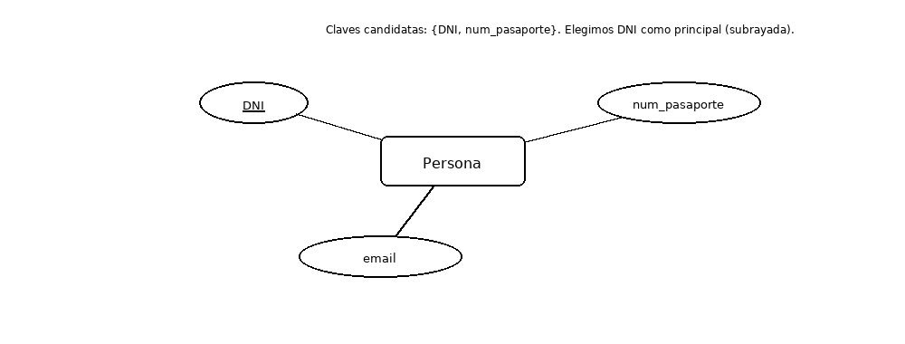
<figcaption>Candidatas: <code>DNI</code> y <code>num_pasaporte</code>. Elegimos <strong>DNI</strong> como principal (subrayada).</figcaption>
</figure>

#### 4.3.3 Clave parcial (entidad débil)

Una **entidad débil** se identifica con la *clave de la fuerte* + una **clave parcial** propia. En E/R la *clave parcial* se indica con **subrayado discontinuo**; la relación identificadora se dibuja con *doble rombo* y la participación de la débil suele ser **total** (doble línea).

<figure class="media-box">
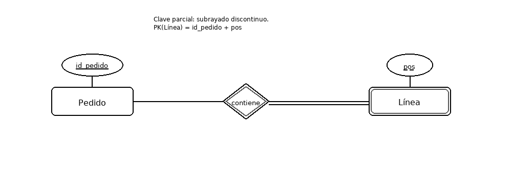
<figcaption><em>PK(Línea)</em> = <code>id_pedido</code> + <code>pos</code>; <code>pos</code> es <strong>clave parcial</strong> (subrayado discontinuo).</figcaption>
</figure>

#### 4.3.4 Criterios de elección (prácticos)

- **Estabilidad:** evita como PK lo que cambie (email, teléfono…).
- **Longitud:** PK cortas mejoran índices y FKs; si la natural es larga, valora surrogate.
- **Semántica:** la natural facilita auditoría y reporting; conserva como `UNIQUE` si usas surrogate.
- **Rendimiento:** FKs compuestas complican joins; en esos casos, surrogate en la entidad de referencia ayuda.

### 4.4 Relaciones y grado

Una **relación** asocia entidades y puede tener *grado* binario (dos entidades), ternario o n-ario. En este curso utilizamos notación **(min,max)** en cada extremo para expresar tanto la *participación* (mínimo = 0 parcial, 1 total) como la *cardinalidad máxima* (1, N). Una relación puede además tener **atributos** propios (p. ej., “precio” en “suministra”) y **roles** cuando una entidad se relaciona consigo misma.

**Lectura correcta.** El par `(min,max)` se lee desde la entidad de ese extremo hacia la relación. Por ejemplo, `(0,N)` en *Cliente* indica que un cliente puede estar en 0 a N pedidos.

#### 4.4.1 Relación binaria

Es la más común. En el ejemplo, un *Cliente* **realiza** *Pedido*: el cliente participa en 0..N pedidos y cada pedido pertenece *exactamente* a 1 cliente.

<figure class="media-box">
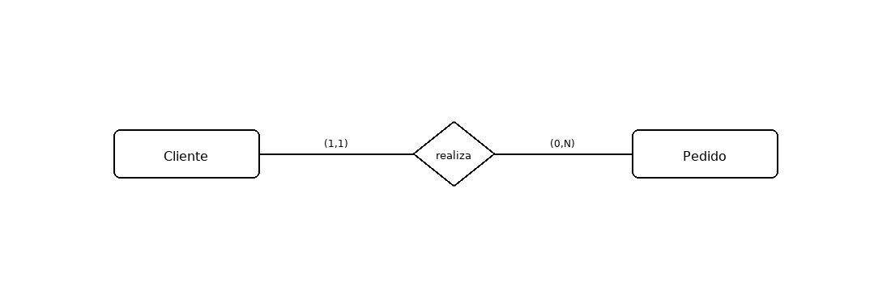
<figcaption>Binaria con <code>(min,max)</code>: <em>Cliente</em> (0,N) — <em>realiza</em> — <em>Pedido</em> (1,1).</figcaption>
</figure>

#### 4.4.2 Relación ternaria (y por qué no son tres binarias)

Una relación **ternaria** captura reglas que dependen *conjuntamente* de tres entidades. No es equivalente a “tres binarias”, porque se perdería la restricción conjunta. En “*Proveedor suministra Producto a Almacén*”, el *precio* puede depender de la triple combinación (proveedor, producto, almacén).

<figure class="media-box">
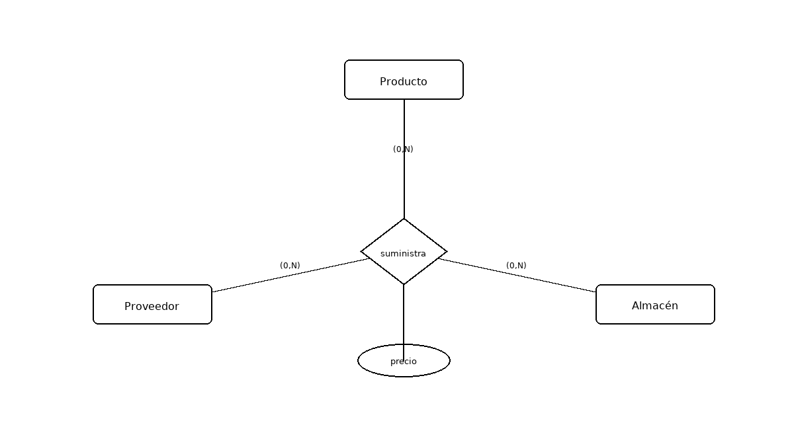
<figcaption>Ternaria con atributo de relación <em>precio</em>. Las cardinalidades se expresan en cada extremo con <code>(min,max)</code>.</figcaption>
</figure>

#### 4.4.3 Relación reflexiva (roles)

Una relación **reflexiva** conecta una entidad consigo misma y requiere **roles** para evitar ambigüedad. En el ejemplo, *Empleado* **supervisa** a *Empleado*: un empleado puede tener `(0,1)` *supervisor* y `(0,N)` *subordinados*.

<figure class="media-box">
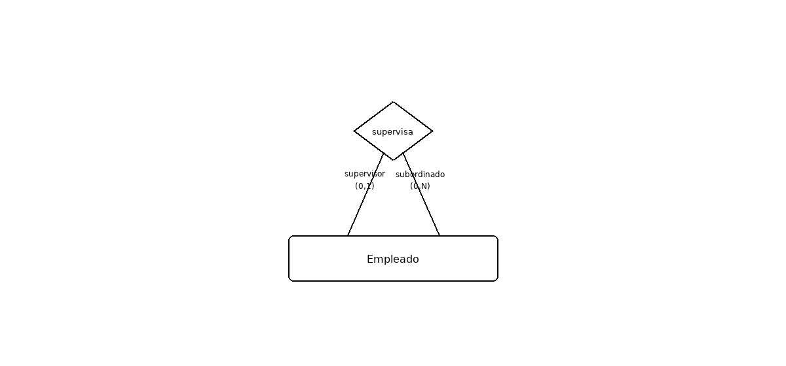
<figcaption>Reflexiva con <strong>roles</strong>: cada <em>Empleado</em> puede tener de 0 a 1 <em>supervisor</em> y de 0 a N <em>subordinados</em>.</figcaption>
</figure>

#### 4.4.4 Consejos de modelado

- **Primero los mínimos:** Decide si la participación es obligatoria (`min=1`) u opcional (`min=0`) y luego la máxima.
- **¿Atributo o entidad?** Si el atributo “vive” en la relación (precio depende de las tres patas), déjalo en la relación.
- **Ternaria de verdad:** Si al descomponer en binarias se pierden reglas (unicidad/conjuntos), debes mantenerla ternaria.
- **Roles claros:** En reflexivas, nombra los roles (mentor/mentorizado, supervisor/subordinado…); evita ambigüedad.

### 4.5 Cardinalidad (min,max) y participación

La **cardinalidad** expresa, en cada extremo de una relación, cuántas veces puede (o debe) aparecer una instancia de esa entidad en la relación: `(min,max)`. En binaria se interpreta como: “cada instancia de A se relaciona con entre *min* y *max* instancias de B”, y viceversa. El valor `min` marca la *participación*: 0 ⇒ **parcial** (opcional); 1 ⇒ **total** (obligatoria).

**Lectura precisa.** El par `(min,max)` se sitúa *encima de la línea y junto al extremo* al que pertenece. Así evitamos ambigüedades.

#### 4.5.1 Relación 1:1

Ambas entidades se emparejan a lo sumo con una instancia de la otra. Suele aparecer cuando hay una descomposición de una misma cosa en dos perspectivas (p. ej., *Persona* y su *DNI*).

<figure class="media-box">
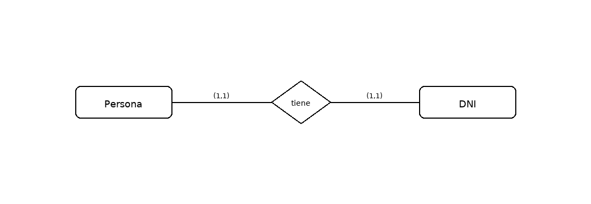
<figcaption><strong>1:1</strong>: <em>Persona</em> (1,1) —tiene— <em>DNI</em> (1,1). Participación total en ambos lados.</figcaption>
</figure>

#### 4.5.2 Relación 1:N (participación opcional)

Un *Cliente* puede realizar **0…N** *Pedidos* (participación *parcial* en Cliente); cada *Pedido* pertenece a **exactamente 1** *Cliente* (participación *total*).

<figure class="media-box">
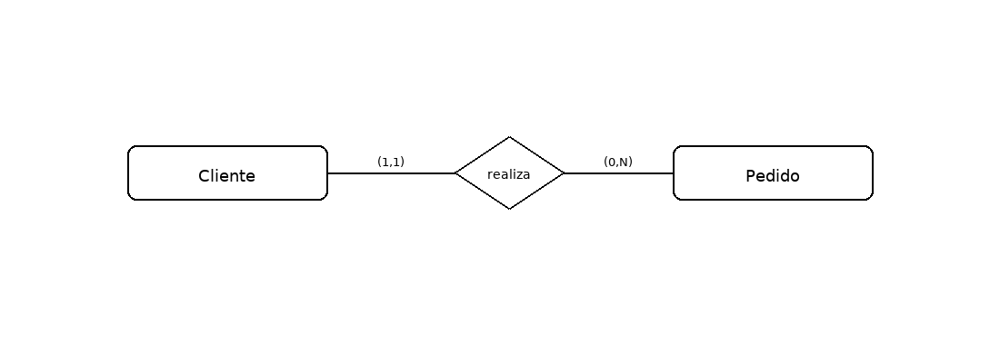
<figcaption><strong>1:N (opcional)</strong>: <em>Cliente</em> (0,N) —realiza— <em>Pedido</em> (1,1).</figcaption>
</figure>

#### 4.5.3 Relación 1:N (participación total)

Cada *Empleado* pertenece a **exactamente 1** *Departamento*; un *Departamento* tiene **1…N** empleados. Es 1:N pero con participación *total* en ambos extremos.

<figure class="media-box">
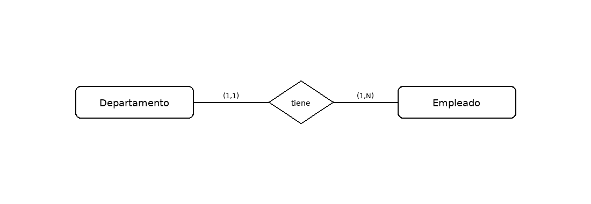
<figcaption><strong>1:N (total)</strong>: <em>Departamento</em> (1,N) —tiene— <em>Empleado</em> (1,1).</figcaption>
</figure>

#### 4.5.4 Relación N:M (muchos a muchos)

Muchas instancias de una entidad se asocian con muchas de la otra. Suele requerir **atributos en la relación** (p. ej., *cantidad* en “*Pedido incluye Producto*”). En el paso lógico-relacional, se transforma en una *tabla intermedia*.

<figure class="media-box">
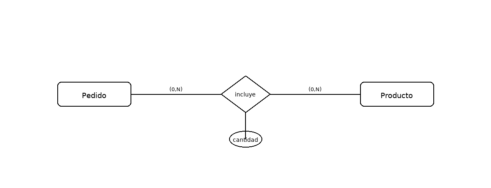
<figcaption><strong>N:M</strong>: <em>Pedido</em> (0,N) —incluye— <em>Producto</em> (0,N). La relación incorpora el atributo <em>cantidad</em>.</figcaption>
</figure>

#### 4.5.5 Consejos de modelado

- **Primero los mínimos:** decide si la participación es obligatoria (1) u opcional (0); luego fija el máximo (1 o N).
- **Cuidado con “ocultar” los mínimos:** escribir solo “1:N / N:M” oculta si hay obligatoriedad. Eso cambia la implementación.
- **Si hay dudas, prototipa reglas con ejemplos:** “¿Puede existir un pedido sin cliente?”, “¿Puede un cliente existir sin pedidos?”.

**Ojo con las etiquetas.** Coloca `(min,max)` *encima de la línea y junto al extremo correcto*. No mezcles los extremos: cambiar el lado puede alterar la interpretación del modelo.

### 4.6 Jerarquías ISA (generalización / especialización)

Una jerarquía **ISA** describe cómo una *superentidad* (también llamada tipo padre) se especializa en uno o varios *subtipos* que heredan su significado, su identificador y sus restricciones, y además pueden añadir atributos y reglas propias. Antes de pensar en tablas, aquí acordamos con el “negocio” cómo se clasifica el mundo: qué es común a todas las instancias (superentidad) y qué varía entre categorías (subtipos). Ese acuerdo es clave, porque condicionará el diseño lógico-relacional posterior: una decisión equivocada aquí se transforma en tablas redundantes o restricciones imposibles de imponer abajo.

**Idea didáctica.** Piensa ISA como “*es un*”: si “Alumno *es una* Persona”, entonces *Alumno* hereda la clave y atributos de *Persona* y añade los suyos (p. ej., `nº_matrícula`).

Al definir una ISA debemos fijar dos decisiones independientes. La primera es si la especialización es **disyunta** (excluyente) o **solapada** (superpuesta). La segunda es si la participación de la superentidad en la especialización es **total** u **parcial**. Disyunta/solapada responde a la pregunta: “¿Puede una misma instancia pertenecer a varios subtipos a la vez?”; total/parcial responde a: “¿Toda instancia del supertipo debe pertenecer a algún subtipo?”. En las figuras usaremos un pequeño triángulo “ISA” como nodo de especialización; marcaremos **\[D\]** si es disyunta o **\[O\]** si es solapada y representaremos la participación *total* con **doble línea** desde la superentidad al triángulo (y *parcial* con línea simple).

#### 4.6.1 Disyunta & Total

La combinación **disyunta y total** obliga a que *toda* instancia de la superentidad se clasifique en *exactamente un* subtipo: no hay superinstancias “sin subtipo” ni superinstancias “en dos subtipos”. Es una decisión fuerte y muy útil cuando el dominio define categorías mutuamente excluyentes y completas. Por ejemplo, si en la empresa toda persona contratada es un *Técnico* o un *Administrativo* y no existe ningún otro perfil, el modelo debe reflejar esa cobertura total y exclusión. En la figura, la doble línea desde *Empleado* al triángulo “ISA” obliga a la pertenencia a algún subtipo, y la marca **\[D\]** recuerda la disyunción.

<figure class="media-box">
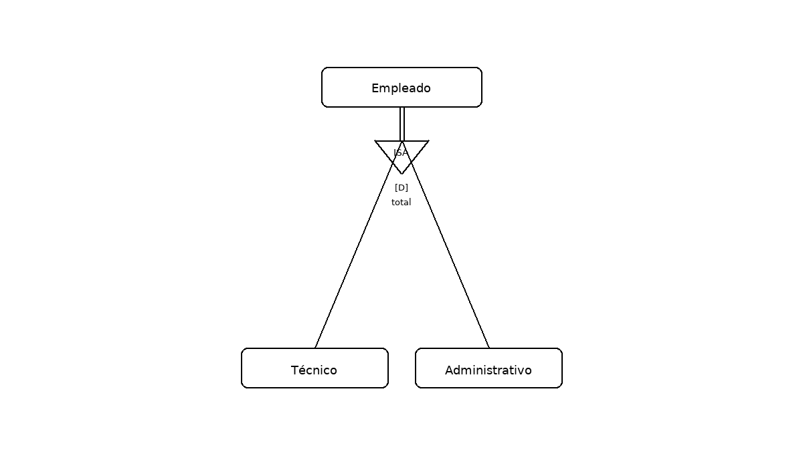
<figcaption><strong>Disyunta &amp; total</strong>: toda <em>Empleado</em> es <em>Técnico</em> <strong>o</strong> <em>Administrativo</em>, nunca ambos. La doble línea exige pertenencia a algún subtipo; <strong>[D]</strong> indica exclusión entre subtipos.</figcaption>
</figure>

#### 4.6.2 Disyunta & Parcial

En la combinación **disyunta y parcial**, una instancia de la superentidad puede pertenecer como mucho a *un* subtipo, pero *también puede no pertenecer a ninguno*. Es apropiada cuando tenemos algunas subcategorías excluyentes (p. ej., *Coche* y *Moto*) pero existen instancias del supertipo que quedan fuera de esa clasificación (p. ej., *Camión*, *Autobús*). Es mejor declarar la parcialidad que forzar a meter “con calzador” objetos en subtipos en los que no encajan: ese error se paga luego con valores nulos sin sentido o reglas difíciles de mantener. En la figura, la línea simple desde *Vehículo* al ISA permite que haya vehículos sin subtipo; **\[D\]** mantiene la exclusión entre *Coche* y *Moto*.

<figure class="media-box">
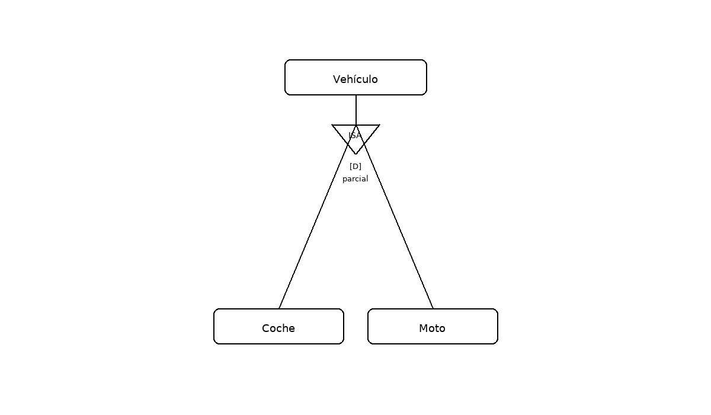
<figcaption><strong>Disyunta &amp; parcial</strong>: un <em>Vehículo</em> puede ser <em>Coche</em> <strong>o</strong> <em>Moto</em>, o ninguno. Línea simple = hay superinstancias sin subtipo; <strong>[D]</strong> = subtipos excluyentes.</figcaption>
</figure>

#### 4.6.3 Solapada & Total

La combinación **solapada y total** obliga a que *toda* instancia del supertipo pertenezca a *al menos un* subtipo, pero permite la pertenencia simultánea a varios. Es la situación típica cuando las categorías representan *roles* que pueden coexistir. Por ejemplo, toda *Persona* en una universidad puede ser *Alumno* o *Empleado* y, en ocasiones, ambos (un estudiante con una beca laboral). La doble línea impide personas “sin rol” y la marca **\[O\]** (overlap) recuerda que no hay exclusión: la implementación posterior deberá permitir múltiples pertenencias, normalmente con tablas que registren esos roles.

<figure class="media-box">
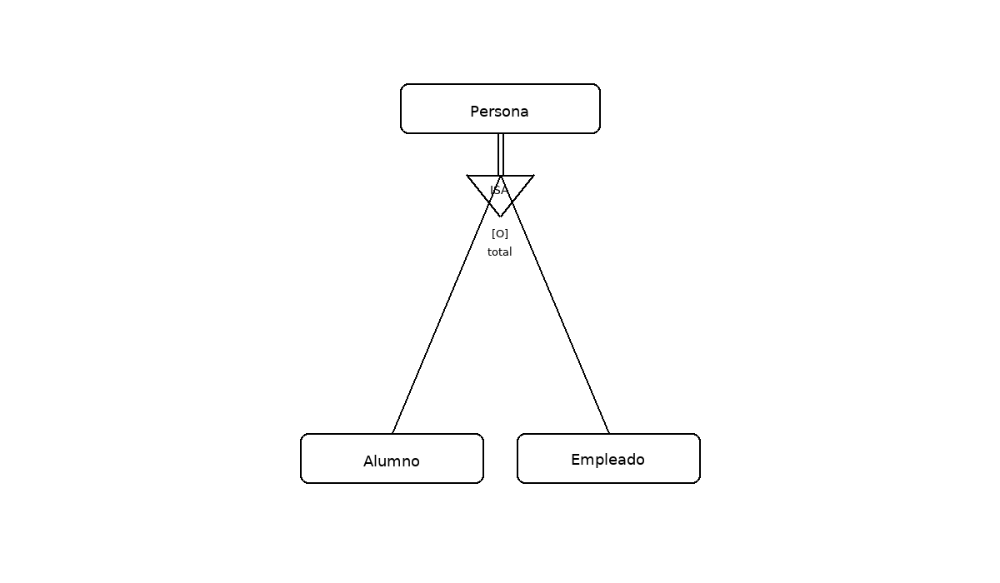
<figcaption><strong>Solapada &amp; total</strong>: toda <em>Persona</em> tiene al menos un rol (<em>Alumno</em>, <em>Empleado</em>) y puede tener ambos. Doble línea = nadie queda fuera; <strong>[O]</strong> = se permite solape.</figcaption>
</figure>

#### 4.6.4 Solapada & Parcial

Por último, **solapada y parcial** permite instancias del supertipo sin subtipo y, si lo tienen, pueden pertenecer a varios a la vez. Es útil cuando los subtipos representan *propiedades opcionales* que pueden coexistir. Imagina *Producto* con subtipos *Perecedero* y *Refrigerado*: hay productos que no son ni perecederos ni requieren frío; otros son solo perecederos; otros solo refrigerados; y algunos son ambas cosas. La línea simple permite productos “sin categoría” y **\[O\]** permite el solapamiento natural entre condiciones.

<figure class="media-box">
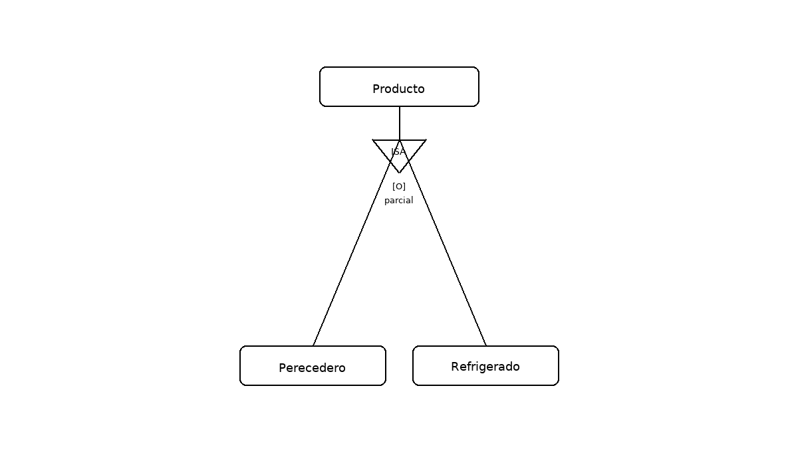
<figcaption><strong>Solapada &amp; parcial</strong>: un <em>Producto</em> puede no estar en ningún subtipo, o estar en uno o en ambos. Línea simple = parcial; <strong>[O]</strong> = subtipos no excluyentes.</figcaption>
</figure>

**Errores típicos.** (1) Forzar disyunción cuando en realidad los roles se solapan, lo que acaba en duplicidades o datos inconsistentes; (2) Declarar total cuando existen casos fuera de los subtipos, lo que luego “obliga” a inventar categorías artificiales; (3) Crear subtipos que no aportan atributos ni reglas: si el subtipo no añade nada, quizá no es un subtipo, sino un valor de un atributo del supertipo (p. ej., un `tipo`).

#### Cómo decidir correctamente (y pensar en la implementación)

Te propongo un guion de entrevista con el “cliente” que funciona muy bien: primero, pregunta si *pueden coexistir roles* (“¿puede una persona ser alumno y empleado a la vez?”). Si la respuesta es sí, la especialización debe ser **solapada**; si no, **disyunta**. Después, pregunta si *todas* las instancias deben caer en algún subtipo (“¿toda persona en el sistema debe ser, al menos, alumno o empleado?”). Si la respuesta es sí, marca la especialización como **total** (doble línea); si no, **parcial**. Al pasar al modelo relacional, las disyuntas se pueden materializar con una única referencia o un atributo `tipo` (si son pocas y estables); las solapadas suelen necesitar *tablas puente* que permitan múltiples pertenencias. Las totales se traducen en *restricciones* que impiden superinstancias “huérfanas”; las parciales permiten que existan.

Como regla de oro, modela solo subtipos que aporten *información o reglas diferenciadas* (atributos adicionales, validaciones distintas, comportamientos específicos). Si un subtipo no añade nada, evita la complejidad: usa un atributo enumerado en la superentidad o, directamente, no especialices. Este criterio mantiene el modelo claro y la base de datos más sencilla de implementar y mantener.

### 4.7 Agregación / Composición

En algunos dominios hay relaciones que no son “un detalle más”, sino auténticos *hechos complejos* que conviene tratar como una unidad. La **agregación** nos permite “elevar” una *relación* (con sus entidades participantes) a un *concepto compuesto*, de forma que podamos relacionarlo a su vez con otras entidades. Es como si agrupáramos “el hecho” completo y lo conectáramos con otras partes del modelo. En términos didácticos: primero definimos una relación normal (con sus cardinalidades y, si procede, atributos); después *la encerramos* en una caja con nombre (la agregación) y conectamos esa caja con lo que tenga sentido. Este recurso evita multiplicar relaciones binarias con reglas redundantes y hace explícito “qué estamos relacionando exactamente”: no *Proveedor* o *Producto* por separado, sino el **Suministro** (Proveedor–Producto) como hecho único.

La **composición** (en E/R clásico se modela mediante *entidad débil* e *identificación*) captura el patrón “*todo–parte* con *dependencia de existencia*”: la parte *no puede existir sin* el todo, y su identificador incluye la clave del todo. Pedagógicamente, es el mismo mensaje que en diseño orientado a objetos: si desaparece el “todo”, sus “partes” dejan de tener sentido. En E/R reconocerás la composición cuando veas una **entidad débil** (rectángulo doble), una **relación identificadora** (rombo doble) y participación **total** de la débil en esa relación (doble línea): ahí queda claro que la parte depende del todo y que su identidad “se apoya” en la del todo.

#### Agregación: convertir un hecho en un concepto compuesto

Imagina que ya tenemos *Proveedor* —**suministra**— *Producto*, con cardinalidades habituales `(0,N)` en ambos extremos (un proveedor puede suministrar 0..N productos y un producto puede tener 0..N proveedores). Si ahora queremos expresar “este *suministro concreto* sirve a un *Almacén*”, no es correcto unir *Proveedor* con *Almacén* y *Producto* por separado: perderíamos el hecho compuesto “proveedor+producto”. La agregación nos deja envolver el triángulo *Proveedor–suministra–Producto* dentro de una caja llamada **Suministro** y relacionar esa *unidad* con *Almacén*. Así dejamos claro que estamos hablando de “ese proveedor suministrando ese producto” y no de las entidades de forma aislada.

<figure class="media-box">
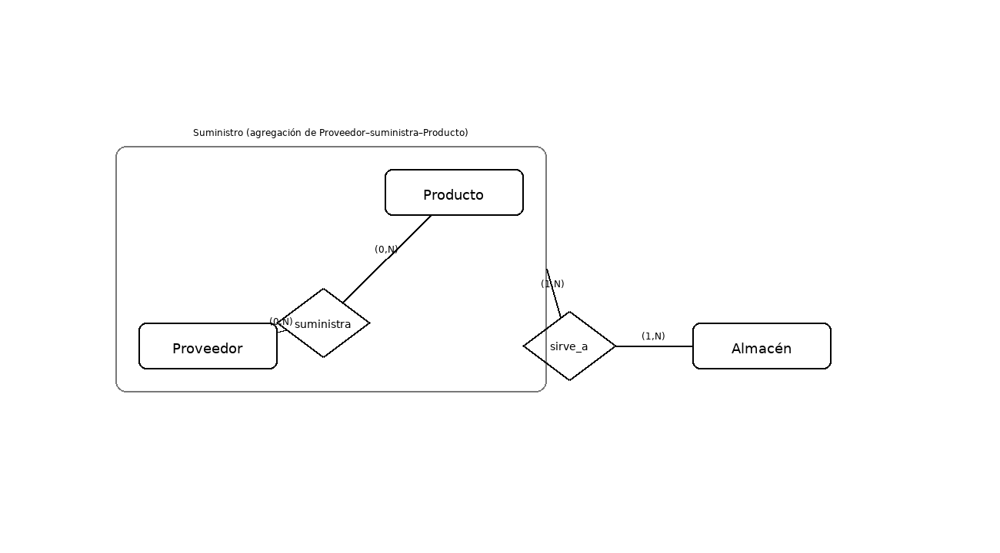
<figcaption><strong>Agregación</strong>: el hecho <em>Suministro</em> (agregación de <em>Proveedor—suministra—Producto</em>) se relaciona con <em>Almacén</em> mediante <em>sirve_a</em>. Las cardinalidades se leen sobre cada línea: en el ejemplo, un <em>Suministro</em> puede <em>servir a</em> 1..N <em>Almacenes</em> y un <em>Almacén</em> puede recibir 1..N <em>Suministros</em>. Este patrón evita mezclar entidades por separado y deja explícito qué combinación concreta estamos conectando.</figcaption>
</figure>

**Cuándo usar agregación.** Cuando una relación con sus participantes es el “objeto” de otra regla: calendario de entregas de un pedido, programación de turnos de una asignación (Profesor–imparte–Grupo), o restricciones que afectan al conjunto (p. ej., cupos o tarifas específicas del emparejamiento).

#### Composición (todo–parte con dependencia)

En comercio electrónico, un *Pedido* se forma por varias *Líneas*. Una *Línea* no tiene sentido fuera del *Pedido* al que pertenece, y su identidad se define por la clave del pedido más una clave parcial (por ejemplo, `nº_línea`). En E/R esto se plasma como **entidad débil** *Línea* (doble rectángulo) unida a *Pedido* por una **relación identificadora** *contiene* (rombo doble), con participación **total** de la débil (doble línea). Las cardinalidades típicas son `(1,N)` en *Pedido* (un pedido tiene 1..N líneas) y `(1,1)` en *Línea* (cada línea pertenece a exactamente un pedido). Este patrón comunica —sin ambigüedad— existencia dependiente y clave compuesta.

<figure class="media-box">
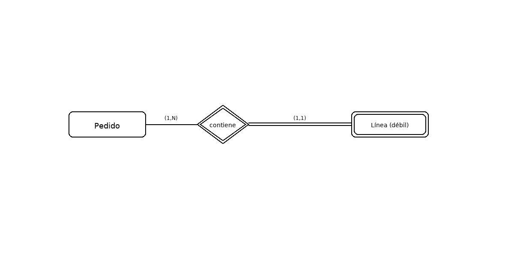
<figcaption><strong>Composición (existencia dependiente)</strong>: <em>Pedido</em> —(1,N)— <em>contiene</em> —(1,1)— <em>Línea</em>. La <em>Línea</em> es <strong>débil</strong> (doble rectángulo), la relación es <strong>identificadora</strong> (doble rombo), y la participación de la débil es <strong>total</strong> (doble línea). Al pasar al modelo relacional, la clave de <em>Línea</em> incluirá la clave de <em>Pedido</em> más una clave parcial.</figcaption>
</figure>

#### Elección correcta en el diseño

Una regla de oro útil es preguntarse: “¿Estoy tratando de relacionar *la combinación* de varias entidades con otra cosa?” Si la respuesta es sí, probablemente necesitas **agregación**. En cambio, si la relación representa un vínculo estructural “todo–parte” y la parte no tiene sentido por sí misma, opta por la **composición** (entidad débil + relación identificadora + participación total). Esta distinción no es cosmética: marca cómo se transformará el modelo a relaciones (tablas intermedias o claves compuestas) y qué restricciones de integridad podrás imponer sin acrobacias en SQL.

**Errores frecuentes.** (1) Conectar por separado entidades que deberían viajar juntas (olvidando la agregación), lo que produce reglas incongruentes; (2) Modelar como entidad fuerte algo que en realidad es una parte dependiente, perdiendo la garantía de integridad que aporta la composición; (3) Esconder cardinalidades mínimas (0/1) y luego descubrir que el diseño lógico no puede hacer cumplir la obligatoriedad que el negocio sí exige.

### 4.8 Restricciones de integridad

Las **restricciones de integridad** son las reglas que mantienen “coherente” el significado de los datos a lo largo del tiempo. En el *modelo conceptual (E/R)* las expresamos con nombres, cardinalidades `(min,max)`, identificadores, tipos de atributos y notas semánticas; más adelante, en el *modelo lógico* y en SQL, se traducirán a `PRIMARY KEY`, `FOREIGN KEY`, `NOT NULL`, `UNIQUE`, `CHECK`, disparadores, etc. El enfoque correcto es siempre “de arriba a abajo”: primero acordamos la regla con el cliente (en el E/R), después la *implementamos* en el SGBD. Si una regla no está clara arriba, será frágil abajo.

**Esquema mental.** Piensa en cuatro familias: *dominio* (de qué tipo es cada dato), *entidad* (identidad y unicidad), *referencia* (existencias relacionadas) y *semánticas* (reglas del negocio que van más allá de las tres anteriores).

#### 4.8.1 Restricciones de dominio

Un **dominio** especifica el *tipo* y el *rango* de valores que admite un atributo, así como su *formato* y si admite *null*. Modelar bien los dominios en el E/R (con nombres y descripciones claras) evita datos imposibles: fechas futuras para nacimientos, códigos mal formados, números negativos en cantidades, etc. Ejemplos típicos: *precio* → “número real ≥ 0 con dos decimales”; *DNI* → “cadena de 9 caracteres con patrón”; *email* → “cadena \<= 254 chars con ‘@’ y dominio válido”; *edad* derivada de *fecha_nacimiento* (no se almacena).

| Atributo | Dominio                  | ¿NULL? | Observaciones                                     |
|----------|--------------------------|--------|---------------------------------------------------|
| precio   | real ≥ 0 (2 decimales)   | no     | Si es 0, indica artículo gratuito o promoción     |
| dni      | patrón `^[0-9]{8}[A-Z]$` | no     | Único por Persona (ver 4.8.2)                     |
| email    | cadena válida            | sí     | Opcional; si existe, formato obligado             |
| edad     | derivado                 | —      | Se calcula desde *fecha_nacimiento*, no se guarda |

#### 4.8.2 Restricciones de entidad (identidad y unicidad)

Garantizan que cada instancia de una entidad esté **bien identificada** y no existan duplicados. En E/R esto se refleja al elegir el *identificador* (clave) de la entidad; puede ser natural (`DNI`, `ISBN`) o artificial (`id` autogenerado). Si hay varias posibilidades hablamos de *claves candidatas*; elegimos una como *principal* y el resto suelen imponerse como *únicas*. Ejemplos: en *Libro*, `ISBN` identifica de forma natural; en *Cliente*, si el `DNI` no es fiable (clientes extranjeros sin DNI, etc.), se recurre a un `id` y se fuerza `DNI UNIQUE` cuando exista.

**Decisión práctica.** Usa clave natural si es estable y universal. Si no, usa clave surrogate (`id`) y protege la natural con *unicidad* y *formato* (dominio).

#### 4.8.3 Restricciones de referencia (existencia y correspondencia)

Aseguran que una relación solo existe si existen las instancias relacionadas, y que se respeta la *participación* acordada. En E/R lo expresamos con los pares `(min,max)` en cada extremo: el *mínimo* determina si la participación es **total** (1) u **parcial** (0). Ejemplo: *Cliente* —realiza— *Pedido* con `Cliente (0,N)` y `Pedido (1,1)`: un pedido *siempre* pertenece a un cliente (participación total en Pedido), pero un cliente puede no tener pedidos (parcial en Cliente). En el modelo lógico esto se traduce en una *clave ajena* en *Pedido* y en reglas que impiden eliminar un *Cliente* con pedidos si así se establece (política de borrado).

#### 4.8.4 Restricciones semánticas (reglas del negocio)

Son reglas específicas del dominio que no se deducen automáticamente de dominios, claves o `(min,max)`, pero que deben cumplirse para que el dato “tenga sentido”. Ejemplos: “un pedido **cancelado** no puede tener líneas”, “el *importe_total* debe ser la suma de sus líneas”, “un *Profesor* no puede superar 20 h lectivas por semana”, “no se puede asignar un *Alumno* a dos exámenes que se solapan en horario”. En el E/R las recogemos como *notas* o *anotaciones* junto a la relación o entidad afectada; más tarde, en SQL, pueden materializarse con `CHECK`, vistas materializadas de validación, o disparadores.

#### 4.8.5 Nulos, derivados y estados del ciclo de vida

Decidir si un atributo **admite NULL** es una decisión de integridad: un NULL permisivo se convierte en “agujero” que la aplicación debe interpretar (¿desconocido?, ¿no aplicable?). Como regla, los atributos que intervienen en la *identidad* o en la *lógica de negocio* suelen ser **NOT NULL**. Los *atributos derivados* (p. ej., *edad* desde *fecha_nacimiento*) no se almacenan: se recalculan. Además, muchas reglas dependen del **estado** de una entidad (borrador, confirmado, cancelado). En el E/R conviene anotar las reglas por estado: “si *estado=confirmado*, entonces (1) debe haber método de pago; (2) no se pueden modificar líneas”.

#### 4.8.6 Patrones típicos (del E/R a SQL)

Aunque ahora estamos en conceptual, es útil prever cómo “bajan” las reglas: *identificadores* → `PRIMARY KEY` (y `UNIQUE` para candidatas); *dominios* → tipos, `CHECK`, `NOT NULL`; *referencia* → `FOREIGN KEY` con acciones (`ON DELETE`/`UPDATE`); *participación total* suele exigir `NOT NULL` en la FK y, a veces, control transaccional para altas y bajas coherentes; *reglas semánticas* complejas → restricciones declarativas si es posible, o bien procesos de validación/disparadores si afectan a múltiples tablas.

| Regla conceptual (E/R)             | Lectura                                  | Pista para implementación                                                        |
|------------------------------------|------------------------------------------|----------------------------------------------------------------------------------|
| Pedido (1,1) —pertenece a— Cliente | Todo pedido tiene exactamente un cliente | FK NOT NULL en Pedido. Política de borrado: RESTRICT o SET NULL según negocio    |
| Cliente (0,N) —realiza— Pedido     | Un cliente puede no tener pedidos        | No obliga a FK en Cliente; cardinalidad ya cubierta por la FK en Pedido          |
| email: dominio válido              | Formato correcto si existe               | `CHECK` (si procede) y validación en aplicación                                  |
| importe_total = suma(líneas)       | Regla semántica                          | Vista/trigger de consolidación o cálculo a demanda (no almacenar si es derivado) |

**Checklist rápido antes de pasar a lógico:** 1) ¿Todas las entidades tienen identificador claro? 2) ¿Están fijados los dominios y NULL/NOT NULL de los atributos críticos? 3) ¿Cada relación tiene sus `(min,max)` y la lectura es inequívoca sobre la línea correcta? 4) ¿Hemos anotado las reglas semánticas por estado/negocio que no encajan en dominios o cardinalidades?

Con estas reglas bien descritas en el *conceptual*, el salto al *modelo lógico* será mecánico y justificable. Lo importante no es “poner una FK” sino *saber por qué*: la FK es la traducción técnica de una decisión conceptual (`(min,max)` y participación) que ya acordaste aquí.

## 5) Errores comunes

El diseño conceptual con **E/R** es una herramienta potentísima, pero también muy sensible a pequeños deslices que luego se “amplifican” al pasar al modelo lógico y a SQL. En esta sección reunimos los *errores típicos* que más se repiten en 1º DAW y una **lista de verificación final** para revisar tu modelo antes de darlo por cerrado. Léelos como si fueran “antipatrones”: si te reconoces en alguno, vuelve un paso atrás, corrige y vuelve a evaluar con datos de ejemplo. El objetivo no es dibujar “algo bonito”, sino un modelo que haga *cumplir* las reglas del negocio sin ambigüedades.

### 5.1 Errores comunes (y cómo evitarlos)

#### 5.1.1 Cardinalidades mal ubicadas o ambiguas

Uno de los fallos más frecuentes es colocar el par `(min,max)` en el lado equivocado o lejos de la línea, provocando lecturas contradictorias. **Regla de oro:** sitúa cada `(min,max)` *encima de la línea y junto al extremo* al que pertenece, y verbaliza su lectura: “cada A se relaciona con entre *min* y *max* B”. Si al leer en voz alta no tiene sentido, está mal colocada o mal elegida.

#### 5.1.2 Confundir disyunta/solapada y total/parcial en ISA

Otro clásico es declarar una especialización *disyunta* cuando en realidad los subtipos pueden coexistir (roles), o marcarla como *total* cuando hay instancias del supertipo fuera de los subtipos. Pregunta siempre: “¿puede una instancia estar en varios subtipos a la vez?” (si sí, es **solapada**) y “¿todas las instancias deben caer en algún subtipo?” (si sí, **total**). Representa *total* con **doble línea** supertipo→ISA.

#### 5.1.3 Mezclar hechos diferentes en una relación binaria

Intentar expresar con una sola relación binaria un hecho que depende de una *combinación* de entidades lleva a inconsistencias (por ejemplo, conectar *Proveedor* con *Almacén* y *Producto* por separado). Cuando el negocio habla de “la pareja (X,Y)”, probablemente necesitas una **agregación** o una relación **ternaria** con sus propias reglas y atributos.

#### 5.1.4 Elegir mal la clave (identificador)

Usar una clave natural inestable (como *email*) provoca cascadas de cambios; usar una artificial sin proteger la natural permite duplicados semánticos. **Práctica recomendada:** si la natural es universal y estable (DNI, ISBN), úsala; si no, usa *surrogate* (`id`) y declara la natural como *única* y con *dominio* (formato) apropiado.

#### 5.1.5 Atributos derivados almacenados (y desincronizados)

Guardar *edad* además de *fecha_nacimiento* o *importe_total* además de las *líneas* crea inconsistencias. Marca estos datos como **derivados** y calcula cuando haga falta, o controla su actualización con reglas estrictas.

#### 5.1.6 Nulos permisivos en atributos críticos

Permitir `NULL` en atributos que son necesarios para la lógica del negocio lleva a registros “a medias” difíciles de validar. Decide explícitamente **NOT NULL** en claves y datos esenciales, y documenta el significado de cada `NULL` (desconocido / no aplicable).

#### 5.1.7 Olvidar la participación mínima

Poner solo 1:1, 1:N, N:M sin el *mínimo* oculta si la relación es opcional u obligatoria. Recuerda: el **mínimo** (0 o 1) se traduce luego en `NULL/NOT NULL` y en cómo se controlan altas y bajas.

#### 5.1.8 Modelar como binaria algo N:M o ternario

Si una relación “pide” atributo propio (*precio* en un suministro, *cantidad* en líneas de pedido), sospecha de un **N:M** (o ternaria) en lugar de dos binarias sueltas. A nivel lógico necesitarás una tabla intermedia con su clave compuesta.

#### 5.1.9 No documentar reglas semánticas

Muchas restricciones no se deducen de dominios o cardinalidades (p. ej., “pedido cancelado no tiene líneas”). Si no las anotas en el conceptual, luego “desaparecen” al implementar. Añade *notas* claras en el diagrama.

### 5.2 Checklist final antes de pasar a lógico

Usa esta lista como “semáforo” antes de traducir a tablas. Marca cada ítem con ✔ cuando esté resuelto y justificado.

| Ítem                         | Qué comprobar                                                                                                     | ✔   |
|------------------------------|-------------------------------------------------------------------------------------------------------------------|-----|
| **Alcance claro**            | El diagrama incluye solo lo necesario para el caso; no faltan entidades clave ni sobran “adorno”.                 |     |
| **Identificadores**          | Cada entidad tiene clave definida (natural o surrogate) y candidatas razonadas; unicidades anotadas.              |     |
| **Dominios y NULL**          | Tipo/rango de cada atributo, formato si aplica y decisión explícita de NULL/NOT NULL.                             |     |
| **Atributos derivados**      | Marcados como derivados (no almacenados) o, si se almacenan, con regla de sincronización clara.                   |     |
| **Relaciones binarias**      | Cardinalidades `(min,max)` colocadas *encima y en su extremo*; lectura inequívoca.                                |     |
| **N:M / Ternarias**          | Las relaciones que requieren atributos propios están modeladas como N:M o ternarias (no “apaños”).                |     |
| **ISA**                      | Para cada jerarquía: disyunta/solapada y total/parcial decididas y representadas (doble línea si total).          |     |
| **Agregación / Composición** | Hechos compuestos modelados con agregación; dependencias todo–parte como entidad débil + relación identificadora. |     |
| **Reglas semánticas**        | Notas claras para las reglas “de negocio” (por estado, límites, incompatibilidades, etc.).                        |     |
| **Prueba de contraejemplos** | Intentaste “romper” el modelo con datos imposibles y el diagrama los impide (o ajustaste el diseño).              |     |
| **Camino a SQL**             | Sabes cómo cada decisión conceptual bajará a PK, FK, UNIQUE, CHECK y acciones de borrado/actualización.           |     |

## PARTE II

### Enfoque de Programación: Diagrama de Clases UML

En esta parte aprenderás el **diagrama de clases UML (Unified Modeling Language)**, que es la notación estándar para el análisis y diseño orientado a objetos. Es especialmente útil cuando el sistema se implementará en lenguajes de programación orientados a objetos (Java, Python, C#, JavaScript...) y permite una transición natural del diseño conceptual al código.

## 5) Diagrama de Clases UML

### 5.1 ¿Qué es UML?

**UML (Unified Modeling Language)** es un lenguaje de modelado visual estándar creado en los años 90 para especificar, visualizar, construir y documentar sistemas de software. Fue desarrollado por Grady Booch, James Rumbaugh e Ivar Jacobson, y actualmente es mantenido por el Object Management Group (OMG).

UML incluye **14 tipos de diagramas** diferentes, divididos en dos categorías:

- **Diagramas estructurales**: describen la estructura estática del sistema (clases, componentes, despliegue...)
- **Diagramas de comportamiento**: describen el comportamiento dinámico (casos de uso, secuencia, actividad...)

Para el diseño de bases de datos, el más relevante es el **diagrama de clases**, que describe la estructura estática: qué clases existen, qué atributos tienen, qué métodos implementan y cómo se relacionan entre sí.

**Relación con POO.** El diagrama de clases UML se traduce directamente a código en lenguajes orientados a objetos. Una clase del diagrama se convierte en una clase Java/Python/C#, los atributos en campos de la clase, las asociaciones en referencias o colecciones, y la herencia en extends/implements.

### 5.2 Elementos básicos del diagrama de clases

#### 5.2.1 Clase

Una **clase** representa un concepto del dominio o una abstracción del sistema. Se dibuja como un rectángulo dividido en tres compartimentos:

- **Compartimento superior**: nombre de la clase (sustantivo en singular, con inicial mayúscula)
- **Compartimento medio**: atributos (propiedades de la clase)
- **Compartimento inferior**: métodos u operaciones (comportamiento de la clase)

<figure class="media-box">

<figcaption>Clase <strong>Cliente</strong> con atributos privados (-) y método público (+)</figcaption>
</figure>

#### 5.2.2 Atributos

Los **atributos** describen las propiedades de una clase. Se especifican con la sintaxis:

    visibilidad nombre: tipo [= valorPorDefecto]

Visibilidades:

- `+` **public**: accesible desde cualquier parte
- `-` **private**: solo accesible dentro de la clase
- `#` **protected**: accesible en la clase y sus subclases
- `~` **package**: accesible dentro del mismo paquete

Ejemplos: `- email: String`, `+ edad: int = 0`, `# fecha: Date`

#### 5.2.3 Métodos

Los **métodos** definen el comportamiento de la clase. Se especifican con:

    visibilidad nombre(parámetros): tipoRetorno

Ejemplo: `+ calcularTotal(descuento: float): decimal`

**En diseño de BD.** Para el diseño conceptual de bases de datos, los métodos se suelen omitir o documentar por separado, ya que la BD almacena datos (atributos), no comportamiento (métodos). Los métodos se implementarán en la capa de aplicación.

### 5.4 Asociaciones

Una **asociación** representa una relación estructural entre clases. Se dibuja como una línea que conecta dos clases y puede tener:

- **Nombre**: describe la relación (ej: "realiza", "contiene", "pertenece a")
- **Multiplicidad**: cuántas instancias de una clase se relacionan con instancias de otra (ver siguiente subsección)
- **Roles**: nombres en cada extremo que especifican el papel de cada clase en la relación
- **Navegabilidad**: flechas que indican la dirección de acceso (si una clase conoce a la otra)

<figure class="media-box">

<figcaption>Asociación entre Cliente y Pedido con multiplicidades, nombre y roles</figcaption>
</figure>

### 5.5 Multiplicidad

La **multiplicidad** especifica cuántas instancias de una clase pueden estar asociadas con instancias de otra clase. Es el equivalente a la cardinalidad en E/R, pero con sintaxis diferente:

| Multiplicidad UML | Significado                              | Equivalente E/R (min,max) | Ejemplo                                 |
|-------------------|------------------------------------------|---------------------------|-----------------------------------------|
| `1`               | Exactamente uno (obligatorio)            | `(1,1)`                   | Un Pedido tiene exactamente 1 Cliente   |
| `0..1`            | Cero o uno (opcional)                    | `(0,1)`                   | Una Persona puede tener 0 o 1 Pasaporte |
| `*` o `0..*`      | Cero o muchos (opcional, sin límite)     | `(0,N)`                   | Un Cliente puede tener 0 o más Pedidos  |
| `1..*`            | Uno o muchos (obligatorio, al menos uno) | `(1,N)`                   | Un Departamento tiene 1 o más Empleados |
| `2..5`            | Rango específico (entre 2 y 5)           | `(2,5)`                   | Un Equipo tiene entre 2 y 5 Jugadores   |

**Lectura de multiplicidad.** La multiplicidad se lee *desde* la clase hacia la asociación: si ves `0..*` junto a *Pedido* en la asociación *Cliente—Pedido*, significa "un Cliente puede estar asociado a 0 o muchos Pedidos".

### 5.6 Herencia (Generalización)

La **herencia** o **generalización** en UML representa una relación "es-un" entre una clase general (superclase) y clases más específicas (subclases). Se dibuja con una **flecha de punta triangular** desde la subclase hacia la superclase.

Las subclases **heredan** todos los atributos y métodos de la superclase y pueden añadir los suyos propios o redefinir (sobrescribir) métodos heredados.

#### 5.6.1 Restricciones de herencia

UML permite especificar restricciones sobre la herencia mediante **estereotipos**:

- `{disjoint}` o `{exclusive}`: las subclases son **disjuntas** (una instancia solo puede pertenecer a una subclase)
- `{overlapping}`: las subclases pueden **solaparse** (una instancia puede pertenecer a varias subclases)
- `{complete}`: la herencia es **total** (toda instancia de la superclase debe pertenecer a alguna subclase)
- `{incomplete}`: la herencia es **parcial** (pueden existir instancias solo de la superclase, sin pertenecer a ninguna subclase)

<figure class="media-box">

<figcaption><strong>Herencia disjunta y total.</strong> Todo Empleado es Técnico <strong>o</strong> Administrativo (no ambos, sin otras opciones). Equivale a ISA disyunta y total en E/R.</figcaption>
</figure>

### 5.7 Composición y Agregación

UML distingue dos tipos especiales de asociación que representan relaciones "todo-parte":

#### 5.7.1 Composición (rombo negro)

La **composición** es una relación fuerte de "todo-parte" donde **las partes no pueden existir sin el todo**. Se dibuja con un **rombo negro (filled)** en el extremo del "todo". Si se destruye el todo, se destruyen automáticamente las partes. Es el equivalente a la entidad débil en E/R.

- Una parte pertenece a un solo todo (exclusividad)
- La vida de la parte depende del todo (dependencia existencial)
- Ejemplo: Pedido ◆—→ LineaPedido (las líneas no existen sin el pedido)

#### 5.7.2 Agregación (rombo blanco)

La **agregación** es una relación débil de "todo-parte" donde **las partes pueden existir independientemente del todo**. Se dibuja con un **rombo blanco (hollow)**. Es una relación de pertenencia sin dependencia existencial.

- Una parte puede pertenecer a varios todos (no exclusiva)
- La parte puede existir sin el todo
- Ejemplo: Departamento ◇—→ Empleado (el empleado puede existir sin departamento)

<figure class="media-box">

<figcaption><strong>Composición:</strong> Pedido ◆—→ LineaPedido. Dependencia existencial fuerte.</figcaption>
</figure>

**Diferencia clave.** Composición (◆) = dependencia existencial fuerte (entidad débil en E/R). Agregación (◇) = relación de pertenencia sin dependencia (relación normal en E/R).

## Tabla de Equivalencias

### Traducción entre E/R, UML y Modelo Relacional

Esta tabla resume las equivalencias entre los conceptos del **modelo E/R (Chen)**, el **diagrama de clases UML** y su traducción al **modelo relacional (SQL)**. Úsala como guía de referencia rápida para convertir entre notaciones y para implementar el diseño conceptual en una base de datos.

## 6) Tabla de Equivalencias E/R ↔ UML ↔ SQL

La siguiente tabla muestra cómo se traduce cada elemento entre las tres representaciones. Cada fila describe un concepto fundamental del modelado conceptual y su implementación técnica.

<table>
<colgroup>
<col style="width: 25%" />
<col style="width: 25%" />
<col style="width: 25%" />
<col style="width: 25%" />
</colgroup>
<thead>
<tr class="header">
<th style="text-align: center;">E/R (Chen / min-max)</th>
<th style="text-align: center;">UML (Diagrama de clases)</th>
<th style="text-align: center;">Relacional (SQL)</th>
<th style="text-align: center;">Ejemplo práctico</th>
</tr>
</thead>
<tbody>
<tr class="odd" style="background: var(--brand-weak);">
<td colspan="4" style="text-align: center; font-weight: 600;">CONCEPTOS BÁSICOS</td>
</tr>
<tr class="even">
<td style="text-align: center;"><strong>Entidad</strong> 
(rectángulo)</td>
<td style="text-align: center;"><strong>Clase</strong> 
(rectángulo con compartimentos)</td>
<td style="text-align: center;"><strong>Tabla</strong> 
<code>CREATE TABLE</code></td>
<td style="text-align: center;"><code>Cliente</code>, <code>Pedido</code>, <code>Producto</code></td>
</tr>
<tr class="odd">
<td style="text-align: center;"><strong>Atributo</strong> 
(óvalo conectado)</td>
<td style="text-align: center;"><strong>Atributo</strong> 
(en compartimento medio) 
<code>- nombre: tipo</code></td>
<td style="text-align: center;"><strong>Columna</strong> 
<code>nombre TIPO</code></td>
<td style="text-align: center;"><code>email String</code> → <code>email VARCHAR(254)</code></td>
</tr>
<tr class="even">
<td style="text-align: center;"><strong>Identificador</strong> 
(atributo subrayado)</td>
<td style="text-align: center;"><strong>Atributo PK</strong> 
(marcado con <code>{PK}</code> o estereotipo)</td>
<td style="text-align: center;"><strong>PRIMARY KEY</strong></td>
<td style="text-align: center;"><code>id</code> (subrayado) → <code>PRIMARY KEY (id)</code></td>
</tr>
<tr class="odd">
<td style="text-align: center;"><strong>Relación</strong> 
(rombo conectando entidades)</td>
<td style="text-align: center;"><strong>Asociación</strong> 
(línea conectando clases)</td>
<td style="text-align: center;"><strong>Foreign Key</strong> o <strong>tabla intermedia</strong></td>
<td style="text-align: center;">Cliente—Pedido → FK <code>cliente_id</code> en Pedido</td>
</tr>
<tr class="even" style="background: var(--brand-weak);">
<td colspan="4" style="text-align: center; font-weight: 600;">CARDINALIDADES / MULTIPLICIDADES</td>
</tr>
<tr class="odd">
<td style="text-align: center;"><strong>(1,1)</strong> 
Exactamente uno</td>
<td style="text-align: center;"><strong>1</strong> 
Exactamente uno</td>
<td style="text-align: center;">FK <code>NOT NULL</code></td>
<td style="text-align: center;">Pedido tiene 1 Cliente → <code>cliente_id INT NOT NULL</code></td>
</tr>
<tr class="even">
<td style="text-align: center;"><strong>(0,1)</strong> 
Cero o uno</td>
<td style="text-align: center;"><strong>0..1</strong> 
Cero o uno</td>
<td style="text-align: center;">FK <code>NULL</code> + <code>UNIQUE</code></td>
<td style="text-align: center;">Persona tiene 0 o 1 Pasaporte</td>
</tr>
<tr class="odd">
<td style="text-align: center;"><strong>(0,N)</strong> 
Cero o muchos</td>
<td style="text-align: center;"><strong>*</strong> o <strong>0..*</strong> 
Cero o muchos</td>
<td style="text-align: center;">FK <code>NULL</code> (sin <code>UNIQUE</code>)</td>
<td style="text-align: center;">Cliente tiene 0 o muchos Pedidos</td>
</tr>
<tr class="even">
<td style="text-align: center;"><strong>(1,N)</strong> 
Uno o muchos</td>
<td style="text-align: center;"><strong>1..*</strong> 
Uno o muchos</td>
<td style="text-align: center;">FK <code>NOT NULL</code> + validación</td>
<td style="text-align: center;">Departamento tiene 1 o más Empleados</td>
</tr>
<tr class="odd">
<td style="text-align: center;"><strong>Relación N:M</strong></td>
<td style="text-align: center;"><strong>Asociación *--*</strong></td>
<td style="text-align: center;"><strong>Tabla intermedia</strong> con PK compuesta (FK1, FK2)</td>
<td style="text-align: center;">Alumno—Asignatura → <code>matricula(alumno_id, asignatura_id)</code></td>
</tr>
<tr class="even" style="background: var(--brand-weak);">
<td colspan="4" style="text-align: center; font-weight: 600;">ESPECIALIZACIÓN / HERENCIA</td>
</tr>
<tr class="odd">
<td style="text-align: center;"><strong>Jerarquía ISA</strong> 
(triángulo con líneas a subentidades)</td>
<td style="text-align: center;"><strong>Generalización</strong> 
(flecha triangular hacia superclase)</td>
<td style="text-align: center;">Tabla por jerarquía, tabla por subclase, o tabla por clase concreta</td>
<td style="text-align: center;">Empleado ▷ {Técnico, Administrativo}</td>
</tr>
<tr class="even">
<td style="text-align: center;"><strong>ISA disyunta</strong> 
[D] en el triángulo</td>
<td style="text-align: center;"><strong>{disjoint}</strong></td>
<td style="text-align: center;">Restricción: fila solo en un subtipo</td>
<td style="text-align: center;">Empleado es Técnico <strong>o</strong> Administrativo (no ambos)</td>
</tr>
<tr class="odd">
<td style="text-align: center;"><strong>ISA solapada</strong> 
[O] en el triángulo</td>
<td style="text-align: center;"><strong>{overlapping}</strong></td>
<td style="text-align: center;">Permitir filas en múltiples subtipos</td>
<td style="text-align: center;">Persona puede ser Estudiante <strong>y</strong> Profesor</td>
</tr>
<tr class="even">
<td style="text-align: center;"><strong>ISA total</strong> 
Doble línea a ISA</td>
<td style="text-align: center;"><strong>{complete}</strong></td>
<td style="text-align: center;">Toda fila del supertipo debe estar en algún subtipo</td>
<td style="text-align: center;">Todo Empleado debe ser Técnico o Administrativo</td>
</tr>
<tr class="odd">
<td style="text-align: center;"><strong>ISA parcial</strong> 
Línea simple a ISA</td>
<td style="text-align: center;"><strong>{incomplete}</strong></td>
<td style="text-align: center;">Pueden existir filas solo en el supertipo</td>
<td style="text-align: center;">Puede haber Personas que no sean Estudiante ni Profesor</td>
</tr>
<tr class="even" style="background: var(--brand-weak);">
<td colspan="4" style="text-align: center; font-weight: 600;">COMPOSICIÓN Y AGREGACIÓN</td>
</tr>
<tr class="odd">
<td style="text-align: center;"><strong>Entidad débil</strong> 
(doble rectángulo) 
Relación identificadora (doble rombo)</td>
<td style="text-align: center;"><strong>Composición</strong> 
(rombo negro ◆) 
Dependencia existencial</td>
<td style="text-align: center;">PK compuesta: (PK_todo, clave_parcial) 
FK <code>NOT NULL</code> + <code>ON DELETE CASCADE</code></td>
<td style="text-align: center;">Pedido ◆—→ LineaPedido 
<code>PK(id_pedido, pos)</code></td>
</tr>
<tr class="even">
<td style="text-align: center;"><strong>Agregación semántica</strong> 
(relación normal con semántica de agregación)</td>
<td style="text-align: center;"><strong>Agregación</strong> 
(rombo blanco ◇) 
Sin dependencia existencial</td>
<td style="text-align: center;">FK normal (puede ser <code>NULL</code> o <code>NOT NULL</code>)</td>
<td style="text-align: center;">Departamento ◇—→ Empleado 
Empleado existe sin departamento</td>
</tr>
<tr class="odd" style="background: var(--brand-weak);">
<td colspan="4" style="text-align: center; font-weight: 600;">ATRIBUTOS ESPECIALES</td>
</tr>
<tr class="even">
<td style="text-align: center;"><strong>Atributo derivado</strong> 
(óvalo con línea discontinua)</td>
<td style="text-align: center;"><strong>Atributo derivado</strong> 
(<code>/nombre: tipo</code> con barra)</td>
<td style="text-align: center;">Vista calculada o columna generada 
<code>GENERATED ALWAYS AS</code></td>
<td style="text-align: center;"><code>/edad</code> se calcula desde <code>fecha_nacimiento</code></td>
</tr>
<tr class="odd">
<td style="text-align: center;"><strong>Atributo multivalorado</strong> 
(doble óvalo)</td>
<td style="text-align: center;"><strong>Colección</strong> 
(<code>teléfonos: Set&lt;String&gt;</code>)</td>
<td style="text-align: center;">Tabla separada con FK al dueño</td>
<td style="text-align: center;"><code>telefono(cliente_id, numero)</code></td>
</tr>
<tr class="even">
<td style="text-align: center;"><strong>Atributo compuesto</strong> 
(óvalo con subatributos)</td>
<td style="text-align: center;"><strong>Clase embebida</strong> o atributos separados</td>
<td style="text-align: center;">Columnas separadas o tipo compuesto</td>
<td style="text-align: center;"><code>direccion</code> → <code>dir_calle</code>, <code>dir_cp</code></td>
</tr>
<tr class="odd" style="background: var(--brand-weak);">
<td colspan="4" style="text-align: center; font-weight: 600;">RESTRICCIONES</td>
</tr>
<tr class="even">
<td style="text-align: center;"><strong>Relación con atributos</strong> 
(atributos en el rombo)</td>
<td style="text-align: center;"><strong>Clase asociación</strong> 
(clase conectada a asociación)</td>
<td style="text-align: center;">Tabla intermedia con columnas adicionales</td>
<td style="text-align: center;">Alumno—[Matrícula]—Asignatura 
<code>matricula(alumno_id, asignatura_id, nota, fecha)</code></td>
</tr>
<tr class="odd">
<td style="text-align: center;"><strong>Restricción semántica</strong> 
(anotación textual)</td>
<td style="text-align: center;"><strong>Restricción OCL</strong> o nota 
(<code>{edad &gt;= 18}</code>)</td>
<td style="text-align: center;"><code>CHECK</code>, trigger o validación en app</td>
<td style="text-align: center;"><code>CHECK (edad &gt;= 18)</code></td>
</tr>
</tbody>
</table>

**Cómo usar esta tabla.**

- Para **traducir de UML a E/R**: busca el concepto UML en la segunda columna y mira su equivalente E/R en la primera.
- Para **traducir de E/R a UML**: busca el concepto E/R en la primera columna y mira su equivalente UML en la segunda.
- Para **implementar en SQL**: usa la tercera columna como guía de transformación desde cualquiera de las dos notaciones conceptuales.
- **Ejemplo práctico**: si tienes una clase UML con multiplicidad `1..*`, tradúcelo a E/R como `(1,N)` e impleméntalo en SQL con FK `NOT NULL` más validación de existencia.

Con esta tabla de equivalencias, puedes trabajar cómodamente con cualquier notación según el contexto del proyecto, el equipo de trabajo o las herramientas disponibles, y siempre podrás traducir correctamente hacia la implementación en SQL.

<a href="#" class="backtotop" aria-label="Volver arriba">↑</a>

---

<!-- Diseño lógico y normalización -->
# Diseño lógico de bases de datos

Del modelo conceptual (E/R) al relacional normalizado listo para implementar.

## 1) ¿Para qué sirve el modelo lógico?

El **modelo conceptual (E/R)** capta el *significado* del dominio: entidades, relaciones, cardinalidades y reglas. Es el acuerdo con negocio sobre “qué existe” y “cómo se vincula”, sin hablar de tablas. El **modelo lógico (relacional)** transforma ese significado en un *esquema de tablas* con **claves** y **restricciones** aún independiente de un SGBD concreto.

Aquí decidimos qué tablas habrá, qué columnas contienen, qué columnas forman la PK, qué FKs conectan las tablas y qué *obligatoriedades* (NOT NULL) y *unicidades* (UNIQUE) necesitamos para *hacer cumplir* el conceptual. Después, la **normalización** revisa el esquema para eliminar redundancias y anomalías (inserción, borrado, actualización) preservando el significado y las dependencias funcionales. En resumen: *Conceptual* (qué significa) → *Lógico* (cómo se estructura en tablas) → *Físico/SQL* (cómo se implementa con tipos, índices, DDL).

## 2) Notación intermedia (Demarco / “marco”)

La notación de **marco** es una forma compacta de describir el *esquema relacional lógico* antes de escribir SQL. Sirve para: (1) *comunicar* decisiones (PK, AK, FKs, nulabilidad) sin ruido técnico, (2) *validar* que las participaciones del E/R (mínimos y máximos) están bien trasladadas, y (3) *generar* los `CREATE TABLE` casi mecánicamente.

| Marcador                   | Significado                                                        | Ejemplo                          |
|----------------------------|--------------------------------------------------------------------|----------------------------------|
| `T = c1 + … + cn`          | Tabla *T* con columnas *c1..cn* (orden sugerido: PK → FKs → resto) | `CLIENTE = id + dni + nombre`    |
| `CP(...)`                  | Clave primaria (única, mínima y no nula)                           | `CP(id)`                         |
| `C.Alt(...)`               | Clave alternativa (candidata) — debe ser única y mínima            | `C.Alt(dni)`                     |
| `C.Aj(...)` → `T(col_ref)` | Clave ajena (FK) que referencia PK o AK de *T*                     | `C.Aj(cliente_id) → CLIENTE(id)` |
| `VNN(col)`                 | Valor no nulo (NOT NULL)                                           | `VNN(cliente_id)`                |
| `ASERCIÓN n: …`            | Restricción global (involucra más de una tabla)                    | `ASERCIÓN 1: B[b] ⊆ R[b]`        |

### 2.1 Cómo se lee un marco (paso a paso)

    CLIENTE = id + dni + nombre + fecha_nac
    CP(id)
    C.Alt(dni)
    VNN(nombre)
      

1.  **Cabecera**: la tabla y sus columnas.
2.  **CP**: qué columnas forman la PK (a veces compuesta).
3.  **C.Alt**: candidatas adicionales (se materializan con `UNIQUE`).
4.  **VNN**: columnas obligatorias (NOT NULL).
5.  **C.Aj**: referencias a otras tablas y a qué columna exacta (PK o AK) apuntan.

### 2.2 Equivalencias con SQL (cómo se traduce)

- `CP(a,b)` → `PRIMARY KEY (a,b)`
- `C.Alt(x,y)` → `UNIQUE (x,y)`
- `C.Aj(f) → T(k)` → `FOREIGN KEY (f) REFERENCES T(k)` (+ política de borrado/actualización)
- `VNN(c)` → `c ... NOT NULL`
- `ASERCIÓN` → CHECKs complejos, vistas con `WITH CHECK OPTION` o disparadores (según motor)

**Matiz (MySQL / SQL estándar).** `UNIQUE` permite *varios NULL* por defecto. Si necesitas que una *AK* sea “única y no nula”, combina `VNN` + `UNIQUE`.

### 2.3 Estilo y convenciones de nombres

- **Tablas** en mayúsculas y en *singular*: `CLIENTE`, `PEDIDO`.
- **Columnas** en `snake_case`: `cliente_id`, `fecha_alta`.
- **FKs** con sufijo `_id` y prefijo de la tabla referenciada: `cliente_id`.
- En PK compuestas, **orden estable**: primero la PK del “lado 1”, después la clave parcial/atributo local.

### 2.4 Patrones exprés de mapeo (del E/R al marco)

#### 2.4.1 1:N

    CLIENTE = id + nombre
    CP(id)

    PEDIDO = id + cliente_id + fecha
    CP(id)
    C.Aj(cliente_id) → CLIENTE(id)
    VNN(fecha)                
      

#### 2.4.2 N:M (tabla de relación con atributos)

    PEDIDO     = id + fecha
    CP(id)

    PRODUCTO   = id + nombre + pvp
    CP(id)

    LINEA      = pedido_id + producto_id + unidades + precio_ud
    CP(pedido_id, producto_id)                 
    C.Aj(pedido_id)  → PEDIDO(id)
    C.Aj(producto_id)→ PRODUCTO(id)
    VNN(unidades)     VNN(precio_ud)
      

#### 2.4.3 1:1 (evitar tabla intermedia)

    PERSONA    = id + nombre
    CP(id)

    PASAPORTE  = id + numero + persona_id
    CP(id)
    C.Alt(numero)
    C.Aj(persona_id) → PERSONA(id)
    VNN(persona_id)             
    C.Alt(persona_id)           
      

#### 2.4.4 Atributo multivalorado (n teléfonos / cliente)

    CLIENTE  = id + nombre
    CP(id)

    TEL_CLI  = cliente_id + telefono
    CP(cliente_id, telefono)
    C.Aj(cliente_id) → CLIENTE(id)
      

#### 2.4.5 Entidad débil (PK fuerte + clave parcial)

    PEDIDO = id + fecha
    CP(id)

    LINEA  = pedido_id + pos + producto_id
    CP(pedido_id, pos)          
    C.Aj(pedido_id) → PEDIDO(id)
    C.Aj(producto_id) → PRODUCTO(id)
      

#### 2.4.6 Unaria (reflexiva, con roles)

    EMPLEADO = id + nombre + jefe_id
    CP(id)
    C.Aj(jefe_id) → EMPLEADO(id)    
      

#### 2.4.7 ISA (generalización / especialización)

    PERSONA   = id + nombre
    CP(id)

    ALUMNO    = id + curso
    CP(id)
    C.Aj(id) → PERSONA(id)

    PROFESOR  = id + departamento
    CP(id)
    C.Aj(id) → PERSONA(id)

    /* Si la especialización es disyunta y total: */
    ASERCIÓN 1: PERSONA[id] ⊆ ALUMNO[id] ∪ PROFESOR[id]
    ASERCIÓN 2: ALUMNO[id] ∩ PROFESOR[id] = ∅
      

#### 2.4.8 Ternaria (reglas conjuntas)

    PROVEEDOR = id + nombre
    CP(id)
    PRODUCTO  = id + nombre
    CP(id)
    ALMACEN   = id + ciudad
    CP(id)

    SUMINISTRO = proveedor_id + producto_id + almacen_id + precio
    CP(proveedor_id, producto_id, almacen_id)
    C.Aj(proveedor_id) → PROVEEDOR(id)
    C.Aj(producto_id)  → PRODUCTO(id)
    C.Aj(almacen_id)   → ALMACEN(id)
    VNN(precio)
      

### 2.5 Aserciones típicas (plantillas)

- **Cobertura** (participación total de B en R): `ASERCIÓN: B[b] ⊆ R[b]`
- **Disyunción** (ISA excluyente): `ASERCIÓN: S1[k] ∩ S2[k] = ∅`
- **Totalidad** (ISA total): `ASERCIÓN: S1[k] ∪ S2[k] ⊇ SUP[k]`

### 2.6 Errores frecuentes

- Poner `VNN` en una FK cuando el E/R indica *min=0* (debería admitir NULL).
- Olvidar `C.Alt` para una clave natural relevante (luego aparecen duplicados de negocio).
- Crear tabla de relación para un **1:N** (innecesaria salvo casos especiales).
- No documentar la **política** de las FKs (RESTRICT/NO ACTION, CASCADE, SET NULL, SET DEFAULT).

### 2.7 Mini-ejercicios

1.  Transforma el E/R *Cliente (1,N)–realiza–(1,1) Pedido* + *Pedido (1,N)–incluye–(1,N) Producto* al marco completo.
2.  Haz que la participación de *Pedido* en *incluye* sea *total* y de *Producto* sea *opcional*. ¿Qué cambias (VNN/NULL)?
3.  Introduce la AK natural de *Producto* (p. ej., `ean13`) y refleja la restricción en el marco.

## 3) Restricciones usadas por el SGBD

En el paso lógico nos apoyamos en las restricciones que ofrecen los SGBD para *hacer cumplir* lo decidido en el E/R: **entidad** (claves), **referencia** (foráneas), **dominio** (tipos, rangos) y **reglas semánticas** (aserciones/trigger). Aquí fijamos qué es *obligatorio*, qué es *único* y cómo se comportan las referencias ante borrados y actualizaciones.

### 3.1 Clave primaria (CP)

- **Definición:** *única, mínima y no nula*. En SQL, la PK implica `UNIQUE` + `NOT NULL` sobre sus columnas.
- **Compuestas:** todas las columnas de la PK son no nulas; su *minimalidad* es de diseño (no la comprueba el motor).
- **Elección:** usa clave natural si es estable y sin ambigüedad; si no, una surrogate (y conserva la natural como `C.Alt`).

    CLIENTE = id + dni + nombre
    CP(id)
    C.Alt(dni)        
    VNN(nombre)
      

### 3.2 Claves alternativas (C.Alt)

Una **clave alternativa** (candidata no elegida como PK) se materializa con `UNIQUE`. Hay dos prácticas habituales:

1.  *Única + mínima + no nula* (exigir dato siempre).
2.  *Única + mínima* permitiendo `NULL` (comportamiento por defecto en muchos SGBD: `UNIQUE` admite varios `NULL`).

En estos apuntes seguiremos la opción (2) por defecto: si quieres “*única y además obligatoria*”, añade explícitamente `VNN(col)` junto con `C.Alt(col)`.

    PERSONA = id + nif + nombre
    CP(id)
    C.Alt(nif)        
    VNN(nif)          
      

### 3.3 Claves ajenas (C.Aj) e integridad referencial

- **Referencia:** `C.Aj(x) → T(k)` debe apuntar a una *PK* o a una *AK* (`UNIQUE`) de `T`.
- **Tipos compatibles:** mismo tipo/longitud/unsigned/charset/collation en ambas columnas (o compatible según el motor).
- **Nulabilidad:** mapea la participación mínima del E/R:
  - `min=1` ⇒ `VNN(FK)` (obligatoria).
  - `min=0` ⇒ FK *nullable* (opcional).
- **Política de borrado/actualización:** define el comportamiento: `RESTRICT/NO ACTION` (impide si hay dependientes), `CASCADE` (propaga), `SET NULL` (solo si la FK admite `NULL`).

    PEDIDO = id + cliente_id + fecha
    CP(id)
    C.Aj(cliente_id) → CLIENTE(id)
    VNN(fecha)

      

### 3.4 VNN (NOT NULL), DEFAULT y dominios

- **VNN(col)** marca atributo *obligatorio* (min=1). Sin VNN, el silencio implica “opcional”.
- **DEFAULT:** útil para valores por defecto; evita “abusar” de valores mágicos (0, “desconocido”) para simular `NULL`.
- **Dominios:** tipos adecuados y restricciones de rango/formato (edad ≥ 0, email válido, etc.).

### 3.5 CHECK y aserciones

- **CHECK** valida reglas de *columna/tabla* (ej.: `saldo >= 0`, `fecha_ini <= fecha_fin`).
- **ASERCIÓN** documenta reglas *inter–tabla* (“cobertura”, disyunción/totalidad en ISA, etc.). Si el motor no las soporta, se implementan con *triggers* o lógica de aplicación.

    ASERCIÓN 1: B[b] ⊆ R[b]       
    /* Implementable con trigger que impida INSERT/DELETE que rompan la cobertura */
      

### 3.6 Decidir políticas de FK según el E/R

| Situación                    | Participación  | FK                             | Acción recomendada                            |
|------------------------------|----------------|--------------------------------|-----------------------------------------------|
| 1:N clásico (Pedido→Cliente) | min(N)=1       | FK en N con `VNN`              | `ON DELETE RESTRICT` (o SET NULL si min=0)    |
| N:M (Línea→Pedido,Producto)  | min=0 en ambos | FKs nullable o no según reglas | `ON DELETE CASCADE` desde maestros a relación |
| 1:1 total-total              | min=1 en ambos | FK con `VNN` + `UNIQUE`        | `RESTRICT` o `CASCADE` según semántica        |

**Específicos MySQL (8.0+):**

- **FK** solo con *InnoDB*; la tabla referenciada debe tener *PK o UNIQUE* sobre las columnas destino.
- **UNIQUE** permite varios `NULL` (en índices compuestos, cualquier fila con algún `NULL` no choca).
- **CHECK** se *aplica* a partir de 8.0.16 (antes se ignoraba). Úsalo para dominios.
- **SET DEFAULT** en FKs no está implementado (usa `SET NULL` o *triggers*).
- **DEFERRABLE** (posponer chequeos) no existe: las restricciones se validan de inmediato.
- **Tipos/charset/collation** deben ser compatibles en FK y referenciada (especialmente en `VARCHAR` y `CHAR`).

### 3.7 Mini–guía de mapeo (E/R → restricciones)

- *min=1* ⇒ `VNN(FK)`. *min=0* ⇒ FK nullable.
- *máx=1* en el lado referenciado ⇒ `UNIQUE` (si no es PK) para imponer 1:1.
- 1:N ⇒ FK en el lado N; N:M ⇒ tabla de relación con PK compuesta (y atributos si los hay).
- Débil ⇒ PK = PK(fuerte) + clave parcial; FK hacia la fuerte con `VNN`.
- ISA disyunta/total ⇒ documenta como *ASERCIÓN* (y aplica con checks/triggers si el motor lo permite).

## 4) Mapeo de entidades y atributos

Partimos del **E/R** y, para cada caso, mostramos: (a) el diagrama conceptual de partida y (b) el *marco* (notación lógica) resultante. Primero tratamos casos **sin restricción de existencialidad** (participación mínima 0 donde aplique) y después los mismos patrones **con restricción** (min=1), indicando qué cambia (nulabilidad `VNN`, `UNIQUE`, aserciones).

### 4.1 Sin restricción de existencialidad

#### 4.1.1 Relación binaria 1:N (opcional en N)

<figure class="media-box">

<figcaption><strong>Lectura (convención de clase):</strong> <em>Cliente — (1,1) — realiza — (0,N) — Pedido</em>. Mapeo 1:N colocando la PK del lado 1 como FK en el lado N; como la participación en N es opcional (min=0), la FK <em>puede</em> ser NULL.</figcaption>
</figure>

Como ves en el E/R, *Cliente — (1,1) — realiza — (0,N) — Pedido* indica que cada pedido pertenece a exactamente un cliente y que un cliente puede tener ninguno o muchos pedidos. Para llevarlo a lógico sigo siempre el mismo ritual: (1) la entidad del lado **1** (*Cliente*) conserva su PK tal cual; (2) la entidad del lado **N** (*Pedido*) recibe la PK del lado 1 como **FK** (`cliente_id`); (3) decido la **nulabilidad** de la FK en función del mínimo: aquí es `min=0` en *Pedido*, así que la FK *puede* ser `NULL`; (4) todos los atributos que no sean claves van como columnas normales y, si son obligatorios, marco `VNN`. Resultado: una FK en *PEDIDO* que permite `NULL` y preserva la lectura del E/R.

    CLIENTE = id + dni + nombre
    CP(id)
    C.Alt(dni)

    PEDIDO  = id + cliente_id + fecha
    CP(id)
    C.Aj(cliente_id) → CLIENTE(id)   
    VNN(fecha)
      

#### 4.1.2 Relación unaria (reflexiva) 1:N (opcional)

<figure class="media-box">
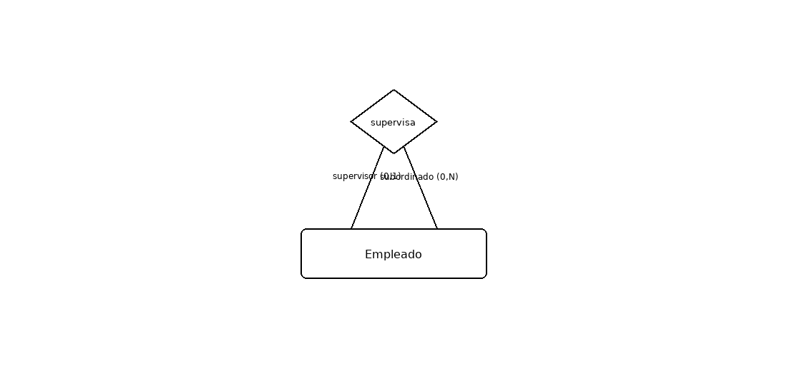
<figcaption><strong>Roles:</strong> supervisor (0,1), subordinado (0,N). Sin existencialidad: un empleado puede no tener jefe y un jefe puede no tener subordinados.</figcaption>
</figure>

En una reflexiva trato a la entidad como si fuese dos roles de la misma tabla. La relación *Empleado —supervisa→ Empleado* con *supervisor (0,1)* y *subordinado (0,N)* se mapea añadiendo una **FK auto-referenciada** en *EMPLEADO* (`jefe_dni` → `dni`). La clave está en la **participación mínima**: si un empleado puede no tener jefe (`min=0`), esa FK se deja *nullable*. No creo tabla de relación intermedia porque el patrón es 1:N; solo documentaría una tabla aparte si surgieran atributos propios de la relación y esta se comportara como N:M.

    EMPLEADO = dni + nombre + jefe_dni
    CP(dni)
    C.Aj(jefe_dni) → EMPLEADO(dni)   
      

#### 4.1.3 Relación ternaria (opcional en los tres extremos)

<figure class="media-box">
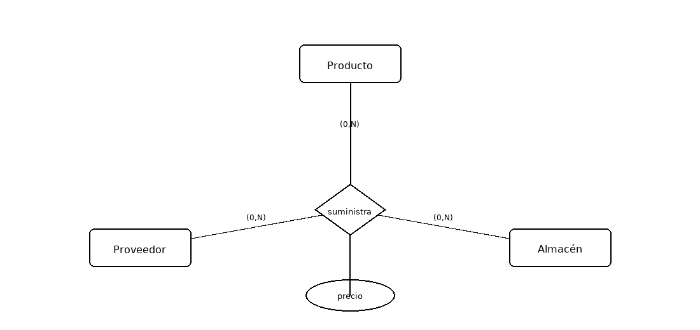
<figcaption><strong>Proveedor — (0,N) — suministra — (0,N) — Producto — (0,N) — Almacén.</strong> La relación tiene atributo <em>precio</em>. Se traduce a una tabla con tres FKs; sin existencialidad, ninguna es VNN por obligación.</figcaption>
</figure>

Las ternarias se traducen casi siempre a una **tabla de relación** cuya PK compuesta incluye las tres FKs (o, según la semántica, dos de ellas más una `AK`). Procedo así: (1) creo la tabla *SUMINISTRO*; (2) defino las tres FKs hacia *PROVEEDOR*, *PRODUCTO* y *ALMACEN*; (3) añado la PK compuesta en el orden que mejor exprese la unicidad del hecho de negocio; (4) coloco los **atributos de la relación** (p. ej., `precio`) aquí. Si en el E/R ningún extremo tiene `min=1`, ninguna FK es `VNN` por obligación.

    PROVEEDOR = id + nombre
    CP(id)

    PRODUCTO  = id + nombre
    CP(id)

    ALMACEN   = id + ciudad
    CP(id)

    SUMINISTRO = proveedor_id + producto_id + almacen_id + precio
    CP(proveedor_id, producto_id, almacen_id)
    C.Aj(proveedor_id) → PROVEEDOR(id)
    C.Aj(producto_id)  → PRODUCTO(id)
    C.Aj(almacen_id)   → ALMACEN(id)
    VNN(precio)
      

#### 4.1.4 Generalización/Especialización (ISA) — parcial y disyunta

<figure class="media-box">
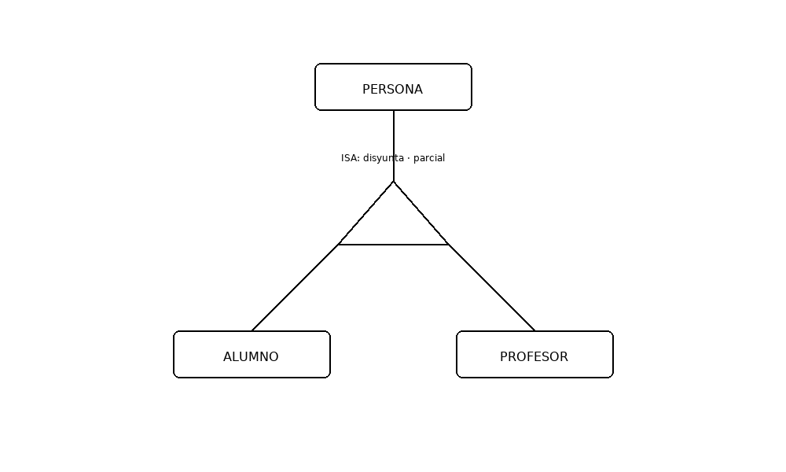
<figcaption><strong>ISA parcial disyunta:</strong> no todas las personas son alumno o profesor; nadie puede ser ambos a la vez. En el mapeo básico: tabla para <em>PERSONA</em> y tablas para subtipos con FK a la super (sin exigir cobertura).</figcaption>
</figure>

En una ISA parcial disyunta (*PERSONA* → *ALUMNO* \| *PROFESOR*), no todas las personas pertenecen a un subtipo y, además, nadie puede estar en ambos. El mapeo más claro para el alumnado es: una tabla para el supertipo con su PK y una tabla por subtipo con una **FK a la PK del supertipo** (que a su vez es su PK). Como la especialización es *parcial*, no fuerzo cobertura con aserciones; la *disyunción* puedo documentarla como restricción conceptual o, si se desea implementar, con aserciones/triggers más adelante.

    PERSONA  = id + nombre
    CP(id)

    ALUMNO   = id + curso
    CP(id)
    C.Aj(id) → PERSONA(id)

    PROFESOR = id + departamento
    CP(id)
    C.Aj(id) → PERSONA(id)

    /* Disyunción (opcional documentarla como aserción informativa):
       ASERCIÓN: ALUMNO[id] ∩ PROFESOR[id] = ∅  */
      

### 4.2 Con restricción de existencialidad

#### 4.2.1 Binaria 1:N con participación total en N

<figure class="media-box">
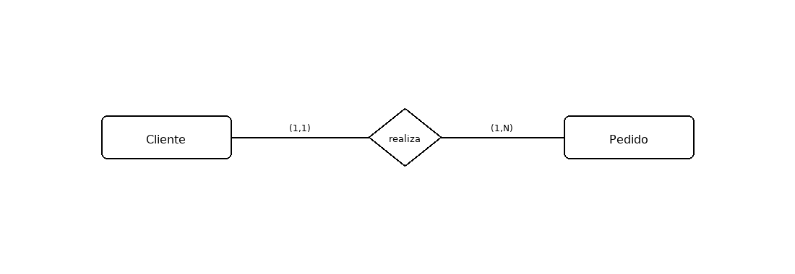
<figcaption><strong>Cliente — (1,1) — realiza — (1,N) — Pedido.</strong> Cada <em>Pedido</em> debe pertenecer a exactamente un <em>Cliente</em> (min=1 en N), por tanto la FK será <code>VNN</code>.</figcaption>
</figure>

Aquí la lectura cambia el mínimo del lado N: *Cliente — (1,1) — realiza — (1,N) — Pedido*. El procedimiento es el mismo que en 4.1.1, salvo un detalle decisivo: la FK **debe ser NOT NULL** porque el mínimo es 1; por tanto marco `VNN(cliente_id)`. Además, si el modelo exige que no se puedan borrar clientes con pedidos, elijo `ON DELETE RESTRICT`; si se permite, podría ser `CASCADE` (con cautela).

    CLIENTE = id + dni + nombre
    CP(id)

    PEDIDO  = id + cliente_id + fecha
    CP(id)
    C.Aj(cliente_id) → CLIENTE(id)
    VNN(cliente_id)                       
    VNN(fecha)
    -- Política recomendada:
    -- ON DELETE RESTRICT (o SET NULL si cambias la participación a min=0)
      

#### 4.2.2 Reflexiva con participación total del subordinado

<figure class="media-box">
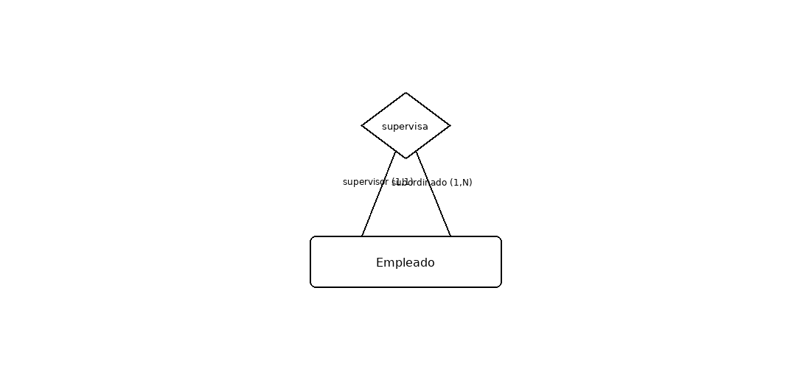
<figcaption><strong>supervisor (1,1) / subordinado (1,N):</strong> toda persona empleada debe tener un supervisor (min=1). Traducción: <code>VNN(jefe_dni)</code>. El lado de “tiene subordinados” puede seguir siendo opcional (0..N).</figcaption>
</figure>

Si toda persona empleada *debe* tener un supervisor (`min=1` en el rol subordinado), la FK auto-referenciada `jefe_dni` pasa a ser **obligatoria** (`VNN`). La lectura práctica para la clase es: “no existe empleado sin jefe registrado”. El lado de supervisor conserva su máximo N y puede tener cero subordinados; no necesito tabla aparte, basta con la FK obligatoria.

    EMPLEADO = dni + nombre + jefe_dni
    CP(dni)
    C.Aj(jefe_dni) → EMPLEADO(dni)
    VNN(jefe_dni)                         
      

#### 4.2.3 Ternaria con participación total en un extremo

<figure class="media-box">

<figcaption><strong>Total en Producto:</strong> cada <em>Producto</em> debe aparecer en algún <em>Suministro</em> (min=1). Esto suele requerir, además de <code>VNN</code> en las FKs, una <strong>ASERCIÓN de cobertura</strong> si se exige que <em>todos</em> los productos estén relacionados.</figcaption>
</figure>

Cuando un extremo de la ternaria es total, por ejemplo “todo *Producto* participa en algún *Suministro*”, reflejo dos cosas: (1) en la tabla de relación todas las FKs que deban ser obligatorias llevan `VNN`, y (2) si necesito garantizar la **cobertura** del conjunto (que no quede ningún producto sin relacionar), añado una **ASERCIÓN** del tipo `PRODUCTO[id] ⊆ SUMINISTRO[producto_id]`. La PK y los posibles `UNIQUE` se eligen en función de la unicidad del hecho (¿puede haber varios suministros del mismo producto y proveedor en almacenes distintos? ¿con distinta fecha?).

    SUMINISTRO = proveedor_id + producto_id + almacen_id + precio
    CP(proveedor_id, producto_id, almacen_id)
    C.Aj(proveedor_id) → PROVEEDOR(id)
    C.Aj(producto_id)  → PRODUCTO(id)
    C.Aj(almacen_id)   → ALMACEN(id)
    VNN(proveedor_id)  VNN(producto_id)  VNN(almacen_id)  VNN(precio)

    ASERCIÓN 1: PRODUCTO[id] ⊆ SUMINISTRO[producto_id]
      

#### 4.2.4 ISA total disyunta

<figure class="media-box">
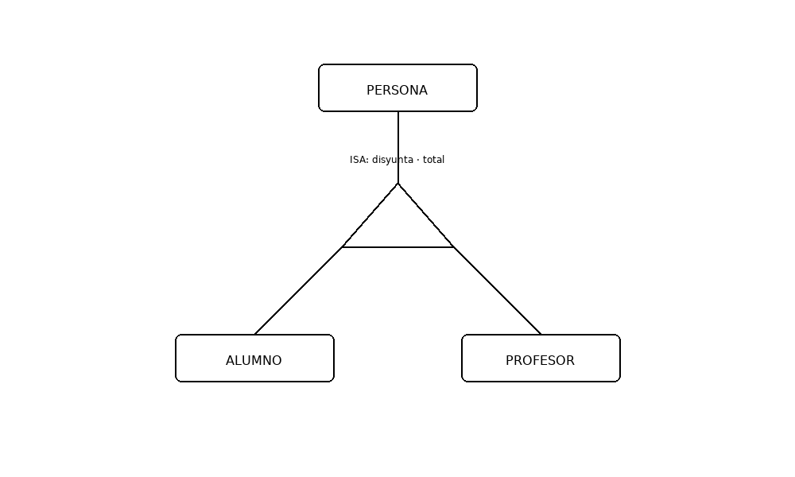
<figcaption><strong>Total y disyunta:</strong> toda <em>PERSONA</em> es <em>ALUMNO</em> o <em>PROFESOR</em> (cobertura) y no ambas (disyunción). Se documenta con aserciones (o lógica de aplicación).</figcaption>
</figure>

En la ISA total disyunta imponemos dos ideas: **cobertura** (toda *PERSONA* está en algún subtipo) y **exclusión** (no puede estar en varios). En lógico lo documento con aserciones: `PERSONA[id] ⊆ ALUMNO[id] ∪ PROFESOR[id]` y `ALUMNO[id] ∩ PROFESOR[id] = ∅`. Si el SGBD no soporta aserciones, explico al alumnado que esto se implementará con *checks*, vistas con `WITH CHECK OPTION` o disparadores, pero a nivel lógico basta con dejarlo claramente especificado.

    ASERCIÓN 1: PERSONA[id] ⊆ ALUMNO[id] ∪ PROFESOR[id]
    ASERCIÓN 2: ALUMNO[id] ∩ PROFESOR[id] = ∅
      

**Regla puente.** Del E/R al marco: *min=1 → VNN(FK)*, *min=0 → FK nullable*. Para imponer 1:1, añade `UNIQUE` sobre la FK (si no es PK). Para “cobertura” global usa **ASERCIÓN**.

## 4.3) Repaso: del E/R al modelo lógico

**Idea fuerza:** lee *(min,max)*, decide **dónde va la FK**, fija **nulabilidad (VNN/NULL)**, define **PK/AK**, añade **políticas de FK** y, si hace falta, **aserciones**. Luego revisa normalización.

### Guía rápida (en 8 pasos)

1.  **Leer el E/R completo**: aridad (binaria/unaria/ternaria), roles, *(min,max)* en cada extremo, atributos de la relación y si hay entidad débil o multivalorados.
2.  **Elegir dónde va la FK**:
    - **1:N**: la FK va en el lado **N**.
    - **1:1**: coloca una FK en uno de los lados; si el lado no-PK debe ser único, añade `UNIQUE`.
    - **N:M**: crea **tabla de relación** con FKs a ambos lados (y atributos de la relación, si existen).
    - **Unaria (reflexiva)**: FK auto-referenciada en la propia tabla (p. ej., `jefe_id → EMPLEADO(id)`).
    - **Ternaria**: crea **tabla de relación** con tres FKs (ajusta PK/AK según la semántica).
    - **Débil**: la PK de la débil = PK de la fuerte + *clave parcial*; relación identificadora no genera tabla aparte.
    - **Multivalorado**: crea tabla propia (`BASE + atributo`) con FK a la entidad base; PK compuesta.
    - **ISA**: supertipo con su PK; cada subtipo = tabla con FK (y PK) al supertipo; documenta disyunción/totalidad.
3.  **Fijar nulabilidad** desde los mínimos del E/R:
    - `min = 1` ⇒ la FK es **obligatoria** → `VNN(FK)`.
    - `min = 0` ⇒ la FK **admite NULL**.
    - Para **1:1**, si un lado tiene `max = 1` y no es PK, añade `UNIQUE` a su FK.
4.  **Definir claves**:
    - **PK** en cada tabla (compuesta si procede: relación N:M, débil, multivalorado).
    - **AK (Candidatas)** con `C.Alt(...)` (en SQL: `UNIQUE`); si deben ser obligatorias, añade `VNN`.
    - Preserva la clave natural estable como `C.Alt` si usas surrogate (`id`).
5.  **Política de integridad referencial** para cada FK:
    - `ON DELETE RESTRICT/NO ACTION` si no quieres huérfanos.
    - `ON DELETE CASCADE` si borrar el padre debe borrar dependientes (típico en tablas de relación).
    - `ON DELETE SET NULL` solo si la FK es nullable (mínimo 0).
    - `ON UPDATE CASCADE` suele ser razonable si cambian claves naturales.
6.  **Trasladar atributos**:
    - Atributos simples → columnas; compuestos → varias columnas; *derivados* no se almacenan.
    - Atributos de la **relación** (p. ej., *precio* en N:M o ternaria) van en la **tabla de relación**.
7.  **Normalización express**:
    - **1NF**: sin multivalorados ni grupos repetitivos en la misma tabla.
    - **2NF**: en PK compuesta, evita dependencias parciales.
    - **3NF/BCNF**: elimina dependencias transitivas de no-clave sobre la clave.
8.  **Verificaciones finales**:
    - Tipos y longitudes compatibles en FKs (incluye charset/collation si aplica).
    - Indexa PK, AK y FKs (*rendimiento*).
    - Nombres consistentes (`snake_case`, sufijo `_id` para FKs).
    - Documenta **ASERCIÓN** si necesitas cobertura/disyunción/totalidad.

### Tabla de decisión (resumen)

| Patrón E/R    | FK / Tabla                                | PK                           | Nulabilidad                      | Extras                                       |
|---------------|-------------------------------------------|------------------------------|----------------------------------|----------------------------------------------|
| 1:N           | FK en lado N                              | PK propias; N hereda FK      | min(N)=1 ⇒ VNN(FK); min=0 ⇒ NULL | RESTRICT/SET NULL según reglas               |
| 1:1           | FK en uno de los lados                    | PK propias                   | min=1 ⇒ VNN(FK)                  | Si no es PK, **UNIQUE** en la FK             |
| N:M           | **Tabla de relación**                     | PK = (FKs) o surrogate + AKs | Normalmente VNN en FKs           | Atributos de relación aquí; suele ir CASCADE |
| Unaria 1:N    | FK auto-referenciada                      | PK propia                    | min=1 ⇒ VNN(FK); min=0 ⇒ NULL    | Roles claros (supervisor/subordinado)        |
| Ternaria      | **Tabla de relación**                     | PK compuesta (2 o 3 FKs)     | Según mínimos de cada extremo    | Posibles **ASERCIÓN** de cobertura           |
| Débil         | Sin tabla para la relación identificadora | PK = PK(fuerte)+parcial      | FK a fuerte **VNN**              | Relación identificadora implícita            |
| Multivalorado | **Nueva tabla** (BASE+atrib)              | PK = PK(base)+atributo       | FK a base VNN                    | Evita listas en una sola columna             |
| ISA           | Subtipo con FK→super                      | PK subtipo = PK super        | Según totalidad                  | Disyunción/Totalidad como **ASERCIÓN**       |

### Plantilla de traducción (marco → SQL)

    T = c1 + c2 + ... + fk_x + ...
    CP(c1, ...)
    C.Alt(ak1, ...)
    C.Aj(fk_x) → OTRA_TABLA(k)
    VNN(c_obligatoria)

    -- SQL (esqueleto)
    CREATE TABLE T (
      c1           ...,
      c2           ...,
      fk_x         ... [NOT NULL],    -- si min=1
      ...,
      CONSTRAINT pk_T PRIMARY KEY (c1, ...),
      CONSTRAINT ak_T UNIQUE (ak1, ...),
      CONSTRAINT fk_T_x FOREIGN KEY (fk_x) REFERENCES OTRA_TABLA(k)
        ON DELETE RESTRICT | SET NULL | CASCADE
        ON UPDATE CASCADE
    );
      

### Checklist relámpago

- ¿Cada tabla tiene **PK** correcta (y mínima)?
- ¿Las **FK** están en el lado adecuado y su **VNN/NULL** coincide con *min*?
- ¿Hay **UNIQUE** cuando *max=1* lo exige (1:1)?
- ¿Atributos de la relación se han puesto en la **tabla de relación**?
- ¿Necesitas **ASERCIÓN** de cobertura/disyunción/totalidad?
- ¿3NF/BCNF y sin pérdida? ¿Índices en PK/AK/FK?

## 5) Integridad lógica y políticas

Además de **CP/PK**, **C.Alt/AK**, **C.Aj/FK** y **VNN**, debemos documentar las **políticas de integridad referencial** que gobiernan el comportamiento ante *borrados* y *actualizaciones* de claves en las tablas referenciadas. Estas políticas deben ser coherentes con las **participaciones** del E/R: los *mínimos* (`min=0` / `min=1`) y, cuando aplique, las restricciones globales (cobertura, disyunción/totalidad).

**Resumen rápido.**

- **RESTRICT / NO ACTION**: impide borrar si hay dependientes.
- **CASCADE**: propaga el borrado/actualización a dependientes.
- **SET NULL**: pone la FK a `NULL` (solo si la FK es *nullable*, es decir, `min=0`).
- **SET DEFAULT**: asigna un valor por defecto (depende del motor; en MySQL no está soportado).

### 5.1 ¿Cómo elijo la política según el E/R?

| Patrón E/R                          | Min/Máx relevantes  | FK (nulabilidad)           | Política sugerida (DELETE)               | Notas                                                                        |
|-------------------------------------|---------------------|----------------------------|------------------------------------------|------------------------------------------------------------------------------|
| 1:N (Pedido→Cliente)                | min(N)=1            | **VNN** (obligatoria)      | **RESTRICT**                             | Un Pedido no puede quedar huérfano; primero reasigna o borra el pedido.      |
| 1:N (Pedido→Cliente)                | min(N)=0            | nullable                   | **SET NULL** o RESTRICT                  | Si permites “pedido sin cliente”, usa SET NULL; si no, RESTRICT.             |
| N:M (Línea entre Pedido y Producto) | min=0 en ambos      | FKs **VNN** en la relación | **CASCADE** desde maestros a la relación | Al borrar un Pedido, borra sus Líneas; nunca al revés.                       |
| 1:1 (Persona—Pasaporte)             | máx=1 en ambos      | FK + **UNIQUE**            | RESTRICT o CASCADE                       | Evita SET NULL si la relación es total en ambos lados.                       |
| Débil (Línea depende de Pedido)     | participación total | FK **VNN**                 | **CASCADE** (fuerte→débil)               | Una débil no vive sin su fuerte; borrar el fuerte elimina las débiles.       |
| Unaria (Empleado—jefe)              | min(subordinado)=0  | FK nullable                | **SET NULL** en baja del jefe            | Si borras al jefe, subordinados quedan sin jefe (si el modelo lo permite).   |
| Unaria (Empleado—jefe)              | min(subordinado)=1  | FK **VNN**                 | **RESTRICT**                             | Antes de borrar al jefe, reasigna subordinados (o usa lógica de aplicación). |
| Ternaria (Suministro)               | según extremos      | FKs VNN/nullable según min | **CASCADE** a la tabla de relación       | La cobertura (*todos los productos aparecen*) se expresa con ASERCIÓN.       |

### 5.2 ¿Y con `ON UPDATE`?

**ON UPDATE CASCADE** tiene sentido si tus claves naturales pueden cambiar (p. ej., `dni`, `isbn`). Si usas surrogate (`id` autoincremental) como PK y las FKs apuntan a ella, lo normal es **RESTRICT** (porque esa PK no se actualiza).

### 5.3 Plantillas (marco → SQL)

#### 5.3.1 1:N con min(N)=1 (FK obligatoria)

    CLIENTE = id + nombre
    CP(id)

    PEDIDO  = id + cliente_id + fecha
    CP(id)
    C.Aj(cliente_id) → CLIENTE(id)
    VNN(cliente_id)  VNN(fecha)
      

    -- SQL (ejemplo)
    CREATE TABLE cliente (
      id     INT PRIMARY KEY,
      nombre VARCHAR(60) NOT NULL
    );

    CREATE TABLE pedido (
      id          INT PRIMARY KEY,
      cliente_id  INT NOT NULL,
      fecha       DATE NOT NULL,
      CONSTRAINT fk_pedido_cliente
        FOREIGN KEY (cliente_id) REFERENCES cliente(id)
          ON DELETE RESTRICT
          ON UPDATE RESTRICT
    );
      

#### 5.3.2 1:N con min(N)=0 (FK nullable)

    PEDIDO = id + cliente_id + fecha
    CP(id)
    C.Aj(cliente_id) → CLIENTE(id)   
      

    -- SQL (ejemplo)
    CREATE TABLE pedido (
      id          INT PRIMARY KEY,
      cliente_id  INT NULL,
      fecha       DATE NOT NULL,
      CONSTRAINT fk_pedido_cliente
        FOREIGN KEY (cliente_id) REFERENCES cliente(id)
          ON DELETE SET NULL     -- permitido porque la FK admite NULL
          ON UPDATE RESTRICT
    );
      

#### 5.3.3 N:M (tabla de relación con CASCADE desde maestros)

    PEDIDO    = id + fecha
    CP(id)

    PRODUCTO  = id + nombre + pvp
    CP(id)

    LINEA     = pedido_id + producto_id + unidades
    CP(pedido_id, producto_id)
    C.Aj(pedido_id)   → PEDIDO(id)
    C.Aj(producto_id) → PRODUCTO(id)
    VNN(unidades)
      

    CREATE TABLE linea (
      pedido_id   INT NOT NULL,
      producto_id INT NOT NULL,
      unidades    INT NOT NULL CHECK (unidades > 0),
      PRIMARY KEY (pedido_id, producto_id),
      CONSTRAINT fk_linea_pedido
        FOREIGN KEY (pedido_id) REFERENCES pedido(id)
          ON DELETE CASCADE
          ON UPDATE RESTRICT,
      CONSTRAINT fk_linea_producto
        FOREIGN KEY (producto_id) REFERENCES producto(id)
          ON DELETE CASCADE
          ON UPDATE RESTRICT
    );
      

#### 5.3.4 Débil (CASCADE desde fuerte)

    PEDIDO = id + fecha
    CP(id)

    LINEA  = pedido_id + n_linea + producto_id + precio_ud
    CP(pedido_id, n_linea)
    C.Aj(pedido_id) → PEDIDO(id)
    VNN(precio_ud)
      

    -- SQL (ejemplo)
    CREATE TABLE linea (
      pedido_id INT NOT NULL,
      n_linea   INT NOT NULL,
      producto_id INT NOT NULL,
      precio_ud DECIMAL(10,2) NOT NULL,
      PRIMARY KEY (pedido_id, n_linea),
      CONSTRAINT fk_linea_pedido
        FOREIGN KEY (pedido_id) REFERENCES pedido(id)
          ON DELETE CASCADE   -- la débil desaparece con su fuerte
          ON UPDATE RESTRICT
    );
      

## 6) Normalización (1NF, 2NF, 3NF, BCNF)

La **normalización** es el proceso de *mejorar el esquema lógico* para eliminar redundancias y evitar *anomalías* (inserción, actualización y borrado), manteniendo el significado del modelo. Trabajaremos con **dependencias funcionales (DF)** y claves para justificar cada paso. La meta docente: que el alumnado sea capaz de explicar *por qué* una descomposición es correcta (sin pérdida y —cuando se pueda— preservando DF).

**Esquema mental:** Identifica DF → detecta redundancias → decide una descomposición *sin pérdida* (y preferiblemente con DF preservadas). Lo habitual en grado es llegar a **3FN**; **BCNF** se reserva para casos con DF complejas.

### 6.1 Conceptos básicos

- **Dependencia funcional (DF):** `X → Y` significa que dos filas iguales en *X* deben ser iguales en *Y*. Las DF describen *reglas de negocio* sobre atributos.
- **Superclave:** conjunto de atributos que identifica unívocamente cada fila.
- **Clave candidata:** superclave *mínima*. Elegimos una como *clave primaria*.
- **Atributo primo:** atributo que forma parte de alguna clave candidata.
- **Cierre de atributos:** `X⁺` = todos los atributos implicados por DF partiendo de *X* (sirve para comprobar claves, cobertura y preservación).

    Algoritmo (cierre de X respecto de F):
    1) X⁺ ← X
    2) Mientras exista A→B en F con A ⊆ X⁺ y B ⊄ X⁺, hacer X⁺ ← X⁺ ∪ B
    3) Termina cuando no se puedan añadir atributos
      

### 6.2 Anomalías (por qué normalizar)

Las redundancias producen:

- **Inserción:** no puedes insertar un producto nuevo sin “inventarte” un pedido.
- **Actualización:** cambiar el nombre del cliente en una fila pero olvidarlo en otra → inconsistencia.
- **Borrado:** borrar el único pedido de un cliente elimina también sus datos de cliente.

| pedido_id | fecha      | cliente_id | cliente_nombre | producto_id | producto_nombre | unidades |
|-----------|------------|------------|----------------|-------------|-----------------|----------|
| 1001      | 2025-09-01 | C37        | Ana Ruiz       | P10         | Teclado         | 2        |
| 1001      | 2025-09-01 | C37        | Ana Ruiz       | P20         | Ratón           | 1        |
| 1002      | 2025-09-05 | C44        | Juan Gil       | P10         | Teclado         | 1        |

Ejemplo de tabla mala (todo junto)

Aquí se repiten datos de cliente y de producto en cada línea → redundancia clara.

### 6.3 Primera Forma Normal (1NF)

Una relación está en **1NF** si no contiene *atributos multivalorados* ni *grupos repetitivos*. Es decir, cada celda es atómica. Si hay listas (teléfonos), se separan en otra tabla (ya lo vimos en el mapeo).

    TEL_CLI = cliente_id + telefono
    CP(cliente_id, telefono)
    C.Aj(cliente_id) → CLIENTE(id)
      

### 6.4 Segunda Forma Normal (2NF)

En una tabla con **PK compuesta**, 2NF exige que *no existan dependencias parciales*: ningún atributo no primo debe depender solo de una parte de la PK. Si ocurre, separa.

    Ejemplo: LINEA(pedido_id, producto_id, unidades, fecha_pedido, cliente_id, cliente_nombre)
    PK = (pedido_id, producto_id)
    DF: pedido_id → fecha_pedido, cliente_id, cliente_nombre
        (pedido_id, producto_id) → unidades

    Violación: fecha_pedido y datos de cliente dependen solo de pedido_id (parte de la PK).
    Solución: separar PEDIDO(pedido_id, fecha_pedido, cliente_id, ...) y LINEA(pedido_id, producto_id, unidades).
      

### 6.5 Tercera Forma Normal (3NF)

Una tabla está en **3NF** si está en 2NF y no tiene *dependencias transitivas* de atributos no primos respecto de una clave. Si `cliente_id → cliente_nombre, cliente_ciudad`, y `pedido_id → cliente_id`, entonces `pedido_id → cliente_nombre` es transitiva: *mueve* los datos de cliente a su propia tabla.

    CLIENTE = id + nombre + ciudad
    CP(id)

    PEDIDO = id + fecha + cliente_id
    CP(id)
    C.Aj(cliente_id) → CLIENTE(id)

    LINEA  = pedido_id + producto_id + unidades + precio_ud
    CP(pedido_id, producto_id)
    C.Aj(pedido_id)   → PEDIDO(id)
    C.Aj(producto_id) → PRODUCTO(id)

    PRODUCTO = id + nombre + pvp
    CP(id)
      

### 6.6 Forma Normal de Boyce–Codd (BCNF)

BCNF refuerza 3NF: para toda DF no trivial `X → Y`, **X debe ser superclave**. A veces 3NF deja alguna DF cuyo lado izquierdo no es superclave (pero 3NF la permite si cada atributo de la derecha es primo). Cuando te interesa máxima robustez (y aceptas posibles pérdidas de preservación de DF), apunta a BCNF.

**Observación:** Pasar de 3NF a BCNF puede *romper la preservación* de alguna DF. En FP solemos preferir 3NF por ser un compromiso excelente entre robustez y simplicidad.

### 6.7 Cobertura mínima (para síntesis a 3NF)

La **cobertura mínima** de un conjunto de DF *F* (también llamado *forma canónica*) se obtiene:

1.  Descomponer derechas: cada DF con un solo atributo en la derecha (`X → A`).
2.  Minimizar izquierdas: intenta eliminar atributos redundantes del lado izquierdo.
3.  Eliminar DF redundantes: si `F - {d}` ya implica `d`, elimina `d`.

    Pseudocódigo (muy resumido):
    - Para cada X→Y en F, sustituye por { X→A | A ∈ Y }
    - Para cada DF X→A, para cada atributo z en X:
        si ( (X - {z}) → A ) está implicada por F, entonces quita z de X
    - Para cada DF d en F:
        si (F - {d}) implica d, elimina d
      

### 6.8 Descomposición correcta: sin pérdida y preservación

- **Sin pérdida (lossless join):** en una descomposición binaria `R = R1 ∪ R2`, es sin pérdida si `R1 ∩ R2` es **superclave** de *R1* *o* de *R2*. (Para más de dos, aplica iterativamente o usa el “chase”).
- **Preservación de DF:** el conjunto de DF de *R* debe estar implicado por la unión de las DF proyectadas sobre cada esquema *Ri*. En práctica docente: intenta que cada DF de la cobertura mínima aparezca en alguna tabla.

    Criterio rápido (binario):
    R descompuesta en R1 y R2 es sin pérdida si (R1 ∩ R2) → R1 o (R1 ∩ R2) → R2
      

### 6.9 Algoritmo de síntesis a 3FN (recomendado en aula)

1.  Obtén la **cobertura mínima** de F.
2.  Para cada DF `X → A` en la cobertura mínima, crea una tabla con atributos `X ∪ {A}` (agrupar por mismos *X*).
3.  Si ninguna de las tablas contiene una **clave candidata** de R, añade una tabla con una clave de R.
4.  Elimina tablas redundantes (si una está contenida completamente en otra).

**Ventaja:** garantiza *preservación de DF* y *sin pérdida* (con el paso 3). Es el método más “mecánico” para enseñar y aplicar en ejercicios.

### 6.10 Ejemplo integral: del “todo junto” a 3FN

Partimos de una relación única (mala) con estos atributos:

    R = (pedido_id, fecha, cliente_id, cliente_nombre, cliente_ciudad,
         producto_id, producto_nombre, pvp, unidades, precio_ud)
      

**DF de negocio (resumen):**

- `pedido_id → fecha, cliente_id`
- `cliente_id → cliente_nombre, cliente_ciudad`
- `producto_id → producto_nombre, pvp`
- `(pedido_id, producto_id) → unidades, precio_ud` (precio acordado en la línea)

**Problemas:** hay dependencias parciales y transitivas; redundancia de cliente y producto por línea.

#### Solución (3FN) vía síntesis + sentido común del E/R

    CLIENTE(id, nombre, ciudad)                 -- cliente_id → ...
    PRODUCTO(id, nombre, pvp)                   -- producto_id → ...
    PEDIDO(id, fecha, cliente_id)               -- pedido_id → fecha, cliente_id
      FK cliente_id → CLIENTE(id)   (VNN)

    LINEA(pedido_id, producto_id, unidades, precio_ud) 
      PK (pedido_id, producto_id)
      FK pedido_id   → PEDIDO(id)   (VNN)
      FK producto_id → PRODUCTO(id) (VNN)
      

**Sin pérdida:** la unión natural sobre claves (PK/FK) recompone la información sin duplicidad. **Preservación de DF:** cada DF relevante queda en alguna tabla (o se deriva por claves primarias/foráneas). **1NF, 2NF, 3NF:** cumplidas: no hay multivalorados, sin parciales (PK compuesta solo en LINEA y sus atributos dependen de toda la PK), y sin transitivas (datos de cliente y producto están fuera de PEDIDO/LINEA).

**Precio en la línea:** no lo derives de `PRODUCTO.pvp` si el precio puede variar con el tiempo o por pedido. Mantener `precio_ud` en LINEA evita perder el histórico.

### 6.11 De 3FN/BCNF a SQL (notas prácticas)

- **PK/AK/FK**: tradúcelas como `PRIMARY KEY`, `UNIQUE` y `FOREIGN KEY`. Respeta nulabilidad (VNN/NULL) según los mínimos del E/R.
- **Índices:** además de PK/AK, indexa FKs para rendimiento en joins.
- **CHECK** (dominio): valida rangos y coherencia (`unidades > 0`, fechas, etc.).
- **Políticas de FK:** elige `RESTRICT` / `CASCADE` / `SET NULL` alineado con reglas de negocio.

### 6.12 ¿Normalizar siempre? Denormalización controlada

En sistemas analíticos o de alto rendimiento de lectura, a veces se *denormaliza* para ahorrar joins (vistos/ materializados, columnas derivadas). Hazlo **conscientemente**, documentando la regla que “rompes” y cómo se recalcula el dato para no perder consistencia.

<a href="#" class="backtotop" aria-label="Volver arriba">↑</a>

<a href="#top" class="backtotop" aria-label="Volver arriba">↑</a>

---

<!-- SQL (DDL, DML, DCL, TCL) -->
# SQL — Lenguaje de consulta estructurado

Este tema introduce SQL desde cero y lo organiza en cuatro familias de instrucciones: **DDL**definir, **DML**leer/escribir, **DCL**permisos y **TCL**transacciones. A lo largo de la unidad alternaremos explicación y ejemplos (PostgreSQL y MySQL/MariaDB) exactamente como yo lo haría en clase.

## 1. Introducción a SQL

**SQL (Structured Query Language)** es el lenguaje estándar para trabajar con bases de datos relacionales. Nació a principios de los 70 en IBM (proyecto System R) a partir del modelo relacional de E. F. Codd, y en los 80 se estandarizó por ANSI/ISO. Desde entonces, todos los SGBDR (Sistemas de Gestión de Bases de Datos Relacionales) —como *PostgreSQL, MySQL/MariaDB, Oracle, SQL Server*— implementan SQL con pequeñas diferencias de dialéctos. SQL es *declarativo*: tú dices *qué* necesitas y el motor decide *cómo* obtenerlo.

**Idea clave.** Piensa en SQL como en cuatro sombreros distintos:

- **DDL**: crear y modificar la *estructura* (bases de datos, tablas, columnas, índices, claves).
- **DML**: insertar, consultar, actualizar y borrar *datos*.
- **DCL**: otorgar o revocar *permisos*.
- **TCL**: gestionar *transacciones* (confirmar o deshacer cambios).

### SQL en el ciclo de vida de una aplicación

En un proyecto típico empezamos levantando el *esquema* (DDL), cargamos datos de prueba (DML), definimos usuarios y privilegios (DCL) y, por último, nos aseguramos de que los cambios sean **atómicos** y consistentes mediante transacciones (TCL). Este orden no es rígido, pero ayuda a estructurar mentalmente el trabajo.

    CREATE TABLE autores (
                id SERIAL PRIMARY KEY,
                nombre VARCHAR(80) NOT NULL
                );
                CREATE TABLE libros (
                id SERIAL PRIMARY KEY,
                isbn CHAR(13) NOT NULL UNIQUE,
                titulo VARCHAR(120) NOT NULL,
                autor_id INT NOT NULL REFERENCES autores(id)
                );
                CREATE INDEX idx_libros_isbn ON libros(isbn);
                

**Consultas con JOIN y agregación.** Obtén el top 3 de clientes por gasto total y el número medio de líneas por pedido.

Solución orientativa

    SELECT c.nombre, SUM(p.total) AS total
                FROM clientes c JOIN pedidos p ON p.cliente_id = c.id
                GROUP BY c.id
                ORDER BY total DESC
                LIMIT 3;
                
                
                SELECT AVG(cnt) AS media_lineas
                FROM (
                SELECT COUNT(*) AS cnt FROM lineas_pedido GROUP BY pedido_id
                ) t;
                

**Transacciones.** Simula un alta de pedido con fallo intermedio y deja la BD consistente usando `SAVEPOINT`.

### Recursos y buenas prácticas

- Escribe sentencias *idempotentes* en despliegues: `CREATE TABLE IF NOT EXISTS`, `DROP ... IF EXISTS`.
- Versiona el esquema con migraciones (p. ej., Flyway, Liquibase) incluso en proyectos pequeños.
- Incluye `EXPLAIN`/`EXPLAIN ANALYZE` en tu rutina para entender planes de ejecución.
- Evita `SELECT *` en producción: carga columnas necesarias y documenta contratos.
- Centraliza constantes y validaciones en la BD siempre que tenga sentido.

## 2. DDL

En esta sección nos ponemos el «sombrero DDL» **centradas 100% en MySQL 8.0+**. Veremos desde la creación de bases de datos hasta el diseño fino de tablas, tipos de datos, claves primarias y ajenas, índices, opciones de motor y el tratamiento de `NULL`. La idea es que, al terminar, puedas leer y escribir DDL con criterio, sabiendo *por qué* eliges cada opción.

### 1) Crear bases de datos (charset y collation)

En MySQL, `CREATE DATABASE` y `CREATE SCHEMA` son sinónimos. Es clave fijar la **codificación** y la **ordenación** desde el principio. Para español moderno recomiendo `utf8mb4` con una collation insensible a mayúsculas y acentos (p. ej., `utf8mb4_0900_ai_ci` o, si la tienes, `utf8mb4_es_0900_ai_ci`).

    -- Crear la base y usarla
      CREATE DATABASE IF NOT EXISTS tienda
        CHARACTER SET utf8mb4
        COLLATE utf8mb4_0900_ai_ci;  -- alternativa: utf8mb4_es_0900_ai_ci
      USE tienda;
      
      -- Inspeccionar la definición
      SHOW CREATE DATABASE tienda\G
      

Consejo: también puedes definir charset/collation por *tabla* o por *columna* si necesitas comportamientos distintos.

### 2) Motores de almacenamiento (ENGINE)

El motor de almacenamiento decide cómo se guardan y bloquean los datos. **InnoDB** es el motor por defecto y el recomendado: soporta *transacciones*, *claves ajenas*, *bloqueo a nivel de fila* y *recuperación*. Otros motores existen (MEMORY, ARCHIVE, etc.) pero tienen usos muy específicos y limitaciones (p. ej., sin FKs). Lo normal en 1º DAW es usar siempre InnoDB.

    -- Motor por tabla
      CREATE TABLE ejemplo (
        id INT PRIMARY KEY
      ) ENGINE=InnoDB;
      

### 3) Tipos de datos en MySQL (elección didáctica)

Elegir bien los tipos evita sorpresas. Abajo tienes una «chuleta» con los más usados y cuándo elegirlos. Recuerda: para *dinero* usa `DECIMAL(p,s)`; para contadores `INT`/`BIGINT`; para textos libres `VARCHAR(n)` o `TEXT` si pueden ser muy largos; para fechas `DATE` y para fecha-hora sin zona horaria `DATETIME` (o `TIMESTAMP` si te interesa el auto-update y aceptas su rango limitado).

| Categoría                | Tipos comunes                                                | Notas prácticas                                                                                                                            |
|--------------------------|--------------------------------------------------------------|--------------------------------------------------------------------------------------------------------------------------------------------|
| Números enteros          | `TINYINT`, `SMALLINT`, `INT`, `BIGINT`                       | Elige el más pequeño que cubra el rango. `BOOLEAN` es alias de `TINYINT(1)`.                                                               |
| Números exactos          | `DECIMAL(p,s)`                                               | Para importes: p.ej., `DECIMAL(10,2)`. Evita `FLOAT/DOUBLE` en dinero.                                                                     |
| Números en coma flotante | `FLOAT`, `DOUBLE`                                            | Para cálculos científicos o medidas aproximadas.                                                                                           |
| Cadenas                  | `CHAR(n)`, `VARCHAR(n)`, `TINYTEXT/TEXT/MEDIUMTEXT/LONGTEXT` | `CHAR` para longitudes fijas (códigos); `VARCHAR` para variable; `TEXT` para textos largos.                                                |
| Binarios                 | `BINARY(n)`, `VARBINARY(n)`, `BLOB`…                         | Para datos binarios. Suele preferirse guardar ficheros fuera de la BD.                                                                     |
| Fecha y hora             | `DATE`, `TIME`, `DATETIME`, `TIMESTAMP`                      | `TIMESTAMP` puede auto-actualizarse (`DEFAULT CURRENT_TIMESTAMP`, `ON UPDATE`) pero su rango es ~1970-2038. `DATETIME` tiene rango amplio. |
| JSON                     | `JSON`                                                       | Valida formato y permite funciones JSON. Úsalo para datos semiestructurados, no como sustituto del modelado relacional.                    |
| Enumerados               | `ENUM`, `SET`                                                | Útiles pero rígidos: valorar tabla de referencia + FK si cambiarán.                                                                        |
| Espaciales               | `POINT`, `GEOMETRY`…                                         | Fuera del alcance básico, pero existen e incluso tienen índices espaciales.                                                                |

### 4) Crear tablas bien formadas

A continuación definimos un esquema tipo «tienda» con **claves primarias**, **únicas**, **foráneas**, **checks**, **columnas generadas** e **índices**. Fíjate en el uso de `ENGINE`, `CHARACTER SET`, `COLLATE` y los nombres explícitos de las restricciones (`CONSTRAINT ...`).

    -- CLIENTES
      CREATE TABLE IF NOT EXISTS clientes (
        id            INT AUTO_INCREMENT,
        nombre        VARCHAR(80)     NOT NULL,
        email         VARCHAR(120)    NOT NULL,
        telefono      VARCHAR(20)     NULL,
        fecha_alta    DATE            NOT NULL DEFAULT (CURRENT_DATE),
        activo        TINYINT(1)      NOT NULL DEFAULT 1,
        nif           VARCHAR(12)     NULL,
        -- Restricciones
        CONSTRAINT pk_clientes PRIMARY KEY (id),
        CONSTRAINT uq_clientes_email UNIQUE (email),
        CONSTRAINT uq_clientes_nif   UNIQUE (nif),
        CONSTRAINT chk_email_arroba  CHECK (email LIKE '%@%')
      ) ENGINE=InnoDB
        DEFAULT CHARSET=utf8mb4
        COLLATE=utf8mb4_0900_ai_ci;
      
      -- PEDIDOS
      CREATE TABLE IF NOT EXISTS pedidos (
        id            INT AUTO_INCREMENT,
        cliente_id    INT            NOT NULL,
        fecha_pedido  DATETIME       NOT NULL DEFAULT CURRENT_TIMESTAMP,
        estado        ENUM('pendiente','enviado','cancelado','entregado') NOT NULL DEFAULT 'pendiente',
        total         DECIMAL(10,2)  NOT NULL DEFAULT 0,
        CONSTRAINT pk_pedidos PRIMARY KEY (id),
        CONSTRAINT fk_pedidos_cliente FOREIGN KEY (cliente_id)
          REFERENCES clientes(id)
          ON UPDATE CASCADE
          ON DELETE RESTRICT,
        KEY idx_pedidos_cliente (cliente_id)
      ) ENGINE=InnoDB;
      
      -- LÍNEAS DE PEDIDO (PK compuesta + columna generada)
      CREATE TABLE IF NOT EXISTS lineas_pedido (
        pedido_id   INT           NOT NULL,
        posicion    INT           NOT NULL,
        producto    VARCHAR(80)   NOT NULL,
        cantidad    INT           NOT NULL CHECK (cantidad > 0),
        precio      DECIMAL(10,2) NOT NULL CHECK (precio >= 0),
        importe     DECIMAL(10,2) AS (cantidad * precio) STORED,
        CONSTRAINT pk_lineas PRIMARY KEY (pedido_id, posicion),
        CONSTRAINT fk_lineas_pedido FOREIGN KEY (pedido_id)
          REFERENCES pedidos(id)
          ON UPDATE CASCADE
          ON DELETE CASCADE
      ) ENGINE=InnoDB;
      

**Sobre CHECK.** En MySQL 8.0.16+ las restricciones `CHECK` se *aplican*. En versiones antiguas se aceptaban pero se ignoraban. Si trabajas con una versión vieja, sustitúyelas por claves y lógica alternativa.

### 5) Claves primarias y AUTO_INCREMENT

Una **PK** identifica de forma única cada fila. En MySQL conviene que la PK sea *compacta y monótona* (p. ej., `INT AUTO_INCREMENT`) para favorecer el índice clustered de InnoDB. También puedes usar PK compuestas cuando tengan significado natural (como `(pedido_id, posicion)` en líneas).

    -- PK simple autoincremental
      CREATE TABLE categorias (
        id INT AUTO_INCREMENT PRIMARY KEY,
        nombre VARCHAR(60) NOT NULL UNIQUE
      ) ENGINE=InnoDB;
      
      -- PK compuesta
      CREATE TABLE favoritos (
        cliente_id INT NOT NULL,
        producto_id INT NOT NULL,
        PRIMARY KEY (cliente_id, producto_id)
      ) ENGINE=InnoDB;
      

### 6) Claves ajenas (FOREIGN KEY) y acciones

Las FKs garantizan integridad referencial. Define siempre la acción adecuada: `ON DELETE RESTRICT` (bloquea borrado), `ON DELETE CASCADE` (borra hijas), `ON DELETE SET NULL` (pone `NULL` si lo permites) o `NO ACTION` (equivalente práctico a `RESTRICT` en MySQL). Para `SET NULL`, la columna debe permitir `NULL`.

    -- SET NULL requiere permitir nulos
      ALTER TABLE pedidos
        ADD COLUMN comercial_id INT NULL,
        ADD CONSTRAINT fk_pedidos_comercial FOREIGN KEY (comercial_id)
        REFERENCES comerciales(id)
        ON DELETE SET NULL;
      

### 7) NULOS: reglas que debes interiorizar

- **`NULL` ≠ 0 ≠ ''**. Representa «valor desconocido». No compares con `=`; usa `IS NULL` / `IS NOT NULL`.
- Una columna sin `NOT NULL` *acepta* nulos. Define `NOT NULL` siempre que el dato sea obligatorio.
- Un índice **UNIQUE** permite múltiples `NULL` (porque `NULL` no es igual a `NULL`).
- Para `ON DELETE SET NULL` la columna debe ser `NULL`-able.
- Usa `DEFAULT` para valores por defecto coherentes (fechas, flags, importes en 0).

<!-- -->

    -- Ejemplos rápidos
      CREATE TABLE ejemplo_nulos (
        a INT UNIQUE NULL,      -- admite varios NULL
        b INT NOT NULL UNIQUE   -- no admite NULL
      );
      
      -- Búsqueda correcta
      SELECT * FROM ejemplo_nulos WHERE a IS NULL;  -- no uses a = NULL
      

### 8) Índices (UNIQUE, compuestos, FULLTEXT)

En InnoDB, la PK es el índice clustered. Crea índices secundarios para acelerar filtros y joins frecuentes. Mejor un índice compuesto bien pensado que varios índices sueltos. Para búsqueda de texto libre en columnas `VARCHAR/TEXT`, puedes usar `FULLTEXT`.

    -- Índice compuesto (cliente + fecha)
      CREATE INDEX idx_pedidos_cliente_fecha ON pedidos(cliente_id, fecha_pedido);
      
      -- Texto libre
      CREATE FULLTEXT INDEX ft_productos_nombre ON productos(nombre);
      
      -- Prefijos (cuando la columna es muy larga)
      CREATE INDEX idx_usuarios_email_pref ON usuarios(email(20));
      

### 9) ALTER TABLE: evolucionar el esquema

MySQL ofrece varias formas de alterar: `ADD`, `DROP`, `MODIFY` (cambia tipo/atributos), `CHANGE` (cambia nombre y tipo), `RENAME COLUMN` (8.0+), añadir/quitar restricciones e índices. Para eliminar una FK debes conocer su *nombre* simbólico.

    -- Añadir columnas y restricciones
      ALTER TABLE clientes
        ADD COLUMN apellidos VARCHAR(120) AFTER nombre,
        ADD CONSTRAINT chk_nombre_long CHECK (CHAR_LENGTH(nombre) >= 2);
      
      -- Cambiar tipo y NOT NULL
      ALTER TABLE clientes MODIFY telefono VARCHAR(25) NULL;
      
      -- Renombrar columna (8.0+)
      ALTER TABLE clientes RENAME COLUMN telefono TO telefono_movil;
      
      -- Añadir/quitar índice
      ALTER TABLE pedidos ADD UNIQUE uq_pedidos (cliente_id, fecha_pedido);
      ALTER TABLE pedidos DROP INDEX uq_pedidos;
      
      -- Quitar FK (necesitas el nombre)
      ALTER TABLE pedidos DROP FOREIGN KEY fk_pedidos_cliente;
      

**¿Cómo sé el nombre de una FK o índice?** Usa `SHOW CREATE TABLE nombre` o consulta `INFORMATION_SCHEMA` (`TABLE_CONSTRAINTS`, `KEY_COLUMN_USAGE`).

### 10) Comentarios, opciones y otras herramientas

- **Comentarios:** añade `COMMENT 'texto'` en columnas y tablas para documentar.
- **Opciones de tabla:** `ROW_FORMAT`, `AUTO_INCREMENT`, `ENGINE`, `CHARSET`, etc.
- **Vistas:** aunque son DDL, las veremos aparte; útiles para exponer «lecturas» estables a la capa de aplicación.
- **Buenas prácticas de despliegue:** usa `CREATE/DROP ... IF EXISTS` y versiona las migraciones.

**Antipatrones frecuentes.**

1.  Usar `VARCHAR(255)` por defecto «porque sí». Elige tamaños razonables.
2.  Abusar de `ENUM`; es sencillo al principio pero rígido para cambios.
3.  Sin claves ajenas «porque las controlo en la app». La BD *debe* hacer cumplir la integridad.
4.  Olvidar el charset/collation y mezclar luego columnas con reglas diferentes.

### 11) Práctica guiada (mini-reto)

Diseña el DDL de un pequeño módulo de «cursos»: *cursos*(id, título, precio), *alumnos*(id, nombre, email) y *matriculas*(curso_id, alumno_id, fecha, precio_pagado). Requisitos: emails únicos, precio no negativo, PK compuesta en `matriculas`, FK con `ON DELETE CASCADE` y columna generada `iva` = 21% de `precio_pagado` (STORED).

Solución orientativa

    CREATE TABLE cursos (
        id INT AUTO_INCREMENT PRIMARY KEY,
        titulo VARCHAR(120) NOT NULL,
        precio DECIMAL(10,2) NOT NULL CHECK (precio >= 0)
      ) ENGINE=InnoDB;
      
      CREATE TABLE alumnos (
        id INT AUTO_INCREMENT PRIMARY KEY,
        nombre VARCHAR(120) NOT NULL,
        email VARCHAR(120) NOT NULL UNIQUE
      ) ENGINE=InnoDB;
      
      CREATE TABLE matriculas (
        curso_id  INT NOT NULL,
        alumno_id INT NOT NULL,
        fecha     DATE NOT NULL DEFAULT (CURRENT_DATE),
        precio_pagado DECIMAL(10,2) NOT NULL CHECK (precio_pagado >= 0),
        iva DECIMAL(10,2) AS (ROUND(precio_pagado * 0.21, 2)) STORED,
        PRIMARY KEY (curso_id, alumno_id),
        CONSTRAINT fk_mat_curso  FOREIGN KEY (curso_id)  REFERENCES cursos(id)  ON DELETE CASCADE,
        CONSTRAINT fk_mat_alumno FOREIGN KEY (alumno_id) REFERENCES alumnos(id) ON DELETE CASCADE
      ) ENGINE=InnoDB;
      

## 3. DML: Consultas

En esta unidad profundizamos en **DML**: `SELECT`, `INSERT`, `UPDATE` y `DELETE`. Iremos de menos a más: primero consultas sobre *una tabla*, después *agrupaciones*, y finalmente trabajaremos con *varias tablas* (joins) y *subconsultas*. Todo con **MySQL 8.0+** en mente y usando el esquema del tema (*clientes*, *pedidos*, *lineas_pedido*). Añadiremos además una tabla *productos* para practicar.

**Recordatorio.** Orden lógico de evaluación: `FROM` → `WHERE` → `GROUP BY` → `HAVING` → `SELECT` → `ORDER BY` → `LIMIT`. Te servirá para entender por qué ciertas referencias no funcionan en `WHERE` pero sí en `HAVING` o en la proyección final.

### 0) Preparación: datos de ejemplo rápidos

    -- Tabla de apoyo para consultas
      CREATE TABLE IF NOT EXISTS productos (
        id INT AUTO_INCREMENT PRIMARY KEY,
        nombre VARCHAR(80) NOT NULL,
        categoria VARCHAR(40) NOT NULL,
        precio DECIMAL(10,2) NOT NULL CHECK (precio >= 0),
        stock INT NOT NULL DEFAULT 0 CHECK (stock >= 0)
      ) ENGINE=InnoDB;
      
      INSERT INTO productos (nombre, categoria, precio, stock) VALUES
        ('Libro BBDD', 'libros', 38.50, 50),
        ('Ratón', 'perifericos', 20.00, 120),
        ('Teclado', 'perifericos', 29.90, 80),
        ('Portátil 14\"', 'equipos', 799.00, 10),
        ('USB-C 32GB', 'almacenamiento', 9.99, 200);
      
      -- Algunos clientes/pedidos de ejemplo
      INSERT INTO clientes (nombre, email) VALUES
        ('Ada Lovelace','ada@ejemplo.com'),
        ('Linus Torvalds','linus@ejemplo.com'),
        ('Radia Perlman','radia@ejemplo.com');
      
      INSERT INTO pedidos (cliente_id, estado, total)
      VALUES (1,'pendiente',0), (2,'enviado',58.50);
      
      INSERT INTO lineas_pedido (pedido_id, posicion, producto, cantidad, precio) VALUES
        (2,1,'Libro BBDD',1,38.50),
        (2,2,'Ratón',1,20.00);
      

### 1) Consultas sobre *una tabla* (SELECT básico)

Empezamos con **proyección** (elegir columnas), **filtros** (`WHERE`), **ordenación** (`ORDER BY`) y **paginación** (`LIMIT/OFFSET`). Añadimos alias con `AS` y expresiones básicas.

    -- Columnas concretas + alias + expresión calculada
      SELECT id, nombre AS producto, precio, stock, (precio * stock) AS valor_stock
      FROM productos;
      
      -- Filtrado: operadores (=, <>, >, >=, <, <=), AND/OR/NOT, IN/BETWEEN/LIKE, IS NULL
      SELECT id, nombre, precio
      FROM productos
      WHERE categoria IN ('perifericos','almacenamiento')
        AND precio BETWEEN 10 AND 40
        AND nombre LIKE '%o%';
      
      -- Ordenación múltiple y paginación
      SELECT id, nombre, categoria, precio
      FROM productos
      ORDER BY categoria ASC, precio DESC
      LIMIT 5 OFFSET 0;
      
      -- Eliminar duplicados con DISTINCT
      SELECT DISTINCT categoria FROM productos ORDER BY categoria;
      
      -- Manejo de NULL: COALESCE / IFNULL
      SELECT c.id, c.nombre, COALESCE(c.telefono, '—') AS telefono
      FROM clientes c;
      

**Truco con NULL al ordenar.** MySQL no tiene `NULLS FIRST/LAST`, pero puedes simularlo: `ORDER BY (col IS NULL) ASC, col ASC` (primero no nulos).

### 2) Funciones habituales (números, cadenas y fechas)

Recuerda: en MySQL las funciones se escriben como `NOMBRE(argumentos)`. Las más usadas en 1º DAW:

| Categoría | Funciones típicas                                                 | Ejemplos                                                               |
|-----------|-------------------------------------------------------------------|------------------------------------------------------------------------|
| Números   | `ROUND`, `FLOOR`, `CEIL`, `ABS`                                   | `SELECT ROUND(AVG(precio),2) FROM productos;`                          |
| Cadenas   | `CONCAT`, `SUBSTRING`, `LENGTH`, `UPPER/LOWER`, `TRIM`, `REPLACE` | `SELECT CONCAT(UPPER(nombre),' (',categoria,')') FROM productos;`      |
| Fechas    | `NOW`, `CURDATE`, `DATE_FORMAT`, `DATEDIFF`, `TIMESTAMPDIFF`      | `SELECT TIMESTAMPDIFF(DAY, fecha_pedido, NOW()) AS dias FROM pedidos;` |
| Control   | `COALESCE`, `IFNULL`, `CASE WHEN`                                 | `CASE WHEN stock=0 THEN 'sin stock' ELSE 'ok' END`                     |

### 3) Agregación: `GROUP BY` y `HAVING`

Las agregaciones resumen varias filas en una. Usa `GROUP BY` con `COUNT`, `SUM`, `AVG`, `MIN`, `MAX`. Filtra grupos con `HAVING` (no con `WHERE`).

    -- Ventas por cliente (incluyendo clientes sin pedidos con LEFT JOIN)
      SELECT c.id, c.nombre,
             COALESCE(SUM(p.total),0) AS total_cliente,
             COUNT(p.id) AS num_pedidos
      FROM clientes c
      LEFT JOIN pedidos p ON p.cliente_id = c.id
      GROUP BY c.id, c.nombre
      ORDER BY total_cliente DESC;
      
      -- Solo clientes con >= 1 pedido y total > 50€
      SELECT c.nombre, SUM(p.total) AS total
      FROM clientes c
      JOIN pedidos p ON p.cliente_id = c.id
      GROUP BY c.id, c.nombre
      HAVING COUNT(p.id) >= 1 AND SUM(p.total) > 50;
      
      -- Agregación por categoría de producto
      SELECT categoria,
             COUNT(*) AS num_productos,
             ROUND(AVG(precio),2) AS precio_medio
      FROM productos
      GROUP BY categoria
      ORDER BY precio_medio DESC;
      
      -- Totales con WITH ROLLUP (suma por categoría y total general)
      SELECT categoria, SUM(precio) AS suma
      FROM productos
      GROUP BY categoria WITH ROLLUP;
      

**Regla de oro.** En MySQL, si activas *sql_mode* estricto (recomendado), toda columna en la lista `SELECT` debe estar en `GROUP BY` o ser una agregación. Evita depender de extensiones no estándar.

### 4) Varias tablas: *joins* explicados

Para combinar tablas relacionadas usamos **JOIN**. Siempre pon alias cortos a las tablas y especifica la condición con `ON`.

| Tipo         | Qué devuelve                                                | Esquema mental |
|--------------|-------------------------------------------------------------|----------------|
| `INNER JOIN` | Solo coincidencias en ambas tablas                          | A ∩ B          |
| `LEFT JOIN`  | Todos los de la izquierda, y datos de la derecha si existen | A + (A∩B)      |
| `RIGHT JOIN` | Simétrico al anterior                                       | B + (A∩B)      |
| `CROSS JOIN` | Producto cartesiano (útil con cuidado)                      | A × B          |

    -- INNER JOIN: pedidos con su cliente
      SELECT p.id, c.nombre, p.fecha_pedido, p.estado, p.total
      FROM pedidos p
      INNER JOIN clientes c ON c.id = p.cliente_id
      ORDER BY p.fecha_pedido DESC;
      
      -- LEFT JOIN: clientes sin pedidos (mirando NULL)
      SELECT c.id, c.nombre
      FROM clientes c
      LEFT JOIN pedidos p ON p.cliente_id = c.id
      WHERE p.id IS NULL;
      
      -- RIGHT JOIN: (menos usado; preferimos reordenar tablas y usar LEFT)
      SELECT p.id, c.nombre
      FROM pedidos p
      RIGHT JOIN clientes c ON c.id = p.cliente_id;
      
      -- FULL OUTER JOIN (MySQL no lo tiene nativo): emulación con UNION
      SELECT c.id, c.nombre, p.id AS pedido_id
      FROM clientes c LEFT JOIN pedidos p ON p.cliente_id = c.id
      UNION
      SELECT c.id, c.nombre, p.id AS pedido_id
      FROM clientes c RIGHT JOIN pedidos p ON p.cliente_id = c.id;
      
      -- SELF JOIN: clientes con mismo dominio de email (ejemplo didáctico)
      SELECT c1.id, c1.email, c2.id, c2.email
      FROM clientes c1
      JOIN clientes c2 ON c1.id < c2.id AND SUBSTRING_INDEX(c1.email,'@',-1)=SUBSTRING_INDEX(c2.email,'@',-1);
      

### 5) Subconsultas: *IN*, *EXISTS*, escalares y correlacionadas

Una subconsulta puede devolver un escalar (una columna/una fila), una columna (para `IN`), varias columnas (en `EXISTS`) o una tabla derivada en `FROM`. En MySQL 8.0 también disponemos de **CTE** con `WITH`.

    -- Escalar: clientes con gasto > gasto medio
      SELECT c.*
      FROM clientes c
      WHERE (
        SELECT COALESCE(AVG(p.total),0) FROM pedidos p WHERE p.cliente_id = c.id
      ) > (
        SELECT AVG(total) FROM pedidos
      );
      
      -- IN: clientes que han hecho algún pedido
      SELECT * FROM clientes
      WHERE id IN (SELECT DISTINCT cliente_id FROM pedidos);
      
      -- EXISTS: equivalente, a menudo más eficiente
      SELECT c.* FROM clientes c
      WHERE EXISTS (SELECT 1 FROM pedidos p WHERE p.cliente_id = c.id);
      
      -- Correlacionada: pedidos por encima de la media del mismo cliente
      SELECT p.*
      FROM pedidos p
      WHERE p.total > (
        SELECT AVG(p2.total) FROM pedidos p2
        WHERE p2.cliente_id = p.cliente_id
      );
      
      -- Subconsulta en FROM (tabla derivada)
      SELECT t.cliente_id, t.num_pedidos, t.total
      FROM (
        SELECT cliente_id, COUNT(*) AS num_pedidos, SUM(total) AS total
        FROM pedidos
        GROUP BY cliente_id
      ) AS t
      ORDER BY t.total DESC;
      
      -- CTE (WITH): top 5 clientes por gasto (idéntico a tabla derivada, pero más legible)
      WITH gasto AS (
        SELECT cliente_id, SUM(total) AS total
        FROM pedidos
        GROUP BY cliente_id
      )
      SELECT c.nombre, g.total
      FROM gasto g JOIN clientes c ON c.id = g.cliente_id
      ORDER BY g.total DESC
      LIMIT 5;
      

### 6) Inserciones (`INSERT`)

Inserta una fila, varias filas, duplica desde otra tabla, o resuelve conflictos con `ON DUPLICATE KEY UPDATE`.

    -- Una y varias filas
      INSERT INTO productos (nombre, categoria, precio, stock)
      VALUES ('Altavoces', 'perifericos', 24.99, 40),
             ('Webcam', 'perifericos', 39.00, 30);
      
      -- INSERT ... SELECT (cargar desde otra tabla/consulta)
      INSERT INTO lineas_pedido (pedido_id, posicion, producto, cantidad, precio)
      SELECT 2, ROW_NUMBER() OVER (ORDER BY id), nombre, 1, precio
      FROM productos
      WHERE categoria = 'perifericos' AND precio <= 25
      LIMIT 1;
      
      -- Resolver duplicados por clave única (ej.: email de clientes)
      INSERT INTO clientes (nombre, email)
      VALUES ('Ada L.','ada@ejemplo.com')
      ON DUPLICATE KEY UPDATE nombre = VALUES(nombre);
      
      -- REPLACE INTO (cuidado: borra e inserta; dispara ON DELETE)
      REPLACE INTO productos (id, nombre, categoria, precio, stock)
      VALUES (1, 'Libro BBDD (2ª ed.)', 'libros', 42.00, 40);
      

**Seguridad en inserciones.** Valida rangos y valores por defecto en el *DDL* (`NOT NULL`, `CHECK`). Evita depender solo de validaciones en la aplicación.

### 7) Actualizaciones (`UPDATE`)

Actualiza columnas con expresiones, usa `CASE` para reglas, y recuerda que puedes hacer `UPDATE ... JOIN` para aplicar cambios basados en otra tabla.

    -- Subir precio un 5% en 'perifericos' con tope
      UPDATE productos
      SET precio = LEAST(precio * 1.05, 50)
      WHERE categoria = 'perifericos';
      
      -- Marcar clientes inactivos sin pedidos en 2 años
      UPDATE clientes c
      LEFT JOIN pedidos p
        ON p.cliente_id = c.id
        AND p.fecha_pedido >= (CURRENT_DATE - INTERVAL 2 YEAR)
      SET c.activo = 0
      WHERE p.id IS NULL;
      
      -- Recalcular total de un pedido desde sus líneas
      UPDATE pedidos p
      JOIN (
        SELECT pedido_id, SUM(cantidad * precio) AS total_calc
        FROM lineas_pedido
        GROUP BY pedido_id
      ) t ON t.pedido_id = p.id
      SET p.total = t.total_calc
      WHERE p.id = 2;
      

### 8) Borrados (`DELETE`)

Usa `DELETE` con `WHERE` (sin WHERE, borra toda la tabla). Para borrar con condición basada en otra tabla, utiliza `DELETE ... JOIN`. Para vaciar rápido toda la tabla y reiniciar `AUTO_INCREMENT`, `TRUNCATE TABLE` (ojo: es DDL).

    -- Borrar productos sin stock y baratos
      DELETE FROM productos
      WHERE stock = 0 AND precio < 10;
      
      -- Borrar líneas de pedidos cancelados
      DELETE lp
      FROM lineas_pedido lp
      JOIN pedidos p ON p.id = lp.pedido_id
      WHERE p.estado = 'cancelado';
      
      -- Vaciar tabla (reinicia AUTO_INCREMENT)
      TRUNCATE TABLE productos;
      

**Modo seguro de MySQL Workbench/CLI.** Si tienes activado `SQL_SAFE_UPDATES`, necesitas `WHERE` con clave o `LIMIT`. Puedes desactivarlo con `SET SQL_SAFE_UPDATES=0;` (mejor aprender a filtrar bien).

### 9) Operadores de conjuntos (`UNION` y `UNION ALL`)

Une resultados de varias consultas compatibles (mismo número y tipo de columnas). `UNION` elimina duplicados; `UNION ALL` los conserva.

    -- Catálogo mixto: nombres que vengan de productos o de líneas de pedido
      SELECT nombre FROM productos
      UNION
      SELECT producto FROM lineas_pedido;
      

### 10) (Opcional) Funciones de ventana

MySQL 8.0 incorpora **ventanas** (`OVER`), útiles para rankings y totales acumulados sin perder el detalle fila a fila.

    -- Ranking de productos por precio dentro de su categoría
      SELECT categoria, nombre, precio,
             RANK() OVER (PARTITION BY categoria ORDER BY precio DESC) AS pos
      FROM productos;
      
      -- Total acumulado de ventas por cliente (ejemplo sobre pedidos)
      SELECT c.nombre, p.fecha_pedido, p.total,
             SUM(p.total) OVER (PARTITION BY c.id ORDER BY p.fecha_pedido) AS acumulado
      FROM clientes c
      JOIN pedidos p ON p.cliente_id = c.id
      ORDER BY c.nombre, p.fecha_pedido;
      

### 11) Buenas prácticas y errores comunes

- Evita `SELECT *` en producción: selecciona solo lo necesario.
- Filtra pronto: las condiciones en `WHERE` y los *joins* adecuados mejoran el plan.
- Comprueba planes con `EXPLAIN` cuando una consulta sea lenta.
- Cuida los índices que soportan tus filtros y joins más frecuentes.
- No uses `DELETE`/`UPDATE` masivos sin `WHERE` (y considera transacciones).

### 12) Ejercicios guiados

1.  **Una tabla:** Lista los 3 productos más caros de cada categoría, mostrando categoría, nombre, precio y su posición dentro de la categoría (1–3).

    Solución orientativa

        WITH r AS (
            SELECT categoria, nombre, precio,
                   ROW_NUMBER() OVER (PARTITION BY categoria ORDER BY precio DESC) AS rn
            FROM productos
          )
          SELECT categoria, nombre, precio, rn
          FROM r
          WHERE rn <= 3
          ORDER BY categoria, rn;
          

2.  **Agrupación:** Muestra por categoría el número de productos con stock \> 0 y el precio medio.

    Solución orientativa

        SELECT categoria,
                 COUNT(*) AS num,
                 ROUND(AVG(precio),2) AS media
          FROM productos
          WHERE stock > 0
          GROUP BY categoria;
          

3.  **Varios joins:** Saca el importe total por pedido (`SUM(cantidad*precio)`) junto con el nombre del cliente y la fecha, incluyendo pedidos sin líneas (importe 0).

    Solución orientativa

        SELECT p.id, c.nombre, p.fecha_pedido,
                 COALESCE(SUM(lp.cantidad * lp.precio),0) AS importe
          FROM pedidos p
          JOIN clientes c ON c.id = p.cliente_id
          LEFT JOIN lineas_pedido lp ON lp.pedido_id = p.id
          GROUP BY p.id, c.nombre, p.fecha_pedido
          ORDER BY p.fecha_pedido DESC;
          

4.  **Subconsulta correlacionada:** Pedidos cuyo total es mayor que la media de sus pedidos del mismo cliente.

    Solución orientativa

        SELECT p.*
          FROM pedidos p
          WHERE p.total > (
            SELECT AVG(p2.total) FROM pedidos p2 WHERE p2.cliente_id = p.cliente_id
          );
          

## 3.c) DML en MySQL — Inserciones, actualizaciones y borrado (CRUD)

En DML no todo es `SELECT`. En el día a día insertamos nuevas filas (`INSERT`), modificamos datos existentes (`UPDATE`) y eliminamos filas (`DELETE`). También veremos variantes útiles como `INSERT ... SELECT`, `ON DUPLICATE KEY UPDATE`, `INSERT IGNORE`, `REPLACE`, actualizaciones/borrados con *JOIN*, y diferencias con `TRUNCATE`. Todo con **MySQL 8.0+** y el esquema del tema.

### 1) INSERT — insertar filas

La forma básica es indicar las columnas destino y los valores en el mismo orden. Si no indicas una columna, se aplica su `DEFAULT` (si lo tiene) o `NULL` (si lo permite). Para claves autoincrementales usa `AUTO_INCREMENT`. Tras un `INSERT`, recupera el identificador con `SELECT LAST_INSERT_ID();`

    -- Una fila
      INSERT INTO clientes (nombre, email) 
      VALUES ('Grace Hopper','grace@ejemplo.com');
      
      -- Varias filas en una sola sentencia
      INSERT INTO productos (nombre, categoria, precio, stock) VALUES
        ('Auriculares', 'perifericos', 19.95, 40),
        ('SSD 1TB',    'almacenamiento', 89.00, 25);
      
      -- Insertar sin algunas columnas (usará DEFAULT o NULL)
      INSERT INTO pedidos (cliente_id, estado) VALUES (1, 'pendiente');
      
      -- Recuperar el último id autogenerado (sesión actual)
      SELECT LAST_INSERT_ID() AS nuevo_pedido_id;
      

#### 1.1) INSERT ... SELECT (cargar desde otra tabla/consulta)

Muy útil para migraciones o para duplicar datos transformados. La lista de columnas de destino debe ser compatible con la consulta.

    -- Crear líneas copiando productos baratos como «regalos» del pedido 3
      INSERT INTO lineas_pedido (pedido_id, posicion, producto, cantidad, precio)
      SELECT 3,
             ROW_NUMBER() OVER (ORDER BY id) AS posicion,
             nombre,
             1 AS cantidad,
             0.00 AS precio
      FROM productos
      WHERE precio <= 10;
      

#### 1.2) Manejo de duplicados

**Contexto.** Cuando hay un índice `UNIQUE` (por ejemplo en `clientes.email`) un `INSERT` que lo rompa fallará. Tienes tres estrategias: *reemplazar*, *ignorar* o *fusionar/actualizar*.

    -- a) ON DUPLICATE KEY UPDATE (upsert): si choca con una clave única, actualiza
      INSERT INTO clientes (nombre, email)
      VALUES ('Grace H.', 'grace@ejemplo.com')
      ON DUPLICATE KEY UPDATE nombre = VALUES(nombre);   -- véase nota abajo
      
      -- Nota: En MySQL 8.0.20+ la función VALUES() está deprecada.
      -- Alternativa moderna: alias de la fila insertada (cuando tu versión lo permita):
      -- INSERT INTO clientes AS nuevo (nombre, email)
      -- VALUES ('Grace H.', 'grace@ejemplo.com')
      -- ON DUPLICATE KEY UPDATE nombre = nuevo.nombre;
      
      -- b) INSERT IGNORE: no lanza error; las filas problemáticas se ignoran (¡ojo!)
      INSERT IGNORE INTO clientes (nombre, email)
      VALUES ('Duplicada','grace@ejemplo.com');
      
      -- c) REPLACE: borra la fila que choque y la inserta de nuevo (dispara ON DELETE + ON INSERT)
      REPLACE INTO clientes (id, nombre, email)
      VALUES (1, 'Grace H. (actualizada)', 'grace@ejemplo.com');
      

**Advertencia.** `INSERT IGNORE` puede ocultar problemas (datos truncados, *checks* que fallan, etc.). `REPLACE` elimina y vuelve a insertar: puede perder valores de otras columnas no incluidas y dispara disparadores (*triggers*). Para la mayoría de casos, prefiero `ON DUPLICATE KEY UPDATE`.

### 2) UPDATE — modificar filas

Actualiza columnas con expresiones, funciones y condiciones. Recuerda que sin `WHERE` se actualiza *toda* la tabla. En MySQL Workbench y CLI suele estar activo `SQL_SAFE_UPDATES` (modo seguro), que exige `WHERE` por clave o `LIMIT`.

    -- Subir el precio un 5% en «perifericos», con tope 50€
      UPDATE productos
      SET precio = LEAST(precio * 1.05, 50)
      WHERE categoria = 'perifericos';
      
      -- Reglas condicionales con CASE
      UPDATE productos
      SET precio = CASE
        WHEN categoria = 'libros' THEN precio * 0.95   -- 5% descuento
        WHEN stock <= 5          THEN precio * 1.10   -- recargo por escasez
        ELSE precio
      END;
      
      -- Modo seguro (si bloquea la ejecución, desactívalo en tu sesión)
      -- SET SQL_SAFE_UPDATES = 0;
      

#### 2.1) UPDATE con JOIN (basado en otra tabla)

Muy potente para sincronizar campos entre tablas relacionadas o resultados agregados.

    -- Recalcular el total del pedido 2 desde sus líneas
      UPDATE pedidos p
      JOIN (
        SELECT pedido_id, SUM(cantidad * precio) AS total_calc
        FROM lineas_pedido
        GROUP BY pedido_id
      ) t ON t.pedido_id = p.id
      SET p.total = t.total_calc
      WHERE p.id = 2;
      
      -- Desactivar clientes sin pedidos en los últimos 2 años
      UPDATE clientes c
      LEFT JOIN pedidos p
        ON p.cliente_id = c.id
        AND p.fecha_pedido >= (CURRENT_DATE - INTERVAL 2 YEAR)
      SET c.activo = 0
      WHERE p.id IS NULL;
      

#### 2.2) ORDER BY y LIMIT en UPDATE

MySQL permite limitar cuántas filas actualizas y en qué orden. Útil para «trabajar por lotes».

    -- Subir un céntimo a los 10 productos más baratos
      UPDATE productos
      SET precio = precio + 0.01
      ORDER BY precio ASC
      LIMIT 10;
      
      -- Filas afectadas en esta sesión
      SELECT ROW_COUNT() AS filas_modificadas;
      

### 3) DELETE — eliminar filas

Igual que en `UPDATE`, si omites `WHERE` borrarás toda la tabla. Puedes borrar en base a otra tabla con `DELETE ... JOIN`.

    -- Borrar productos sin stock y baratos
      DELETE FROM productos
      WHERE stock = 0 AND precio < 10;
      
      -- Borrar líneas de pedidos cancelados (apoyándonos en la tabla pedidos)
      DELETE lp
      FROM lineas_pedido lp
      JOIN pedidos p ON p.id = lp.pedido_id
      WHERE p.estado = 'cancelado';
      
      -- Borrar por lotes, controlando el número
      DELETE FROM lineas_pedido
      WHERE pedido_id = 3
      ORDER BY posicion DESC
      LIMIT 1;
      

#### 3.1) TRUNCATE vs DELETE vs DROP

| Operación              | Qué hace                         | Notas                                                                                                                             |
|------------------------|----------------------------------|-----------------------------------------------------------------------------------------------------------------------------------|
| `DELETE FROM tabla`    | Elimina filas según `WHERE`      | Lento en tablas grandes (borra fila a fila). Respeta *triggers*. No reinicia `AUTO_INCREMENT` salvo que lo fuerces.               |
| `TRUNCATE TABLE tabla` | Vacía toda la tabla              | Es DDL (implícitamente hace `COMMIT`), muy rápido, reinicia `AUTO_INCREMENT`, no dispara *triggers*. Requiere permisos más altos. |
| `DROP TABLE tabla`     | Elimina la tabla y su definición | Destruye también índices, permisos y datos. Irreversible salvo copia de seguridad.                                                |

### 4) Integridad y transacciones: cómo afectan al CRUD

- **Claves ajenas:** un `DELETE` puede fallar si hay filas hijas sin una acción definida; usa `ON DELETE CASCADE` o `ON DELETE SET NULL` si es correcto en tu modelo.
- **CHECK/NOT NULL/UNIQUE:** evitan que `INSERT`/`UPDATE` dejen datos inconsistentes. Prefiere validar en la BD además de en la app.
- **Transacciones (TCL):** agrupa cambios dependientes con `START TRANSACTION` → `COMMIT` / `ROLLBACK`. Úsalo siempre en operaciones multi-tabla.

<!-- -->

    -- Alta de cliente y pedido de forma atómica
      START TRANSACTION;
        INSERT INTO clientes (nombre, email) VALUES ('Ada L.','ada@ejemplo.com');
        SET @id_cliente = LAST_INSERT_ID();
      
        INSERT INTO pedidos (cliente_id, estado, total)
        VALUES (@id_cliente, 'pendiente', 0);
      
        -- si todo va bien:
      COMMIT;
      -- si algo falla: ROLLBACK;
      

### 5) Mini-prácticas rápidas

1.  **Upsert de productos.** Inserta o actualiza el precio y el stock de un producto por su nombre (único).

    Solución orientativa

        ALTER TABLE productos ADD CONSTRAINT uq_prod_nombre UNIQUE (nombre);
          
          INSERT INTO productos (nombre, categoria, precio, stock)
          VALUES ('USB-C 64GB','almacenamiento', 14.99, 80)
          ON DUPLICATE KEY UPDATE
            precio = VALUES(precio),
            stock  = VALUES(stock);
          

2.  **Actualizar por join.** Sube un 10% el precio de todos los productos vendidos alguna vez.

    Solución orientativa

        UPDATE productos pr
          JOIN lineas_pedido lp ON lp.producto = pr.nombre
          SET pr.precio = pr.precio * 1.10;
          

3.  **Borrado seguro.** Borra como máximo 20 pedidos cancelados más antiguos, manteniendo un registro por si hay que deshacer.

    Solución orientativa

        START TRANSACTION;
            -- (opcional) copiar ids a una tabla temporal / registro
            CREATE TEMPORARY TABLE a_borrar AS
              SELECT id FROM pedidos
              WHERE estado = 'cancelado'
              ORDER BY fecha_pedido ASC
              LIMIT 20;
          
            DELETE p
            FROM pedidos p
            JOIN a_borrar t ON t.id = p.id;
          COMMIT;
          

**Checklist mental antes de ejecutar un CRUD masivo:** 1) ¿Tengo `WHERE` correcto? 2) ¿Afectarán FKs/índices/triggers? 3) ¿Necesito transacción? 4) ¿He probado con `SELECT` previo? 5) ¿Debo limitar (`LIMIT`) o paginar por lotes?

## 4.b) DCL en MySQL — Usuarios, roles y privilegios (guía completa)

Con **DCL** definimos *quién* puede hacer *qué* en nuestra base de datos. En MySQL 8.0 trabajaremos con **usuarios** (`CREATE USER`, `ALTER USER`, `DROP USER`), **roles** (`CREATE ROLE`, `GRANT ... TO`), y **privilegios** (`GRANT`, `REVOKE`). Aplicaremos el principio de mínimo privilegio y veremos buenas prácticas para entornos reales.

| Nivel           | Ámbito                             | Ejemplo de destino       | Cuándo usar                        |
|-----------------|------------------------------------|--------------------------|------------------------------------|
| Global          | Todo el servidor                   | `*.*`                    | Administración (evítalo para apps) |
| Base de datos   | Una BD                             | `tienda.*`               | Permisos típicos de app            |
| Tabla / Vista   | Objeto concreto                    | `tienda.pedidos`         | Control fino                       |
| Columna         | Columnas específicas               | `tienda.clientes(email)` | Informes parciales                 |
| Rutina / Evento | Procedimientos, funciones, eventos | `tienda.fn_calcular()`   | Ejecución controlada               |

### 1) Crear usuarios (identidad y seguridad)

Un usuario en MySQL es `'nombre'@'host'`. El *host* controla desde dónde se puede conectar (p. ej., `'app'@'localhost'` solo desde el propio servidor; `'app'@'%'` desde cualquier IP). En MySQL 8.0, el plugin de autenticación por defecto es `caching_sha2_password`.

    -- Crear una usuaria de aplicación con contraseña fuerte
      CREATE USER 'app_ro'@'%' IDENTIFIED BY 'Contraseña#Segura#2025';
      
      -- Crear otro usuario restringido a conexiones locales
      CREATE USER 'app_rw'@'localhost' IDENTIFIED BY 'Otra#Fuerte#2025';
      
      -- Políticas: caducidad, bloqueo por intentos, etc.
      ALTER USER 'app_ro'@'%'
        PASSWORD EXPIRE INTERVAL 180 DAY
        FAILED_LOGIN_ATTEMPTS 6
        PASSWORD HISTORY 5
        PASSWORD REUSE INTERVAL 365 DAY;
      
      -- Reglas de conexión segura (si tu despliegue usa TLS)
      ALTER USER 'app_ro'@'%' REQUIRE SSL;
      
      -- Cambiar contraseña más tarde
      ALTER USER 'app_ro'@'%' IDENTIFIED BY 'Nueva#Contraseña#2026';
      

**Consejo.** Evita `'root'@'%'` y no uses cuentas de administración en la aplicación. Crea *usuarios de servicio* con permisos mínimos.

### 2) Privilegios: GRANT y REVOKE

Los privilegios más comunes: `SELECT`, `INSERT`, `UPDATE`, `DELETE`, `CREATE`, `ALTER`, `DROP`, `INDEX`, `REFERENCES`, `CREATE VIEW`, `SHOW VIEW`, `TRIGGER`, `EVENT`, `EXECUTE`. Evita `FILE` salvo casos muy controlados.

    -- Lectura en toda la BD 'tienda' (afecta a tablas actuales y futuras de esa BD)
      GRANT SELECT ON tienda.* TO 'app_ro'@'%';
      
      -- Lectura + escritura solo en tablas de negocio (ejemplo fino por tabla)
      GRANT SELECT, INSERT, UPDATE, DELETE ON tienda.pedidos       TO 'app_rw'@'localhost';
      GRANT SELECT, INSERT, UPDATE, DELETE ON tienda.lineas_pedido TO 'app_rw'@'localhost';
      
      -- Privilegios de definición (DDL) para tareas de mantenimiento
      GRANT CREATE, ALTER, INDEX, DROP ON tienda.* TO 'app_rw'@'localhost';
      
      -- Column-level: permitir UPDATE solo de 'telefono' y 'email' en clientes
      GRANT UPDATE (telefono, email) ON tienda.clientes TO 'app_rw'@'localhost';
      
      -- Revocar privilegios (siempre especifica el mismo ámbito que concediste)
      REVOKE INSERT, UPDATE ON tienda.pedidos FROM 'app_rw'@'localhost';
      
      -- Mostrar lo que tiene un usuario
      SHOW GRANTS FOR 'app_rw'@'localhost'\G
      

**Con `WITH GRANT OPTION` cuidado.** Permite a un usuario *redistribuir* privilegios. Evítalo en cuentas de aplicación; resérvalo para administración.

### 3) Roles (reutiliza conjuntos de privilegios)

Un **rol** agrupa privilegios y se puede otorgar a usuarios (¡incluso a otros roles!). Actívalo por defecto con `SET DEFAULT ROLE` para que se cargue al iniciar sesión.

    -- 1) Definir roles
      CREATE ROLE 'rol_lectura', 'rol_escritura';
      
      -- 2) Dar privilegios a los roles
      GRANT SELECT ON tienda.* TO 'rol_lectura';
      GRANT SELECT, INSERT, UPDATE, DELETE ON tienda.* TO 'rol_escritura';
      
      -- 3) Asignar roles a usuarios (con o sin capacidad de administrarlos)
      GRANT 'rol_lectura'  TO 'app_ro'@'%';
      GRANT 'rol_escritura' TO 'app_rw'@'localhost' WITH ADMIN OPTION;
      
      -- 4) Activar roles por defecto para cada usuario
      SET DEFAULT ROLE 'rol_lectura'  TO 'app_ro'@'%';
      SET DEFAULT ROLE 'rol_escritura' TO 'app_rw'@'localhost';
      
      -- Comprobar
      SHOW GRANTS FOR 'app_ro'@'%'\G
      

**BD completa vs. tabla suelta.** Dar permisos a nivel *base de datos* (p. ej., `tienda.*`) aplica a tablas existentes *y a las que se creen después* en esa BD. Para casos especiales, complementa con tabla/columna.

### 4) Vistas con seguridad controlada

Las **vistas** permiten exponer un subconjunto de datos. Con `SQL SECURITY DEFINER` la vista se ejecuta con los privilegios de su creador (ideal para encapsular reglas de acceso).

    -- Vista de solo lectura con columnas permitidas
      CREATE VIEW v_clientes_publicos
      SQL SECURITY DEFINER
      AS
      SELECT id, nombre, email
      FROM tienda.clientes;
      
      -- Dar permiso solo sobre la vista, no sobre la tabla
      GRANT SELECT ON tienda.v_clientes_publicos TO 'app_ro'@'%';
      

### 5) Gestión del ciclo de vida: renombrar, bloquear, borrar

    -- Bloquear una cuenta temporalmente (no puede autenticarse)
      ALTER USER 'app_rw'@'localhost' ACCOUNT LOCK;
      
      -- Desbloquear
      ALTER USER 'app_rw'@'localhost' ACCOUNT UNLOCK;
      
      -- Renombrar usuario (útil en migraciones)
      RENAME USER 'app_rw'@'localhost' TO 'app_writer'@'localhost';
      
      -- Borrar usuario (se revocan sus roles/privilegios automáticamente)
      DROP USER IF EXISTS 'app_writer'@'localhost';
      

### 6) Cómo decide MySQL qué usuario coincide (resolución `user@host`)

Si existen varias entradas que podrían coincidir (p. ej., `'ana'@'localhost'` y `'ana'@'%'`), MySQL elige la más específica. Revisa con `SELECT user, host FROM mysql.user ORDER BY host;` para detectar solapamientos.

### 7) Buenas prácticas de seguridad

- Principio de **mínimo privilegio**: da solo lo imprescindible.
- Separa *cuentas de administración* de *cuentas de aplicación*.
- Usa **roles** para estandarizar permisos y simplificar auditorías.
- Revisa periódicamente con `SHOW GRANTS` y elimina cuentas que no se usan (*account hygiene*).
- Activa políticas de **contraseña** (caducidad, intentos fallidos, complejidad) y, si procede, **TLS** (`REQUIRE SSL`).
- Evita `FILE` y privilegios globales para usuarios de app.

### 8) Escenarios prácticos

1.  **Solo lectura para analistas externos** (acceso desde cualquier IP, sin redistribuir permisos).

    Solución orientativa

        CREATE USER 'analista'@'%' IDENTIFIED BY 'Analista#2025';
          GRANT SELECT ON tienda.* TO 'analista'@'%';
          -- impedir que delegue permisos:
          -- (no usamos WITH GRANT OPTION)
          SHOW GRANTS FOR 'analista'@'%'\G
          

2.  **Aplicación con CRUD limitado** (sin DROP/ALTER).

    Solución orientativa

        CREATE USER 'app'@'%' IDENTIFIED BY 'App#2025';
          GRANT SELECT, INSERT, UPDATE, DELETE ON tienda.* TO 'app'@'%';
          -- nada de DDL ni privilegios peligrosos
          

3.  **Permitir edición solo de ciertas columnas sensibles** (p. ej., teléfono y email).

    Solución orientativa

        GRANT UPDATE (telefono, email) ON tienda.clientes TO 'app'@'%';
          REVOKE UPDATE ON tienda.clientes FROM 'app'@'%'; -- elimina UPDATE global a la tabla si lo tuviera
          

**Errores típicos.** 1) Dar permisos en `*.*` a cuentas de app. 2) Usar `'%'` sin necesidad (prefiere rangos/hosts concretos). 3) Olvidar `SET DEFAULT ROLE` tras asignar roles. 4) Conceder `WITH GRANT OPTION` a usuarios no administradores.

## 5.b) TCL en MySQL — Transacciones en profundidad

**TCL** (Transaction Control Language) nos da el control sobre cómo se aplican o deshacen los cambios en la base de datos. En MySQL (InnoDB) trabajamos con `START TRANSACTION`/`BEGIN`, `COMMIT`, `ROLLBACK`, `SAVEPOINT` y los **niveles de aislamiento**. Además, entenderemos cómo funcionan los *bloqueos* (row locks) y la *lectura consistente* (MVCC) para evitar sorpresas en concurrencia.

### 1) Autocommit y transacciones explícitas

Por defecto MySQL suele tener `autocommit=1`: cada sentencia DML se confirma sola. Para agrupar varias operaciones dependientes, desactiva autocommit o usa una transacción explícita.

    -- Ver/ajustar autocommit (sesión actual)
      SHOW VARIABLES LIKE 'autocommit';
      SET autocommit = 0;     -- a partir de ahora, cada sentencia queda pendiente hasta COMMIT
      
      -- Patrón recomendado: transacción explícita
      START TRANSACTION;       -- opcional: START TRANSACTION READ WRITE;
        -- ... tus INSERT/UPDATE/DELETE aquí ...
      COMMIT;                  -- aplica los cambios
      -- ROLLBACK;             -- si hubo error, deshazlo
      
      -- Volver a autocommit si quieres
      SET autocommit = 1;
      

#### 1.1) Ejemplo completo: alta de pedido atómica

Alta de pedido + líneas + recálculo del total. Si algo falla, nada queda a medias.

    START TRANSACTION;
      
        INSERT INTO pedidos (cliente_id, estado, total)
        VALUES (1, 'pendiente', 0);
      
        SET @id_pedido := LAST_INSERT_ID();
      
        INSERT INTO lineas_pedido (pedido_id, posicion, producto, cantidad, precio) VALUES
          (@id_pedido, 1, 'Libro BBDD', 1, 38.50),
          (@id_pedido, 2, 'Ratón', 1, 20.00);
      
        -- recalcular total desde las líneas
        UPDATE pedidos p
        JOIN (
          SELECT pedido_id, SUM(cantidad * precio) AS total_calc
          FROM lineas_pedido
          WHERE pedido_id = @id_pedido
          GROUP BY pedido_id
        ) t ON t.pedido_id = p.id
        SET p.total = t.total_calc;
      
      COMMIT;
      

**Consejo.** Antes de confirmar, valida supuestos (existencias, importes no negativos, etc.). Si algo no cuadra, `ROLLBACK;`.

### 2) SAVEPOINT, ROLLBACK TO y RELEASE

Los **savepoints** permiten “marcar” puntos intermedios para deshacer *parcialmente* sin perder toda la transacción.

    START TRANSACTION;
        -- operaciones A
        SAVEPOINT sp_despues_A;
      
        -- operaciones B (arriesgadas)
        -- ...
        -- Si algo sale mal:
        ROLLBACK TO sp_despues_A;  -- deshace solo B; A se mantiene
      
        -- seguimos con C...
        RELEASE SAVEPOINT sp_despues_A;  -- opcional: libera el savepoint
      COMMIT;
      

### 3) Niveles de aislamiento

Controlan qué fenómenos de concurrencia toleramos. InnoDB por defecto usa **REPEATABLE READ**. A mayor aislamiento, menos anomalías… y potencialmente menos concurrencia.

| Nivel                                | Lecturas sucias | No repetibles | Fantasmas                         |
|--------------------------------------|-----------------|---------------|-----------------------------------|
| READ UNCOMMITTED                     | posibles        | posibles      | posibles                          |
| READ COMMITTED                       | no              | posibles      | posibles                          |
| REPEATABLE READ (InnoDB por defecto) | no              | no            | mitigadas con *next-key locks*    |
| SERIALIZABLE                         | no              | no            | no (equivale a ejecutar en serie) |

    -- Fijar el aislamiento para la siguiente transacción
      SET TRANSACTION ISOLATION LEVEL READ COMMITTED;
      START TRANSACTION;
        -- ... consultas y DML aquí se ejecutan con READ COMMITTED ...
      COMMIT;
      
      -- Fijarlo para toda la sesión
      SET SESSION TRANSACTION ISOLATION LEVEL REPEATABLE READ;
      

### 4) Lectura consistente (MVCC) y SELECT con bloqueo

Con MVCC, una consulta “ve” un *snapshot* consistente. Si necesitas **bloquear** filas para evitar que otra transacción las cambie (p. ej., al calcular stock), usa `SELECT ... FOR UPDATE` (bloqueo exclusivo) o `SELECT ... FOR SHARE` (bloqueo compartido).

    START TRANSACTION;
      
        -- Bloquear una fila de productos para actualización de stock
        SELECT id, stock
        FROM productos
        WHERE id = 10
        FOR UPDATE;   -- evita que otra transacción la modifique hasta COMMIT/ROLLBACK
      
        -- comprobar stock y actualizar
        UPDATE productos SET stock = stock - 1 WHERE id = 10 AND stock > 0;
      
      COMMIT;
      

**Matiz.** `FOR SHARE` ofrece lectura con bloqueo compartido (antes se usaba `LOCK IN SHARE MODE`). En versiones recientes existen variantes para cola de trabajo (*NOWAIT* / *SKIP LOCKED*) si tu servidor las soporta.

### 5) Deadlocks y lock waits: cómo reconocerlos y actuar

Un **deadlock** aparece cuando dos transacciones se esperan mutuamente. InnoDB detecta el ciclo y aborta una de ellas con error para liberar el bloqueo. Estrategia: *captura el error, haz ROLLBACK y reintenta*.

    -- Escenario didáctico (dos sesiones)
      -- Sesión A
      START TRANSACTION;
      UPDATE productos SET precio = precio + 1 WHERE id = 1;
      -- (sin COMMIT) ahora intenta:
      UPDATE productos SET precio = precio + 1 WHERE id = 2;
      
      -- Sesión B
      START TRANSACTION;
      UPDATE productos SET precio = precio + 1 WHERE id = 2;
      -- (sin COMMIT) ahora intenta:
      UPDATE productos SET precio = precio + 1 WHERE id = 1;
      -- InnoDB detectará deadlock en una de las sesiones
      

**Evítalos con orden consistente.** Actualiza filas en el mismo orden en todas las transacciones (por ejemplo, siempre por `id` ascendente). Usa índices adecuados para que el *where* seleccione por clave y reduzca bloqueos.

**Diagnóstico.** Si necesitas detalles, consulta el último conflicto en `SHOW ENGINE INNODB STATUS\G` o las vistas de *performance_schema* relacionadas con bloqueos si están activadas.

### 6) DDL y *commits* implícitos

En MySQL, muchas sentencias DDL fuerzan **commits implícitos** antes y después de ejecutarse (p. ej., `CREATE/DROP/ALTER TABLE`, `TRUNCATE`, `CREATE/DROP DATABASE`, `LOCK/UNLOCK TABLES`). No puedes incluirlas “a medias” en una transacción y esperar deshacerlas.

    START TRANSACTION;
        DELETE FROM pedidos WHERE estado = 'cancelado';
        -- ¡Ojo! Esto hace commit implícito, no es parte de la transacción:
        TRUNCATE TABLE log_temporal;
      -- COMMIT aquí no afectará al TRUNCATE anterior
      

### 7) Patrón práctico: “disminuir stock” de forma segura

Disminuir stock debe ser *atómico* y evitar condiciones de carrera. Bloqueamos la fila de producto, validamos, y aplicamos el cambio.

    START TRANSACTION;
      
        -- bloquear fila del producto
        SELECT stock FROM productos WHERE id = 42 FOR UPDATE;
      
        -- verificar disponibilidad
        -- (si no hay stock, ROLLBACK y notificar)
        UPDATE productos
        SET stock = stock - 1
        WHERE id = 42 AND stock > 0;
      
        -- comprobar que realmente se afectó 1 fila
        SELECT ROW_COUNT() AS filas_afectadas;
      
        -- opcional: registrar movimiento, insertar línea de pedido, etc.
      
      COMMIT;
      

### 8) Errores comunes y buenas prácticas

- Olvidar **COMMIT/ROLLBACK**: deja bloqueos abiertos y sesiones colgadas.
- Mezclar **DDL** en mitad de una lógica DML crítica: provoca *commits* implícitos.
- Asumir que **SELECT** “ve” cambios de otra transacción sin confirmar: con MVCC no es así (salvo que bloquees explícitamente).
- No controlar errores de **deadlock** o **lock wait timeout**: añade un pequeño *retry* exponencial.
- Elegir niveles de aislamiento sin medir: empieza con *READ COMMITTED* o *REPEATABLE READ* según tu caso, y perfila.

### 9) Mini-prácticas guiadas

1.  **Rollback parcial.** Inserta dos líneas de pedido; simula un error en la segunda y usa `SAVEPOINT` para deshacer solo esa parte y confirmar el resto.

    Solución orientativa

        START TRANSACTION;
            INSERT INTO lineas_pedido VALUES (3,1,'USB-C',1,9.99);
            SAVEPOINT sp;
            INSERT INTO lineas_pedido VALUES (3,2,'Portátil 14"',1,-1.00); -- viola CHECK
            -- error: deshacer solo la segunda
            ROLLBACK TO sp;
          COMMIT;
          

2.  **Comparar aislamientos.** En dos sesiones, con *READ COMMITTED* y *REPEATABLE READ*, observa si una consulta repetida ve cambios confirmados por la otra sesión.
    Guía
    Ejecuta `SET SESSION TRANSACTION ISOLATION LEVEL ...`, empieza una transacción, lanza `SELECT` y repítela tras un `UPDATE` confirmado desde otra sesión. Compara resultados.

3.  **Evitar deadlocks.** Diseña una actualización multi-fila que siempre recorra IDs en orden ascendente en todas las sesiones. Verifica que no se producen interbloqueos.

<a href="#top" class="backtotop" aria-label="Volver arriba">↑</a>

---

<!-- PL/SQL -->
# PL/SQL

## ¿Qué es PL/SQL?

**PL/SQL** (Procedural Language/Structured Query Language) es la extensión procedural de Oracle para SQL. Para entender PL/SQL, primero debemos comprender la diferencia entre lenguajes declarativos y procedurales:

**SQL es un lenguaje declarativo,** le dices a la base de datos QUÉ quieres obtener, pero no CÓMO obtenerlo. Por ejemplo:

    SELECT nombre, salario FROM empleados WHERE departamento_id = 10;

Esta consulta dice "dame los nombres y salarios de empleados del departamento 10", pero no especifica cómo debe recorrer la tabla, en qué orden, etc. Oracle decide la mejor forma de hacerlo.

**PL/SQL es un lenguaje procedural:** Te permite escribir código que indica CÓMO realizar las operaciones, paso a paso, como en lenguajes de programación tradicionales (Java, Python, etc.). Esto te da control total sobre la lógica del programa.

PL/SQL combina lo mejor de ambos mundos, ya que puedes usar sentencias SQL dentro de estructuras procedurales. Esto te permite:

- **Variables y constantes:** Almacenar datos temporalmente mientras se ejecuta el programa. Por ejemplo, puedes guardar el resultado de una consulta en una variable y usarlo después en otra operación.
- **Estructuras de control:** Tomar decisiones (IF-THEN-ELSE) y repetir operaciones (bucles LOOP, WHILE, FOR). Por ejemplo, puedes actualizar el salario de empleados solo si cumplen ciertas condiciones, o procesar miles de registros uno por uno.
- **Manejo de excepciones:** Capturar errores y decidir qué hacer cuando algo sale mal. Por ejemplo, si un empleado no existe, puedes mostrar un mensaje personalizado en lugar de que el programa simplemente falle.
- **Cursores:** Procesar los resultados de una consulta fila por fila, como si recorrieras un array. Esto es útil cuando necesitas hacer operaciones complejas con cada registro.
- **Subprogramas (procedimientos y funciones):** Crear bloques de código reutilizables. Por ejemplo, puedes crear una función "calcular_bonus" y usarla en múltiples lugares sin repetir código.
- **Paquetes:** Agrupar funciones y procedimientos relacionados en un solo "contenedor", como si fueran módulos o clases en otros lenguajes.

### ¿Por qué usar PL/SQL en lugar de solo SQL?

Imagina que necesitas dar un aumento de salario del 10% a todos los empleados, pero solo si su salario actual es menor de 3000€. Con SQL puro sería:

    UPDATE empleados
    SET salario = salario * 1.10
    WHERE salario < 3000;

Esto funciona bien para operaciones simples. Pero ¿qué pasa si necesitas:

- Validar que el nuevo salario no supere un máximo permitido?
- Registrar cada cambio en una tabla de auditoría?
- Enviar una notificación por cada empleado actualizado?
- Hacer diferentes aumentos según el departamento?
- Manejar errores si algo falla?

Para este tipo de lógica compleja, necesitas PL/SQL. Te permite escribir "programas" completos que se ejecutan en el servidor de base de datos.

## Estructura de un Bloque PL/SQL

Un bloque PL/SQL tiene una sección de declaración de variables (DECLARE), otra donde escribes el código (BEGIN-END), y opcionalmente una sección para manejar problemas (EXCEPTION).

Todo programa PL/SQL se escribe en forma de bloques. Un bloque es un conjunto de sentencias agrupadas que se ejecutan como una unidad. Puede ser:

- **Anónimo:** Un bloque que se ejecuta una vez y no se guarda en la base de datos
- **Nombrado:** Un procedimiento, función o paquete que se guarda en la BD y puede ejecutarse múltiples veces

### Las Tres Secciones de un Bloque

    DECLARE
        -- ════════════════════════════════════════════════════════════
        -- SECCIÓN 1: DECLARATIVA (OPCIONAL)
        -- ════════════════════════════════════════════════════════════
        -- Aquí "preparas" todo lo que vas a necesitar:
        -- - Variables
        -- - Constantes
        -- - Cursores
        -- - Excepciones personalizadas

        v_nombre VARCHAR2(50);      -- Variable para guardar un nombre
        v_edad NUMBER := 25;        -- Variable inicializada con valor 25
        c_mayor_edad CONSTANT NUMBER := 18;  -- Constante que nunca cambiará
    BEGIN
        -- ════════════════════════════════════════════════════════════
        -- SECCIÓN 2: EJECUTABLE (OBLIGATORIA)
        -- ════════════════════════════════════════════════════════════
        -- Aquí va el código que HACE cosas:
        -- - Asignaciones a variables
        -- - Consultas SQL
        -- - Estructuras de control (IF, LOOP, etc.)
        -- - Llamadas a procedimientos/funciones

        v_nombre := 'Juan';  -- Asignar valor a la variable

        -- Mostrar un mensaje en la consola
        DBMS_OUTPUT.PUT_LINE('Hola ' || v_nombre);

        -- Tomar decisiones
        IF v_edad >= c_mayor_edad THEN
            DBMS_OUTPUT.PUT_LINE('Es mayor de edad');
        ELSE
            DBMS_OUTPUT.PUT_LINE('Es menor de edad');
        END IF;

    EXCEPTION
        -- ════════════════════════════════════════════════════════════
        -- SECCIÓN 3: EXCEPCIONES (OPCIONAL)
        -- ════════════════════════════════════════════════════════════
        -- Aquí capturas y manejas los errores que puedan ocurrir
        -- Es como el "try-catch" en Java o "try-except" en Python

        WHEN OTHERS THEN
            -- OTHERS captura cualquier error no especificado
            DBMS_OUTPUT.PUT_LINE('Error: ' || SQLERRM);
            -- SQLERRM es una función que devuelve el mensaje de error
    END;
    /

### Desglosando cada parte:

1\. Sección DECLARE (Opcional)

**¿Para qué sirve?** Es donde declaras todas las variables y constantes que vas a usar en el bloque.

**¿Es obligatoria?** No. Si no necesitas variables, puedes omitir esta sección completamente.

**¿Qué puedes declarar?**

- Variables (valores que pueden cambiar)
- Constantes (valores fijos)
- Cursores (para recorrer datos)
- Excepciones personalizadas
- Tipos de datos personalizados

2\. Sección BEGIN...END (Obligatoria)

**¿Para qué sirve?** Aquí va el código que realmente SE EJECUTA. Es el "cuerpo" del programa.

**¿Es obligatoria?** ¡Sí! Todo bloque PL/SQL debe tener al menos BEGIN...END, aunque esté vacío.

**¿Qué puedes poner?**

- Asignaciones de valores a variables
- Sentencias SQL (SELECT, INSERT, UPDATE, DELETE)
- Estructuras de control (IF, CASE, LOOP)
- Llamadas a procedimientos y funciones
- Instrucciones de entrada/salida (DBMS_OUTPUT)

3\. Sección EXCEPTION (Opcional)

**¿Para qué sirve?** Para "atrapar" errores y decidir qué hacer cuando algo sale mal, en lugar de que el programa simplemente falle.

**¿Es obligatoria?** No, pero es MUY recomendable usarla en código de producción.

**¿Qué pasa si no la pones?** Si ocurre un error, el bloque se detiene inmediatamente y el error se propaga hacia arriba.

**Ejemplo:** Si intentas dividir por cero sin manejar la excepción, el programa falla. Con EXCEPTION puedes mostrar un mensaje amigable.

La barra diagonal ( / )

La barra diagonal `/` al final del bloque es MUY IMPORTANTE. Le indica a herramientas como SQL\*Plus, SQL Developer o SQLcl que debe ejecutar el código PL/SQL que acabas de escribir.

**Sin la barra:** El código queda "esperando" y no se ejecuta.

**Con la barra:** El código se envía al motor PL/SQL y se ejecuta.

**Nota:** La barra debe estar en una línea separada, no al final de END;

### Tu Primer Programa PL/SQL

Empecemos con el ejemplo más simple posible - un "Hola Mundo":

    BEGIN
        DBMS_OUTPUT.PUT_LINE('¡Hola, mundo desde PL/SQL!');
    END;
    /

**Explicación línea por línea:**

1.  `BEGIN` - Marca el inicio del bloque ejecutable
2.  `DBMS_OUTPUT.PUT_LINE(...)` - Es como `System.out.println()` en Java o `print()` en Python. Muestra un mensaje en la consola.
3.  `END;` - Marca el final del bloque
4.  `/` - Ejecuta el bloque

⚠️ ¿No ves la salida?

Si ejecutas el código y no ves nada, es porque `DBMS_OUTPUT` está desactivado por defecto. En SQL Developer o SQL\*Plus, primero ejecuta:

    SET SERVEROUTPUT ON;

Esto activa la visualización de mensajes. Solo necesitas hacerlo una vez por sesión.

### Componentes del bloque:

| Sección         | Obligatoria | Descripción                                                    |
|-----------------|-------------|----------------------------------------------------------------|
| `DECLARE`       | No          | Declaración de variables, constantes, cursores y tipos locales |
| `BEGIN ... END` | Sí          | Contiene las sentencias ejecutables del programa               |
| `EXCEPTION`     | No          | Manejo de errores y excepciones                                |

## Ventajas de PL/SQL

### Mejor Rendimiento

PL/SQL se ejecuta en el servidor de base de datos, reduciendo el tráfico de red al enviar bloques completos en lugar de sentencias individuales.

### Mayor Seguridad

Los procedimientos almacenados permiten controlar el acceso a los datos sin dar permisos directos sobre las tablas.

### Modularidad

Permite crear procedimientos, funciones y paquetes reutilizables, facilitando el mantenimiento del código.

### Manejo de Errores

Sistema robusto de excepciones que permite capturar y gestionar errores de forma controlada.

# Variables y Tipos de Datos

## ¿Qué es una Variable?

Una **variable** es un "contenedor" en la memoria donde puedes guardar un valor temporalmente mientras se ejecuta tu programa.

**¿Por qué necesitamos variables?**

- **Guardar resultados:** Por ejemplo, el resultado de una consulta SQL para usarlo después
- **Hacer cálculos:** Guardar valores intermedios en operaciones matemáticas
- **Contar o acumular:** Llevar la cuenta de cuántas veces se repite algo en un bucle
- **Tomar decisiones:** Comparar valores para decidir qué hacer

## Declaración de Variables

En PL/SQL, **TODAS las variables deben declararse** antes de poder usarlas (a diferencia de JavaScript o Python). Esto ayuda a evitar errores.

**Sintaxis general:**

    nombre_variable tipo_dato [NOT NULL] [:= valor_inicial];

**Desglosando la sintaxis:**

- `nombre_variable` - El nombre que le das (por convención se usa v\_ al principio, v de "variable")
- `tipo_dato` - Qué tipo de dato guardará (número, texto, fecha, etc.)
- `NOT NULL` - (Opcional) Indica que la variable DEBE tener siempre un valor, no puede estar vacía
- `:= valor_inicial` - (Opcional) Puedes asignar un valor inicial al declarar la variable

### Ejemplos de Declaraciones

    DECLARE
        -- Variable simple sin valor inicial (vale NULL por defecto)
        v_nombre VARCHAR2(50);

        -- Variable con valor inicial
        v_edad NUMBER := 18;

        -- Variable que NO puede ser NULL (DEBE inicializarse)
        v_pais VARCHAR2(20) NOT NULL := 'España';

        -- Múltiples variables del mismo tipo
        v_precio NUMBER(10,2);
        v_descuento NUMBER(10,2) := 0;

        -- Variable booleana (solo TRUE, FALSE o NULL)
        v_activo BOOLEAN := TRUE;
    BEGIN
        DBMS_OUTPUT.PUT_LINE('País: ' || v_pais);
        DBMS_OUTPUT.PUT_LINE('Edad: ' || v_edad);
    END;
    /

⚠️ Reglas para Nombres de Variables

- Deben empezar con una letra (no con número)
- Pueden contener letras, números y guiones bajos (\_)
- No pueden tener espacios ni caracteres especiales (@, \#, etc.)
- No pueden ser palabras reservadas (SELECT, BEGIN, etc.)
- Longitud máxima: 30 caracteres
- No distinguen entre mayúsculas y minúsculas (v_Nombre = v_nombre)

**Buenas prácticas:** Usa prefijos como v\_ para variables, c\_ para constantes, p\_ para parámetros

## Tipos de Datos Básicos

El **tipo de dato** define qué clase de información puede almacenar una variable. Es como decidir qué tipo de caja necesitas: una para zapatos, otra para libros, otra para joyas, etc.

### 1. Tipos para TEXTO (Cadenas de Caracteres)

| Tipo          | Explicación Detallada                                                                                                                                                                     | Cuándo Usarlo                                                                      |
|---------------|-------------------------------------------------------------------------------------------------------------------------------------------------------------------------------------------|------------------------------------------------------------------------------------|
| `VARCHAR2(n)` | **Variable Character** - Texto de longitud variable hasta `n` caracteres (máximo 32,767 en PL/SQL). Solo ocupa el espacio necesario. Si guardas 'Ana' en VARCHAR2(100), solo usa 3 bytes. | Nombres, direcciones, descripciones, emails - cualquier texto de longitud variable |
| `CHAR(n)`     | **Character** - Texto de longitud FIJA de exactamente `n` caracteres. Si guardas 'Ana' en CHAR(10), se rellena con espacios hasta completar 10 caracteres.                                | Códigos de longitud fija (código postal: CHAR(5), códigos de país: CHAR(2))        |

    DECLARE
        v_nombre VARCHAR2(50) := 'María García';     -- Usa 12 caracteres
        v_pais CHAR(2) := 'ES';                      -- Siempre usa 2 caracteres
        v_codigo_postal CHAR(5) := '28001';          -- Siempre 5 caracteres
        v_email VARCHAR2(100) := 'maria@ejemplo.com'; -- Usa lo necesario
    BEGIN
        DBMS_OUTPUT.PUT_LINE('Nombre: ' || v_nombre);
        DBMS_OUTPUT.PUT_LINE('País: ' || v_pais);
    END;
    /

### 2. Tipos para NÚMEROS

| Tipo          | Explicación Detallada                                                                                                 | Cuándo Usarlo                                                             |
|---------------|-----------------------------------------------------------------------------------------------------------------------|---------------------------------------------------------------------------|
| `NUMBER`      | Número genérico (enteros o decimales). Puede almacenar desde números pequeñísimos hasta enormes con hasta 38 dígitos. | Cuando no sabes si será entero o decimal                                  |
| `NUMBER(p)`   | `p` = precisión (total de dígitos). Ej: NUMBER(5) puede almacenar -99999 a 99999                                      | Números enteros con límite conocido                                       |
| `NUMBER(p,s)` | `p` = precisión total, `s` = decimales. NUMBER(7,2) = 5 enteros + 2 decimales. Ejemplo: 12345.67                      | Precios, salarios, porcentajes - cualquier decimal con precisión conocida |
| `INTEGER`     | Equivale a NUMBER(38). Solo números enteros (sin decimales)                                                           | Contadores, cantidades, IDs                                               |

    DECLARE
        -- Números enteros
        v_edad INTEGER := 25;
        v_cantidad NUMBER(5) := 1000;        -- Máximo 99999

        -- Números decimales
        v_precio NUMBER(10,2) := 299.99;     -- 8 enteros + 2 decimales
        v_iva NUMBER(4,2) := 0.21;           -- 2 enteros + 2 decimales (21%)
        v_nota NUMBER(4,2) := 7.85;          -- Notas con 2 decimales

        -- Número genérico
        v_resultado NUMBER;
    BEGIN
        v_resultado := v_precio * (1 + v_iva);
        DBMS_OUTPUT.PUT_LINE('Precio con IVA: ' || v_resultado);
        -- Resultado: 362.9879 (puedes redondearlo con ROUND)
    END;
    /

### 3. Tipos para FECHAS y TIEMPO

| Tipo        | Explicación Detallada                                                                                                              | Cuándo Usarlo                                                                |
|-------------|------------------------------------------------------------------------------------------------------------------------------------|------------------------------------------------------------------------------|
| `DATE`      | Almacena fecha Y hora (desde el año -4712 hasta el 9999). Incluye: año, mes, día, hora, minutos, segundos. Precisión de 1 segundo. | Fechas de nacimiento, fechas de contratos, timestamps generales              |
| `TIMESTAMP` | Como DATE pero con fracciones de segundo (hasta 9 decimales). Más preciso que DATE.                                                | Cuando necesitas precisión de milisegundos (logs, transacciones, mediciones) |

    DECLARE
        v_hoy DATE := SYSDATE;                    -- Fecha y hora actual
        v_nacimiento DATE := TO_DATE('15/03/2000', 'DD/MM/YYYY');
        v_momento TIMESTAMP := SYSTIMESTAMP;       -- Con fracciones de segundo
        v_edad NUMBER;
    BEGIN
        -- Calcular edad (MONTHS_BETWEEN devuelve meses entre dos fechas)
        v_edad := FLOOR(MONTHS_BETWEEN(v_hoy, v_nacimiento) / 12);

        DBMS_OUTPUT.PUT_LINE('Hoy es: ' || TO_CHAR(v_hoy, 'DD/MM/YYYY HH24:MI:SS'));
        DBMS_OUTPUT.PUT_LINE('Edad: ' || v_edad || ' años');
        DBMS_OUTPUT.PUT_LINE('Timestamp preciso: ' || v_momento);
    END;
    /

### 4. Tipo LÓGICO (Booleano)

| Tipo      | Explicación Detallada                                                                                                                             | Cuándo Usarlo                                 |
|-----------|---------------------------------------------------------------------------------------------------------------------------------------------------|-----------------------------------------------|
| `BOOLEAN` | Solo puede tener 3 valores: TRUE (verdadero), FALSE (falso) o NULL (desconocido). **MUY IMPORTANTE:** No se puede usar en tablas, solo en PL/SQL. | Banderas (flags), condiciones, estados on/off |

    DECLARE
        v_es_mayor BOOLEAN;
        v_tiene_descuento BOOLEAN := FALSE;
        v_activo BOOLEAN := TRUE;
        v_edad NUMBER := 20;
    BEGIN
        -- Asignar resultado de una comparación
        v_es_mayor := (v_edad >= 18);

        IF v_es_mayor THEN
            DBMS_OUTPUT.PUT_LINE('Es mayor de edad');
            v_tiene_descuento := TRUE;
        END IF;

        -- IMPORTANTE: No puedes hacer esto:
        -- DBMS_OUTPUT.PUT_LINE(v_activo);  -- ERROR!
        -- Porque BOOLEAN no se puede convertir a texto directamente

        -- Debes hacer esto:
        IF v_activo THEN
            DBMS_OUTPUT.PUT_LINE('Estado: ACTIVO');
        ELSE
            DBMS_OUTPUT.PUT_LINE('Estado: INACTIVO');
        END IF;
    END;
    /

## Atributo %TYPE

**El Problema:** Imagina que declaras una variable así:

    DECLARE
        v_nombre VARCHAR2(50);  -- Declaras que el nombre tiene máximo 50 caracteres
    BEGIN
        SELECT nombre INTO v_nombre
        FROM empleados
        WHERE empleado_id = 100;
    END;
    /

Pero un día, alguien cambia la tabla y hace la columna `nombre` de tipo `VARCHAR2(100)`. ¡Tu código puede fallar! Tendrías que buscar todas las variables relacionadas con nombre y cambiarlas manualmente.

**La Solución: %TYPE**

Con `%TYPE` le dices a PL/SQL: "Esta variable debe tener exactamente el mismo tipo de dato que esta columna de tabla". Si la tabla cambia, tu variable se adapta automáticamente.

    DECLARE
        -- Esta variable tendrá el MISMO tipo que la columna nombre de empleados
        v_nombre empleados.nombre%TYPE;

        -- También puedes basarte en otra variable
        v_apellido v_nombre%TYPE;

        -- O en cualquier columna de cualquier tabla
        v_salario empleados.salario%TYPE;
        v_fecha_contrato empleados.fecha_contratacion%TYPE;
    BEGIN
        SELECT nombre, salario, fecha_contratacion
        INTO v_nombre, v_salario, v_fecha_contrato
        FROM empleados
        WHERE empleado_id = 100;

        DBMS_OUTPUT.PUT_LINE('Empleado: ' || v_nombre);
        DBMS_OUTPUT.PUT_LINE('Salario: ' || v_salario);
    END;
    /

✨ Ventajas de usar %TYPE

- **Mantenibilidad:** Si cambia la estructura de la tabla, no necesitas cambiar tu código
- **Seguridad:** Garantiza que el tipo de dato es compatible
- **Menos código:** No necesitas recordar qué tipo exacto tiene cada columna
- **Documentación:** Al leer el código, sabes inmediatamente de dónde viene el tipo de dato

**Regla de oro:** Siempre que una variable vaya a recibir datos de una columna de tabla, usa %TYPE

## Atributo %ROWTYPE - Guardando Filas Completas

**El Problema:** ¿Qué pasa si necesitas guardar todos los datos de un empleado?

    -- Forma TEDIOSA (NO hagas esto):
    DECLARE
        v_empleado_id empleados.empleado_id%TYPE;
        v_nombre empleados.nombre%TYPE;
        v_apellido empleados.apellido%TYPE;
        v_email empleados.email%TYPE;
        v_telefono empleados.telefono%TYPE;
        v_fecha_contratacion empleados.fecha_contratacion%TYPE;
        v_salario empleados.salario%TYPE;
        v_departamento_id empleados.departamento_id%TYPE;
        -- ¡Y si la tabla tiene 20 columnas!
    BEGIN
        SELECT empleado_id, nombre, apellido, email, telefono,
               fecha_contratacion, salario, departamento_id
        INTO v_empleado_id, v_nombre, v_apellido, v_email, v_telefono,
             v_fecha_contratacion, v_salario, v_departamento_id
        FROM empleados
        WHERE empleado_id = 100;
    END;
    /

**La Solución: %ROWTYPE**

`%ROWTYPE` crea automáticamente una variable "registro" (como un struct en C o un object en JavaScript) que tiene un campo por cada columna de la tabla.

    DECLARE
        -- UNA sola variable que representa una fila COMPLETA de la tabla
        v_empleado empleados%ROWTYPE;
    BEGIN
        -- Selecciona TODOS los campos de la tabla con *
        SELECT * INTO v_empleado
        FROM empleados
        WHERE empleado_id = 100;

        -- Accede a cada campo usando punto (.)
        DBMS_OUTPUT.PUT_LINE('ID: ' || v_empleado.empleado_id);
        DBMS_OUTPUT.PUT_LINE('Nombre: ' || v_empleado.nombre);
        DBMS_OUTPUT.PUT_LINE('Email: ' || v_empleado.email);
        DBMS_OUTPUT.PUT_LINE('Salario: ' || v_empleado.salario);
        DBMS_OUTPUT.PUT_LINE('Departamento: ' || v_empleado.departamento_id);

        -- Puedes modificar los valores
        v_empleado.salario := v_empleado.salario * 1.10;  -- Aumento del 10%

        DBMS_OUTPUT.PUT_LINE('Nuevo salario: ' || v_empleado.salario);
    END;
    /

Cómo funciona %ROWTYPE

Cuando escribes `v_empleado empleados%ROWTYPE;`, Oracle automáticamente crea una variable que tiene:

- `v_empleado.empleado_id` del tipo de la columna empleado_id
- `v_empleado.nombre` del tipo de la columna nombre
- `v_empleado.salario` del tipo de la columna salario
- ... y así para TODAS las columnas de la tabla

Es como si Oracle leyera la estructura de la tabla y creara automáticamente todas las variables necesarias por ti.

### Ejemplo Práctico: Comparar Empleados

    DECLARE
        v_empleado1 empleados%ROWTYPE;
        v_empleado2 empleados%ROWTYPE;
    BEGIN
        -- Cargar dos empleados diferentes
        SELECT * INTO v_empleado1
        FROM empleados
        WHERE empleado_id = 100;

        SELECT * INTO v_empleado2
        FROM empleados
        WHERE empleado_id = 101;

        -- Comparar sus salarios
        IF v_empleado1.salario > v_empleado2.salario THEN
            DBMS_OUTPUT.PUT_LINE(v_empleado1.nombre || ' gana más que ' ||
                               v_empleado2.nombre);
        ELSE
            DBMS_OUTPUT.PUT_LINE(v_empleado2.nombre || ' gana más que ' ||
                               v_empleado1.nombre);
        END IF;

        -- Mostrar diferencia de salario
        DBMS_OUTPUT.PUT_LINE('Diferencia: ' ||
            ABS(v_empleado1.salario - v_empleado2.salario) || '€');
    END;
    /

⚠️ %ROWTYPE con SELECT \*

Cuando usas %ROWTYPE, normalmente usas `SELECT *` para traer todos los campos. Pero también puedes seleccionar campos específicos usando un cursor (lo veremos más adelante).

**Importante:** Si la tabla tiene 50 columnas y solo necesitas 3, quizás sea mejor declarar variables individuales con %TYPE en lugar de usar %ROWTYPE.

## Constantes

**¿Qué es una constante?** Es como una variable, pero su valor NO puede cambiar una vez asignado. Piensa en valores que son siempre los mismos en tu programa:

- El IVA (21% en España) - no cambia durante la ejecución del programa
- El nombre de tu empresa
- Valores matemáticos como PI (3.14159...)
- Límites o umbrales fijos (salario mínimo, edad de jubilación, etc.)

### ¿Por qué usar constantes en lugar de variables?

1.  **Seguridad:** Evitas cambiar accidentalmente un valor que debe permanecer fijo
2.  **Claridad:** Al leer el código, sabes que ese valor no cambiará
3.  **Mantenimiento:** Si el IVA cambia, solo lo modificas en UN lugar (donde declaras la constante)
4.  **Rendimiento:** Oracle puede optimizar mejor el código

### Sintaxis de las Constantes

    nombre_constante CONSTANT tipo_dato := valor;

**Reglas importantes:**

- Debes usar la palabra `CONSTANT`
- DEBES inicializar la constante (darle valor inmediatamente)
- No puedes cambiar su valor después
- Por convención, se usa el prefijo c\_ (de "constant")

### Ejemplos Prácticos

    DECLARE
        -- Constantes de configuración
        c_iva CONSTANT NUMBER(4,2) := 0.21;           -- IVA 21%
        c_empresa CONSTANT VARCHAR2(50) := 'TechSolutions S.L.';
        c_email_soporte CONSTANT VARCHAR2(100) := 'soporte@techsolutions.com';

        -- Constantes matemáticas
        c_pi CONSTANT NUMBER := 3.14159265359;

        -- Límites de negocio
        c_salario_minimo CONSTANT NUMBER := 1000;
        c_edad_jubilacion CONSTANT NUMBER := 67;
        c_dias_garantia CONSTANT NUMBER := 365;

        -- Variables que sí pueden cambiar
        v_precio NUMBER := 100;
        v_precio_final NUMBER;
    BEGIN
        -- Usar las constantes en cálculos
        v_precio_final := v_precio * (1 + c_iva);

        DBMS_OUTPUT.PUT_LINE('Empresa: ' || c_empresa);
        DBMS_OUTPUT.PUT_LINE('Email: ' || c_email_soporte);
        DBMS_OUTPUT.PUT_LINE('Precio sin IVA: ' || v_precio || '€');
        DBMS_OUTPUT.PUT_LINE('IVA (' || (c_iva * 100) || '%): ' ||
                            (v_precio * c_iva) || '€');
        DBMS_OUTPUT.PUT_LINE('Precio final: ' || v_precio_final || '€');

        -- Esto daría ERROR:
        -- c_iva := 0.10;  -- ❌ ERROR! No puedes modificar una constante
    END;
    /

### Ejemplo Real: Sistema de Descuentos

    DECLARE
        -- Definir constantes para los diferentes descuentos
        c_descuento_estudiante CONSTANT NUMBER := 0.15;  -- 15%
        c_descuento_jubilado CONSTANT NUMBER := 0.20;    -- 20%
        c_descuento_empleado CONSTANT NUMBER := 0.25;    -- 25%

        -- Variables
        v_precio_base NUMBER := 100;
        v_precio_final NUMBER;
        v_es_estudiante BOOLEAN := TRUE;
    BEGIN
        -- Aplicar descuento según el tipo de cliente
        IF v_es_estudiante THEN
            v_precio_final := v_precio_base * (1 - c_descuento_estudiante);
            DBMS_OUTPUT.PUT_LINE('Descuento estudiante aplicado: ' ||
                               (c_descuento_estudiante * 100) || '%');
        ELSE
            v_precio_final := v_precio_base;
        END IF;

        DBMS_OUTPUT.PUT_LINE('Precio final: ' || v_precio_final || '€');
    END;
    /

💡 Buenas Prácticas con Constantes

- **Nombres descriptivos:** `c_iva` es mejor que `c_impuesto`
- **Mayúsculas opcionales:** Algunos programadores usan TODO EN MAYÚSCULAS para constantes: `C_IVA`
- **Agrúpalas al principio:** Declara todas las constantes juntas para que sean fáciles de encontrar
- **Documéntalas:** Añade comentarios explicando qué representa cada constante

Variable vs Constante - ¿Cuándo usar cada una?

**Usa VARIABLE cuando:**

- El valor puede cambiar durante la ejecución
- Almacenas resultados de consultas o cálculos
- Usas contadores o acumuladores

**Usa CONSTANTE cuando:**

- El valor es fijo y conocido de antemano
- Representa configuración, límites o parámetros de negocio
- Quieres dar nombre a un "número mágico" (evitar v_total := v_precio \* 1.21)

# Asignaciones

**Asignar** es el acto de dar un valor a una variable. Es como llenar una caja vacía con algo concreto. En PL/SQL hay dos formas principales de hacerlo:

1.  **Asignación directa (`:=`)** - Tú decides qué valor poner
2.  **Asignación con SELECT INTO** - El valor viene de la base de datos

## 1. Asignación Directa con el operador :=

**¿Por qué `:=` y no solo `=`?**

En PL/SQL, `=` se usa para **comparar** y `:=` se usa para **asignar**.

    -- En otros lenguajes (JavaScript, Python):
    x = 5          // Asignación

    -- En PL/SQL:
    x := 5         -- Asignación
    x = 5          -- Comparación (¿x es igual a 5?)

### Sintaxis básica

    nombre_variable := valor;

El **valor** puede ser:

- Un número literal: `v_edad := 25;`
- Una cadena de texto: `v_nombre := 'María';`
- El resultado de una operación: `v_total := 100 + 50;`
- El valor de otra variable: `v_copia := v_original;`
- El resultado de una función: `v_hoy := SYSDATE;`

### Ejemplos de Asignación Directa

    DECLARE
        v_nombre VARCHAR2(50);
        v_edad NUMBER;
        v_salario NUMBER(10,2);
    BEGIN
        -- Asignaciones directas
        v_nombre := 'Ana García';
        v_edad := 30;
        v_salario := 2500.50;

        -- Asignación con expresiones
        v_salario := v_salario * 1.10;  -- Incremento del 10%

        -- Asignación con funciones
        v_nombre := UPPER(v_nombre);

        DBMS_OUTPUT.PUT_LINE(v_nombre || ', ' || v_edad || ' años, salario: ' || v_salario);
    END;
    /

## 2. Asignación con SELECT INTO

Cuando necesitas que el valor venga de la base de datos, usas `SELECT INTO`. Es como hacer una consulta SQL normal, pero en lugar de mostrar los resultados en pantalla, los guardas en variables.

### ¿Cómo funciona?

En SQL normal haces:

    SELECT nombre, salario FROM empleados WHERE empleado_id = 100;

Esto muestra los datos en pantalla. Pero en PL/SQL necesitas **guardar** esos datos en variables para poder trabajar con ellos:

    SELECT nombre, salario
    INTO v_nombre, v_salario    -- Aquí se GUARDAN los datos
    FROM empleados
    WHERE empleado_id = 100;

### Sintaxis

    SELECT columna1, columna2, ...
    INTO variable1, variable2, ...
    FROM tabla
    WHERE condición;

**Reglas importantes:**

- El número de columnas debe coincidir con el número de variables
- Los tipos de datos deben ser compatibles
- El orden importa: la primera columna va a la primera variable, etc.

### Ejemplo Completo

    DECLARE
        -- Declarar variables para recibir los datos
        v_nombre empleados.nombre%TYPE;
        v_salario empleados.salario%TYPE;
        v_departamento empleados.departamento_id%TYPE;
    BEGIN
        -- Ejecutar consulta y guardar resultados
        SELECT nombre, salario, departamento_id
        INTO v_nombre, v_salario, v_departamento
        FROM empleados
        WHERE empleado_id = 100;

        -- Ahora puedes usar las variables
        DBMS_OUTPUT.PUT_LINE('=== DATOS DEL EMPLEADO ===');
        DBMS_OUTPUT.PUT_LINE('Nombre: ' || v_nombre);
        DBMS_OUTPUT.PUT_LINE('Salario: ' || v_salario || '€');
        DBMS_OUTPUT.PUT_LINE('Departamento: ' || v_departamento);

        -- Puedes hacer cálculos con los valores obtenidos
        DBMS_OUTPUT.PUT_LINE('Salario anual: ' || (v_salario * 12) || '€');
    END;
    /

### Ejemplo: SELECT INTO con Cálculos

Puedes seleccionar directamente el resultado de cálculos o funciones:

    DECLARE
        v_total_empleados NUMBER;
        v_salario_medio NUMBER;
        v_salario_maximo NUMBER;
    BEGIN
        -- Seleccionar resultados de funciones agregadas
        SELECT COUNT(*),
               AVG(salario),
               MAX(salario)
        INTO v_total_empleados,
             v_salario_medio,
             v_salario_maximo
        FROM empleados;

        DBMS_OUTPUT.PUT_LINE('Total empleados: ' || v_total_empleados);
        DBMS_OUTPUT.PUT_LINE('Salario medio: ' || ROUND(v_salario_medio, 2) || '€');
        DBMS_OUTPUT.PUT_LINE('Salario máximo: ' || v_salario_maximo || '€');
    END;
    /

⚠️ LA REGLA MÁS IMPORTANTE: Exactamente UNA fila

`SELECT INTO` solo funciona si la consulta devuelve **EXACTAMENTE UNA FILA**. Si devuelve 0 filas o más de 1, el programa falla con un error:

**Si devuelve 0 filas:**

- Se genera el error `NO_DATA_FOUND`
- Ejemplo: buscas el empleado 999 pero no existe

**Si devuelve más de 1 fila:**

- Se genera el error `TOO_MANY_ROWS`
- Ejemplo: seleccionas empleados del departamento 10 pero hay 5 empleados en ese departamento

**¿Cómo evitar estos errores?**

1.  Usa condiciones WHERE que garanticen una única fila (ej: WHERE empleado_id = 100)
2.  Para múltiples filas, usa CURSORES (lo veremos más adelante)
3.  Para funciones agregadas (COUNT, AVG, etc.) siempre devuelven una fila
4.  Maneja las excepciones (siguiente ejemplo)

## Manejo de Errores con SELECT INTO

Para manejar los casos donde SELECT INTO puede fallar, usamos la sección EXCEPTION:

    DECLARE
        v_nombre empleados.nombre%TYPE;
        v_salario empleados.salario%TYPE;
        v_buscar_id NUMBER := 999;  -- ID que probablemente no existe
    BEGIN
        -- Intentar buscar el empleado
        SELECT nombre, salario
        INTO v_nombre, v_salario
        FROM empleados
        WHERE empleado_id = v_buscar_id;

        -- Si llegamos aquí, es que se encontró exactamente 1 empleado
        DBMS_OUTPUT.PUT_LINE('✓ Empleado encontrado:');
        DBMS_OUTPUT.PUT_LINE('  Nombre: ' || v_nombre);
        DBMS_OUTPUT.PUT_LINE('  Salario: ' || v_salario || '€');

    EXCEPTION
        -- Si no encontró ningún empleado
        WHEN NO_DATA_FOUND THEN
            DBMS_OUTPUT.PUT_LINE('✗ No existe empleado con ID ' || v_buscar_id);
            DBMS_OUTPUT.PUT_LINE('  Verifica que el ID sea correcto');

        -- Si encontró más de uno (raro con empleado_id, pero posible con otros criterios)
        WHEN TOO_MANY_ROWS THEN
            DBMS_OUTPUT.PUT_LINE('✗ La consulta devolvió múltiples empleados');
            DBMS_OUTPUT.PUT_LINE('  Usa un WHERE más específico o un cursor');

        -- Cualquier otro error inesperado
        WHEN OTHERS THEN
            DBMS_OUTPUT.PUT_LINE('✗ Error inesperado: ' || SQLERRM);
    END;
    /

### Ejemplo Práctico: Buscar y Actualizar

Un caso real: buscar un empleado y darle un aumento de salario:

    DECLARE
        v_empleado_id NUMBER := 100;
        v_nombre empleados.nombre%TYPE;
        v_salario_actual empleados.salario%TYPE;
        v_salario_nuevo NUMBER;
        c_aumento CONSTANT NUMBER := 0.10;  -- 10% de aumento
    BEGIN
        -- 1. Buscar datos actuales del empleado
        SELECT nombre, salario
        INTO v_nombre, v_salario_actual
        FROM empleados
        WHERE empleado_id = v_empleado_id;

        -- 2. Calcular nuevo salario
        v_salario_nuevo := v_salario_actual * (1 + c_aumento);

        -- 3. Mostrar información
        DBMS_OUTPUT.PUT_LINE('Empleado: ' || v_nombre);
        DBMS_OUTPUT.PUT_LINE('Salario actual: ' || v_salario_actual || '€');
        DBMS_OUTPUT.PUT_LINE('Aumento: ' || (c_aumento * 100) || '%');
        DBMS_OUTPUT.PUT_LINE('Nuevo salario: ' || ROUND(v_salario_nuevo, 2) || '€');

        -- 4. Aplicar el aumento en la base de datos
        UPDATE empleados
        SET salario = v_salario_nuevo
        WHERE empleado_id = v_empleado_id;

        -- 5. Confirmar cambios
        COMMIT;
        DBMS_OUTPUT.PUT_LINE('✓ Aumento aplicado correctamente');

    EXCEPTION
        WHEN NO_DATA_FOUND THEN
            DBMS_OUTPUT.PUT_LINE('Error: Empleado ' || v_empleado_id || ' no encontrado');
            -- No hay nada que hacer con ROLLBACK porque no se hizo ningún cambio

        WHEN OTHERS THEN
            DBMS_OUTPUT.PUT_LINE('Error al aplicar aumento: ' || SQLERRM);
            ROLLBACK;  -- Deshacer cualquier cambio si hubo error
    END;
    /

Resumen: SELECT INTO paso a paso

1.  **Declarar variables** del tipo correcto (usa %TYPE)
2.  **Escribir el SELECT** con las columnas que necesitas
3.  **Añadir INTO** con las variables donde guardar los datos
4.  **Añadir FROM y WHERE** para especificar qué fila quieres
5.  **Asegurarte** de que el WHERE devuelve exactamente 1 fila
6.  **Manejar excepciones** NO_DATA_FOUND y TOO_MANY_ROWS

💡 ¿Cuándo usar cada método de asignación?

**Usa := cuando:**

- Conoces el valor de antemano (literales, constantes)
- Haces cálculos con otras variables
- Usas funciones de PL/SQL (SYSDATE, UPPER, etc.)

**Usa SELECT INTO cuando:**

- El valor está en la base de datos
- Necesitas buscar información basándote en algún criterio
- Trabajas con agregaciones (COUNT, SUM, AVG, etc.)

# Operadores en PL/SQL

## Operadores Aritméticos

| Operador | Descripción    | Ejemplo                              |
|----------|----------------|--------------------------------------|
| `+`      | Suma           | `v_total := v_precio + v_iva;`       |
| `-`      | Resta          | `v_descuento := v_precio - 10;`      |
| `*`      | Multiplicación | `v_area := v_base * v_altura;`       |
| `/`      | División       | `v_promedio := v_suma / v_cantidad;` |
| `**`     | Exponenciación | `v_cuadrado := v_numero ** 2;`       |

## Operadores de Comparación

| Operador    | Descripción       | Ejemplo                            |
|-------------|-------------------|------------------------------------|
| `=`         | Igual a           | `IF v_edad = 18 THEN ...`          |
| `!=` o `<>` | Diferente de      | `IF v_estado != 'ACTIVO' THEN ...` |
| `<`         | Menor que         | `IF v_precio < 100 THEN ...`       |
| `>`         | Mayor que         | `IF v_salario > 3000 THEN ...`     |
| `<=`        | Menor o igual que | `IF v_edad <= 65 THEN ...`         |
| `>=`        | Mayor o igual que | `IF v_nota >= 5 THEN ...`          |

## Operadores Lógicos

| Operador | Descripción | Ejemplo                                             |
|----------|-------------|-----------------------------------------------------|
| `AND`    | Y lógico    | `IF v_edad >= 18 AND v_edad <= 65 THEN ...`         |
| `OR`     | O lógico    | `IF v_dia = 'SABADO' OR v_dia = 'DOMINGO' THEN ...` |
| `NOT`    | Negación    | `IF NOT v_activo THEN ...`                          |

## Operador de Concatenación

El operador `||` se usa para concatenar cadenas de texto:

    DECLARE
        v_nombre VARCHAR2(50) := 'Juan';
        v_apellido VARCHAR2(50) := 'Pérez';
        v_nombre_completo VARCHAR2(100);
    BEGIN
        v_nombre_completo := v_nombre || ' ' || v_apellido;
        DBMS_OUTPUT.PUT_LINE('Nombre completo: ' || v_nombre_completo);

        -- También se puede concatenar con números
        v_edad NUMBER := 25;
        DBMS_OUTPUT.PUT_LINE(v_nombre || ' tiene ' || v_edad || ' años');
    END;
    /

# Estructura Condicional IF-THEN-ELSE

Las estructuras condicionales permiten que tu programa **tome decisiones**. Es como los "si...entonces" de la vida real:

- "**Si** llueve, **entonces** llevo paraguas"
- "**Si** tengo más de 18 años, **entonces** puedo votar, **si no**, no puedo"
- "**Si** la nota es \>= 9, sobresaliente; **si** es \>= 7, notable; **si** es \>= 5, aprobado; **si no**, suspenso"

En PL/SQL, la estructura `IF` evalúa una **condición** (una expresión que es verdadera o falsa) y ejecuta diferentes bloques de código según el resultado.

### ¿Qué es una condición?

Una condición es cualquier expresión que Oracle pueda evaluar como verdadera (TRUE) o falsa (FALSE):

    v_edad >= 18           -- ¿La edad es mayor o igual que 18?
    v_nombre = 'Juan'      -- ¿El nombre es exactamente 'Juan'?
    v_salario > 3000       -- ¿El salario es mayor que 3000?
    v_activo = TRUE        -- ¿La variable activo es verdadera?
    v_stock <= 0           -- ¿El stock es menor o igual que 0?

## IF-THEN Simple - Ejecutar algo solo si se cumple una condición

**Úsalo cuando:** Solo quieres hacer algo SI se cumple una condición. Si no se cumple, no pasa nada.

    IF condición THEN
        -- Este código SOLO se ejecuta si la condición es TRUE
    END IF;

### Ejemplo 1: Alerta de stock bajo

    DECLARE
        v_stock NUMBER := 5;
        c_stock_minimo CONSTANT NUMBER := 10;
    BEGIN
        -- Solo mostrar alerta si el stock es bajo
        IF v_stock < c_stock_minimo THEN
            DBMS_OUTPUT.PUT_LINE('⚠️ ALERTA: Stock bajo!');
            DBMS_OUTPUT.PUT_LINE('Stock actual: ' || v_stock);
            DBMS_OUTPUT.PUT_LINE('Stock mínimo: ' || c_stock_minimo);
        END IF;

        DBMS_OUTPUT.PUT_LINE('Fin del programa');
        -- Este mensaje SIEMPRE se muestra, esté o no dentro del IF
    END;
    /

**¿Qué pasa si v_stock = 15?** El código dentro del IF NO se ejecuta, solo se muestra "Fin del programa".

### Ejemplo 2: Bonus para salarios bajos

    DECLARE
        v_salario NUMBER := 1500;
        v_bonus NUMBER := 0;
    BEGIN
        DBMS_OUTPUT.PUT_LINE('Salario base: ' || v_salario || '€');

        -- Dar bonus solo si el salario es menor de 2000
        IF v_salario < 2000 THEN
            v_bonus := 300;
            DBMS_OUTPUT.PUT_LINE('✓ Bonus aplicado: ' || v_bonus || '€');
        END IF;

        DBMS_OUTPUT.PUT_LINE('Salario total: ' || (v_salario + v_bonus) || '€');
    END;
    /

## IF-THEN-ELSE - Hacer una cosa u otra

**Úsalo cuando:** Quieres ejecutar un código si se cumple la condición, y OTRO código diferente si no se cumple. Siempre se ejecuta uno de los dos bloques.

    IF condición THEN
        -- Código si la condición es TRUE
    ELSE
        -- Código si la condición es FALSE
    END IF;

### Diagrama de flujo mental:

          ┌──────────────┐
          │  ¿Condición? │
          └──────┬───────┘
                 │
           ┌─────┴─────┐
           │           │
        TRUE          FALSE
           │           │
           ▼           ▼
      ┌────────┐  ┌────────┐
      │  THEN  │  │  ELSE  │
      └────────┘  └────────┘
           │           │
           └─────┬─────┘
                 ▼
          (continúa programa)

### Ejemplo 1: Mayor o menor de edad

    DECLARE
        v_edad NUMBER := 17;
    BEGIN
        DBMS_OUTPUT.PUT_LINE('Edad: ' || v_edad);

        IF v_edad >= 18 THEN
            DBMS_OUTPUT.PUT_LINE('✓ Eres mayor de edad');
            DBMS_OUTPUT.PUT_LINE('Puedes votar');
        ELSE
            DBMS_OUTPUT.PUT_LINE('✗ Eres menor de edad');
            DBMS_OUTPUT.PUT_LINE('No puedes votar');
        END IF;
    END;
    /

### Ejemplo 2: Aplicar descuento según el precio

    DECLARE
        v_precio NUMBER := 150;
        v_precio_final NUMBER;
        c_umbral CONSTANT NUMBER := 100;
    BEGIN
        DBMS_OUTPUT.PUT_LINE('Precio original: ' || v_precio || '€');

        IF v_precio > c_umbral THEN
            -- Compra grande: 10% de descuento
            v_precio_final := v_precio * 0.90;
            DBMS_OUTPUT.PUT_LINE('✓ Descuento del 10% aplicado');
        ELSE
            -- Compra pequeña: sin descuento
            v_precio_final := v_precio;
            DBMS_OUTPUT.PUT_LINE('Sin descuento (mínimo: ' || c_umbral || '€)');
        END IF;

        DBMS_OUTPUT.PUT_LINE('Precio final: ' || v_precio_final || '€');
    END;
    /

### Ejemplo 3: Par o impar

    DECLARE
        v_numero NUMBER := 7;
    BEGIN
        -- MOD devuelve el resto de la división
        -- Si numero MOD 2 = 0, es par; si es 1, es impar
        IF MOD(v_numero, 2) = 0 THEN
            DBMS_OUTPUT.PUT_LINE(v_numero || ' es PAR');
        ELSE
            DBMS_OUTPUT.PUT_LINE(v_numero || ' es IMPAR');
        END IF;
    END;
    /

## IF-THEN-ELSIF-ELSE - Múltiples Condiciones

**Úsalo cuando:** Tienes más de dos opciones. Es como una cadena de decisiones: "si esto... si no esto otro... si no esto otro... y si nada de lo anterior, entonces..."

    IF condición1 THEN
        -- Código si condición1 es TRUE
    ELSIF condición2 THEN
        -- Código si condición1 es FALSE y condición2 es TRUE
    ELSIF condición3 THEN
        -- Código si condición1 y condición2 son FALSE, y condición3 es TRUE
    ELSE
        -- Código si NINGUNA condición anterior es TRUE
    END IF;

⚠️ ¡Atención! Es ELSIF, no ELSEIF

En PL/SQL se escribe `ELSIF` (sin la segunda 'E'). Este es uno de los errores más comunes de principiantes:

- [x] Correcto: `ELSIF`
- ✗ Incorrecto: `ELSEIF` (como en PHP o Python)
- ✗ Incorrecto: `ELSE IF` (dos palabras separadas)

### ¿Cómo funciona la evaluación?

1.  Evalúa la primera condición (IF)
2.  Si es TRUE, ejecuta ese bloque y sale (NO evalúa el resto)
3.  Si es FALSE, pasa a evaluar el siguiente (ELSIF)
4.  Si ese es TRUE, ejecuta ese bloque y sale
5.  Si todos son FALSE, ejecuta el ELSE (si existe)

**Importante:** Solo se ejecuta UNO de los bloques, nunca más de uno.

### Ejemplo 1: Sistema de Calificaciones

    DECLARE
        v_nota NUMBER := 7.5;
        v_calificacion VARCHAR2(20);
    BEGIN
        DBMS_OUTPUT.PUT_LINE('Nota numérica: ' || v_nota);

        -- Evaluar la nota de mayor a menor
        IF v_nota >= 9 THEN
            v_calificacion := 'Sobresaliente';
        ELSIF v_nota >= 7 THEN
            v_calificacion := 'Notable';
        ELSIF v_nota >= 5 THEN
            v_calificacion := 'Aprobado';
        ELSIF v_nota >= 3 THEN
            v_calificacion := 'Insuficiente';
        ELSE
            v_calificacion := 'Muy deficiente';
        END IF;

        DBMS_OUTPUT.PUT_LINE('Calificación: ' || v_calificacion);
    END;
    /

**Explicación del flujo:**

    Nota = 7.5

    ¿7.5 >= 9?   → NO  → pasa al siguiente
    ¿7.5 >= 7?   → SÍ  → Ejecuta: v_calificacion := 'Notable'
                      → SALE del IF (no evalúa el resto)

    Resultado: "Notable"

### Ejemplo 2: Categorías de Salario

    DECLARE
        v_salario NUMBER := 2800;
        v_categoria VARCHAR2(20);
        v_descripcion VARCHAR2(100);
    BEGIN
        IF v_salario < 1000 THEN
            v_categoria := 'Becario';
            v_descripcion := 'Salario en prácticas';

        ELSIF v_salario < 1500 THEN
            v_categoria := 'Junior';
            v_descripcion := 'Empleado de nivel inicial';

        ELSIF v_salario < 2500 THEN
            v_categoria := 'Intermedio';
            v_descripcion := 'Empleado con experiencia';

        ELSIF v_salario < 4000 THEN
            v_categoria := 'Senior';
            v_descripcion := 'Empleado experimentado';

        ELSE
            v_categoria := 'Directivo';
            v_descripcion := 'Puesto de alta dirección';
        END IF;

        DBMS_OUTPUT.PUT_LINE('Salario: ' || v_salario || '€');
        DBMS_OUTPUT.PUT_LINE('Categoría: ' || v_categoria);
        DBMS_OUTPUT.PUT_LINE('Descripción: ' || v_descripcion);
    END;
    /

### Ejemplo 3: Calculadora de Descuentos por Volumen

    DECLARE
        v_cantidad NUMBER := 150;
        v_precio_unitario NUMBER := 10;
        v_descuento NUMBER;
        v_total NUMBER;
    BEGIN
        -- Descuentos por volumen de compra
        IF v_cantidad >= 500 THEN
            v_descuento := 0.20;  -- 20% para compras grandes
            DBMS_OUTPUT.PUT_LINE('✓ Descuento TOP aplicado: 20%');

        ELSIF v_cantidad >= 200 THEN
            v_descuento := 0.15;  -- 15% para compras medianas-grandes
            DBMS_OUTPUT.PUT_LINE('✓ Descuento ALTO aplicado: 15%');

        ELSIF v_cantidad >= 100 THEN
            v_descuento := 0.10;  -- 10% para compras medianas
            DBMS_OUTPUT.PUT_LINE('✓ Descuento MEDIO aplicado: 10%');

        ELSIF v_cantidad >= 50 THEN
            v_descuento := 0.05;  -- 5% para compras pequeñas
            DBMS_OUTPUT.PUT_LINE('✓ Descuento BÁSICO aplicado: 5%');

        ELSE
            v_descuento := 0;     -- Sin descuento
            DBMS_OUTPUT.PUT_LINE('Sin descuento (mínimo: 50 unidades)');
        END IF;

        -- Calcular total
        v_total := v_cantidad * v_precio_unitario * (1 - v_descuento);

        DBMS_OUTPUT.PUT_LINE('----------------------------');
        DBMS_OUTPUT.PUT_LINE('Cantidad: ' || v_cantidad || ' unidades');
        DBMS_OUTPUT.PUT_LINE('Precio unitario: ' || v_precio_unitario || '€');
        DBMS_OUTPUT.PUT_LINE('Subtotal: ' || (v_cantidad * v_precio_unitario) || '€');
        DBMS_OUTPUT.PUT_LINE('Descuento: ' || (v_descuento * 100) || '%');
        DBMS_OUTPUT.PUT_LINE('TOTAL: ' || v_total || '€');
    END;
    /

Orden de las Condiciones

El orden de las condiciones es MUY IMPORTANTE. Siempre evalúa de la más restrictiva a la menos restrictiva:

**✓ Correcto (de mayor a menor):**

    IF nota >= 9 THEN ...
    ELSIF nota >= 7 THEN ...
    ELSIF nota >= 5 THEN ...

**✗ Incorrecto (de menor a mayor):**

    IF nota >= 5 THEN ...      -- ¡Esto captura TODO >= 5!
    ELSIF nota >= 7 THEN ...   -- Nunca se ejecutará
    ELSIF nota >= 9 THEN ...   -- Nunca se ejecutará

Si pones las condiciones en orden incorrecto, los bloques posteriores nunca se ejecutarán.

## Condiciones Compuestas

    DECLARE
        v_edad NUMBER := 25;
        v_estudiante BOOLEAN := TRUE;
    BEGIN
        IF v_edad >= 18 AND v_edad <= 65 THEN
            DBMS_OUTPUT.PUT_LINE('Edad laboral');
        END IF;

        IF v_estudiante OR v_edad < 18 THEN
            DBMS_OUTPUT.PUT_LINE('Descuento aplicable');
        END IF;

        IF NOT v_estudiante THEN
            DBMS_OUTPUT.PUT_LINE('No es estudiante');
        END IF;
    END;
    /

# Expresión CASE

La expresión `CASE` es una alternativa a múltiples `IF-ELSIF` cuando se compara el mismo valor contra varias opciones.

## CASE Simple

    DECLARE
        v_dia_num NUMBER := 3;
        v_dia_nombre VARCHAR2(10);
    BEGIN
        v_dia_nombre := CASE v_dia_num
            WHEN 1 THEN 'Lunes'
            WHEN 2 THEN 'Martes'
            WHEN 3 THEN 'Miércoles'
            WHEN 4 THEN 'Jueves'
            WHEN 5 THEN 'Viernes'
            WHEN 6 THEN 'Sábado'
            WHEN 7 THEN 'Domingo'
            ELSE 'Día inválido'
        END;

        DBMS_OUTPUT.PUT_LINE('Día: ' || v_dia_nombre);
    END;
    /

## CASE Buscado

Permite evaluar diferentes condiciones en cada `WHEN`:

    DECLARE
        v_salario NUMBER := 2800;
        v_categoria VARCHAR2(20);
    BEGIN
        v_categoria := CASE
            WHEN v_salario < 1000 THEN 'Junior'
            WHEN v_salario BETWEEN 1000 AND 2500 THEN 'Medio'
            WHEN v_salario BETWEEN 2501 AND 4000 THEN 'Senior'
            ELSE 'Ejecutivo'
        END;

        DBMS_OUTPUT.PUT_LINE('Categoría: ' || v_categoria);
    END;
    /

## Sentencia CASE

También existe la sentencia `CASE` (no expresión) para control de flujo:

    DECLARE
        v_tipo_producto CHAR(1) := 'A';
    BEGIN
        CASE v_tipo_producto
            WHEN 'A' THEN
                DBMS_OUTPUT.PUT_LINE('Producto alimentario');
                DBMS_OUTPUT.PUT_LINE('IVA: 4%');
            WHEN 'B' THEN
                DBMS_OUTPUT.PUT_LINE('Producto básico');
                DBMS_OUTPUT.PUT_LINE('IVA: 10%');
            WHEN 'C' THEN
                DBMS_OUTPUT.PUT_LINE('Producto general');
                DBMS_OUTPUT.PUT_LINE('IVA: 21%');
            ELSE
                DBMS_OUTPUT.PUT_LINE('Tipo de producto desconocido');
        END CASE;
    END;
    /

# Bucles en PL/SQL

Un **bucle** (loop en inglés) es una estructura que permite ejecutar el mismo bloque de código múltiples veces.

### ¿Cuándo necesitas un bucle?

- Procesar todos los empleados de un departamento (uno por uno)
- Generar las tablas de multiplicar del 1 al 10
- Recorrer los 12 meses del año
- Repetir algo hasta que se cumpla una condición (ej: hasta que el usuario introduzca 0)
- Hacer cálculos iterativos (ej: calcular factoriales, secuencia de Fibonacci)

### Los Tres Tipos de Bucles en PL/SQL

| Tipo    | Cuándo Usarlo                                  | Característica Principal              |
|---------|------------------------------------------------|---------------------------------------|
| `LOOP`  | Cuando no sabes cuántas veces repetir          | Bucle "infinito" que sales con EXIT   |
| `WHILE` | Cuando sabes la condición pero no las veces    | Evalúa condición ANTES de cada vuelta |
| `FOR`   | Cuando sabes EXACTAMENTE cuántas veces repetir | Contador automático que va de X a Y   |

Conceptos Clave de los Bucles

- **Iteración:** Cada "vuelta" o repetición del bucle
- **Contador:** Variable que lleva la cuenta de cuántas vueltas has dado
- **Condición de salida:** Cuándo debe parar el bucle
- **Bucle infinito:** Un bucle que nunca termina (¡ERROR! consume recursos)

## LOOP Básico - El Bucle más Simple

El bucle `LOOP` es el más básico: repite el código indefinidamente hasta que TÚ le digas que pare con `EXIT`.

### Sintaxis

    LOOP
        -- Código que se repite
        -- ...

        EXIT WHEN condición;  -- Sale cuando la condición es TRUE
    END LOOP;

**⚠️ PELIGRO:** Si nunca pones EXIT, ¡el bucle será infinito y nunca terminará!

### Ejemplo 1: Contar del 1 al 5

    DECLARE
        v_contador NUMBER := 1;
    BEGIN
        LOOP
            -- Mostrar el número actual
            DBMS_OUTPUT.PUT_LINE('Número: ' || v_contador);

            -- Incrementar el contador
            v_contador := v_contador + 1;

            -- Condición de salida
            EXIT WHEN v_contador > 5;
        END LOOP;

        DBMS_OUTPUT.PUT_LINE('¡Bucle terminado!');
    END;
    /

    -- Salida:
    -- Número: 1
    -- Número: 2
    -- Número: 3
    -- Número: 4
    -- Número: 5
    -- ¡Bucle terminado!

**¿Cómo funciona?**

1.  Vuelta 1: contador=1, muestra "1", incrementa a 2, ¿2\>5? NO → continúa
2.  Vuelta 2: contador=2, muestra "2", incrementa a 3, ¿3\>5? NO → continúa
3.  Vuelta 3: contador=3, muestra "3", incrementa a 4, ¿4\>5? NO → continúa
4.  Vuelta 4: contador=4, muestra "4", incrementa a 5, ¿5\>5? NO → continúa
5.  Vuelta 5: contador=5, muestra "5", incrementa a 6, ¿6\>5? SÍ → SALE

### Ejemplo 2: Sumar números hasta superar 100

    DECLARE
        v_suma NUMBER := 0;
        v_numero NUMBER := 1;
    BEGIN
        DBMS_OUTPUT.PUT_LINE('Sumando números hasta superar 100...');

        LOOP
            -- Añadir el número actual a la suma
            v_suma := v_suma + v_numero;
            DBMS_OUTPUT.PUT_LINE('  ' || v_numero || ' sumado → Total: ' || v_suma);

            -- Pasar al siguiente número
            v_numero := v_numero + 1;

            -- Salir si la suma supera 100
            EXIT WHEN v_suma > 100;
        END LOOP;

        DBMS_OUTPUT.PUT_LINE('----------------------------');
        DBMS_OUTPUT.PUT_LINE('Suma final: ' || v_suma);
        DBMS_OUTPUT.PUT_LINE('Último número sumado: ' || (v_numero - 1));
    END;
    /

    -- ¿Qué hace? Suma 1+2+3+4+... hasta que la suma supere 100

### Dos formas de usar EXIT

#### 1. EXIT WHEN (condicional)

    LOOP
        -- código
        EXIT WHEN condición;  -- Sale SI la condición es TRUE
        -- más código
    END LOOP;

#### 2. EXIT solo (incondicional)

    LOOP
        -- código

        IF condición THEN
            EXIT;  -- Sale SIEMPRE que llegue aquí
        END IF;

        -- más código
    END LOOP;

### Ejemplo Práctico: Menú de Opciones

    DECLARE
        v_opcion NUMBER := 1;  -- En un programa real vendría del usuario
        v_contador NUMBER := 0;
    BEGIN
        DBMS_OUTPUT.PUT_LINE('=== MENÚ DE OPCIONES ===');

        LOOP
            v_contador := v_contador + 1;

            DBMS_OUTPUT.PUT_LINE('');
            DBMS_OUTPUT.PUT_LINE('Procesando opción ' || v_opcion || '...');

            -- Procesar según la opción
            IF v_opcion = 1 THEN
                DBMS_OUTPUT.PUT_LINE('  → Generando informe');
            ELSIF v_opcion = 2 THEN
                DBMS_OUTPUT.PUT_LINE('  → Exportando datos');
            ELSIF v_opcion = 3 THEN
                DBMS_OUTPUT.PUT_LINE('  → Abriendo configuración');
            ELSIF v_opcion = 0 THEN
                DBMS_OUTPUT.PUT_LINE('  → Saliendo del programa...');
                EXIT;  -- Salida inmediata
            ELSE
                DBMS_OUTPUT.PUT_LINE('  → Opción inválida');
            END IF;

            -- Simular cambio de opción
            v_opcion := v_opcion - 1;

            -- Seguridad: evitar bucle infinito en demostración
            EXIT WHEN v_contador > 10;
        END LOOP;

        DBMS_OUTPUT.PUT_LINE('');
        DBMS_OUTPUT.PUT_LINE('Programa finalizado');
    END;
    /

⚠️ Evita Bucles Infinitos

Un error común es olvidar la condición de salida:

**✗ MALO (bucle infinito):**

    DECLARE
        v_contador NUMBER := 1;
    BEGIN
        LOOP
            DBMS_OUTPUT.PUT_LINE(v_contador);
            -- ¡FALTA incrementar v_contador!
            -- ¡FALTA condición EXIT!
        END LOOP;
        -- Este bucle NUNCA termina → cuelga el programa
    END;
    /

**✓ BUENO:**

    DECLARE
        v_contador NUMBER := 1;
    BEGIN
        LOOP
            DBMS_OUTPUT.PUT_LINE(v_contador);
            v_contador := v_contador + 1;  -- ✓ Incrementa
            EXIT WHEN v_contador > 10;      -- ✓ Condición de salida
        END LOOP;
    END;
    /

**Tip:** Siempre asegúrate de que tu bucle TIENE una forma de salir.

## WHILE-LOOP

El bucle `WHILE` evalúa la condición antes de cada iteración:

    DECLARE
        v_contador NUMBER := 1;
    BEGIN
        WHILE v_contador <= 5 LOOP
            DBMS_OUTPUT.PUT_LINE('Contador: ' || v_contador);
            v_contador := v_contador + 1;
        END LOOP;
    END;
    /

**Ejemplo: Calcular factorial**

    DECLARE
        v_numero NUMBER := 5;
        v_factorial NUMBER := 1;
        v_i NUMBER := 1;
    BEGIN
        WHILE v_i <= v_numero LOOP
            v_factorial := v_factorial * v_i;
            v_i := v_i + 1;
        END LOOP;

        DBMS_OUTPUT.PUT_LINE('Factorial de ' || v_numero || ' = ' || v_factorial);
    END;
    /

## FOR-LOOP

El bucle `FOR` itera sobre un rango de valores:

    BEGIN
        FOR i IN 1..5 LOOP
            DBMS_OUTPUT.PUT_LINE('i = ' || i);
        END LOOP;
    END;
    /

Importante

La variable del bucle FOR (en este caso `i`) se declara automáticamente y solo existe dentro del bucle. No necesitas declararla en la sección DECLARE.

### FOR-LOOP Inverso

Usa `REVERSE` para iterar en orden descendente:

    BEGIN
        DBMS_OUTPUT.PUT_LINE('Cuenta atrás:');
        FOR i IN REVERSE 1..10 LOOP
            DBMS_OUTPUT.PUT_LINE(i);
        END LOOP;
        DBMS_OUTPUT.PUT_LINE('¡Despegue!');
    END;
    /

### CONTINUE

La sentencia `CONTINUE` salta a la siguiente iteración:

    BEGIN
        FOR i IN 1..10 LOOP
            -- Saltar números pares
            CONTINUE WHEN MOD(i, 2) = 0;

            DBMS_OUTPUT.PUT_LINE('Número impar: ' || i);
        END LOOP;
    END;
    /

## Bucles Anidados

Se pueden anidar bucles y usar etiquetas para mayor claridad:

    BEGIN
        <>
        FOR i IN 1..3 LOOP
            DBMS_OUTPUT.PUT_LINE('Fila ' || i);

            <>
            FOR j IN 1..4 LOOP
                DBMS_OUTPUT.PUT_LINE('  Columna ' || j);
            END LOOP bucle_interno;

        END LOOP bucle_externo;
    END;
    /

**Salir de bucles anidados:**

    DECLARE
        v_encontrado BOOLEAN := FALSE;
    BEGIN
        <>
        FOR i IN 1..10 LOOP
            FOR j IN 1..10 LOOP
                IF i * j = 42 THEN
                    DBMS_OUTPUT.PUT_LINE(i || ' x ' || j || ' = 42');
                    EXIT busqueda;  -- Sale del bucle externo
                END IF;
            END LOOP;
        END LOOP busqueda;
    END;
    /

# Cursores en PL/SQL

## ¿Qué es un Cursor?

¿Recuerdas que `SELECT INTO` solo funciona si la consulta devuelve EXACTAMENTE una fila? ¿Qué pasa si quieres procesar 100 empleados uno por uno?

Ahí es donde entran los **cursores**. Un cursosr es un puntero que recorre un conjunto de resultados fila por fila.

### Ejemplo Visual

    Resultado de SELECT * FROM empleados WHERE departamento_id = 10:

        ┌────────┬────────────┬─────────┐
        │  ID    │   Nombre   │ Salario │
        ├────────┼────────────┼─────────┤
     ┌─→│  101   │   Ana      │  2500   │  ← CURSOR apunta aquí (fila 1)
     │  ├────────┼────────────┼─────────┤
     │  │  102   │   Juan     │  2800   │
     │  ├────────┼────────────┼─────────┤
     │  │  103   │   María    │  3000   │
     │  └────────┴────────────┴─────────┘
     │
     └── FETCH: "dame la fila actual y avanza al siguiente"

    El cursor lee Ana → la procesas → avanza a Juan → lo procesas → avanza a María...

### ¿Cuándo Usar Cursores?

| Situación                                                              | ¿Usar Cursor? | ¿Por qué?                       |
|------------------------------------------------------------------------|---------------|---------------------------------|
| Consulta devuelve 1 fila                                               | NO            | Usa SELECT INTO                 |
| Consulta devuelve 0 o muchas filas y necesitas procesarlas una por una | SÍ            | Los cursores son la solución    |
| Solo necesitas contar o sumar                                          | NO            | Usa COUNT(), SUM() directamente |
| Necesitas hacer UPDATE/DELETE en cada fila con lógica compleja         | SÍ            | Cursor FOR UPDATE               |

Tipos de Cursores

1.  **Cursores Implícitos:** Oracle los crea automáticamente cuando ejecutas SQL (SELECT INTO, UPDATE, DELETE, INSERT). Tú no los ves, Oracle los gestiona.
2.  **Cursores Explícitos:** TÚ los declaras, los abres, lees las filas una por una, y los cierras. Tienes control total.

En esta sección nos centraremos en los **cursores explícitos** porque son los que necesitas conocer para procesar múltiples filas.

## El Problema que resuelven los cursores

**Intento fallido sin cursor:**

    DECLARE
        v_nombre empleados.nombre%TYPE;
        v_salario empleados.salario%TYPE;
    BEGIN
        -- Esto FALLA si hay más de 1 empleado en el departamento 10
        SELECT nombre, salario
        INTO v_nombre, v_salario
        FROM empleados
        WHERE departamento_id = 10;

        -- ERROR: ORA-01422: TOO_MANY_ROWS
    END;
    /

**Solución con cursor:**

    DECLARE
        v_nombre empleados.nombre%TYPE;
        v_salario empleados.salario%TYPE;

        -- 1. DECLARAR el cursor (definir la consulta)
        CURSOR c_empleados IS
            SELECT nombre, salario
            FROM empleados
            WHERE departamento_id = 10;
    BEGIN
        -- 2. ABRIR el cursor (ejecutar la consulta)
        OPEN c_empleados;

        -- 3. FETCH: leer filas una por una en un bucle
        LOOP
            FETCH c_empleados INTO v_nombre, v_salario;
            EXIT WHEN c_empleados%NOTFOUND;  -- Salir cuando no hay más filas

            -- Procesar cada empleado
            DBMS_OUTPUT.PUT_LINE(v_nombre || ' - ' || v_salario || '€');
        END LOOP;

        -- 4. CERRAR el cursor (liberar recursos)
        CLOSE c_empleados;
    END;
    /

**¡Ahora funciona!** Procesa todos los empleados del departamento 10, sin importar cuántos sean.

## Cursores Implícitos

Oracle gestiona automáticamente los cursores implícitos. Puedes usar sus atributos para obtener información:

| Atributo       | Descripción                                                         |
|----------------|---------------------------------------------------------------------|
| `SQL%FOUND`    | TRUE si la última sentencia SQL afectó al menos una fila            |
| `SQL%NOTFOUND` | TRUE si la última sentencia SQL no afectó ninguna fila              |
| `SQL%ROWCOUNT` | Número de filas afectadas por la última sentencia SQL               |
| `SQL%ISOPEN`   | Siempre FALSE para cursores implícitos (se cierran automáticamente) |

    BEGIN
        UPDATE empleados
        SET salario = salario * 1.10
        WHERE departamento_id = 10;

        IF SQL%FOUND THEN
            DBMS_OUTPUT.PUT_LINE('Empleados actualizados: ' || SQL%ROWCOUNT);
        ELSE
            DBMS_OUTPUT.PUT_LINE('No se actualizó ningún empleado');
        END IF;
    END;
    /

## Cursores Explícitos

Trabajar con cursores explícitos es como leer un libro: lo abres, lees página por página, y cuando terminas lo cierras.

### El Ciclo de Vida de un Cursor (4 pasos obligatorios)

Los 4 Pasos de un Cursor

1.  **DECLARE (Declarar):** Defines QUÉ consulta ejecutará el cursor. Es como decidir qué libro vas a leer.
2.  **OPEN (Abrir):** Ejecutas la consulta y preparas los resultados. Es como abrir el libro en la primera página.
3.  **FETCH (Leer/Recuperar):** Lees una fila y avanzas a la siguiente. Es como leer una página y pasar a la siguiente. Lo repites en un bucle hasta que no queden más filas.
4.  **CLOSE (Cerrar):** Liberas los recursos del cursor. Es como cerrar el libro cuando terminas. ¡MUY IMPORTANTE! Si no cierras cursores, consumes memoria innecesariamente.

### Analogía Visual del Flujo

    1. DECLARE                  2. OPEN                    3. FETCH (en bucle)
       ┌─────────┐                 ┌─────────┐                ┌─────────┐
       │ Cursor  │                 │Ejecutar │                │ Leer    │
       │ definido│────────────────→│ SELECT  │───────────────→│ fila    │
       └─────────┘                 └─────────┘                └────┬────┘
                                         │                          │
                                         ▼                          │
                                   ┌─────────┐                      │
                                   │Resultado│                      │
                                   │ de la   │                      │
                                   │consulta │                      │
                                   └─────────┘                      │
                                                                    │
                                   4. CLOSE ←───────────────────────┘
                                     ┌─────────┐
                                     │ Liberar │
                                     │recursos │
                                     └─────────┘

### Ejemplo Completo Paso a Paso

    DECLARE
        -- ═══════════════════════════════════════════════════════════
        -- PASO 1: DECLARAR el cursor
        -- ═══════════════════════════════════════════════════════════
        -- Aquí defines la consulta que ejecutará el cursor
        -- Por convención, los cursores se nombran con prefijo c_

        CURSOR c_empleados IS
            SELECT empleado_id, nombre, salario
            FROM empleados
            WHERE departamento_id = 10;

        -- Variables para almacenar cada fila que leas del cursor
        -- Usa %TYPE para que coincidan con los tipos de las columnas
        v_id empleados.empleado_id%TYPE;
        v_nombre empleados.nombre%TYPE;
        v_salario empleados.salario%TYPE;
    BEGIN
        DBMS_OUTPUT.PUT_LINE('=== LISTADO DE EMPLEADOS DEPT. 10 ===');
        DBMS_OUTPUT.PUT_LINE('');

        -- ═══════════════════════════════════════════════════════════
        -- PASO 2: ABRIR el cursor
        -- ═══════════════════════════════════════════════════════════
        -- Esto ejecuta el SELECT y prepara los resultados
        -- Es como ejecutar la consulta y tener los datos listos para leer

        OPEN c_empleados;

        -- ═══════════════════════════════════════════════════════════
        -- PASO 3: FETCH - Leer filas una por una en un BUCLE
        -- ═══════════════════════════════════════════════════════════
        LOOP
            -- FETCH: lee la SIGUIENTE fila y la guarda en las variables
            FETCH c_empleados INTO v_id, v_nombre, v_salario;

            -- ¿Ya no hay más filas? Salir del bucle
            -- %NOTFOUND es TRUE cuando FETCH no encontró más filas
            EXIT WHEN c_empleados%NOTFOUND;

            -- Procesar la fila actual
            DBMS_OUTPUT.PUT_LINE('ID: ' || v_id ||
                               ' | Nombre: ' || v_nombre ||
                               ' | Salario: ' || v_salario || '€');
        END LOOP;

        -- ═══════════════════════════════════════════════════════════
        -- PASO 4: CERRAR el cursor
        -- ═══════════════════════════════════════════════════════════
        -- ¡MUY IMPORTANTE! Siempre cierra el cursor para liberar recursos

        CLOSE c_empleados;

        DBMS_OUTPUT.PUT_LINE('');
        DBMS_OUTPUT.PUT_LINE('Fin del listado');
    END;
    /

### ¿Qué hace el código anterior?

1.  **Línea CURSOR:** Define que c_empleados es un cursor que ejecutará ese SELECT
2.  **OPEN:** Ejecuta el SELECT. Ahora Oracle tiene los resultados en memoria
3.  **Primera vuelta del LOOP:**
    - FETCH lee la primera fila y la guarda en v_id, v_nombre, v_salario
    - %NOTFOUND es FALSE (hay datos), no sale
    - Muestra los datos
4.  **Segunda vuelta:** FETCH lee la segunda fila, la procesa...
5.  **Última vuelta:**
    - FETCH intenta leer pero no hay más filas
    - %NOTFOUND es TRUE
    - EXIT saca del bucle
6.  **CLOSE:** Libera la memoria usada por el cursor

⚠️ Error Común: Olvidar EXIT WHEN

Si no pones `EXIT WHEN c_cursor%NOTFOUND`, el bucle intentará leer infinitamente y causará errores.

**¿Por qué?** Cuando FETCH no encuentra más filas, las variables quedan con el valor de la última fila leída. El bucle seguiría procesando esos mismos datos eternamente.

### Ejemplo Real: Dar Bonus a Empleados

    DECLARE
        CURSOR c_empleados_bajo_salario IS
            SELECT empleado_id, nombre, salario
            FROM empleados
            WHERE salario < 2000  -- Solo empleados con salario bajo
            ORDER BY salario ASC; -- Del menor al mayor salario

        v_id empleados.empleado_id%TYPE;
        v_nombre empleados.nombre%TYPE;
        v_salario empleados.salario%TYPE;
        v_bonus NUMBER;
        v_total_bonus NUMBER := 0;
        v_contador NUMBER := 0;
    BEGIN
        DBMS_OUTPUT.PUT_LINE('=== PROGRAMA DE BONUS ===');
        DBMS_OUTPUT.PUT_LINE('Bonus para empleados con salario < 2000€');
        DBMS_OUTPUT.PUT_LINE('');

        OPEN c_empleados_bajo_salario;

        LOOP
            FETCH c_empleados_bajo_salario INTO v_id, v_nombre, v_salario;
            EXIT WHEN c_empleados_bajo_salario%NOTFOUND;

            -- Calcular bonus (10% del salario, mínimo 150€)
            v_bonus := GREATEST(v_salario * 0.10, 150);

            -- Mostrar información
            DBMS_OUTPUT.PUT_LINE('Empleado: ' || v_nombre);
            DBMS_OUTPUT.PUT_LINE('  Salario actual: ' || v_salario || '€');
            DBMS_OUTPUT.PUT_LINE('  Bonus asignado: ' || ROUND(v_bonus, 2) || '€');
            DBMS_OUTPUT.PUT_LINE('');

            -- Acumular estadísticas
            v_total_bonus := v_total_bonus + v_bonus;
            v_contador := v_contador + 1;
        END LOOP;

        CLOSE c_empleados_bajo_salario;

        -- Mostrar resumen
        DBMS_OUTPUT.PUT_LINE('=== RESUMEN ===');
        DBMS_OUTPUT.PUT_LINE('Empleados beneficiados: ' || v_contador);
        DBMS_OUTPUT.PUT_LINE('Total bonus repartido: ' || ROUND(v_total_bonus, 2) || '€');
        DBMS_OUTPUT.PUT_LINE('Bonus promedio: ' ||
            ROUND(v_total_bonus / NULLIF(v_contador, 0), 2) || '€');
    END;
    /

### Atributos de Cursores

Los cursores tienen "atributos" que te dan información sobre su estado actual. Son como sensores que te dicen qué está pasando con el cursor.

| Atributo    | ¿Qué te dice?                                               | Cuándo Usarlo                                                     |
|-------------|-------------------------------------------------------------|-------------------------------------------------------------------|
| `%FOUND`    | TRUE si el último FETCH encontró y leyó una fila            | Para confirmar que se leyó una fila correctamente                 |
| `%NOTFOUND` | TRUE si el último FETCH NO encontró más filas (se acabaron) | Para salir del bucle cuando ya no hay más datos                   |
| `%ROWCOUNT` | Número total de filas que has leído hasta ahora             | Para llevar la cuenta, mostrar progreso, o limitar procesamiento  |
| `%ISOPEN`   | TRUE si el cursor está actualmente abierto                  | Para verificar si ya abriste el cursor (evitar abrirlo dos veces) |

#### Ejemplo: Usando los Atributos

    DECLARE
        CURSOR c_empleados IS
            SELECT nombre, salario FROM empleados WHERE departamento_id = 10;

        v_nombre empleados.nombre%TYPE;
        v_salario empleados.salario%TYPE;
    BEGIN
        -- Verificar si el cursor está abierto (buena práctica)
        IF c_empleados%ISOPEN THEN
            DBMS_OUTPUT.PUT_LINE('El cursor ya estaba abierto');
            CLOSE c_empleados;
        END IF;

        OPEN c_empleados;

        DBMS_OUTPUT.PUT_LINE('Procesando empleados...');
        DBMS_OUTPUT.PUT_LINE('');

        LOOP
            FETCH c_empleados INTO v_nombre, v_salario;

            -- Salir si no hay más filas
            EXIT WHEN c_empleados%NOTFOUND;

            -- Mostrar número de fila procesada usando %ROWCOUNT
            DBMS_OUTPUT.PUT_LINE('Fila ' || c_empleados%ROWCOUNT || ': ' ||
                               v_nombre || ' - ' || v_salario || '€');

            -- Procesar solo las primeras 10 filas (ejemplo de límite)
            EXIT WHEN c_empleados%ROWCOUNT >= 10;
        END LOOP;

        DBMS_OUTPUT.PUT_LINE('');
        DBMS_OUTPUT.PUT_LINE('Total filas procesadas: ' || c_empleados%ROWCOUNT);

        CLOSE c_empleados;
    END;
    /

💡 %FOUND vs %NOTFOUND

Son opuestos exactos:

- `%FOUND` = TRUE → hay datos → continúa procesando
- `%NOTFOUND` = TRUE → no hay más datos → sal del bucle

Normalmente usas `%NOTFOUND` porque es más intuitivo: "si NO encontró datos, sal".

### Cursores con Parámetros

Los cursores pueden aceptar parámetros para hacerlos más flexibles:

    DECLARE
        CURSOR c_empleados_dept(p_dept_id NUMBER) IS
            SELECT empleado_id, nombre, salario
            FROM empleados
            WHERE departamento_id = p_dept_id
            ORDER BY salario DESC;

        v_id empleados.empleado_id%TYPE;
        v_nombre empleados.nombre%TYPE;
        v_salario empleados.salario%TYPE;
    BEGIN
        -- Abrir el cursor para el departamento 10
        OPEN c_empleados_dept(10);
        DBMS_OUTPUT.PUT_LINE('=== Departamento 10 ===');

        LOOP
            FETCH c_empleados_dept INTO v_id, v_nombre, v_salario;
            EXIT WHEN c_empleados_dept%NOTFOUND;
            DBMS_OUTPUT.PUT_LINE(v_nombre || ': ' || v_salario);
        END LOOP;

        CLOSE c_empleados_dept;

        -- Reutilizar el cursor para otro departamento
        OPEN c_empleados_dept(20);
        DBMS_OUTPUT.PUT_LINE('=== Departamento 20 ===');

        LOOP
            FETCH c_empleados_dept INTO v_id, v_nombre, v_salario;
            EXIT WHEN c_empleados_dept%NOTFOUND;
            DBMS_OUTPUT.PUT_LINE(v_nombre || ': ' || v_salario);
        END LOOP;

        CLOSE c_empleados_dept;
    END;
    /

## FOR-LOOP con cursores

**¡Atención!** Esta es la forma MÁS FÁCIL y RECOMENDADA de trabajar con cursores. Oracle hace TODO el trabajo por ti.

### El Problema con el Método Manual

Con el método que vimos antes (OPEN, LOOP, FETCH, CLOSE) tienes que:

- Declarar variables para cada columna
- Acordarte de OPEN
- Escribir el FETCH manualmente
- Acordarte de EXIT WHEN %NOTFOUND
- Acordarte de CLOSE

Son muchas cosas para recordar y es fácil olvidar alguna (especialmente el CLOSE).

### La solución: FOR-LOOP con cursor

Con el bucle FOR, Oracle hace TODO esto automáticamente:

Lo que hace FOR automáticamente

1.  **Abre el cursor** automáticamente
2.  **Declara una variable registro** que tiene todos los campos del SELECT
3.  **Hace FETCH** automáticamente en cada vuelta del bucle
4.  **Sale del bucle** automáticamente cuando no hay más filas
5.  **Cierra el cursor** automáticamente al terminar

**Resultado:** ¡Menos código, menos errores, más fácil de leer!

### Comparación: Antes y Después

#### Método Manual (largo y tedioso)

    DECLARE
        CURSOR c_empleados IS
            SELECT nombre, salario FROM empleados WHERE departamento_id = 10;

        -- Tienes que declarar variables manualmente
        v_nombre empleados.nombre%TYPE;
        v_salario empleados.salario%TYPE;
    BEGIN
        OPEN c_empleados;  -- Abrir manualmente

        LOOP
            FETCH c_empleados INTO v_nombre, v_salario;  -- Fetch manual
            EXIT WHEN c_empleados%NOTFOUND;              -- Salida manual

            DBMS_OUTPUT.PUT_LINE(v_nombre || ' - ' || v_salario);
        END LOOP;

        CLOSE c_empleados;  -- Cerrar manualmente (¡fácil de olvidar!)
    END;
    /

#### Método FOR (corto y elegante)

    DECLARE
        CURSOR c_empleados IS
            SELECT nombre, salario FROM empleados WHERE departamento_id = 10;
    BEGIN
        -- FOR hace TODO automáticamente
        FOR emp IN c_empleados LOOP
            -- emp es un registro con los campos nombre y salario
            DBMS_OUTPUT.PUT_LINE(emp.nombre || ' - ' || emp.salario);
        END LOOP;
        -- No necesitas CLOSE, se hace automáticamente
    END;
    /

### ¿Cómo Funciona FOR con Cursores?

    FOR variable_registro IN nombre_cursor LOOP
        -- Usa variable_registro.nombre_columna para acceder a los datos
    END LOOP;

**Desglosando la sintaxis:**

- `variable_registro` - Un nombre que eliges (común: emp, row, reg). Oracle la crea automáticamente, NO la declares en DECLARE
- `nombre_cursor` - El cursor que declaraste
- Dentro del LOOP: accedes a las columnas con `variable.columna`

### Ejemplo Completo con FOR

    DECLARE
        CURSOR c_empleados IS
            SELECT empleado_id, nombre, salario, departamento_id
            FROM empleados
            WHERE departamento_id = 10
            ORDER BY salario DESC;  -- Del mayor al menor salario

        v_contador NUMBER := 0;
        v_suma_salarios NUMBER := 0;
    BEGIN
        DBMS_OUTPUT.PUT_LINE('=== EMPLEADOS DEL DEPARTAMENTO 10 ===');
        DBMS_OUTPUT.PUT_LINE('');

        -- FOR hace todo automáticamente
        FOR emp IN c_empleados LOOP
            v_contador := v_contador + 1;
            v_suma_salarios := v_suma_salarios + emp.salario;

            -- Acceder a los campos con emp.nombre_columna
            DBMS_OUTPUT.PUT_LINE('Empleado #' || v_contador);
            DBMS_OUTPUT.PUT_LINE('  ID: ' || emp.empleado_id);
            DBMS_OUTPUT.PUT_LINE('  Nombre: ' || emp.nombre);
            DBMS_OUTPUT.PUT_LINE('  Salario: ' || emp.salario || '€');
            DBMS_OUTPUT.PUT_LINE('');
        END LOOP;

        -- Mostrar estadísticas
        IF v_contador > 0 THEN
            DBMS_OUTPUT.PUT_LINE('=== RESUMEN ===');
            DBMS_OUTPUT.PUT_LINE('Total empleados: ' || v_contador);
            DBMS_OUTPUT.PUT_LINE('Suma salarios: ' || v_suma_salarios || '€');
            DBMS_OUTPUT.PUT_LINE('Salario promedio: ' ||
                ROUND(v_suma_salarios / v_contador, 2) || '€');
        ELSE
            DBMS_OUTPUT.PUT_LINE('No hay empleados en este departamento');
        END IF;
    END;
    /

### FOR-LOOP con cursor Inline

¿Quieres hacerlo aún más simple? Puedes escribir el SELECT directamente dentro del FOR, sin ni siquiera declarar el cursor:

    BEGIN
        -- El cursor se crea y se ejecuta directamente en el FOR
        FOR emp IN (SELECT empleado_id, nombre, salario
                    FROM empleados
                    WHERE salario > 3000
                    ORDER BY salario DESC)
        LOOP
            DBMS_OUTPUT.PUT_LINE(emp.nombre || ' gana ' || emp.salario || '€');
        END LOOP;
    END;
    /

**Ventajas del cursor inline:**

- No necesitas sección DECLARE
- El cursor solo existe dentro del FOR (no "contamina" el resto del código)
- Perfecto para consultas simples que solo usas una vez

**¿Cuándo usar cada forma?**

- **Cursor declarado:** Cuando la consulta es compleja o la reutilizarás
- **Cursor inline:** Cuando es una consulta simple que solo usas una vez

### Ejemplo Real: Generar Informe de Ventas

    BEGIN
        DBMS_OUTPUT.PUT_LINE('╔════════════════════════════════════════╗');
        DBMS_OUTPUT.PUT_LINE('║     INFORME DE VENTAS POR PRODUCTO     ║');
        DBMS_OUTPUT.PUT_LINE('╚════════════════════════════════════════╝');
        DBMS_OUTPUT.PUT_LINE('');

        -- Cursor inline con JOIN y funciones agregadas
        FOR producto IN (
            SELECT p.nombre,
                   p.precio_unitario,
                   COUNT(v.venta_id) AS num_ventas,
                   SUM(v.cantidad) AS total_unidades,
                   SUM(v.cantidad * p.precio_unitario) AS total_ingresos
            FROM productos p
            LEFT JOIN ventas v ON p.producto_id = v.producto_id
            GROUP BY p.producto_id, p.nombre, p.precio_unitario
            HAVING SUM(v.cantidad * p.precio_unitario) > 1000  -- Solo productos rentables
            ORDER BY total_ingresos DESC
        )
        LOOP
            DBMS_OUTPUT.PUT_LINE('Producto: ' || producto.nombre);
            DBMS_OUTPUT.PUT_LINE('  Precio: ' || producto.precio_unitario || '€');
            DBMS_OUTPUT.PUT_LINE('  Ventas realizadas: ' || producto.num_ventas);
            DBMS_OUTPUT.PUT_LINE('  Unidades vendidas: ' || producto.total_unidades);
            DBMS_OUTPUT.PUT_LINE('  Ingresos totales: ' ||
                ROUND(producto.total_ingresos, 2) || '€');
            DBMS_OUTPUT.PUT_LINE('  ────────────────────────');
        END LOOP;

        DBMS_OUTPUT.PUT_LINE('');
        DBMS_OUTPUT.PUT_LINE('Fin del informe');
    END;
    /

Regla de Oro para Cursores

**Usa SIEMPRE el bucle FOR con cursores**, a menos que:

- Necesites control muy preciso sobre OPEN/CLOSE (raro)
- Necesites salir del bucle bajo condiciones muy específicas en medio del procesamiento

El 95% de las veces, FOR es la mejor opción. Es más simple, más seguro (no olvidas cerrar el cursor), y más fácil de leer.

### Cursores FOR UPDATE

Cuando necesitas actualizar las filas recuperadas por un cursor, usa `FOR UPDATE`:

    DECLARE
        CURSOR c_empleados IS
            SELECT empleado_id, nombre, salario
            FROM empleados
            WHERE departamento_id = 10
            FOR UPDATE OF salario NOWAIT;
    BEGIN
        FOR emp IN c_empleados LOOP
            -- Actualizar el salario de cada empleado
            UPDATE empleados
            SET salario = salario * 1.10
            WHERE CURRENT OF c_empleados;

            DBMS_OUTPUT.PUT_LINE('Actualizado: ' || emp.nombre);
        END LOOP;

        COMMIT;
    END;
    /

⚠️ NOWAIT

La cláusula `NOWAIT` hace que el cursor falle inmediatamente si las filas están bloqueadas por otro usuario. Sin ella, esperaría indefinidamente.

# Procedimientos Almacenados

## ¿Qué es un Procedimiento?

Imagina que tienes una tarea que haces frecuentemente: por ejemplo, calcular el bonus de un empleado, actualizar su salario, y registrar el cambio en una tabla de auditoría. En lugar de escribir ese código cada vez que lo necesitas, lo escribes una vez como un procedimiento y luego lo llamas cuando lo necesites.

Un **procedimiento** es como una "receta" guardada: le das un nombre, lo guardas en la base de datos, y luego puedes ejecutarlo las veces que quieras simplemente llamándolo por su nombre.

### ¿Por qué usar Procedimientos?

### ♻Reutilización

Escribe el código una vez, úsalo mil veces. No repites código.

### Mantenimiento

Si hay un error o necesitas cambiar algo, lo corriges en UN solo lugar.

### Modularidad

Divide problemas grandes en piezas pequeñas y manejables.

### Seguridad

Puedes dar permiso para ejecutar el procedimiento sin dar acceso directo a las tablas.

### ⚡ Rendimiento

Se compila una vez y se ejecuta rápido. Reduce el tráfico de red.

### 📝 Claridad

Tu código es más legible: `aumentar_salario(100, 10)` es más claro que 20 líneas de SQL.

### Procedimiento vs Bloque Anónimo

| Característica        | Bloque Anónimo               | Procedimiento             |
|-----------------------|------------------------------|---------------------------|
| ¿Tiene nombre?        | NO                           | SÍ                        |
| ¿Se guarda en la BD?  | NO (se ejecuta y desaparece) | SÍ (permanece en la BD)   |
| ¿Se puede reutilizar? | NO (hay que reescribirlo)    | SÍ (se llama por nombre)  |
| ¿Acepta parámetros?   | NO                           | SÍ                        |
| Cuándo usar           | Para pruebas rápidas         | Para código de producción |

## Sintaxis Básica

    CREATE [OR REPLACE] PROCEDURE nombre_procedimiento
        [(parametro1 [modo] tipo_dato,
          parametro2 [modo] tipo_dato,
          ...)]
    IS
        -- Declaraciones locales
    BEGIN
        -- Sentencias ejecutables
    EXCEPTION
        -- Manejo de excepciones (opcional)
    END nombre_procedimiento;
    /

## Tu Primer Procedimiento

Empecemos con el ejemplo más simple posible:

### 1. Crear el Procedimiento

    -- Crear el procedimiento y guardarlo en la base de datos
    CREATE OR REPLACE PROCEDURE saludar
    IS
        -- IS es equivalente a AS - puedes usar cualquiera
        -- Aquí irían las declaraciones de variables (si las necesitas)
    BEGIN
        DBMS_OUTPUT.PUT_LINE('¡Hola desde un procedimiento!');
        DBMS_OUTPUT.PUT_LINE('Me ejecutaré cada vez que me llames');
    END saludar;
    /

    -- Mensaje de Oracle: "Procedure created."

**Explicación línea por línea:**

- `CREATE OR REPLACE` - Crea el procedimiento. Si ya existe uno con ese nombre, lo reemplaza
- `PROCEDURE saludar` - El nombre del procedimiento (usa nombres descriptivos)
- `IS` - Separa la declaración de la implementación (también puedes usar `AS`)
- `BEGIN ... END` - El código que se ejecutará cuando llames al procedimiento
- `END saludar;` - Opcionalmente puedes poner el nombre del procedimiento aquí (buena práctica)
- `/` - Ejecuta el comando CREATE (guarda el procedimiento en la BD)

CREATE OR REPLACE

Usa siempre `CREATE OR REPLACE` en lugar de solo `CREATE`:

- Si el procedimiento no existe → lo crea
- Si ya existe → lo reemplaza con la nueva versión

Esto es muy útil durante el desarrollo, porque puedes ejecutar el script múltiples veces sin errores.

### 2. Llamar (Ejecutar) el Procedimiento

Una vez creado, puedes ejecutarlo de tres formas:

#### Forma 1: Desde un bloque PL/SQL

    BEGIN
        saludar;  -- Simplemente escribe su nombre
    END;
    /

    -- Salida:
    -- ¡Hola desde un procedimiento!
    -- Me ejecutaré cada vez que me llames

#### Forma 2: Con EXECUTE (solo en SQL\*Plus/SQLcl/SQL Developer)

    EXECUTE saludar;
    -- o la forma corta:
    EXEC saludar;

#### Forma 3: Con CALL (estándar SQL)

    CALL saludar();

**¿Cuál usar?** En bloques PL/SQL usa la Forma 1. Para pruebas rápidas desde SQL Developer, usa `EXEC`.

### Ejemplo: Procedimiento para Limpiar Datos

    CREATE OR REPLACE PROCEDURE limpiar_empleados_inactivos
    IS
        v_eliminados NUMBER;
    BEGIN
        DBMS_OUTPUT.PUT_LINE('Iniciando limpieza de empleados inactivos...');

        -- Eliminar empleados que no han tenido actividad en 5 años
        DELETE FROM empleados
        WHERE fecha_ultimo_acceso < ADD_MONTHS(SYSDATE, -60)
        AND estado = 'INACTIVO';

        -- Guardar cuántos se eliminaron
        v_eliminados := SQL%ROWCOUNT;

        -- Confirmar cambios
        COMMIT;

        DBMS_OUTPUT.PUT_LINE('Limpieza completada.');
        DBMS_OUTPUT.PUT_LINE('Empleados eliminados: ' || v_eliminados);
    END limpiar_empleados_inactivos;
    /

    -- Ejecutar:
    EXEC limpiar_empleados_inactivos;

## Parámetros en Procedimientos

Los procedimientos sin parámetros son limitados: siempre hacen exactamente lo mismo. Los parámetros te permiten hacer procedimientos **flexibles** que se adaptan a diferentes situaciones.

### Analogía

Piensa en una calculadora:

- **Sin parámetros:** Una calculadora que solo suma 2+2. Siempre da 4.
- **Con parámetros:** Una calculadora que suma dos números QUE TÚ LE DAS. Tú decides qué sumar.

Los parámetros son esas "entradas" que le pasas al procedimiento para que trabaje con ellas.

### Los Tres Modos de Parámetros

En PL/SQL, los parámetros pueden funcionar de tres formas diferentes:

| Modo     | Dirección          | Explicación Simple                                                      | Analogía                                                                             |
|----------|--------------------|-------------------------------------------------------------------------|--------------------------------------------------------------------------------------|
| `IN`     | Tú → Procedimiento | Le PASAS un valor al procedimiento. Él lo lee pero NO lo puede cambiar. | Como darle una fotocopia de un documento: puede leerlo pero no modificar el original |
| `OUT`    | Procedimiento → Tú | El procedimiento te DEVUELVE un valor. No le pasas nada de entrada.     | Como una máquina expendedora: no metes nada, solo recibes algo de vuelta             |
| `IN OUT` | Tú ⟷ Procedimiento | Le pasas un valor Y él te devuelve otro (o el mismo modificado).        | Como darle un documento original para que lo modifique y te lo devuelva modificado   |

💡 Modo por Defecto

Si no especificas el modo, Oracle asume `IN`. Estos son equivalentes:

    PROCEDURE ejemplo(p_numero NUMBER)          -- IN por defecto
    PROCEDURE ejemplo(p_numero IN NUMBER)       -- Explícito

### Visualización de los Modos

                  IN                    OUT                  IN OUT
             ┌──────────┐          ┌──────────┐         ┌──────────┐
      Valor  │          │          │          │  Valor  │          │  Valor
      ──────→│  PROC    │          │  PROC    │←────────│  PROC    │←──────
             │          │          │          │         │          │
             └──────────┘          └──────────┘         └────┬─────┘
                                                             │
                                                        Valor modificado
                                                             │
                                                             ↓

### Modo IN - Pasar Datos AL Procedimiento

**Úsalo cuando:** Necesitas pasarle información al procedimiento, pero el procedimiento NO debe modificar ese valor.

#### Ejemplo Simple: Saludar a Alguien

    CREATE OR REPLACE PROCEDURE saludar_persona(
        p_nombre IN VARCHAR2  -- Parámetro de ENTRADA
    )
    IS
    BEGIN
        -- Podemos LEER p_nombre
        DBMS_OUTPUT.PUT_LINE('¡Hola, ' || p_nombre || '!');
        DBMS_OUTPUT.PUT_LINE('Bienvenido al sistema');

        -- Pero NO podemos hacer esto:
        -- p_nombre := 'Otro nombre';  -- ERROR! IN no se puede modificar
    END saludar_persona;
    /

    -- Llamadas al procedimiento:
    BEGIN
        saludar_persona('Ana');     -- Salida: ¡Hola, Ana!
        saludar_persona('Juan');    -- Salida: ¡Hola, Juan!
        saludar_persona('María');   -- Salida: ¡Hola, María!
    END;
    /

#### Ejemplo Real: Aumentar Salario

    CREATE OR REPLACE PROCEDURE aumentar_salario(
        p_empleado_id IN NUMBER,      -- ID del empleado a actualizar
        p_porcentaje IN NUMBER        -- % de aumento (ej: 10 para 10%)
    )
    IS
        v_salario_actual NUMBER;
        v_salario_nuevo NUMBER;
    BEGIN
        DBMS_OUTPUT.PUT_LINE('Procesando aumento para empleado ' || p_empleado_id);

        -- 1. Obtener salario actual
        SELECT salario INTO v_salario_actual
        FROM empleados
        WHERE empleado_id = p_empleado_id;

        -- 2. Calcular nuevo salario
        v_salario_nuevo := v_salario_actual * (1 + p_porcentaje / 100);

        -- 3. Actualizar en la base de datos
        UPDATE empleados
        SET salario = v_salario_nuevo
        WHERE empleado_id = p_empleado_id;

        -- 4. Mostrar resultado
        DBMS_OUTPUT.PUT_LINE('Salario anterior: ' || v_salario_actual || '€');
        DBMS_OUTPUT.PUT_LINE('Aumento: ' || p_porcentaje || '%');
        DBMS_OUTPUT.PUT_LINE('Salario nuevo: ' || v_salario_nuevo || '€');

        COMMIT;

    EXCEPTION
        WHEN NO_DATA_FOUND THEN
            DBMS_OUTPUT.PUT_LINE('ERROR: Empleado ' || p_empleado_id || ' no existe');
        WHEN OTHERS THEN
            DBMS_OUTPUT.PUT_LINE('ERROR: ' || SQLERRM);
            ROLLBACK;
    END aumentar_salario;
    /

    -- Llamadas de ejemplo:
    BEGIN
        aumentar_salario(100, 10);    -- Aumentar 10% al empleado 100
        aumentar_salario(101, 5);     -- Aumentar 5% al empleado 101
        aumentar_salario(102, 15);    -- Aumentar 15% al empleado 102
    END;
    /

**Ventajas de usar parámetros IN:**

- Un solo procedimiento sirve para TODOS los empleados (no necesitas uno por empleado)
- Puedes aplicar diferentes porcentajes de aumento
- El código es reutilizable y flexible

### Modo OUT - Recibir Datos DEL Procedimiento

**Úsalo cuando:** El procedimiento necesita DEVOLVERTE uno o más valores (resultados).

**Diferencia clave:** Los procedimientos NO usan `RETURN` (eso es para funciones). Para devolver valores usan parámetros OUT.

#### Ejemplo Simple: Calcular Área de un Rectángulo

    CREATE OR REPLACE PROCEDURE calcular_area_rectangulo(
        p_base IN NUMBER,        -- ENTRADA: le pasamos la base
        p_altura IN NUMBER,      -- ENTRADA: le pasamos la altura
        p_area OUT NUMBER        -- SALIDA: él nos devuelve el área
    )
    IS
    BEGIN
        -- Calcular área y guardarla en el parámetro OUT
        p_area := p_base * p_altura;

        -- El parámetro OUT se "devuelve" automáticamente al finalizar
    END calcular_area_rectangulo;
    /

    -- Uso del procedimiento:
    DECLARE
        v_resultado NUMBER;  -- Variable para recibir el resultado
    BEGIN
        -- Llamar al procedimiento
        -- Los parámetros OUT se pasan como variables (no como valores)
        calcular_area_rectangulo(10, 5, v_resultado);

        -- Ahora v_resultado contiene el valor que devolvió el procedimiento
        DBMS_OUTPUT.PUT_LINE('El área es: ' || v_resultado);
        -- Salida: El área es: 50
    END;
    /

⚠️ Importante sobre OUT

Los parámetros OUT:

- Se pasan como VARIABLES, no como valores literales
- Cuando el procedimiento termina, las variables "se llenan" con los valores
- Puedes tener múltiples parámetros OUT (devolver varios valores a la vez)

**Error común:**

    -- ✗ INCORRECTO:
    calcular_area_rectangulo(10, 5, 50);  -- ERROR! 50 es un valor, no una variable

    -- ✓ CORRECTO:
    DECLARE
        v_area NUMBER;
    BEGIN
        calcular_area_rectangulo(10, 5, v_area);  -- v_area es una variable
    END;

#### Ejemplo Real: Obtener Datos de Empleado

    CREATE OR REPLACE PROCEDURE obtener_datos_empleado(
        -- Parámetro IN: le pasamos el ID
        p_empleado_id IN NUMBER,

        -- Parámetros OUT: nos devuelve los datos
        p_nombre OUT VARCHAR2,
        p_salario OUT NUMBER,
        p_departamento OUT VARCHAR2
    )
    IS
    BEGIN
        -- Buscar empleado y guardar resultados en los parámetros OUT
        SELECT e.nombre, e.salario, d.nombre
        INTO p_nombre, p_salario, p_departamento
        FROM empleados e
        JOIN departamentos d ON e.departamento_id = d.departamento_id
        WHERE e.empleado_id = p_empleado_id;

    EXCEPTION
        WHEN NO_DATA_FOUND THEN
            -- Si no existe, devolver NULLs
            p_nombre := NULL;
            p_salario := NULL;
            p_departamento := NULL;
    END obtener_datos_empleado;
    /

    -- Uso del procedimiento:
    DECLARE
        -- Declarar variables para RECIBIR los valores
        v_nombre VARCHAR2(100);
        v_salario NUMBER;
        v_depto VARCHAR2(100);
    BEGIN
        DBMS_OUTPUT.PUT_LINE('=== CONSULTAR EMPLEADO ===');

        -- Llamar al procedimiento
        -- El procedimiento "llenará" estas tres variables con los datos
        obtener_datos_empleado(100, v_nombre, v_salario, v_depto);

        -- Verificar si encontró al empleado
        IF v_nombre IS NOT NULL THEN
            DBMS_OUTPUT.PUT_LINE('✓ Empleado encontrado:');
            DBMS_OUTPUT.PUT_LINE('  Nombre: ' || v_nombre);
            DBMS_OUTPUT.PUT_LINE('  Salario: ' || v_salario || '€');
            DBMS_OUTPUT.PUT_LINE('  Departamento: ' || v_depto);
        ELSE
            DBMS_OUTPUT.PUT_LINE('✗ Empleado no encontrado');
        END IF;
    END;
    /

#### ¿Por qué usar OUT en lugar de SELECT INTO directamente?

Ventajas de usar un procedimiento con OUT:

- **Reutilización:** El mismo procedimiento se usa en múltiples lugares
- **Encapsulación:** La lógica de la consulta (el JOIN) está en un solo lugar
- **Mantenimiento:** Si cambia la estructura de las tablas, solo modificas el procedimiento
- **Seguridad:** Puedes dar permiso para ejecutar el procedimiento sin dar acceso directo a las tablas

### Modo IN OUT - Pasar Y Recibir el Mismo Valor Modificado

**Úsalo cuando:** Necesitas pasarle un valor al procedimiento Y que el procedimiento te devuelva ese MISMO valor pero modificado.

**Analogía:** Es como llevar tu coche al taller:

- Le PASAS tu coche (IN)
- El taller lo modifica/repara
- Te DEVUELVEN el mismo coche pero mejorado (OUT)

#### Ejemplo Simple: Aplicar Descuento

    CREATE OR REPLACE PROCEDURE aplicar_descuento(
        p_precio IN OUT NUMBER,    -- ENTRA con un valor y SALE modificado
        p_descuento IN NUMBER      -- Solo entrada
    )
    IS
    BEGIN
        -- Leer el valor que vino (IN)
        DBMS_OUTPUT.PUT_LINE('  Precio recibido: ' || p_precio || '€');

        -- Modificarlo
        p_precio := p_precio * (1 - p_descuento / 100);

        -- Al terminar, el nuevo valor se "devuelve" automáticamente (OUT)
        DBMS_OUTPUT.PUT_LINE('  Precio con descuento: ' || p_precio || '€');
    END aplicar_descuento;
    /

    -- Uso del procedimiento:
    DECLARE
        v_precio NUMBER := 100;  -- Variable que se modificará
    BEGIN
        DBMS_OUTPUT.PUT_LINE('Precio original: ' || v_precio || '€');

        -- Pasar la variable al procedimiento
        -- Cuando termine, v_precio tendrá el valor modificado
        aplicar_descuento(v_precio, 20);  -- 20% de descuento

        DBMS_OUTPUT.PUT_LINE('Precio final: ' || v_precio || '€');
    END;
    /

    -- Salida:
    -- Precio original: 100€
    --   Precio recibido: 100€
    --   Precio con descuento: 80€
    -- Precio final: 80€

#### Diferencia entre IN OUT y usar IN + OUT separados

**Con IN OUT (un solo parámetro):**

    PROCEDURE aplicar_descuento(p_precio IN OUT NUMBER, ...)

    -- Uso:
    v_precio := 100;
    aplicar_descuento(v_precio, 20);
    -- v_precio ahora vale 80

**Equivalente con IN + OUT separados (dos parámetros):**

    PROCEDURE aplicar_descuento(
        p_precio_original IN NUMBER,
        p_descuento IN NUMBER,
        p_precio_final OUT NUMBER
    )

    -- Uso:
    v_precio_original := 100;
    aplicar_descuento(v_precio_original, 20, v_precio_final);
    -- v_precio_final vale 80, v_precio_original sigue siendo 100

**¿Cuándo usar cada uno?**

- **IN OUT:** Cuando quieres modificar el valor "en su lugar" (como actualizar una variable)
- **IN + OUT separados:** Cuando quieres conservar el valor original Y obtener el nuevo

#### Ejemplo Real: Normalizar Formato de Texto

    CREATE OR REPLACE PROCEDURE normalizar_texto(
        p_texto IN OUT VARCHAR2  -- Entra mal formateado, sale normalizado
    )
    IS
    BEGIN
        -- 1. Eliminar espacios al inicio y final
        p_texto := TRIM(p_texto);

        -- 2. Convertir a mayúsculas la primera letra, resto minúsculas
        p_texto := INITCAP(p_texto);

        -- 3. Reemplazar múltiples espacios por uno solo
        WHILE INSTR(p_texto, '  ') > 0 LOOP
            p_texto := REPLACE(p_texto, '  ', ' ');
        END LOOP;
    END normalizar_texto;
    /

    -- Uso:
    DECLARE
        v_nombre VARCHAR2(100) := '   JUAN    PÉREZ  ';
    BEGIN
        DBMS_OUTPUT.PUT_LINE('Antes: [' || v_nombre || ']');

        normalizar_texto(v_nombre);

        DBMS_OUTPUT.PUT_LINE('Después: [' || v_nombre || ']');
    END;
    /

    -- Salida:
    -- Antes: [   JUAN    PÉREZ  ]
    -- Después: [Juan Pérez]

Resumen de los Tres Modos

| Modo     | Antes de llamar            | Después de llamar       | Uso Típico                           |
|----------|----------------------------|-------------------------|--------------------------------------|
| `IN`     | v = 10                     | v = 10 (sin cambios)    | Pasar datos al procedimiento         |
| `OUT`    | v puede ser cualquier cosa | v = valor nuevo         | Obtener resultados del procedimiento |
| `IN OUT` | v = 10                     | v = modificado (ej: 15) | Modificar un valor existente         |

# Funciones

Una **función** es similar a un procedimiento, pero siempre devuelve un valor mediante la sentencia `RETURN`.

## Sintaxis

    CREATE [OR REPLACE] FUNCTION nombre_funcion
        [(parametro1 [modo] tipo_dato,
          parametro2 [modo] tipo_dato,
          ...)]
    RETURN tipo_dato_retorno
    IS
        -- Declaraciones locales
    BEGIN
        -- Sentencias ejecutables
        RETURN valor;
    EXCEPTION
        -- Manejo de excepciones (opcional)
    END nombre_funcion;
    /

## Diferencias entre Funciones y Procedimientos

| Característica   | Función                      | Procedimiento                      |
|------------------|------------------------------|------------------------------------|
| Valor de retorno | Obligatorio (un solo valor)  | Opcional (mediante parámetros OUT) |
| Sentencia RETURN | Obligatoria                  | No permitida                       |
| Uso en SQL       | Puede usarse en SELECT       | No puede usarse en SELECT          |
| Propósito        | Calcular y devolver un valor | Realizar una acción                |

## Función Simple

    CREATE OR REPLACE FUNCTION obtener_nombre_completo(
        p_nombre VARCHAR2,
        p_apellido VARCHAR2
    )
    RETURN VARCHAR2
    IS
    BEGIN
        RETURN p_nombre || ' ' || p_apellido;
    END obtener_nombre_completo;
    /

    -- Uso en un bloque PL/SQL
    DECLARE
        v_completo VARCHAR2(200);
    BEGIN
        v_completo := obtener_nombre_completo('Juan', 'Pérez');
        DBMS_OUTPUT.PUT_LINE(v_completo);
    END;
    /

    -- Uso en una consulta SQL
    SELECT obtener_nombre_completo(nombre, apellido) AS nombre_completo
    FROM empleados;

## Función para Cálculos

    CREATE OR REPLACE FUNCTION calcular_imc(
        p_peso NUMBER,     -- en kilogramos
        p_altura NUMBER    -- en metros
    )
    RETURN NUMBER
    IS
        v_imc NUMBER;
    BEGIN
        IF p_altura <= 0 THEN
            RAISE_APPLICATION_ERROR(-20001, 'La altura debe ser mayor que 0');
        END IF;

        v_imc := p_peso / (p_altura * p_altura);
        RETURN ROUND(v_imc, 2);
    END calcular_imc;
    /

    -- Uso
    BEGIN
        DBMS_OUTPUT.PUT_LINE('IMC: ' || calcular_imc(70, 1.75));
    END;
    /

## Función con Consulta a la Base de Datos

    CREATE OR REPLACE FUNCTION contar_empleados_dept(
        p_departamento_id NUMBER
    )
    RETURN NUMBER
    IS
        v_cantidad NUMBER;
    BEGIN
        SELECT COUNT(*)
        INTO v_cantidad
        FROM empleados
        WHERE departamento_id = p_departamento_id;

        RETURN v_cantidad;
    END contar_empleados_dept;
    /

    -- Uso en SQL
    SELECT d.nombre,
           contar_empleados_dept(d.departamento_id) AS num_empleados
    FROM departamentos d;

## Función Determinista

Una función `DETERMINISTIC` siempre devuelve el mismo resultado para los mismos parámetros (sin acceder a la BD):

    CREATE OR REPLACE FUNCTION fahrenheit_a_celsius(
        p_fahrenheit NUMBER
    )
    RETURN NUMBER
    DETERMINISTIC
    IS
    BEGIN
        RETURN (p_fahrenheit - 32) * 5 / 9;
    END fahrenheit_a_celsius;
    /

    SELECT fahrenheit_a_celsius(100) AS celsius FROM DUAL;
    -- Resultado: 37.77...

💡 DETERMINISTIC

Marcar una función como `DETERMINISTIC` permite a Oracle optimizar su ejecución al poder cachear resultados.

# Paquetes (Packages)

Un **paquete** es un objeto de base de datos que agrupa procedimientos, funciones, variables, constantes, cursores y tipos relacionados. Los paquetes tienen dos partes:

- **Especificación (Package Specification):** Define la interfaz pública del paquete
- **Cuerpo (Package Body):** Contiene la implementación del código

## Ventajas de los Paquetes

### Modularidad

Agrupa elementos relacionados en una única unidad lógica

### Encapsulación

Oculta detalles de implementación, exponiendo solo la interfaz pública

### Rendimiento

Se carga completamente en memoria la primera vez que se usa

### Mantenimiento

Facilita el mantenimiento al cambiar solo el cuerpo sin afectar la especificación

## Estructura de un Paquete

### 1. Especificación del Paquete

    CREATE OR REPLACE PACKAGE pkg_empleados AS
        -- Constantes públicas
        c_salario_minimo CONSTANT NUMBER := 1000;

        -- Variables públicas (usar con precaución)
        g_contador NUMBER := 0;

        -- Declaración de procedimientos públicos
        PROCEDURE contratar_empleado(
            p_nombre VARCHAR2,
            p_salario NUMBER,
            p_departamento_id NUMBER
        );

        -- Declaración de funciones públicas
        FUNCTION calcular_salario_anual(
            p_empleado_id NUMBER
        ) RETURN NUMBER;

        FUNCTION obtener_total_empleados
        RETURN NUMBER;

    END pkg_empleados;
    /

### 2. Cuerpo del Paquete

    CREATE OR REPLACE PACKAGE BODY pkg_empleados AS

        -- Variables y procedimientos privados (solo visibles dentro del paquete)
        v_ultimo_id NUMBER;

        -- Procedimiento privado (no está en la especificación)
        PROCEDURE validar_salario(p_salario NUMBER) IS
        BEGIN
            IF p_salario < c_salario_minimo THEN
                RAISE_APPLICATION_ERROR(-20001,
                    'El salario no puede ser menor que ' || c_salario_minimo);
            END IF;
        END validar_salario;

        -- Implementación de procedimientos públicos
        PROCEDURE contratar_empleado(
            p_nombre VARCHAR2,
            p_salario NUMBER,
            p_departamento_id NUMBER
        ) IS
            v_nuevo_id NUMBER;
        BEGIN
            -- Validar salario usando procedimiento privado
            validar_salario(p_salario);

            -- Obtener nuevo ID
            SELECT NVL(MAX(empleado_id), 0) + 1
            INTO v_nuevo_id
            FROM empleados;

            -- Insertar empleado
            INSERT INTO empleados (empleado_id, nombre, salario, departamento_id)
            VALUES (v_nuevo_id, p_nombre, p_salario, p_departamento_id);

            g_contador := g_contador + 1;
            v_ultimo_id := v_nuevo_id;

            DBMS_OUTPUT.PUT_LINE('Empleado contratado con ID: ' || v_nuevo_id);
            COMMIT;
        END contratar_empleado;

        -- Implementación de funciones públicas
        FUNCTION calcular_salario_anual(
            p_empleado_id NUMBER
        ) RETURN NUMBER IS
            v_salario_mensual NUMBER;
        BEGIN
            SELECT salario
            INTO v_salario_mensual
            FROM empleados
            WHERE empleado_id = p_empleado_id;

            RETURN v_salario_mensual * 12;
        EXCEPTION
            WHEN NO_DATA_FOUND THEN
                RETURN NULL;
        END calcular_salario_anual;

        FUNCTION obtener_total_empleados
        RETURN NUMBER IS
            v_total NUMBER;
        BEGIN
            SELECT COUNT(*) INTO v_total FROM empleados;
            RETURN v_total;
        END obtener_total_empleados;

    END pkg_empleados;
    /

## Uso del Paquete

    BEGIN
        -- Llamar a procedimiento del paquete
        pkg_empleados.contratar_empleado('María García', 2500, 10);

        -- Usar función del paquete
        DBMS_OUTPUT.PUT_LINE('Total empleados: ' ||
            pkg_empleados.obtener_total_empleados);

        -- Acceder a constante pública
        DBMS_OUTPUT.PUT_LINE('Salario mínimo: ' ||
            pkg_empleados.c_salario_minimo);

        -- Acceder a variable pública
        DBMS_OUTPUT.PUT_LINE('Contador: ' || pkg_empleados.g_contador);
    END;
    /

Estado del Paquete

Las variables de paquete mantienen su valor durante toda la sesión del usuario. Esto permite crear variables "globales" a nivel de sesión.

# Manejo de Excepciones

## ¿Qué es una Excepción?

Una **excepción** es un error que ocurre mientras se ejecuta tu programa.

Sin manejo de excepciones, cuando ocurre un error, tu programa simplemente "EXPLOTA" y se detiene mostrando un mensaje críptico. Con manejo de excepciones, puedes:

- Detectar cuándo ocurre un error
- Decidir qué hacer (mostrar mensaje amigable, intentar otra cosa, registrar el error, etc.)
- Continuar ejecutando el programa de forma controlada

### Ejemplo del Problema

**Sin manejo de excepciones:**

    DECLARE
        v_salario NUMBER;
    BEGIN
        -- Intentar buscar un empleado que no existe
        SELECT salario INTO v_salario
        FROM empleados
        WHERE empleado_id = 9999;  -- Este ID no existe

        DBMS_OUTPUT.PUT_LINE('Salario: ' || v_salario);
    END;
    /

    -- ERROR! ORA-01403: no data found
    -- El programa se detiene abruptamente 💥

**Con manejo de excepciones:**

    DECLARE
        v_salario NUMBER;
    BEGIN
        SELECT salario INTO v_salario
        FROM empleados
        WHERE empleado_id = 9999;

        DBMS_OUTPUT.PUT_LINE('Salario: ' || v_salario);

    EXCEPTION
        WHEN NO_DATA_FOUND THEN
            -- Capturar el error elegantemente
            DBMS_OUTPUT.PUT_LINE('Lo siento, ese empleado no existe');
            DBMS_OUTPUT.PUT_LINE('Por favor, verifica el ID');
    END;
    /

    -- Salida: Lo siento, ese empleado no existe
    --         Por favor, verifica el ID
    -- El programa termina normalmente ✓

### ¿Por qué es Importante Manejar Excepciones?

### Mejor Experiencia de Usuario

Mensajes claros en lugar de códigos de error crípticos

### Programas Más Robustos

El programa no "muere" ante el primer problema

### Facilita Debugging

Puedes registrar errores en logs para analizarlos después

### Recuperación de Errores

Puedes intentar soluciones alternativas cuando algo falla

## Estructura de Manejo de Excepciones

    BEGIN
        -- Código ejecutable
    EXCEPTION
        WHEN nombre_excepcion1 THEN
            -- Manejo del error 1
        WHEN nombre_excepcion2 THEN
            -- Manejo del error 2
        WHEN OTHERS THEN
            -- Manejo de cualquier otra excepción
    END;

## Excepciones Predefinidas

Oracle proporciona excepciones predefinidas para errores comunes:

| Excepción          | Código Error | Descripción                                             |
|--------------------|--------------|---------------------------------------------------------|
| `NO_DATA_FOUND`    | ORA-01403    | SELECT INTO no devolvió filas                           |
| `TOO_MANY_ROWS`    | ORA-01422    | SELECT INTO devolvió más de una fila                    |
| `ZERO_DIVIDE`      | ORA-01476    | División por cero                                       |
| `VALUE_ERROR`      | ORA-06502    | Error de conversión, truncamiento o asignación          |
| `DUP_VAL_ON_INDEX` | ORA-00001    | Intento de insertar un valor duplicado en columna única |
| `INVALID_CURSOR`   | ORA-01001    | Operación inválida sobre cursor                         |
| `INVALID_NUMBER`   | ORA-01722    | Conversión de cadena a número falló                     |
| `LOGIN_DENIED`     | ORA-01017    | Usuario/contraseña inválidos                            |

## Cómo Manejar Excepciones - Paso a Paso

### Sintaxis Básica

    BEGIN
        -- Código normal que puede generar errores

    EXCEPTION
        WHEN nombre_excepcion1 THEN
            -- Qué hacer si ocurre este error específico

        WHEN nombre_excepcion2 THEN
            -- Qué hacer si ocurre este otro error

        WHEN OTHERS THEN
            -- Qué hacer si ocurre cualquier otro error no especificado
    END;

### Flujo de Ejecución

    ┌────────────────────────────────────┐
    │ BEGIN                              │
    │   línea 1                          │
    │   línea 2                          │
    │   línea 3  ← ERROR! Se dispara    │
    │   línea 4  (no se ejecuta)         │
    │   línea 5  (no se ejecuta)         │
    └────────┬───────────────────────────┘
             │ Salta inmediatamente a EXCEPTION
             ↓
    ┌────────────────────────────────────┐
    │ EXCEPTION                          │
    │   WHEN tipo_error THEN             │
    │     [manejo del error]             │
    └────────────────────────────────────┘
             │
             ↓
        Programa termina (con o sin error según manejaste)

⚠️ Importante: El Flujo se Interrumpe

Cuando ocurre una excepción:

1.  La ejecución se DETIENE inmediatamente en la línea del error
2.  Salta a la sección EXCEPTION
3.  Las líneas que seguían al error NO se ejecutan

### Ejemplo Completo y Comentado

    DECLARE
        v_salario NUMBER;
        v_empleado_id NUMBER := 999;
    BEGIN
        DBMS_OUTPUT.PUT_LINE('Buscando empleado ' || v_empleado_id || '...');

        -- Esta línea puede generar varias excepciones diferentes:
        -- - NO_DATA_FOUND si el empleado no existe
        -- - TOO_MANY_ROWS si hay más de un empleado (improbable con ID único)
        SELECT salario INTO v_salario
        FROM empleados
        WHERE empleado_id = v_empleado_id;

        -- Si llegamos aquí, es que NO hubo error
        DBMS_OUTPUT.PUT_LINE('✓ Empleado encontrado');
        DBMS_OUTPUT.PUT_LINE('Salario: ' || v_salario || '€');

    EXCEPTION
        -- Capturar error específico: empleado no existe
        WHEN NO_DATA_FOUND THEN
            DBMS_OUTPUT.PUT_LINE('✗ ERROR: No existe empleado con ID ' || v_empleado_id);
            DBMS_OUTPUT.PUT_LINE('Verifica que el ID sea correcto');

        -- Capturar error específico: múltiples filas
        WHEN TOO_MANY_ROWS THEN
            DBMS_OUTPUT.PUT_LINE('✗ ERROR: La consulta devolvió múltiples resultados');
            DBMS_OUTPUT.PUT_LINE('Esto no debería pasar con un ID único');

        -- Capturar CUALQUIER otro error no previsto
        WHEN OTHERS THEN
            DBMS_OUTPUT.PUT_LINE('✗ ERROR inesperado: ' || SQLERRM);
            DBMS_OUTPUT.PUT_LINE('Código de error: ' || SQLCODE);
    END;
    /

### Ejemplo: División por Cero

    DECLARE
        v_total NUMBER := 100;
        v_cantidad NUMBER := 0;  -- ¡Cero!
        v_promedio NUMBER;
    BEGIN
        DBMS_OUTPUT.PUT_LINE('Calculando promedio...');

        -- Esto generará ZERO_DIVIDE
        v_promedio := v_total / v_cantidad;

        -- Esta línea nunca se ejecuta si v_cantidad es 0
        DBMS_OUTPUT.PUT_LINE('Promedio: ' || v_promedio);

    EXCEPTION
        WHEN ZERO_DIVIDE THEN
            DBMS_OUTPUT.PUT_LINE('✗ ERROR: No se puede dividir por cero');
            DBMS_OUTPUT.PUT_LINE('La cantidad no puede ser 0');
            -- Podrías asignar un valor por defecto:
            v_promedio := 0;
    END;
    /

## Funciones para Manejo de Errores

| Función   | Descripción                                               |
|-----------|-----------------------------------------------------------|
| `SQLCODE` | Devuelve el código numérico del error (0 si no hay error) |
| `SQLERRM` | Devuelve el mensaje de error asociado al código           |

    BEGIN
        -- Código que puede generar errores
        UPDATE empleados SET salario = salario * 1.10;

    EXCEPTION
        WHEN OTHERS THEN
            DBMS_OUTPUT.PUT_LINE('Código de error: ' || SQLCODE);
            DBMS_OUTPUT.PUT_LINE('Mensaje: ' || SQLERRM);
            ROLLBACK;
    END;
    /

## Excepciones Definidas por el Usuario

Puedes declarar tus propias excepciones:

    DECLARE
        -- Declarar excepción personalizada
        e_salario_invalido EXCEPTION;
        v_salario NUMBER := 500;
        c_salario_minimo CONSTANT NUMBER := 1000;
    BEGIN
        -- Validar salario
        IF v_salario < c_salario_minimo THEN
            RAISE e_salario_invalido;  -- Lanzar la excepción
        END IF;

        DBMS_OUTPUT.PUT_LINE('Salario válido: ' || v_salario);

    EXCEPTION
        WHEN e_salario_invalido THEN
            DBMS_OUTPUT.PUT_LINE('Error: El salario debe ser al menos ' ||
                               c_salario_minimo);
    END;
    /

## RAISE_APPLICATION_ERROR

**¿Para qué sirve?** A veces necesitas detener el programa porque detectas que algo está mal según tus reglas de negocio (no solo errores de Oracle).

### Ejemplos de Cuándo Usarlo

- Un salario es negativo (Oracle no lo impide, pero tú sí quieres)
- Un descuento supera el 100%
- Un usuario intenta hacer algo que no tiene permisos para hacer
- Una fecha de fin es anterior a la fecha de inicio

### Sintaxis

    RAISE_APPLICATION_ERROR(código_error, 'mensaje de error');

    -- código_error: DEBE estar entre -20000 y -20999
    -- mensaje: El texto que verá el usuario (máximo 2048 caracteres)

Rango de Códigos de Error

- **-20000 a -20999:** Reservados para TI (errores personalizados de tu aplicación)
- **Otros números:** Usados por Oracle (no los uses)

**Buena práctica:** Documenta qué significa cada código en tu aplicación:

- -20001: Error de validación
- -20002: Recurso no encontrado
- -20003: Permiso denegado
- Etc.

### Ejemplo Simple: Validar Edad

    DECLARE
        v_edad NUMBER := -5;  -- Edad inválida
    BEGIN
        DBMS_OUTPUT.PUT_LINE('Validando edad...');

        -- Validar que la edad sea coherente
        IF v_edad < 0 THEN
            -- ¡Alto! Esto no tiene sentido
            RAISE_APPLICATION_ERROR(-20001,
                'La edad no puede ser negativa. Valor recibido: ' || v_edad);
        END IF;

        IF v_edad > 150 THEN
            RAISE_APPLICATION_ERROR(-20001,
                'La edad no puede superar 150 años. Valor recibido: ' || v_edad);
        END IF;

        -- Si llegamos aquí, la edad es válida
        DBMS_OUTPUT.PUT_LINE('Edad válida: ' || v_edad);
    END;
    /

    -- Error: ORA-20001: La edad no puede ser negativa. Valor recibido: -5

### Ejemplo Real: Procedimiento con Validaciones

    CREATE OR REPLACE PROCEDURE aumentar_salario(
        p_empleado_id NUMBER,
        p_porcentaje NUMBER
    ) IS
        v_salario_actual NUMBER;
        c_porcentaje_max CONSTANT NUMBER := 50;  -- Máximo 50% de aumento
    BEGIN
        -- ═══════════════════════════════════════════════════════════
        -- VALIDACIÓN 1: Porcentaje válido
        -- ═══════════════════════════════════════════════════════════
        IF p_porcentaje < 0 THEN
            RAISE_APPLICATION_ERROR(-20001,
                'El porcentaje no puede ser negativo');
        END IF;

        IF p_porcentaje > c_porcentaje_max THEN
            RAISE_APPLICATION_ERROR(-20001,
                'El porcentaje no puede superar ' || c_porcentaje_max || '%');
        END IF;

        -- ═══════════════════════════════════════════════════════════
        -- VALIDACIÓN 2: Empleado existe
        -- ═══════════════════════════════════════════════════════════
        BEGIN
            SELECT salario INTO v_salario_actual
            FROM empleados
            WHERE empleado_id = p_empleado_id;
        EXCEPTION
            WHEN NO_DATA_FOUND THEN
                -- Transformar la excepción de Oracle en un mensaje personalizado
                RAISE_APPLICATION_ERROR(-20002,
                    'Empleado con ID ' || p_empleado_id || ' no encontrado');
        END;

        -- ═══════════════════════════════════════════════════════════
        -- VALIDACIÓN 3: Salario actual válido
        -- ═══════════════════════════════════════════════════════════
        IF v_salario_actual <= 0 THEN
            RAISE_APPLICATION_ERROR(-20003,
                'El empleado tiene un salario inválido en la base de datos');
        END IF;

        -- ═══════════════════════════════════════════════════════════
        -- Todo validado → Aplicar el aumento
        -- ═══════════════════════════════════════════════════════════
        UPDATE empleados
        SET salario = salario * (1 + p_porcentaje / 100)
        WHERE empleado_id = p_empleado_id;

        DBMS_OUTPUT.PUT_LINE('✓ Aumento aplicado correctamente');
        DBMS_OUTPUT.PUT_LINE('Salario anterior: ' || v_salario_actual || '€');
        DBMS_OUTPUT.PUT_LINE('Nuevo salario: ' ||
            (v_salario_actual * (1 + p_porcentaje / 100)) || '€');

        COMMIT;
    END aumentar_salario;
    /

    -- Pruebas:
    BEGIN
        aumentar_salario(100, 10);   -- ✓ OK
        aumentar_salario(100, -5);   -- ✗ ERROR -20001: porcentaje negativo
        aumentar_salario(100, 80);   -- ✗ ERROR -20001: porcentaje muy alto
        aumentar_salario(9999, 10);  -- ✗ ERROR -20002: empleado no existe
    END;
    /

💡 RAISE_APPLICATION_ERROR vs EXCEPTION

**¿Cuándo usar cada uno?**

**EXCEPTION:** Para CAPTURAR errores que ya ocurrieron

    BEGIN
        SELECT ... -- Esto puede fallar
    EXCEPTION
        WHEN NO_DATA_FOUND THEN
            -- Reaccionar al error
    END;

**RAISE_APPLICATION_ERROR:** Para GENERAR un error cuando TÚ detectas algo malo

    IF salario < 0 THEN
        RAISE_APPLICATION_ERROR(-20001, 'Salario inválido');
    END IF;

Puedes combinarlos:

    BEGIN
        SELECT ...
    EXCEPTION
        WHEN NO_DATA_FOUND THEN
            -- Capturar el error de Oracle y lanzar el tuyo personalizado
            RAISE_APPLICATION_ERROR(-20002, 'Cliente no encontrado');
    END;

## Propagación de Excepciones

Si una excepción no se maneja en un bloque, se propaga al bloque exterior:

    BEGIN
        -- Bloque exterior
        DBMS_OUTPUT.PUT_LINE('Inicio bloque exterior');

        BEGIN
            -- Bloque interior
            DBMS_OUTPUT.PUT_LINE('Inicio bloque interior');

            -- Esto generará una excepción
            DECLARE
                v_resultado NUMBER;
            BEGIN
                v_resultado := 10 / 0;  -- División por cero
            END;

        EXCEPTION
            WHEN ZERO_DIVIDE THEN
                DBMS_OUTPUT.PUT_LINE('Error en bloque interior: División por cero');
                RAISE;  -- Re-lanzar la excepción al bloque exterior
        END;

        DBMS_OUTPUT.PUT_LINE('Esta línea no se ejecutará');

    EXCEPTION
        WHEN ZERO_DIVIDE THEN
            DBMS_OUTPUT.PUT_LINE('Error capturado en bloque exterior');
    END;
    /

⚠️ WHEN OTHERS

Usa `WHEN OTHERS` con precaución y siempre al final. Captura cualquier excepción no manejada explícitamente.

# Triggers (Disparadores)

## ¿Qué es un Trigger?

Un **trigger** (disparador) es un bloque de código PL/SQL que se ejecuta **automáticamente** cuando ocurre un evento específico en una tabla.

### Analogía del Mundo Real

Imagina una alarma de tu casa:

- **Evento:** Alguien abre la puerta
- **Acción automática:** La alarma suena
- Tú no activaste la alarma manualmente, se disparó sola cuando ocurrió el evento

Los triggers funcionan igual en la base de datos:

- **Evento:** Se inserta/actualiza/elimina una fila en una tabla
- **Acción automática:** Se ejecuta el código del trigger
- Nadie llamó al trigger, Oracle lo ejecuta automáticamente

### ¿Para Qué Sirven los Triggers?

### Auditoría

Registrar quién modificó qué y cuándo automáticamente

### Validación

Asegurar que los datos cumplen reglas de negocio complejas

### Sincronización

Mantener tablas relacionadas actualizadas automáticamente

### Seguridad

Prevenir cambios no autorizados o en horarios específicos

### Cálculos Automáticos

Actualizar totales, contadores, estadísticas automáticamente

### Prevención

Impedir operaciones que violarían reglas de negocio

### Ejemplos del Mundo Real

| Situación                                  | Sin Trigger                                                                    | Con Trigger                                                   |
|--------------------------------------------|--------------------------------------------------------------------------------|---------------------------------------------------------------|
| Auditar cambios de salario                 | Cada desarrollador debe recordar escribir en la tabla de auditoría (se olvida) | El trigger lo hace automáticamente siempre                    |
| Actualizar stock al vender                 | Código manual para restar del inventario (puede olvidarse)                     | Al insertar venta, el trigger actualiza stock automáticamente |
| Prevenir eliminaciones los fines de semana | Confiar en que nadie ejecutará DELETE en sábado/domingo                        | El trigger bloquea DELETE automáticamente si es fin de semana |

⚠️ Cuidado con los Triggers

Los triggers son potentes pero tienen riesgos:

- **"Magia invisible":** Código que se ejecuta sin que lo veas, difícil de debuggear
- **Rendimiento:** Se ejecutan en CADA operación, pueden ralentizar la BD
- **Complejidad:** Triggers que disparan otros triggers pueden ser difíciles de entender

**Regla:** Úsalos solo cuando realmente lo necesites. Si puedes lograr lo mismo con constraints o código de aplicación, mejor.

## Tipos de Triggers

Hay que tomar dos decisiones al crear un trigger:

1.  **¿CUÁNDO?** (BEFORE, AFTER o INSTEAD OF)
2.  **¿CUÁNTAS VECES?** (Una por sentencia o una por cada fila)

### 1. CUÁNDO - Momento de Ejecución

| Tipo         | Se Ejecuta...                                     | Úsalo Para...                                           | Ejemplo                                            |
|--------------|---------------------------------------------------|---------------------------------------------------------|----------------------------------------------------|
| `BEFORE`     | ANTES de que se ejecute el INSERT/UPDATE/DELETE   | Validar o modificar datos ANTES de guardarlos           | Convertir email a minúsculas antes de insertar     |
| `AFTER`      | DESPUÉS de que se ejecutó el INSERT/UPDATE/DELETE | Auditoría, registrar el cambio, actualizar otras tablas | Registrar en tabla de auditoría quién modificó qué |
| `INSTEAD OF` | EN LUGAR de la operación (solo para vistas)       | Hacer que las vistas sean actualizables                 | Permitir INSERT en una vista compleja con JOIN     |

#### Visualización del Flujo

    UPDATE empleados SET salario = 3000 WHERE empleado_id = 100;
                    ↓
            ┌───────────────┐
            │ BEFORE Trigger│  ← Ejecuta aquí (puede modificar 3000 a otro valor)
            └───────┬───────┘
                    ↓
            ┌───────────────┐
            │ Ejecutar      │  ← Oracle ejecuta el UPDATE real
            │ UPDATE        │
            └───────┬───────┘
                    ↓
            ┌───────────────┐
            │ AFTER Trigger │  ← Ejecuta aquí (el UPDATE ya ocurrió)
            └───────────────┘

### 2. CUÁNTAS VECES - Nivel de Ejecución

<table class="data-table">
<colgroup>
<col style="width: 25%" />
<col style="width: 25%" />
<col style="width: 25%" />
<col style="width: 25%" />
</colgroup>
<thead>
<tr class="header">
<th>Nivel</th>
<th>Se Ejecuta...</th>
<th>Sintaxis</th>
<th>Ejemplo</th>
</tr>
</thead>
<tbody>
<tr class="odd">
<td><strong>Statement</strong> 
(Sentencia)</td>
<td>UNA vez por cada sentencia SQL, sin importar cuántas filas afecte</td>
<td>(por defecto, sin <code>FOR EACH ROW</code>)</td>
<td>Registrar "Se actualizaron salarios" (sin detalles de cada fila)</td>
</tr>
<tr class="even">
<td><strong>Row</strong> 
(Fila)</td>
<td>UNA vez POR CADA fila afectada</td>
<td>Con <code>FOR EACH ROW</code></td>
<td>Validar CADA salario individualmente antes de actualizar</td>
</tr>
</tbody>
</table>

#### Ejemplo de la Diferencia

    -- Sentencia que afecta 100 filas:
    UPDATE empleados SET salario = salario * 1.10 WHERE departamento_id = 10;

    ┌─────────────────────────┬───────────────────────────┐
    │  Statement-level        │  Row-level (FOR EACH ROW) │
    ├─────────────────────────┼───────────────────────────┤
    │  Se ejecuta 1 vez       │  Se ejecuta 100 veces     │
    │  (una por la sentencia) │  (una por cada fila)      │
    └─────────────────────────┴───────────────────────────┘

### Combinaciones Posibles

| Combinación             | Cuándo Usarlo                                                   |
|-------------------------|-----------------------------------------------------------------|
| `BEFORE + FOR EACH ROW` | Validar o modificar datos de CADA fila ANTES de guardarlos      |
| `AFTER + FOR EACH ROW`  | Auditoría detallada: registrar cambio de CADA fila              |
| `BEFORE + Statement`    | Validación general antes de cualquier cambio (raro)             |
| `AFTER + Statement`     | Registrar que SE HIZO una operación (sin detalles de cada fila) |

## Sintaxis Básica

    CREATE [OR REPLACE] TRIGGER nombre_trigger
    {BEFORE | AFTER | INSTEAD OF}
    {INSERT | UPDATE | DELETE}
    [OR {INSERT | UPDATE | DELETE}]
    ON nombre_tabla
    [FOR EACH ROW]
    [WHEN (condición)]
    BEGIN
        -- Código del trigger
    END;
    /

## Ejemplos Prácticos de Triggers

### Entendiendo :NEW y :OLD

En los triggers de fila (`FOR EACH ROW`), tienes acceso a dos "registros" especiales que representan los datos:

| Registro | Qué Contiene                                                              | Disponible en... |
|----------|---------------------------------------------------------------------------|------------------|
| `:NEW`   | Los valores NUEVOS que se van a insertar o con los que se va a actualizar | INSERT, UPDATE   |
| `:OLD`   | Los valores ANTIGUOS que tenía la fila antes del cambio                   | UPDATE, DELETE   |

#### Visualización de :NEW y :OLD

    -- ANTES del UPDATE:
    empleado_id | nombre | salario
         100    |  Ana   |  2000

    -- Ejecutas:
    UPDATE empleados SET salario = 2500 WHERE empleado_id = 100;

    -- En el trigger BEFORE UPDATE FOR EACH ROW:
    :OLD.empleado_id → 100     :NEW.empleado_id → 100
    :OLD.nombre      → 'Ana'   :NEW.nombre      → 'Ana'
    :OLD.salario     → 2000    :NEW.salario     → 2500  ← Cambió!

    -- DESPUÉS del UPDATE (si el trigger no lo impide):
    empleado_id | nombre | salario
         100    |  Ana   |  2500

✏Puedes MODIFICAR :NEW en BEFORE

En triggers `BEFORE FOR EACH ROW` puedes **cambiar** los valores de `:NEW` antes de que se guarden:

    :NEW.nombre := UPPER(:NEW.nombre);  -- Convertir a mayúsculas
    :NEW.fecha_modificacion := SYSDATE;  -- Poner fecha actual

¡Esto modifica los datos que se van a guardar!

### Ejemplo 1: BEFORE INSERT - Validar y Normalizar Datos

    CREATE OR REPLACE TRIGGER trg_validar_empleado
    BEFORE INSERT OR UPDATE ON empleados
    FOR EACH ROW
    DECLARE
        c_salario_minimo CONSTANT NUMBER := 1000;
    BEGIN
        DBMS_OUTPUT.PUT_LINE('→ Trigger ejecutándose...');

        -- ═══════════════════════════════════════════════════════════
        -- VALIDACIÓN: Salario no puede ser menor que el mínimo
        -- ═══════════════════════════════════════════════════════════
        IF :NEW.salario < c_salario_minimo THEN
            -- ¡DETENER! Rechazar la operación
            RAISE_APPLICATION_ERROR(-20001,
                'ERROR: El salario no puede ser menor que ' || c_salario_minimo ||
                '€. Salario recibido: ' || :NEW.salario || '€');
        END IF;

        -- ═══════════════════════════════════════════════════════════
        -- NORMALIZACIÓN: Convertir nombre a formato estándar
        -- ═══════════════════════════════════════════════════════════
        -- INITCAP: Primera letra mayúscula, resto minúsculas
        :NEW.nombre := INITCAP(TRIM(:NEW.nombre));

        -- Ejemplo: "  JUAN pérez  " → "Juan Pérez"

        -- ═══════════════════════════════════════════════════════════
        -- AUTO-RELLENAR: Fecha de modificación
        -- ═══════════════════════════════════════════════════════════
        :NEW.fecha_modificacion := SYSDATE;

        -- ═══════════════════════════════════════════════════════════
        -- AUTO-RELLENAR: Email si está vacío
        -- ═══════════════════════════════════════════════════════════
        IF :NEW.email IS NULL THEN
            -- Generar email automáticamente: nombre@empresa.com
            :NEW.email := LOWER(REPLACE(:NEW.nombre, ' ', '.')) || '@empresa.com';
        END IF;

        DBMS_OUTPUT.PUT_LINE('✓ Validación completada');
    END trg_validar_empleado;
    /

    -- Probar el trigger:
    INSERT INTO empleados (empleado_id, nombre, salario)
    VALUES (200, '  MARÍA  garcía  ', 2500);

    -- ¿Qué pasa?
    -- 1. nombre se normaliza → "María García"
    -- 2. fecha_modificacion se rellena con SYSDATE
    -- 3. email se genera → "maría.garcía@empresa.com"
    -- 4. Se guarda en la BD

    -- Intento con salario inválido:
    INSERT INTO empleados (empleado_id, nombre, salario)
    VALUES (201, 'Pedro', 500);
    -- ERROR: ORA-20001: El salario no puede ser menor que 1000€

### Ejemplo 2: AFTER UPDATE - Auditoría de Cambios

    -- Primero, crear tabla de auditoría
    CREATE TABLE auditoria_salarios (
        auditoria_id NUMBER PRIMARY KEY,
        empleado_id NUMBER,
        nombre_empleado VARCHAR2(100),
        salario_anterior NUMBER,
        salario_nuevo NUMBER,
        diferencia NUMBER,
        usuario VARCHAR2(50),
        fecha TIMESTAMP DEFAULT SYSTIMESTAMP
    );

    CREATE SEQUENCE seq_auditoria;

    -- Trigger que registra cambios de salario
    CREATE OR REPLACE TRIGGER trg_auditar_salario
    AFTER UPDATE OF salario ON empleados  -- Solo cuando cambia el salario
    FOR EACH ROW
    WHEN (OLD.salario != NEW.salario)     -- Solo si realmente cambió
    BEGIN
        -- Registrar el cambio en la tabla de auditoría
        INSERT INTO auditoria_salarios (
            auditoria_id,
            empleado_id,
            nombre_empleado,
            salario_anterior,
            salario_nuevo,
            diferencia,
            usuario
        ) VALUES (
            seq_auditoria.NEXTVAL,
            :NEW.empleado_id,
            :NEW.nombre,
            :OLD.salario,           -- Valor ANTES del cambio
            :NEW.salario,           -- Valor DESPUÉS del cambio
            :NEW.salario - :OLD.salario,  -- Cuánto cambió
            USER                    -- Quién hizo el cambio
        );

        DBMS_OUTPUT.PUT_LINE('✓ Cambio de salario registrado en auditoría');
    END trg_auditar_salario;
    /

    -- Probar:
    UPDATE empleados SET salario = 3000 WHERE empleado_id = 100;

    -- Consultar auditoría:
    SELECT empleado_id, nombre_empleado,
           salario_anterior, salario_nuevo, diferencia,
           usuario, TO_CHAR(fecha, 'DD/MM/YYYY HH24:MI:SS') AS cuando
    FROM auditoria_salarios
    ORDER BY fecha DESC;

## Trigger AFTER de Sentencia

Ejemplo: Auditoría de cambios:

    -- Tabla de auditoría
    CREATE TABLE auditoria_empleados (
        auditoria_id NUMBER PRIMARY KEY,
        usuario VARCHAR2(50),
        fecha TIMESTAMP,
        operacion VARCHAR2(10),
        num_filas NUMBER
    );

    CREATE SEQUENCE seq_auditoria;

    -- Trigger de auditoría
    CREATE OR REPLACE TRIGGER trg_auditoria_empleados
    AFTER INSERT OR UPDATE OR DELETE ON empleados
    DECLARE
        v_operacion VARCHAR2(10);
    BEGIN
        -- Determinar tipo de operación
        IF INSERTING THEN
            v_operacion := 'INSERT';
        ELSIF UPDATING THEN
            v_operacion := 'UPDATE';
        ELSIF DELETING THEN
            v_operacion := 'DELETE';
        END IF;

        -- Registrar en tabla de auditoría
        INSERT INTO auditoria_empleados
        VALUES (seq_auditoria.NEXTVAL,
                USER,
                SYSTIMESTAMP,
                v_operacion,
                SQL%ROWCOUNT);
    END;
    /

## Trigger con Predicados Condicionales

    CREATE OR REPLACE TRIGGER trg_log_cambios
    AFTER INSERT OR UPDATE OR DELETE ON empleados
    FOR EACH ROW
    BEGIN
        IF INSERTING THEN
            DBMS_OUTPUT.PUT_LINE('Nuevo empleado: ' || :NEW.nombre);

        ELSIF UPDATING THEN
            DBMS_OUTPUT.PUT_LINE('Actualizado: ' || :OLD.nombre);

            IF :OLD.salario != :NEW.salario THEN
                DBMS_OUTPUT.PUT_LINE('Salario cambió de ' ||
                                   :OLD.salario || ' a ' || :NEW.salario);
            END IF;

        ELSIF DELETING THEN
            DBMS_OUTPUT.PUT_LINE('Empleado eliminado: ' || :OLD.nombre);
        END IF;
    END;
    /

## Trigger con Cláusula WHEN

Filtrar qué filas activan el trigger:

    CREATE OR REPLACE TRIGGER trg_salario_alto
    BEFORE UPDATE OF salario ON empleados
    FOR EACH ROW
    WHEN (NEW.salario > 5000)
    BEGIN
        DBMS_OUTPUT.PUT_LINE('ALERTA: Salario alto asignado a ' || :NEW.nombre);

        -- Podría enviar una notificación, registrar en log, etc.
        INSERT INTO log_salarios_altos (empleado_id, salario, fecha)
        VALUES (:NEW.empleado_id, :NEW.salario, SYSDATE);
    END;
    /

## Gestión de Triggers

### Deshabilitar/Habilitar Triggers

    -- Deshabilitar un trigger específico
    ALTER TRIGGER trg_validar_salario DISABLE;

    -- Habilitar un trigger
    ALTER TRIGGER trg_validar_salario ENABLE;

    -- Deshabilitar todos los triggers de una tabla
    ALTER TABLE empleados DISABLE ALL TRIGGERS;

    -- Habilitar todos los triggers de una tabla
    ALTER TABLE empleados ENABLE ALL TRIGGERS;

### Eliminar un Trigger

    DROP TRIGGER trg_validar_salario;

⚠️ Limitaciones de los Triggers

- No pueden contener sentencias COMMIT, ROLLBACK o SAVEPOINT
- No pueden declarar variables de tipo LONG o LONG RAW
- Cuidado con triggers mutuamente activables (recursión)
- Los triggers de fila no pueden consultar o modificar la tabla que los activó (tabla mutante)

<a href="#top" class="backtotop" aria-label="Volver arriba">↑</a>

