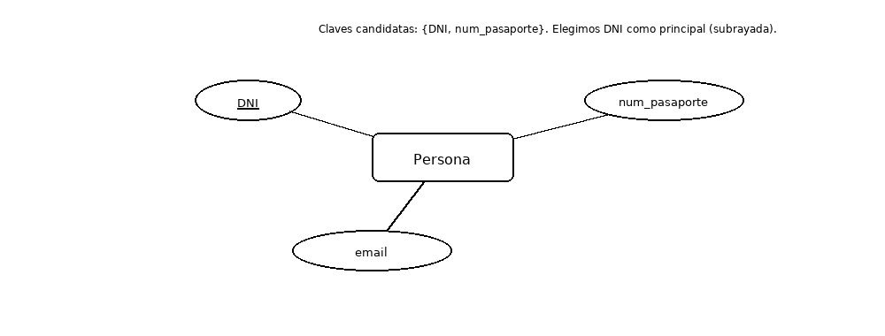
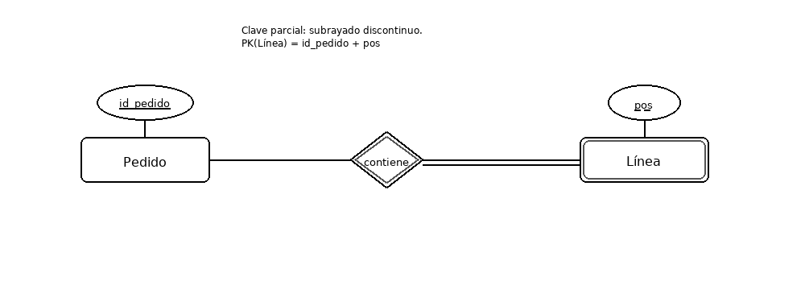
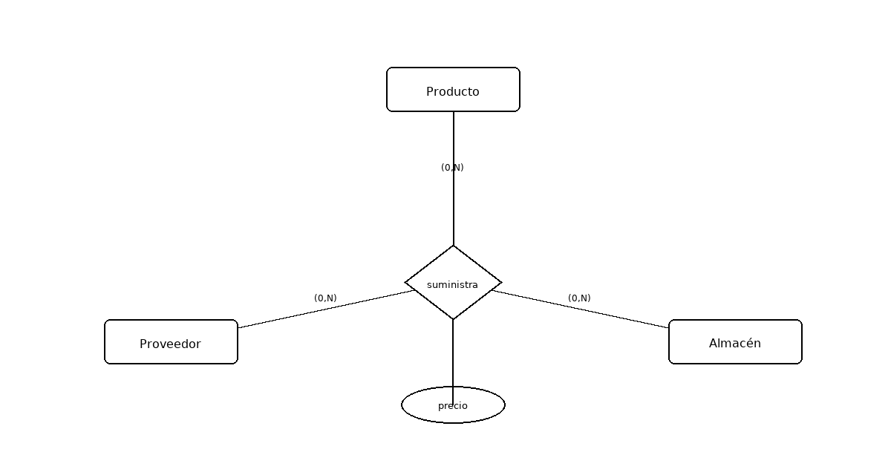
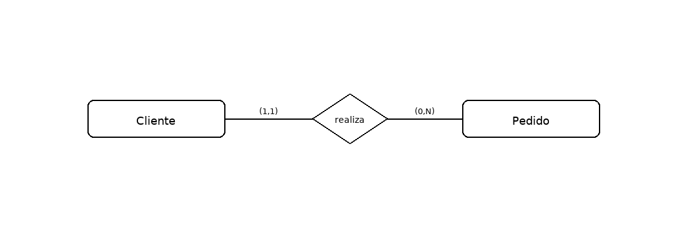
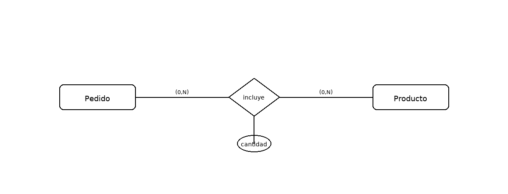
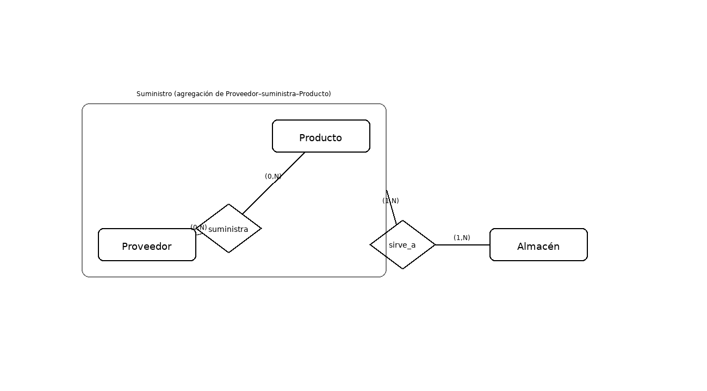

# Modelado Conceptual de Datos

En esta unidad aprendemos a describir el _dominio de información_ de un sistema utilizando diferentes enfoques de modelado conceptual: el **modelo Entidad–Relación (E/R)** orientado a bases de datos y el **diagrama de clases UML** orientado a programación. Ambos permiten especificar qué objetos existen, qué propiedades tienen y cómo se relacionan, estableciendo las bases del [diseño lógico](logico.html) y, más adelante, de la implementación en [SQL](sql.html).

**Estructura del tema.** Introducción general ⟶ PARTE I: E/R (Bases de Datos) ⟶ PARTE II: UML (Programación) ⟶ Equivalencias.

## 1) Introducción General

### 1.1 ¿Qué es el modelado conceptual?

El **modelado conceptual** es la representación abstracta y precisa del _dominio de información_ de un sistema, independientemente de cómo se vaya a implementar técnicamente. Su objetivo es _entender y acordar_ con las partes interesadas:

-   Qué **objetos o conceptos** existen en el sistema (Cliente, Pedido, Producto, Usuario...)
-   Qué **propiedades** tiene cada concepto (nombre, email, fecha, precio...)
-   Cómo se **relacionan** entre sí (un Cliente realiza Pedidos, un Pedido incluye Productos...)
-   Qué **reglas** deben cumplirse (todo Pedido debe tener Cliente, un Cliente puede no tener Pedidos...)

**Idea clave.** En el modelado conceptual hablamos de _cosas del mundo real_, no de tablas ni de código. Las decisiones de implementación vendrán después: aquí nos centramos en el _qué_ y el _por qué_, no en el _cómo_.

### 1.2 Dos enfoques complementarios

Existen diferentes notaciones para el modelado conceptual, cada una con su origen y ámbito de aplicación preferente. En este curso trabajaremos con las dos más importantes:

Enfoque

Notación

Origen

Ámbito principal

**Bases de Datos**

**Modelo Entidad–Relación (E/R)**  
Notación Chen y (min,max)

Peter Chen, 1976  
Diseño de bases de datos

Diseño conceptual de BD relacionales, análisis de requisitos de datos, documentación técnica de BD

**Programación**

**Diagrama de Clases UML**

UML (Unified Modeling Language)  
Ingeniería del software OO

Análisis y diseño orientado a objetos, arquitectura de software, desarrollo en lenguajes OO (Java, Python, C#...)

### 1.3 ¿Por qué estudiar ambas notaciones?

-   **Versatilidad profesional**: Diferentes equipos y proyectos prefieren diferentes notaciones. Dominar ambas te hace más empleable.
-   **Complementariedad**: E/R es más preciso para cardinalidades y restricciones de BD; UML es más natural cuando el sistema tiene implementación OO.
-   **Comunicación eficaz**: Podrás hablar el lenguaje de los diseñadores de BD (E/R) y de los programadores (UML).
-   **Integración de conocimientos**: El módulo de Bases de Datos y el de Programación comparten los mismos conceptos; aprenderás a conectarlos.

**Estructura de este tema.**

-   **PARTE I (E/R)**: Aprenderás el modelo Entidad-Relación con notación Chen y (min,max), enfocado al diseño de bases de datos relacionales.
-   **PARTE II (UML)**: Aprenderás el diagrama de clases UML, enfocado al análisis y diseño orientado a objetos.
-   **Tabla de equivalencias**: Al final verás cómo traducir entre ambas notaciones y hacia el modelo relacional (SQL).

### 1.4 Ruta completa del diseño de una BD

El diseño es _iterativo_: podemos volver atrás si descubrimos nuevos requisitos. Este es el camino recomendado, con entregables y relación con el resto de páginas del curso.

Fase

Objetivo

Entregables

**0) Idea y contexto**

Definir el problema, alcance y objetivos (qué se pretende resolver).

"Elevator pitch", lista de actores, supuestos y restricciones.

**1) Requisitos y vocabulario**

Recopilar términos del negocio y reglas clave.

Glosario, casos de uso, ejemplos de datos (pequeño set).

**2) Modelo conceptual (E/R)**

Identificar _entidades_, _atributos_ y _relaciones_ con **(min,max)** y participación.

Diagrama E/R, diccionario de datos, reglas de negocio.

**3) Revisión del E/R**

Validar con ejemplos/contraejemplos y detectar casos especiales.

Ajustes de cardinalidades, _entidades débiles_, _ISA_, _agregación_.

**4) Diseño lógico (relacional)**

Transformar el E/R a tablas: PK, UK, FK y tablas intermedias.

Notación de marco, esquema preliminar.

**5) Normalización**

Eliminar redundancias y anomalías (1FN, 2FN, 3FN/BCNF).

Esquema normalizado y justificación de (des)normalizaciones.

**6) Implementación (DDL)**

Crear BD/tablas, tipos y restricciones en el SGBD.

Scripts `CREATE DATABASE/TABLE`, índices y comentarios.

**7) Carga y manipulación (DML)**

Insertar datos, consultar, actualizar y borrar de forma segura.

Scripts `INSERT`/`SELECT`/`UPDATE`/`DELETE`, casos de prueba.

**8) Seguridad (DCL)**

Definir usuarios, roles y privilegios mínimos necesarios.

`GRANT/REVOKE`, vistas de seguridad, `SHOW GRANTS`.

**9) Transacciones (TCL)**

Garantizar atomicidad y consistencia bajo concurrencia.

`START TRANSACTION`, `COMMIT`, `ROLLBACK`, `SAVEPOINT`.

**10) Pruebas y rendimiento**

Verificar integridad y ajustar tiempos de respuesta.

Datos de prueba, `EXPLAIN`, plan de índices, checklist final.

### 1.5 Qué esperamos al terminar esta unidad

-   Un **diagrama E/R final** con _(min,max)_ y participación (total/parcial) en cada relación.
-   Un **diccionario** de entidades y atributos (nombre, significado, dominio y ejemplos).
-   Una **lista de restricciones** (dominio, entidad, referencia y semánticas) validada con el “cliente”.

## 2) ¿Por qué modelar? Objetivos y alcance

Modelar con **E/R** no es “dibujar por dibujar”: es _entender_ el dominio, acordar el significado de los datos y fijar reglas antes de pasar a tablas y SQL. Un buen modelo reduce la ambigüedad, evita decisiones improvisadas y sirve de contrato entre quienes conocen el negocio y quienes lo implementan.

### 2.1 Objetivos del modelado conceptual

-   **Comunicación**: crear un lenguaje común (glosario + diagrama) entendible por perfiles técnicos y no técnicos.
-   **Precisión**: explicitar _cardinalidades (min,max)_, _participación_, identificadores y reglas de negocio.
-   **Calidad de datos**: detectar redundancias y dependencias antes de que existan tablas o datos productivos.
-   **Trazabilidad**: justificar por qué luego habrá ciertas PK/FK, tablas intermedias o jerarquías en el diseño lógico.
-   **Independencia**: separar el _qué_ y el _por qué_ (conceptual) del _cómo_ (relacional/SQL/SGBD).

**Lo que _no_ es el E/R:** no define pantallas, ni consultas concretas, ni el almacenamiento físico. Tampoco es un diagrama de procesos. Es un _modelo de información_.

### 2.2 ¿Qué pasa si no modelamos?

Fallo típico

Consecuencia

Cómo lo evita el E/R

Omitir mínimos (participación)

FKs opcionales donde deberían ser obligatorias (datos huérfanos)

(min,max) obliga a decidir si es _total_ u _opcional_

Confundir N:M con dos 1:N

Pérdida de atributos de la relación, duplicidades

Relación N:M con tabla intermedia planificada desde el modelo

Meter listas en un atributo

Imposible consultar/validar por elemento

Detecta multivalorados → entidad/relación específica

Elegir mal el identificador

Duplicados, dificultades para referenciar

Lista de identificadores candidatos y criterio de estabilidad

### 2.3 Criterios de “hecho” (Definition of Done) para el E/R

-   Todas las **entidades** tienen un **identificador** claro (natural o surrogate justificado).
-   Cada **relación** tiene pares **(min,max)** y **participación** documentados en ambos extremos.
-   Los **atributos multivalorados/compuestos** se han tratado adecuadamente (no como listas en una sola celda).
-   Se han identificado **entidades débiles**, posibles **ISA** y casos de **agregación**.
-   Existe un **glosario** con nombres definidos y ejemplos de valores.
-   El modelo ha sido **validado** con 3–5 escenarios de negocio (incluye contraejemplos).

## PARTE I

### Enfoque de Bases de Datos: Modelo Entidad-Relación (Chen)

En esta parte aprenderás el **modelo Entidad-Relación (E/R)** con **notación Chen** y la variante **(min,max)**, que es la notación tradicional y más utilizada en el diseño conceptual de bases de datos relacionales. Se centra en especificar con precisión las entidades, atributos, relaciones, cardinalidades y restricciones que luego se traducirán a tablas SQL.

## 3) Modelo Entidad-Relación (Chen)

### 3.1 Notación Chen y (min,max)

El **modelo Entidad-Relación (E/R)** fue propuesto por Peter Chen en 1976 como herramienta para el diseño conceptual de bases de datos. La **notación Chen** utiliza figuras geométricas específicas para cada elemento:

-   **Rectángulos** para entidades (conceptos del dominio)
-   **Óvalos** para atributos (propiedades de las entidades)
-   **Rombos** para relaciones (asociaciones entre entidades)
-   **Líneas** para conectar los elementos
-   **Pares (min,max)** en cada extremo de las relaciones para especificar cardinalidades

En este curso utilizaremos la variante **(min,max)** porque nos obliga a decidir explícitamente tanto los _mínimos_ (participación total o parcial) como los _máximos_ (cardinalidad) en cada extremo de una relación. Esta notación es más precisa y menos ambigua que otras variantes del modelo E/R.

#### Ejemplo de notación Chen con (min,max)

A continuación ves un ejemplo —_Cliente realiza Pedido_— en notación Chen. La semántica es: cada **Pedido** pertenece a **exactamente un** Cliente (participación _total_ con cardinalidad (1,1)), y un **Cliente** puede tener **cero o muchos** Pedidos (participación _parcial_ con cardinalidad (0,N)).

Notación Chen: Cliente — realiza — Pedido Relación 1:N con participación total en Pedido (doble línea). Cliente a la izquierda, Pedido a la derecha, rombo "realiza" en el centro. Cliente Pedido realiza (0,N) (1,1)

Chen — participación total en _Pedido_ y (0,N) en _Cliente_.

Notación crow’s foot: Cliente — Pedido A la izquierda Cliente (0..N): círculo + pata de cuervo. A la derecha Pedido (1): barra. Línea central “realiza”. Cliente Pedido realiza

Crow’s foot — `0..N` en Cliente, `1` (obligatorio) en Pedido.

Notación min–max: Cliente — Pedido Segmento con etiquetas (0,N) junto a Cliente y (1,1) junto a Pedido. Cliente Pedido (0,N) (1,1) realiza

Min–max — etiquetas explícitas en cada extremo.

## 4) Componentes del E/R

### 4.1 Entidades

Una **entidad** es un conjunto de objetos distinguibles del mundo real (Alumno, Asignatura, Pedido…). Modelar bien una entidad implica _delimitar su significado_, elegir un **identificador** estable y decidir qué propiedades (atributos) le pertenecen realmente (y cuáles deben convertirse en entidades/relaciones aparte).

#### 4.1.1 ¿Cuándo algo es una entidad?

-   **Nombre propio y estable:** podemos hablar de “un X” individual (p. ej., “un Pedido”).
-   **Identificable:** existe al menos un _candidato a identificador_ (natural o surrogate).
-   **Propiedades propias:** tiene atributos que no dependen de otra entidad “dueña”.
-   **Relaciones naturales:** se asocia con otras entidades con reglas claras (cardinalidades, participación).

#### 4.1.2 Identificadores (claves) y candidatos

Un **identificador** distingue de forma única cada instancia (p. ej., `ISBN` en Libro). Puede ser _natural_ (significativo en el negocio) o _surrogate_ (artificial, p. ej. `id`). Si hay varios, hablamos de _claves candidatas_; elegimos una como _principal_ y el resto quedan como _alternativas_.

**Criterio práctico:** usa clave natural si es _estable_ y sin ambigüedad; en caso contrario, crea un surrogate y mantén la natural como `UNIQUE` (para detectar duplicados).

#### 4.1.3 Entidad fuerte vs. entidad débil

-   **Fuerte:** se identifica por sí misma (p. ej., _Libro_ por `ISBN`).
-   **Débil:** no tiene identificador propio y se identifica por una _relación identificadora_ con una entidad fuerte + una _clave parcial_ (p. ej., _Línea_ de pedido por `id_pedido` + `pos`). La participación de la débil en esa relación es **total** (mínimo=1).


**Entidad fuerte:** _Libro_ se identifica por `ISBN` (clave subrayada).


**Entidad débil:** _Línea_ se identifica con `id_pedido` (desde _Pedido_) + clave parcial `pos`. Relación _contiene_ es _identificadora_ (doble rombo) y la participación de _Línea_ es **total**.

### 4.2 Atributos

Los **atributos** describen propiedades de las entidades. En notación Chen se representan como _óvalos_ conectados a la entidad. Es crucial elegir bien qué es atributo y qué debe modelarse como _entidad/relación_ (por ejemplo, una “lista de teléfonos” no es un texto con comas, sino un conjunto de ocurrencias → atributo multivalorado).

#### 4.2.1 Tipos principales

-   **Simples**: no se descomponen (p. ej., _nombre_).
-   **Compuestos**: se descomponen en subatributos (p. ej., _dirección_ → calle, número, CP).
-   **Monovalorados**: una sola ocurrencia por entidad (p. ej., _email_).
-   **Multivalorados**: varias ocurrencias (p. ej., _teléfono_); en Chen se dibujan con _doble óvalo_.
-   **Derivados**: calculados a partir de otros (p. ej., _edad_ desde _fecha\_nacimiento_); se dibujan con _óvalo discontinuo_.

**Convenciones visuales:** clave _subrayada_ (subrayado justo bajo la línea base del texto); _clave parcial_ con subrayado _discontinuo_; multivalorado con _doble óvalo_; derivado con _contorno discontinuo_.

#### 4.2.2 Simples y compuestos

Un atributo es **compuesto** si sus partes tienen significado propio y pueden usarse de forma independiente en reglas o consultas (buscar por _CP_, ordenar por _calle_…). En el ejemplo, _dirección_ se descompone en _calle_, _número_ y _CP_. La clave del ejemplo es _dni_ (subrayada).


Simples vs. compuestos: el subrayado de _dni_ marca la **clave**; _dirección_ se descompone en subatributos.

#### 4.2.3 Monovalorados y multivalorados

Usa **multivalorado** cuando exista un conjunto de valores (varios _teléfonos_ por cliente). En notación Chen lo representamos con _doble óvalo_. Si _email_ es único por cliente, será **monovalorado** (óvalo simple).


Multivalorado: _teléfono_ (doble óvalo) frente a monovalorado: _email_ (óvalo simple).

#### 4.2.4 Derivados

Un atributo es **derivado** si puede calcularse a partir de otros (p. ej., _edad_ desde _fecha\_nacimiento_ y la fecha actual). Ventajas: evita inconsistencias; Inconveniente: cálculos en consulta. Recomendación: _no almacenar_ el derivado salvo justificación de rendimiento.


Derivado: _edad_ con contorno discontinuo. Se sugiere su relación con _fecha\_nacimiento_.

#### 4.2.5 Decidir: ¿atributo o entidad?

-   **Es atributo** si no necesitas identificarlo por separado ni referenciarlo desde otros conceptos (p. ej., _nombre_ de cliente).
-   **Es entidad** si tiene vida propia, múltiples propiedades o relaciones (p. ej., un _Teléfono_ con tipo, extensión, validaciones, histórico).
-   **Regla de la lista:** si esperas “varios valores” (lista), piensa en _multivalorado_ o en una entidad/relación específica.

### 4.3 Identificadores (claves)

Un **identificador** distingue de forma _única_ a cada instancia de una entidad. Puede ser: _natural_ (tiene significado de negocio, p. ej., `ISBN`), _surrogate_ (artificial, p. ej., `id`), _compuesto_ (varios atributos juntos) o _parcial_ (en entidades débiles, combinado con la clave de la fuerte). Si existen varios candidatos posibles, hablamos de **claves candidatas**; se elige una como **principal** y el resto quedan como _alternativas_ (normalmente con restricción `UNIQUE` al implementar).

**Convenciones visuales (Chen):** clave _subrayada_ (subrayado justo bajo el texto); _clave parcial_ con subrayado _discontinuo_.

#### 4.3.1 Clave natural vs. clave surrogate (ampliación)

Una **clave natural** es un identificador con _significado de negocio_ que ya distingue a una instancia fuera del sistema (p. ej., `ISBN` de un libro, `DNI` de una persona). Una **clave surrogate** (también llamada _artificial_ o _sustituta_) la _crea el sistema_ solo para identificar filas (p. ej., `id_libro` `INT AUTO_INCREMENT` o un `UUID`); no tiene significado en el dominio.

**Idea clave.** La surrogate _no sustituye_ a las reglas de negocio: si existe un identificador natural relevante, **protégelo con `UNIQUE`** aunque la PK sea surrogate.

##### ¿Cuándo elegir cada una?

Situación

Mejor opción

Motivo

El identificador natural es _estable, corto y único_ (p. ej., ISBN real)

Natural como PK

Evita columnas extra y mantiene trazabilidad semántica directa

La “natural” puede _cambiar_ (email, username) o es _larga/compuesta_

Surrogate como PK + `UNIQUE` en la natural

FKs más cortas y estables; evita cascadas por cambios de negocio

Muchas FKs hacia la entidad; índices secundarios grandes

Surrogate como PK

En InnoDB la PK va en todos los índices secundarios; una PK corta reduce tamaño

Auditoría/legibilidad humana prioritarias

Natural como PK _o_ Surrogate + natural con `UNIQUE`

Depende del compromiso entre semántica y rendimiento

##### Ventajas y cautelas

-   **Surrogate (PK artificial)**: PK/FK _cortas y estables_, joins más ligeros, evita exponer datos sensibles como PK. _Cuidado:_ sin un `UNIQUE` en la natural, puedes introducir **duplicados de negocio**.
-   **Natural**: la PK _explica_ el negocio y facilita trazabilidad. _Cuidado:_ si cambia o es compuesta/larga, las FKs e índices se vuelven más pesados y frágiles.

**Error frecuente.** Usar surrogate y olvidar la restricción `UNIQUE` sobre la clave de negocio: terminarás con “el mismo libro” repetido con distintos `id`.

##### Checklist de decisión (rápida)

-   ¿La natural es **inmutable** y **corta** (≤ 16 bytes aprox.)? → Puedes usarla como PK.
-   ¿Podría **cambiar**, es **larga** o **compuesta**? → Surrogate como PK + `UNIQUE` en la natural.
-   ¿Habrá muchas FKs/índices hacia esta tabla? → Surrogate (reduce tamaño y coste de joins).
-   ¿Necesitas trazabilidad humana directa? → Natural como PK, o surrogate + columna natural visible y `UNIQUE`.

#### 4.3.2 Claves candidatas y clave principal

Si hay varias formas de identificar una entidad, tenemos **candidatos**. Seleccionamos una **principal** (subrayada) y dejamos las otras como _alternativas_ (no subrayadas en E/R, pero con `UNIQUE` al implementar).



Candidatas: `DNI` y `num_pasaporte`. Elegimos **DNI** como principal (subrayada).

#### 4.3.3 Clave parcial (entidad débil)

Una **entidad débil** se identifica con la _clave de la fuerte_ + una **clave parcial** propia. En E/R la _clave parcial_ se indica con **subrayado discontinuo**; la relación identificadora se dibuja con _doble rombo_ y la participación de la débil suele ser **total** (doble línea).



_PK(Línea)_ = `id_pedido` + `pos`; `pos` es **clave parcial** (subrayado discontinuo).

#### 4.3.4 Criterios de elección (prácticos)

-   **Estabilidad:** evita como PK lo que cambie (email, teléfono…).
-   **Longitud:** PK cortas mejoran índices y FKs; si la natural es larga, valora surrogate.
-   **Semántica:** la natural facilita auditoría y reporting; conserva como `UNIQUE` si usas surrogate.
-   **Rendimiento:** FKs compuestas complican joins; en esos casos, surrogate en la entidad de referencia ayuda.

### 4.4 Relaciones y grado

Una **relación** asocia entidades y puede tener _grado_ binario (dos entidades), ternario o n-ario. En este curso utilizamos notación **(min,max)** en cada extremo para expresar tanto la _participación_ (mínimo = 0 parcial, 1 total) como la _cardinalidad máxima_ (1, N). Una relación puede además tener **atributos** propios (p. ej., “precio” en “suministra”) y **roles** cuando una entidad se relaciona consigo misma.

**Lectura correcta.** El par `(min,max)` se lee desde la entidad de ese extremo hacia la relación. Por ejemplo, `(0,N)` en _Cliente_ indica que un cliente puede estar en 0 a N pedidos.

#### 4.4.1 Relación binaria

Es la más común. En el ejemplo, un _Cliente_ **realiza** _Pedido_: el cliente participa en 0..N pedidos y cada pedido pertenece _exactamente_ a 1 cliente.


Binaria con `(min,max)`: _Cliente_ (0,N) — _realiza_ — _Pedido_ (1,1).

#### 4.4.2 Relación ternaria (y por qué no son tres binarias)

Una relación **ternaria** captura reglas que dependen _conjuntamente_ de tres entidades. No es equivalente a “tres binarias”, porque se perdería la restricción conjunta. En “_Proveedor suministra Producto a Almacén_”, el _precio_ puede depender de la triple combinación (proveedor, producto, almacén).



Ternaria con atributo de relación _precio_. Las cardinalidades se expresan en cada extremo con `(min,max)`.

#### 4.4.3 Relación reflexiva (roles)

Una relación **reflexiva** conecta una entidad consigo misma y requiere **roles** para evitar ambigüedad. En el ejemplo, _Empleado_ **supervisa** a _Empleado_: un empleado puede tener `(0,1)` _supervisor_ y `(0,N)` _subordinados_.


Reflexiva con **roles**: cada _Empleado_ puede tener de 0 a 1 _supervisor_ y de 0 a N _subordinados_.

#### 4.4.4 Consejos de modelado

-   **Primero los mínimos:** Decide si la participación es obligatoria (`min=1`) u opcional (`min=0`) y luego la máxima.
-   **¿Atributo o entidad?** Si el atributo “vive” en la relación (precio depende de las tres patas), déjalo en la relación.
-   **Ternaria de verdad:** Si al descomponer en binarias se pierden reglas (unicidad/conjuntos), debes mantenerla ternaria.
-   **Roles claros:** En reflexivas, nombra los roles (mentor/mentorizado, supervisor/subordinado…); evita ambigüedad.

### 4.5 Cardinalidad (min,max) y participación

La **cardinalidad** expresa, en cada extremo de una relación, cuántas veces puede (o debe) aparecer una instancia de esa entidad en la relación: `(min,max)`. En binaria se interpreta como: “cada instancia de A se relaciona con entre _min_ y _max_ instancias de B”, y viceversa. El valor `min` marca la _participación_: 0 ⇒ **parcial** (opcional); 1 ⇒ **total** (obligatoria).

**Lectura precisa.** El par `(min,max)` se sitúa _encima de la línea y junto al extremo_ al que pertenece. Así evitamos ambigüedades.

#### 4.5.1 Relación 1:1

Ambas entidades se emparejan a lo sumo con una instancia de la otra. Suele aparecer cuando hay una descomposición de una misma cosa en dos perspectivas (p. ej., _Persona_ y su _DNI_).


**1:1**: _Persona_ (1,1) —tiene— _DNI_ (1,1). Participación total en ambos lados.

#### 4.5.2 Relación 1:N (participación opcional)

Un _Cliente_ puede realizar **0…N** _Pedidos_ (participación _parcial_ en Cliente); cada _Pedido_ pertenece a **exactamente 1** _Cliente_ (participación _total_).



**1:N (opcional)**: _Cliente_ (0,N) —realiza— _Pedido_ (1,1).

#### 4.5.3 Relación 1:N (participación total)

Cada _Empleado_ pertenece a **exactamente 1** _Departamento_; un _Departamento_ tiene **1…N** empleados. Es 1:N pero con participación _total_ en ambos extremos.


**1:N (total)**: _Departamento_ (1,N) —tiene— _Empleado_ (1,1).

#### 4.5.4 Relación N:M (muchos a muchos)

Muchas instancias de una entidad se asocian con muchas de la otra. Suele requerir **atributos en la relación** (p. ej., _cantidad_ en “_Pedido incluye Producto_”). En el paso lógico-relacional, se transforma en una _tabla intermedia_.



**N:M**: _Pedido_ (0,N) —incluye— _Producto_ (0,N). La relación incorpora el atributo _cantidad_.

#### 4.5.5 Consejos de modelado

-   **Primero los mínimos:** decide si la participación es obligatoria (1) u opcional (0); luego fija el máximo (1 o N).
-   **Cuidado con “ocultar” los mínimos:** escribir solo “1:N / N:M” oculta si hay obligatoriedad. Eso cambia la implementación.
-   **Si hay dudas, prototipa reglas con ejemplos:** “¿Puede existir un pedido sin cliente?”, “¿Puede un cliente existir sin pedidos?”.

**Ojo con las etiquetas.** Coloca `(min,max)` _encima de la línea y junto al extremo correcto_. No mezcles los extremos: cambiar el lado puede alterar la interpretación del modelo.

### 4.6 Jerarquías ISA (generalización / especialización)

Una jerarquía **ISA** describe cómo una _superentidad_ (también llamada tipo padre) se especializa en uno o varios _subtipos_ que heredan su significado, su identificador y sus restricciones, y además pueden añadir atributos y reglas propias. Antes de pensar en tablas, aquí acordamos con el “negocio” cómo se clasifica el mundo: qué es común a todas las instancias (superentidad) y qué varía entre categorías (subtipos). Ese acuerdo es clave, porque condicionará el diseño lógico-relacional posterior: una decisión equivocada aquí se transforma en tablas redundantes o restricciones imposibles de imponer abajo.

**Idea didáctica.** Piensa ISA como “_es un_”: si “Alumno _es una_ Persona”, entonces _Alumno_ hereda la clave y atributos de _Persona_ y añade los suyos (p. ej., `nº_matrícula`).

Al definir una ISA debemos fijar dos decisiones independientes. La primera es si la especialización es **disyunta** (excluyente) o **solapada** (superpuesta). La segunda es si la participación de la superentidad en la especialización es **total** u **parcial**. Disyunta/solapada responde a la pregunta: “¿Puede una misma instancia pertenecer a varios subtipos a la vez?”; total/parcial responde a: “¿Toda instancia del supertipo debe pertenecer a algún subtipo?”. En las figuras usaremos un pequeño triángulo “ISA” como nodo de especialización; marcaremos **\[D\]** si es disyunta o **\[O\]** si es solapada y representaremos la participación _total_ con **doble línea** desde la superentidad al triángulo (y _parcial_ con línea simple).

#### 4.6.1 Disyunta & Total

La combinación **disyunta y total** obliga a que _toda_ instancia de la superentidad se clasifique en _exactamente un_ subtipo: no hay superinstancias “sin subtipo” ni superinstancias “en dos subtipos”. Es una decisión fuerte y muy útil cuando el dominio define categorías mutuamente excluyentes y completas. Por ejemplo, si en la empresa toda persona contratada es un _Técnico_ o un _Administrativo_ y no existe ningún otro perfil, el modelo debe reflejar esa cobertura total y exclusión. En la figura, la doble línea desde _Empleado_ al triángulo “ISA” obliga a la pertenencia a algún subtipo, y la marca **\[D\]** recuerda la disyunción.

![ISA disyunta y total: Empleado → Técnico | Administrativo. Doble línea al ISA, \[D\] disyunta.](img/isa_disyunta_total.png)

**Disyunta & total**: toda _Empleado_ es _Técnico_ **o** _Administrativo_, nunca ambos. La doble línea exige pertenencia a algún subtipo; **\[D\]** indica exclusión entre subtipos.

#### 4.6.2 Disyunta & Parcial

En la combinación **disyunta y parcial**, una instancia de la superentidad puede pertenecer como mucho a _un_ subtipo, pero _también puede no pertenecer a ninguno_. Es apropiada cuando tenemos algunas subcategorías excluyentes (p. ej., _Coche_ y _Moto_) pero existen instancias del supertipo que quedan fuera de esa clasificación (p. ej., _Camión_, _Autobús_). Es mejor declarar la parcialidad que forzar a meter “con calzador” objetos en subtipos en los que no encajan: ese error se paga luego con valores nulos sin sentido o reglas difíciles de mantener. En la figura, la línea simple desde _Vehículo_ al ISA permite que haya vehículos sin subtipo; **\[D\]** mantiene la exclusión entre _Coche_ y _Moto_.

![ISA disyunta y parcial: Vehículo → Coche | Moto. Línea simple al ISA, \[D\] disyunta.](img/isa_disyunta_parcial.png)

**Disyunta & parcial**: un _Vehículo_ puede ser _Coche_ **o** _Moto_, o ninguno. Línea simple = hay superinstancias sin subtipo; **\[D\]** = subtipos excluyentes.

#### 4.6.3 Solapada & Total

La combinación **solapada y total** obliga a que _toda_ instancia del supertipo pertenezca a _al menos un_ subtipo, pero permite la pertenencia simultánea a varios. Es la situación típica cuando las categorías representan _roles_ que pueden coexistir. Por ejemplo, toda _Persona_ en una universidad puede ser _Alumno_ o _Empleado_ y, en ocasiones, ambos (un estudiante con una beca laboral). La doble línea impide personas “sin rol” y la marca **\[O\]** (overlap) recuerda que no hay exclusión: la implementación posterior deberá permitir múltiples pertenencias, normalmente con tablas que registren esos roles.

![ISA solapada y total: Persona → Alumno | Empleado. Doble línea al ISA, \[O\] solapada.](img/isa_solapada_total.png)

**Solapada & total**: toda _Persona_ tiene al menos un rol (_Alumno_, _Empleado_) y puede tener ambos. Doble línea = nadie queda fuera; **\[O\]** = se permite solape.

#### 4.6.4 Solapada & Parcial

Por último, **solapada y parcial** permite instancias del supertipo sin subtipo y, si lo tienen, pueden pertenecer a varios a la vez. Es útil cuando los subtipos representan _propiedades opcionales_ que pueden coexistir. Imagina _Producto_ con subtipos _Perecedero_ y _Refrigerado_: hay productos que no son ni perecederos ni requieren frío; otros son solo perecederos; otros solo refrigerados; y algunos son ambas cosas. La línea simple permite productos “sin categoría” y **\[O\]** permite el solapamiento natural entre condiciones.

![ISA solapada y parcial: Producto → Perecedero | Refrigerado. Línea simple al ISA, \[O\] solapada.](img/isa_solapada_parcial.png)

**Solapada & parcial**: un _Producto_ puede no estar en ningún subtipo, o estar en uno o en ambos. Línea simple = parcial; **\[O\]** = subtipos no excluyentes.

**Errores típicos.** (1) Forzar disyunción cuando en realidad los roles se solapan, lo que acaba en duplicidades o datos inconsistentes; (2) Declarar total cuando existen casos fuera de los subtipos, lo que luego “obliga” a inventar categorías artificiales; (3) Crear subtipos que no aportan atributos ni reglas: si el subtipo no añade nada, quizá no es un subtipo, sino un valor de un atributo del supertipo (p. ej., un `tipo`).

#### Cómo decidir correctamente (y pensar en la implementación)

Te propongo un guion de entrevista con el “cliente” que funciona muy bien: primero, pregunta si _pueden coexistir roles_ (“¿puede una persona ser alumno y empleado a la vez?”). Si la respuesta es sí, la especialización debe ser **solapada**; si no, **disyunta**. Después, pregunta si _todas_ las instancias deben caer en algún subtipo (“¿toda persona en el sistema debe ser, al menos, alumno o empleado?”). Si la respuesta es sí, marca la especialización como **total** (doble línea); si no, **parcial**. Al pasar al modelo relacional, las disyuntas se pueden materializar con una única referencia o un atributo `tipo` (si son pocas y estables); las solapadas suelen necesitar _tablas puente_ que permitan múltiples pertenencias. Las totales se traducen en _restricciones_ que impiden superinstancias “huérfanas”; las parciales permiten que existan.

Como regla de oro, modela solo subtipos que aporten _información o reglas diferenciadas_ (atributos adicionales, validaciones distintas, comportamientos específicos). Si un subtipo no añade nada, evita la complejidad: usa un atributo enumerado en la superentidad o, directamente, no especialices. Este criterio mantiene el modelo claro y la base de datos más sencilla de implementar y mantener.

### 4.7 Agregación / Composición

En algunos dominios hay relaciones que no son “un detalle más”, sino auténticos _hechos complejos_ que conviene tratar como una unidad. La **agregación** nos permite “elevar” una _relación_ (con sus entidades participantes) a un _concepto compuesto_, de forma que podamos relacionarlo a su vez con otras entidades. Es como si agrupáramos “el hecho” completo y lo conectáramos con otras partes del modelo. En términos didácticos: primero definimos una relación normal (con sus cardinalidades y, si procede, atributos); después _la encerramos_ en una caja con nombre (la agregación) y conectamos esa caja con lo que tenga sentido. Este recurso evita multiplicar relaciones binarias con reglas redundantes y hace explícito “qué estamos relacionando exactamente”: no _Proveedor_ o _Producto_ por separado, sino el **Suministro** (Proveedor–Producto) como hecho único.

La **composición** (en E/R clásico se modela mediante _entidad débil_ e _identificación_) captura el patrón “_todo–parte_ con _dependencia de existencia_”: la parte _no puede existir sin_ el todo, y su identificador incluye la clave del todo. Pedagógicamente, es el mismo mensaje que en diseño orientado a objetos: si desaparece el “todo”, sus “partes” dejan de tener sentido. En E/R reconocerás la composición cuando veas una **entidad débil** (rectángulo doble), una **relación identificadora** (rombo doble) y participación **total** de la débil en esa relación (doble línea): ahí queda claro que la parte depende del todo y que su identidad “se apoya” en la del todo.

#### Agregación: convertir un hecho en un concepto compuesto

Imagina que ya tenemos _Proveedor_ —**suministra**— _Producto_, con cardinalidades habituales `(0,N)` en ambos extremos (un proveedor puede suministrar 0..N productos y un producto puede tener 0..N proveedores). Si ahora queremos expresar “este _suministro concreto_ sirve a un _Almacén_”, no es correcto unir _Proveedor_ con _Almacén_ y _Producto_ por separado: perderíamos el hecho compuesto “proveedor+producto”. La agregación nos deja envolver el triángulo _Proveedor–suministra–Producto_ dentro de una caja llamada **Suministro** y relacionar esa _unidad_ con _Almacén_. Así dejamos claro que estamos hablando de “ese proveedor suministrando ese producto” y no de las entidades de forma aislada.



**Agregación**: el hecho _Suministro_ (agregación de _Proveedor—suministra—Producto_) se relaciona con _Almacén_ mediante _sirve\_a_. Las cardinalidades se leen sobre cada línea: en el ejemplo, un _Suministro_ puede _servir a_ 1..N _Almacenes_ y un _Almacén_ puede recibir 1..N _Suministros_. Este patrón evita mezclar entidades por separado y deja explícito qué combinación concreta estamos conectando.

**Cuándo usar agregación.** Cuando una relación con sus participantes es el “objeto” de otra regla: calendario de entregas de un pedido, programación de turnos de una asignación (Profesor–imparte–Grupo), o restricciones que afectan al conjunto (p. ej., cupos o tarifas específicas del emparejamiento).

#### Composición (todo–parte con dependencia)

En comercio electrónico, un _Pedido_ se forma por varias _Líneas_. Una _Línea_ no tiene sentido fuera del _Pedido_ al que pertenece, y su identidad se define por la clave del pedido más una clave parcial (por ejemplo, `nº_línea`). En E/R esto se plasma como **entidad débil** _Línea_ (doble rectángulo) unida a _Pedido_ por una **relación identificadora** _contiene_ (rombo doble), con participación **total** de la débil (doble línea). Las cardinalidades típicas son `(1,N)` en _Pedido_ (un pedido tiene 1..N líneas) y `(1,1)` en _Línea_ (cada línea pertenece a exactamente un pedido). Este patrón comunica —sin ambigüedad— existencia dependiente y clave compuesta.


**Composición (existencia dependiente)**: _Pedido_ —(1,N)— _contiene_ —(1,1)— _Línea_. La _Línea_ es **débil** (doble rectángulo), la relación es **identificadora** (doble rombo), y la participación de la débil es **total** (doble línea). Al pasar al modelo relacional, la clave de _Línea_ incluirá la clave de _Pedido_ más una clave parcial.

#### Elección correcta en el diseño

Una regla de oro útil es preguntarse: “¿Estoy tratando de relacionar _la combinación_ de varias entidades con otra cosa?” Si la respuesta es sí, probablemente necesitas **agregación**. En cambio, si la relación representa un vínculo estructural “todo–parte” y la parte no tiene sentido por sí misma, opta por la **composición** (entidad débil + relación identificadora + participación total). Esta distinción no es cosmética: marca cómo se transformará el modelo a relaciones (tablas intermedias o claves compuestas) y qué restricciones de integridad podrás imponer sin acrobacias en SQL.

**Errores frecuentes.** (1) Conectar por separado entidades que deberían viajar juntas (olvidando la agregación), lo que produce reglas incongruentes; (2) Modelar como entidad fuerte algo que en realidad es una parte dependiente, perdiendo la garantía de integridad que aporta la composición; (3) Esconder cardinalidades mínimas (0/1) y luego descubrir que el diseño lógico no puede hacer cumplir la obligatoriedad que el negocio sí exige.

### 4.8 Restricciones de integridad

Las **restricciones de integridad** son las reglas que mantienen “coherente” el significado de los datos a lo largo del tiempo. En el _modelo conceptual (E/R)_ las expresamos con nombres, cardinalidades `(min,max)`, identificadores, tipos de atributos y notas semánticas; más adelante, en el _modelo lógico_ y en SQL, se traducirán a `PRIMARY KEY`, `FOREIGN KEY`, `NOT NULL`, `UNIQUE`, `CHECK`, disparadores, etc. El enfoque correcto es siempre “de arriba a abajo”: primero acordamos la regla con el cliente (en el E/R), después la _implementamos_ en el SGBD. Si una regla no está clara arriba, será frágil abajo.

**Esquema mental.** Piensa en cuatro familias: _dominio_ (de qué tipo es cada dato), _entidad_ (identidad y unicidad), _referencia_ (existencias relacionadas) y _semánticas_ (reglas del negocio que van más allá de las tres anteriores).

#### 4.8.1 Restricciones de dominio

Un **dominio** especifica el _tipo_ y el _rango_ de valores que admite un atributo, así como su _formato_ y si admite _null_. Modelar bien los dominios en el E/R (con nombres y descripciones claras) evita datos imposibles: fechas futuras para nacimientos, códigos mal formados, números negativos en cantidades, etc. Ejemplos típicos: _precio_ → “número real ≥ 0 con dos decimales”; _DNI_ → “cadena de 9 caracteres con patrón”; _email_ → “cadena <= 254 chars con ‘@’ y dominio válido”; _edad_ derivada de _fecha\_nacimiento_ (no se almacena).

Atributo

Dominio

¿NULL?

Observaciones

precio

real ≥ 0 (2 decimales)

no

Si es 0, indica artículo gratuito o promoción

dni

patrón `^[0-9]{8}[A-Z]$`

no

Único por Persona (ver 4.8.2)

email

cadena válida

sí

Opcional; si existe, formato obligado

edad

derivado

—

Se calcula desde _fecha\_nacimiento_, no se guarda

#### 4.8.2 Restricciones de entidad (identidad y unicidad)

Garantizan que cada instancia de una entidad esté **bien identificada** y no existan duplicados. En E/R esto se refleja al elegir el _identificador_ (clave) de la entidad; puede ser natural (`DNI`, `ISBN`) o artificial (`id` autogenerado). Si hay varias posibilidades hablamos de _claves candidatas_; elegimos una como _principal_ y el resto suelen imponerse como _únicas_. Ejemplos: en _Libro_, `ISBN` identifica de forma natural; en _Cliente_, si el `DNI` no es fiable (clientes extranjeros sin DNI, etc.), se recurre a un `id` y se fuerza `DNI UNIQUE` cuando exista.

**Decisión práctica.** Usa clave natural si es estable y universal. Si no, usa clave surrogate (`id`) y protege la natural con _unicidad_ y _formato_ (dominio).

#### 4.8.3 Restricciones de referencia (existencia y correspondencia)

Aseguran que una relación solo existe si existen las instancias relacionadas, y que se respeta la _participación_ acordada. En E/R lo expresamos con los pares `(min,max)` en cada extremo: el _mínimo_ determina si la participación es **total** (1) u **parcial** (0). Ejemplo: _Cliente_ —realiza— _Pedido_ con `Cliente (0,N)` y `Pedido (1,1)`: un pedido _siempre_ pertenece a un cliente (participación total en Pedido), pero un cliente puede no tener pedidos (parcial en Cliente). En el modelo lógico esto se traduce en una _clave ajena_ en _Pedido_ y en reglas que impiden eliminar un _Cliente_ con pedidos si así se establece (política de borrado).

#### 4.8.4 Restricciones semánticas (reglas del negocio)

Son reglas específicas del dominio que no se deducen automáticamente de dominios, claves o `(min,max)`, pero que deben cumplirse para que el dato “tenga sentido”. Ejemplos: “un pedido **cancelado** no puede tener líneas”, “el _importe\_total_ debe ser la suma de sus líneas”, “un _Profesor_ no puede superar 20 h lectivas por semana”, “no se puede asignar un _Alumno_ a dos exámenes que se solapan en horario”. En el E/R las recogemos como _notas_ o _anotaciones_ junto a la relación o entidad afectada; más tarde, en SQL, pueden materializarse con `CHECK`, vistas materializadas de validación, o disparadores.

#### 4.8.5 Nulos, derivados y estados del ciclo de vida

Decidir si un atributo **admite NULL** es una decisión de integridad: un NULL permisivo se convierte en “agujero” que la aplicación debe interpretar (¿desconocido?, ¿no aplicable?). Como regla, los atributos que intervienen en la _identidad_ o en la _lógica de negocio_ suelen ser **NOT NULL**. Los _atributos derivados_ (p. ej., _edad_ desde _fecha\_nacimiento_) no se almacenan: se recalculan. Además, muchas reglas dependen del **estado** de una entidad (borrador, confirmado, cancelado). En el E/R conviene anotar las reglas por estado: “si _estado=confirmado_, entonces (1) debe haber método de pago; (2) no se pueden modificar líneas”.

#### 4.8.6 Patrones típicos (del E/R a SQL)

Aunque ahora estamos en conceptual, es útil prever cómo “bajan” las reglas: _identificadores_ → `PRIMARY KEY` (y `UNIQUE` para candidatas); _dominios_ → tipos, `CHECK`, `NOT NULL`; _referencia_ → `FOREIGN KEY` con acciones (`ON DELETE`/`UPDATE`); _participación total_ suele exigir `NOT NULL` en la FK y, a veces, control transaccional para altas y bajas coherentes; _reglas semánticas_ complejas → restricciones declarativas si es posible, o bien procesos de validación/disparadores si afectan a múltiples tablas.

Regla conceptual (E/R)

Lectura

Pista para implementación

Pedido (1,1) —pertenece a— Cliente

Todo pedido tiene exactamente un cliente

FK NOT NULL en Pedido. Política de borrado: RESTRICT o SET NULL según negocio

Cliente (0,N) —realiza— Pedido

Un cliente puede no tener pedidos

No obliga a FK en Cliente; cardinalidad ya cubierta por la FK en Pedido

email: dominio válido

Formato correcto si existe

`CHECK` (si procede) y validación en aplicación

importe\_total = suma(líneas)

Regla semántica

Vista/trigger de consolidación o cálculo a demanda (no almacenar si es derivado)

**Checklist rápido antes de pasar a lógico:** 1) ¿Todas las entidades tienen identificador claro? 2) ¿Están fijados los dominios y NULL/NOT NULL de los atributos críticos? 3) ¿Cada relación tiene sus `(min,max)` y la lectura es inequívoca sobre la línea correcta? 4) ¿Hemos anotado las reglas semánticas por estado/negocio que no encajan en dominios o cardinalidades?

Con estas reglas bien descritas en el _conceptual_, el salto al _modelo lógico_ será mecánico y justificable. Lo importante no es “poner una FK” sino _saber por qué_: la FK es la traducción técnica de una decisión conceptual (`(min,max)` y participación) que ya acordaste aquí.

## 5) Errores comunes

El diseño conceptual con **E/R** es una herramienta potentísima, pero también muy sensible a pequeños deslices que luego se “amplifican” al pasar al modelo lógico y a SQL. En esta sección reunimos los _errores típicos_ que más se repiten en 1º DAW y una **lista de verificación final** para revisar tu modelo antes de darlo por cerrado. Léelos como si fueran “antipatrones”: si te reconoces en alguno, vuelve un paso atrás, corrige y vuelve a evaluar con datos de ejemplo. El objetivo no es dibujar “algo bonito”, sino un modelo que haga _cumplir_ las reglas del negocio sin ambigüedades.

### 5.1 Errores comunes (y cómo evitarlos)

#### 5.1.1 Cardinalidades mal ubicadas o ambiguas

Uno de los fallos más frecuentes es colocar el par `(min,max)` en el lado equivocado o lejos de la línea, provocando lecturas contradictorias. **Regla de oro:** sitúa cada `(min,max)` _encima de la línea y junto al extremo_ al que pertenece, y verbaliza su lectura: “cada A se relaciona con entre _min_ y _max_ B”. Si al leer en voz alta no tiene sentido, está mal colocada o mal elegida.

#### 5.1.2 Confundir disyunta/solapada y total/parcial en ISA

Otro clásico es declarar una especialización _disyunta_ cuando en realidad los subtipos pueden coexistir (roles), o marcarla como _total_ cuando hay instancias del supertipo fuera de los subtipos. Pregunta siempre: “¿puede una instancia estar en varios subtipos a la vez?” (si sí, es **solapada**) y “¿todas las instancias deben caer en algún subtipo?” (si sí, **total**). Representa _total_ con **doble línea** supertipo→ISA.

#### 5.1.3 Mezclar hechos diferentes en una relación binaria

Intentar expresar con una sola relación binaria un hecho que depende de una _combinación_ de entidades lleva a inconsistencias (por ejemplo, conectar _Proveedor_ con _Almacén_ y _Producto_ por separado). Cuando el negocio habla de “la pareja (X,Y)”, probablemente necesitas una **agregación** o una relación **ternaria** con sus propias reglas y atributos.

#### 5.1.4 Elegir mal la clave (identificador)

Usar una clave natural inestable (como _email_) provoca cascadas de cambios; usar una artificial sin proteger la natural permite duplicados semánticos. **Práctica recomendada:** si la natural es universal y estable (DNI, ISBN), úsala; si no, usa _surrogate_ (`id`) y declara la natural como _única_ y con _dominio_ (formato) apropiado.

#### 5.1.5 Atributos derivados almacenados (y desincronizados)

Guardar _edad_ además de _fecha\_nacimiento_ o _importe\_total_ además de las _líneas_ crea inconsistencias. Marca estos datos como **derivados** y calcula cuando haga falta, o controla su actualización con reglas estrictas.

#### 5.1.6 Nulos permisivos en atributos críticos

Permitir `NULL` en atributos que son necesarios para la lógica del negocio lleva a registros “a medias” difíciles de validar. Decide explícitamente **NOT NULL** en claves y datos esenciales, y documenta el significado de cada `NULL` (desconocido / no aplicable).

#### 5.1.7 Olvidar la participación mínima

Poner solo 1:1, 1:N, N:M sin el _mínimo_ oculta si la relación es opcional u obligatoria. Recuerda: el **mínimo** (0 o 1) se traduce luego en `NULL/NOT NULL` y en cómo se controlan altas y bajas.

#### 5.1.8 Modelar como binaria algo N:M o ternario

Si una relación “pide” atributo propio (_precio_ en un suministro, _cantidad_ en líneas de pedido), sospecha de un **N:M** (o ternaria) en lugar de dos binarias sueltas. A nivel lógico necesitarás una tabla intermedia con su clave compuesta.

#### 5.1.9 No documentar reglas semánticas

Muchas restricciones no se deducen de dominios o cardinalidades (p. ej., “pedido cancelado no tiene líneas”). Si no las anotas en el conceptual, luego “desaparecen” al implementar. Añade _notas_ claras en el diagrama.

### 5.2 Checklist final antes de pasar a lógico

Usa esta lista como “semáforo” antes de traducir a tablas. Marca cada ítem con ✔ cuando esté resuelto y justificado.

Ítem

Qué comprobar

✔

**Alcance claro**

El diagrama incluye solo lo necesario para el caso; no faltan entidades clave ni sobran “adorno”.

**Identificadores**

Cada entidad tiene clave definida (natural o surrogate) y candidatas razonadas; unicidades anotadas.

**Dominios y NULL**

Tipo/rango de cada atributo, formato si aplica y decisión explícita de NULL/NOT NULL.

**Atributos derivados**

Marcados como derivados (no almacenados) o, si se almacenan, con regla de sincronización clara.

**Relaciones binarias**

Cardinalidades `(min,max)` colocadas _encima y en su extremo_; lectura inequívoca.

**N:M / Ternarias**

Las relaciones que requieren atributos propios están modeladas como N:M o ternarias (no “apaños”).

**ISA**

Para cada jerarquía: disyunta/solapada y total/parcial decididas y representadas (doble línea si total).

**Agregación / Composición**

Hechos compuestos modelados con agregación; dependencias todo–parte como entidad débil + relación identificadora.

**Reglas semánticas**

Notas claras para las reglas “de negocio” (por estado, límites, incompatibilidades, etc.).

**Prueba de contraejemplos**

Intentaste “romper” el modelo con datos imposibles y el diagrama los impide (o ajustaste el diseño).

**Camino a SQL**

Sabes cómo cada decisión conceptual bajará a PK, FK, UNIQUE, CHECK y acciones de borrado/actualización.

## PARTE II

### Enfoque de Programación: Diagrama de Clases UML

En esta parte aprenderás el **diagrama de clases UML (Unified Modeling Language)**, que es la notación estándar para el análisis y diseño orientado a objetos. Es especialmente útil cuando el sistema se implementará en lenguajes de programación orientados a objetos (Java, Python, C#, JavaScript...) y permite una transición natural del diseño conceptual al código.

## 5) Diagrama de Clases UML

### 5.1 ¿Qué es UML?

**UML (Unified Modeling Language)** es un lenguaje de modelado visual estándar creado en los años 90 para especificar, visualizar, construir y documentar sistemas de software. Fue desarrollado por Grady Booch, James Rumbaugh e Ivar Jacobson, y actualmente es mantenido por el Object Management Group (OMG).

UML incluye **14 tipos de diagramas** diferentes, divididos en dos categorías:

-   **Diagramas estructurales**: describen la estructura estática del sistema (clases, componentes, despliegue...)
-   **Diagramas de comportamiento**: describen el comportamiento dinámico (casos de uso, secuencia, actividad...)

Para el diseño de bases de datos, el más relevante es el **diagrama de clases**, que describe la estructura estática: qué clases existen, qué atributos tienen, qué métodos implementan y cómo se relacionan entre sí.

**Relación con POO.** El diagrama de clases UML se traduce directamente a código en lenguajes orientados a objetos. Una clase del diagrama se convierte en una clase Java/Python/C#, los atributos en campos de la clase, las asociaciones en referencias o colecciones, y la herencia en extends/implements.

### 5.2 Elementos básicos del diagrama de clases

#### 5.2.1 Clase

Una **clase** representa un concepto del dominio o una abstracción del sistema. Se dibuja como un rectángulo dividido en tres compartimentos:

-   **Compartimento superior**: nombre de la clase (sustantivo en singular, con inicial mayúscula)
-   **Compartimento medio**: atributos (propiedades de la clase)
-   **Compartimento inferior**: métodos u operaciones (comportamiento de la clase)

Ejemplo de clase UML: Cliente Cliente \- id: int \- nombre: String \+ realizarPedido()

Clase **Cliente** con atributos privados (-) y método público (+)

#### 5.2.2 Atributos

Los **atributos** describen las propiedades de una clase. Se especifican con la sintaxis:

```
visibilidad nombre: tipo [= valorPorDefecto]
```

Visibilidades:

-   `+` **public**: accesible desde cualquier parte
-   `-` **private**: solo accesible dentro de la clase
-   `#` **protected**: accesible en la clase y sus subclases
-   `~` **package**: accesible dentro del mismo paquete

Ejemplos: `- email: String`, `+ edad: int = 0`, `# fecha: Date`

#### 5.2.3 Métodos

Los **métodos** definen el comportamiento de la clase. Se especifican con:

```
visibilidad nombre(parámetros): tipoRetorno
```

Ejemplo: `+ calcularTotal(descuento: float): decimal`

**En diseño de BD.** Para el diseño conceptual de bases de datos, los métodos se suelen omitir o documentar por separado, ya que la BD almacena datos (atributos), no comportamiento (métodos). Los métodos se implementarán en la capa de aplicación.

### 5.4 Asociaciones

Una **asociación** representa una relación estructural entre clases. Se dibuja como una línea que conecta dos clases y puede tener:

-   **Nombre**: describe la relación (ej: "realiza", "contiene", "pertenece a")
-   **Multiplicidad**: cuántas instancias de una clase se relacionan con instancias de otra (ver siguiente subsección)
-   **Roles**: nombres en cada extremo que especifican el papel de cada clase en la relación
-   **Navegabilidad**: flechas que indican la dirección de acceso (si una clase conoce a la otra)

Asociación UML: Cliente realiza Pedido Cliente \- id: int \- nombre: String Pedido \- id: int \- fecha: Date realiza 0..\* 1 cliente pedidos

Asociación entre Cliente y Pedido con multiplicidades, nombre y roles

### 5.5 Multiplicidad

La **multiplicidad** especifica cuántas instancias de una clase pueden estar asociadas con instancias de otra clase. Es el equivalente a la cardinalidad en E/R, pero con sintaxis diferente:

Multiplicidad UML

Significado

Equivalente E/R (min,max)

Ejemplo

`1`

Exactamente uno (obligatorio)

`(1,1)`

Un Pedido tiene exactamente 1 Cliente

`0..1`

Cero o uno (opcional)

`(0,1)`

Una Persona puede tener 0 o 1 Pasaporte

`*` o `0..*`

Cero o muchos (opcional, sin límite)

`(0,N)`

Un Cliente puede tener 0 o más Pedidos

`1..*`

Uno o muchos (obligatorio, al menos uno)

`(1,N)`

Un Departamento tiene 1 o más Empleados

`2..5`

Rango específico (entre 2 y 5)

`(2,5)`

Un Equipo tiene entre 2 y 5 Jugadores

**Lectura de multiplicidad.** La multiplicidad se lee _desde_ la clase hacia la asociación: si ves `0..*` junto a _Pedido_ en la asociación _Cliente—Pedido_, significa "un Cliente puede estar asociado a 0 o muchos Pedidos".

### 5.6 Herencia (Generalización)

La **herencia** o **generalización** en UML representa una relación "es-un" entre una clase general (superclase) y clases más específicas (subclases). Se dibuja con una **flecha de punta triangular** desde la subclase hacia la superclase.

Las subclases **heredan** todos los atributos y métodos de la superclase y pueden añadir los suyos propios o redefinir (sobrescribir) métodos heredados.

#### 5.6.1 Restricciones de herencia

UML permite especificar restricciones sobre la herencia mediante **estereotipos**:

-   `{disjoint}` o `{exclusive}`: las subclases son **disjuntas** (una instancia solo puede pertenecer a una subclase)
-   `{overlapping}`: las subclases pueden **solaparse** (una instancia puede pertenecer a varias subclases)
-   `{complete}`: la herencia es **total** (toda instancia de la superclase debe pertenecer a alguna subclase)
-   `{incomplete}`: la herencia es **parcial** (pueden existir instancias solo de la superclase, sin pertenecer a ninguna subclase)

Herencia UML: Empleado con subclases Técnico y Administrativo Empleado \- id: int \- nombre: String {disjoint, complete} Técnico \- especialidad: String Administrativo \- departamento: String

**Herencia disjunta y total.** Todo Empleado es Técnico **o** Administrativo (no ambos, sin otras opciones). Equivale a ISA disyunta y total en E/R.

### 5.7 Composición y Agregación

UML distingue dos tipos especiales de asociación que representan relaciones "todo-parte":

#### 5.7.1 Composición (rombo negro)

La **composición** es una relación fuerte de "todo-parte" donde **las partes no pueden existir sin el todo**. Se dibuja con un **rombo negro (filled)** en el extremo del "todo". Si se destruye el todo, se destruyen automáticamente las partes. Es el equivalente a la entidad débil en E/R.

-   Una parte pertenece a un solo todo (exclusividad)
-   La vida de la parte depende del todo (dependencia existencial)
-   Ejemplo: Pedido ◆—→ LineaPedido (las líneas no existen sin el pedido)

#### 5.7.2 Agregación (rombo blanco)

La **agregación** es una relación débil de "todo-parte" donde **las partes pueden existir independientemente del todo**. Se dibuja con un **rombo blanco (hollow)**. Es una relación de pertenencia sin dependencia existencial.

-   Una parte puede pertenecer a varios todos (no exclusiva)
-   La parte puede existir sin el todo
-   Ejemplo: Departamento ◇—→ Empleado (el empleado puede existir sin departamento)

Composición UML: Pedido contiene LineaPedido Pedido \- id: int \- fecha: Date 1 1..\* contiene LineaPedido \- pos: int \- cantidad: int ◆ Rombo negro = composición fuerte. Las líneas no existen sin el pedido. Si se elimina el Pedido, se eliminan automáticamente todas sus LineaPedido.

**Composición:** Pedido ◆—→ LineaPedido. Dependencia existencial fuerte.

**Diferencia clave.** Composición (◆) = dependencia existencial fuerte (entidad débil en E/R). Agregación (◇) = relación de pertenencia sin dependencia (relación normal en E/R).

## Tabla de Equivalencias

### Traducción entre E/R, UML y Modelo Relacional

Esta tabla resume las equivalencias entre los conceptos del **modelo E/R (Chen)**, el **diagrama de clases UML** y su traducción al **modelo relacional (SQL)**. Úsala como guía de referencia rápida para convertir entre notaciones y para implementar el diseño conceptual en una base de datos.

## 6) Tabla de Equivalencias E/R ↔ UML ↔ SQL

La siguiente tabla muestra cómo se traduce cada elemento entre las tres representaciones. Cada fila describe un concepto fundamental del modelado conceptual y su implementación técnica.

E/R (Chen / min-max)

UML (Diagrama de clases)

Relacional (SQL)

Ejemplo práctico

CONCEPTOS BÁSICOS

**Entidad**  
(rectángulo)

**Clase**  
(rectángulo con compartimentos)

**Tabla**  
`CREATE TABLE`

`Cliente`, `Pedido`, `Producto`

**Atributo**  
(óvalo conectado)

**Atributo**  
(en compartimento medio)  
`- nombre: tipo`

**Columna**  
`nombre TIPO`

`email String` → `email VARCHAR(254)`

**Identificador**  
(atributo subrayado)

**Atributo PK**  
(marcado con `{PK}` o estereotipo)

**PRIMARY KEY**

`id` (subrayado) → `PRIMARY KEY (id)`

**Relación**  
(rombo conectando entidades)

**Asociación**  
(línea conectando clases)

**Foreign Key** o **tabla intermedia**

Cliente—Pedido → FK `cliente_id` en Pedido

CARDINALIDADES / MULTIPLICIDADES

**(1,1)**  
Exactamente uno

**1**  
Exactamente uno

FK `NOT NULL`

Pedido tiene 1 Cliente → `cliente_id INT NOT NULL`

**(0,1)**  
Cero o uno

**0..1**  
Cero o uno

FK `NULL` + `UNIQUE`

Persona tiene 0 o 1 Pasaporte

**(0,N)**  
Cero o muchos

**\*** o **0..\***  
Cero o muchos

FK `NULL` (sin `UNIQUE`)

Cliente tiene 0 o muchos Pedidos

**(1,N)**  
Uno o muchos

**1..\***  
Uno o muchos

FK `NOT NULL` + validación

Departamento tiene 1 o más Empleados

**Relación N:M**

**Asociación \*--\***

**Tabla intermedia** con PK compuesta (FK1, FK2)

Alumno—Asignatura → `matricula(alumno_id, asignatura_id)`

ESPECIALIZACIÓN / HERENCIA

**Jerarquía ISA**  
(triángulo con líneas a subentidades)

**Generalización**  
(flecha triangular hacia superclase)

Tabla por jerarquía, tabla por subclase, o tabla por clase concreta

Empleado ▷ {Técnico, Administrativo}

**ISA disyunta**  
\[D\] en el triángulo

**{disjoint}**

Restricción: fila solo en un subtipo

Empleado es Técnico **o** Administrativo (no ambos)

**ISA solapada**  
\[O\] en el triángulo

**{overlapping}**

Permitir filas en múltiples subtipos

Persona puede ser Estudiante **y** Profesor

**ISA total**  
Doble línea a ISA

**{complete}**

Toda fila del supertipo debe estar en algún subtipo

Todo Empleado debe ser Técnico o Administrativo

**ISA parcial**  
Línea simple a ISA

**{incomplete}**

Pueden existir filas solo en el supertipo

Puede haber Personas que no sean Estudiante ni Profesor

COMPOSICIÓN Y AGREGACIÓN

**Entidad débil**  
(doble rectángulo)  
Relación identificadora (doble rombo)

**Composición**  
(rombo negro ◆)  
Dependencia existencial

PK compuesta: (PK\_todo, clave\_parcial)  
FK `NOT NULL` + `ON DELETE CASCADE`

Pedido ◆—→ LineaPedido  
`PK(id_pedido, pos)`

**Agregación semántica**  
(relación normal con semántica de agregación)

**Agregación**  
(rombo blanco ◇)  
Sin dependencia existencial

FK normal (puede ser `NULL` o `NOT NULL`)

Departamento ◇—→ Empleado  
Empleado existe sin departamento

ATRIBUTOS ESPECIALES

**Atributo derivado**  
(óvalo con línea discontinua)

**Atributo derivado**  
(`/nombre: tipo` con barra)

Vista calculada o columna generada  
`GENERATED ALWAYS AS`

`/edad` se calcula desde `fecha_nacimiento`

**Atributo multivalorado**  
(doble óvalo)

**Colección**  
(`teléfonos: Set<String>`)

Tabla separada con FK al dueño

`telefono(cliente_id, numero)`

**Atributo compuesto**  
(óvalo con subatributos)

**Clase embebida** o atributos separados

Columnas separadas o tipo compuesto

`direccion` → `dir_calle`, `dir_cp`

RESTRICCIONES

**Relación con atributos**  
(atributos en el rombo)

**Clase asociación**  
(clase conectada a asociación)

Tabla intermedia con columnas adicionales

Alumno—\[Matrícula\]—Asignatura  
`matricula(alumno_id, asignatura_id, nota, fecha)`

**Restricción semántica**  
(anotación textual)

**Restricción OCL** o nota  
(`{edad >= 18}`)

`CHECK`, trigger o validación en app

`CHECK (edad >= 18)`

**Cómo usar esta tabla.**

-   Para **traducir de UML a E/R**: busca el concepto UML en la segunda columna y mira su equivalente E/R en la primera.
-   Para **traducir de E/R a UML**: busca el concepto E/R en la primera columna y mira su equivalente UML en la segunda.
-   Para **implementar en SQL**: usa la tercera columna como guía de transformación desde cualquiera de las dos notaciones conceptuales.
-   **Ejemplo práctico**: si tienes una clase UML con multiplicidad `1..*`, tradúcelo a E/R como `(1,N)` e impleméntalo en SQL con FK `NOT NULL` más validación de existencia.

Con esta tabla de equivalencias, puedes trabajar cómodamente con cualquier notación según el contexto del proyecto, el equipo de trabajo o las herramientas disponibles, y siempre podrás traducir correctamente hacia la implementación en SQL.

[↑](#)
