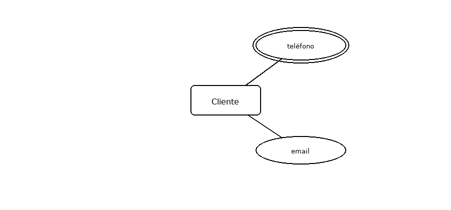
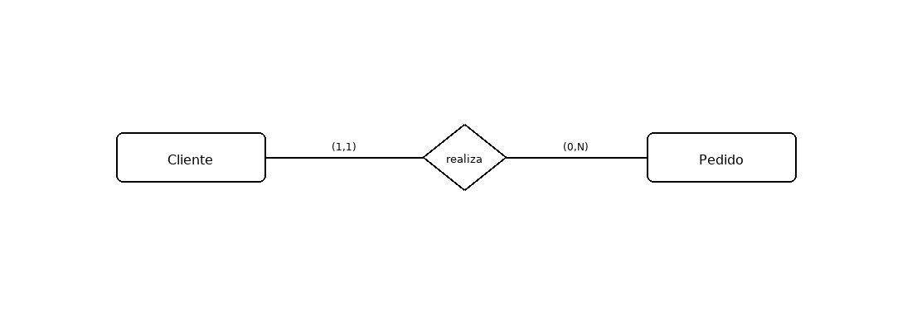
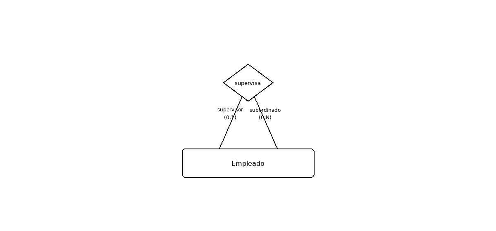
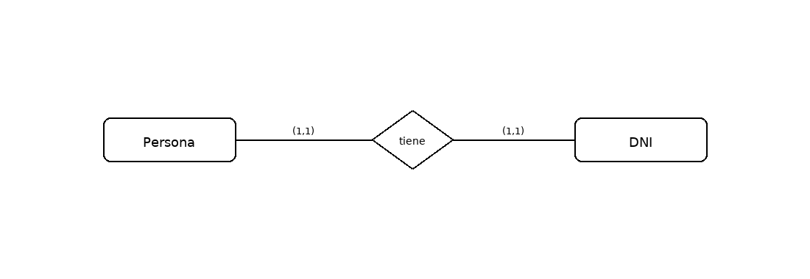
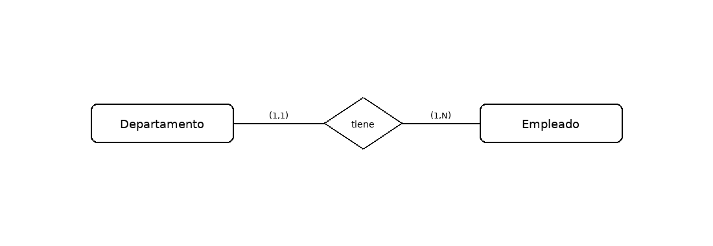
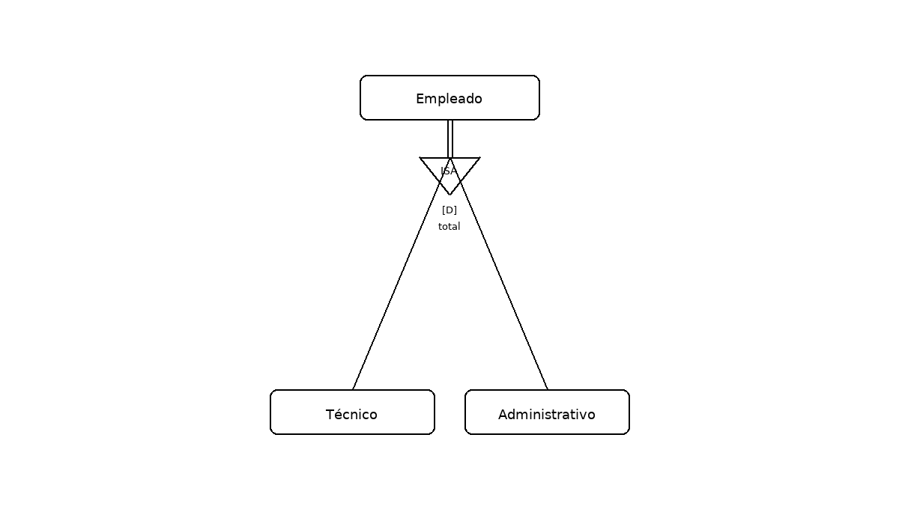
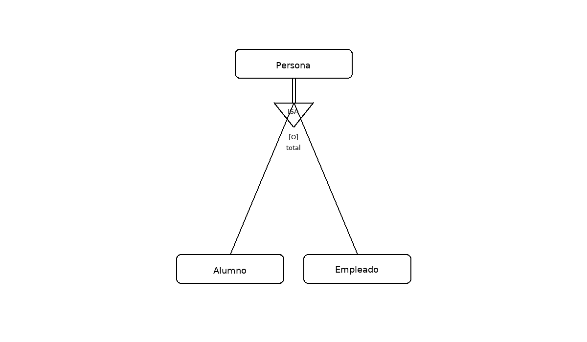
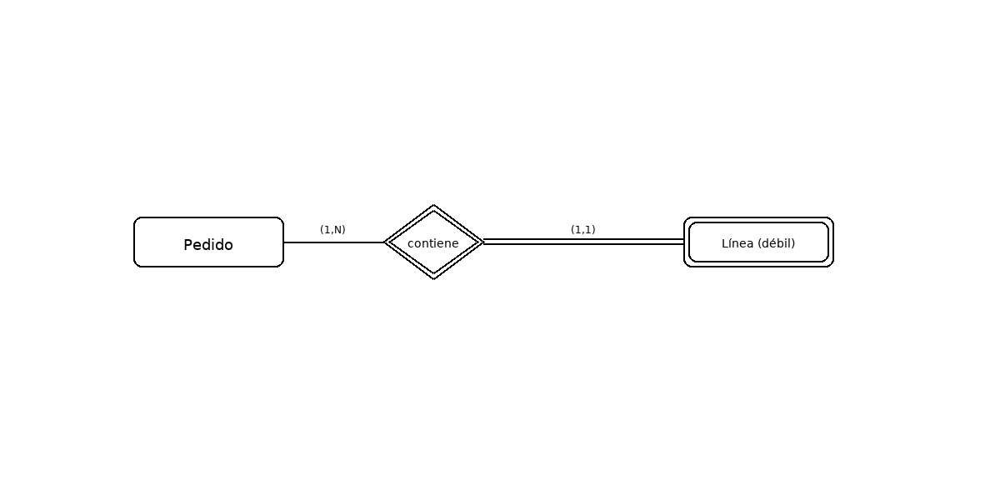

> Fuente: https://dexpositofp.github.io/docencia/BDA/conceptual.html (descargado el 13/11/2026)

# Modelado Conceptual de Datos

En esta unidad aprendemos a describir el *dominio de información* de un sistema utilizando diferentes enfoques de modelado conceptual: el **modelo Entidad–Relación (E/R)** orientado a bases de datos y el **diagrama de clases UML** orientado a programación. Ambos permiten especificar qué objetos existen, qué propiedades tienen y cómo se relacionan, estableciendo las bases del [diseño lógico](logico.md) y, más adelante, de la implementación en [SQL](sql.md).

**Estructura del tema.** Introducción general ⟶ PARTE I: E/R (Bases de Datos) ⟶ PARTE II: UML (Programación) ⟶ Equivalencias.

## 1) Introducción General

### 1.1 ¿Qué es el modelado conceptual?

El **modelado conceptual** es la representación abstracta y precisa del *dominio de información* de un sistema, independientemente de cómo se vaya a implementar técnicamente. Su objetivo es *entender y acordar* con las partes interesadas:

- Qué **objetos o conceptos** existen en el sistema (Cliente, Pedido, Producto, Usuario...)
- Qué **propiedades** tiene cada concepto (nombre, email, fecha, precio...)
- Cómo se **relacionan** entre sí (un Cliente realiza Pedidos, un Pedido incluye Productos...)
- Qué **reglas** deben cumplirse (todo Pedido debe tener Cliente, un Cliente puede no tener Pedidos...)

**Idea clave.** En el modelado conceptual hablamos de *cosas del mundo real*, no de tablas ni de código. Las decisiones de implementación vendrán después: aquí nos centramos en el *qué* y el *por qué*, no en el *cómo*.

### 1.2 Dos enfoques complementarios

Existen diferentes notaciones para el modelado conceptual, cada una con su origen y ámbito de aplicación preferente. En este curso trabajaremos con las dos más importantes:

<table>
<colgroup>
<col style="width: 25%" />
<col style="width: 25%" />
<col style="width: 25%" />
<col style="width: 25%" />
</colgroup>
<thead>
<tr class="header">
<th>Enfoque</th>
<th>Notación</th>
<th>Origen</th>
<th>Ámbito principal</th>
</tr>
</thead>
<tbody>
<tr class="odd">
<td><strong>Bases de Datos</strong></td>
<td><strong>Modelo Entidad–Relación (E/R)</strong> 
Notación Chen y (min,max)</td>
<td>Peter Chen, 1976 
Diseño de bases de datos</td>
<td>Diseño conceptual de BD relacionales, análisis de requisitos de datos, documentación técnica de BD</td>
</tr>
<tr class="even">
<td><strong>Programación</strong></td>
<td><strong>Diagrama de Clases UML</strong></td>
<td>UML (Unified Modeling Language) 
Ingeniería del software OO</td>
<td>Análisis y diseño orientado a objetos, arquitectura de software, desarrollo en lenguajes OO (Java, Python, C#...)</td>
</tr>
</tbody>
</table>

### 1.3 ¿Por qué estudiar ambas notaciones?

- **Versatilidad profesional**: Diferentes equipos y proyectos prefieren diferentes notaciones. Dominar ambas te hace más empleable.
- **Complementariedad**: E/R es más preciso para cardinalidades y restricciones de BD; UML es más natural cuando el sistema tiene implementación OO.
- **Comunicación eficaz**: Podrás hablar el lenguaje de los diseñadores de BD (E/R) y de los programadores (UML).
- **Integración de conocimientos**: El módulo de Bases de Datos y el de Programación comparten los mismos conceptos; aprenderás a conectarlos.

**Estructura de este tema.**

- **PARTE I (E/R)**: Aprenderás el modelo Entidad-Relación con notación Chen y (min,max), enfocado al diseño de bases de datos relacionales.
- **PARTE II (UML)**: Aprenderás el diagrama de clases UML, enfocado al análisis y diseño orientado a objetos.
- **Tabla de equivalencias**: Al final verás cómo traducir entre ambas notaciones y hacia el modelo relacional (SQL).

### 1.4 Ruta completa del diseño de una BD

El diseño es *iterativo*: podemos volver atrás si descubrimos nuevos requisitos. Este es el camino recomendado, con entregables y relación con el resto de páginas del curso.

| Fase                              | Objetivo                                                                               | Entregables                                                          |
|-----------------------------------|----------------------------------------------------------------------------------------|----------------------------------------------------------------------|
| **0) Idea y contexto**            | Definir el problema, alcance y objetivos (qué se pretende resolver).                   | "Elevator pitch", lista de actores, supuestos y restricciones.       |
| **1) Requisitos y vocabulario**   | Recopilar términos del negocio y reglas clave.                                         | Glosario, casos de uso, ejemplos de datos (pequeño set).             |
| **2) Modelo conceptual (E/R)**    | Identificar *entidades*, *atributos* y *relaciones* con **(min,max)** y participación. | Diagrama E/R, diccionario de datos, reglas de negocio.               |
| **3) Revisión del E/R**           | Validar con ejemplos/contraejemplos y detectar casos especiales.                       | Ajustes de cardinalidades, *entidades débiles*, *ISA*, *agregación*. |
| **4) Diseño lógico (relacional)** | Transformar el E/R a tablas: PK, UK, FK y tablas intermedias.                          | Notación de marco, esquema preliminar.                               |
| **5) Normalización**              | Eliminar redundancias y anomalías (1FN, 2FN, 3FN/BCNF).                                | Esquema normalizado y justificación de (des)normalizaciones.         |
| **6) Implementación (DDL)**       | Crear BD/tablas, tipos y restricciones en el SGBD.                                     | Scripts `CREATE DATABASE/TABLE`, índices y comentarios.              |
| **7) Carga y manipulación (DML)** | Insertar datos, consultar, actualizar y borrar de forma segura.                        | Scripts `INSERT`/`SELECT`/`UPDATE`/`DELETE`, casos de prueba.        |
| **8) Seguridad (DCL)**            | Definir usuarios, roles y privilegios mínimos necesarios.                              | `GRANT/REVOKE`, vistas de seguridad, `SHOW GRANTS`.                  |
| **9) Transacciones (TCL)**        | Garantizar atomicidad y consistencia bajo concurrencia.                                | `START TRANSACTION`, `COMMIT`, `ROLLBACK`, `SAVEPOINT`.              |
| **10) Pruebas y rendimiento**     | Verificar integridad y ajustar tiempos de respuesta.                                   | Datos de prueba, `EXPLAIN`, plan de índices, checklist final.        |

### 1.5 Qué esperamos al terminar esta unidad

- Un **diagrama E/R final** con *(min,max)* y participación (total/parcial) en cada relación.
- Un **diccionario** de entidades y atributos (nombre, significado, dominio y ejemplos).
- Una **lista de restricciones** (dominio, entidad, referencia y semánticas) validada con el “cliente”.

## 2) ¿Por qué modelar? Objetivos y alcance

Modelar con **E/R** no es “dibujar por dibujar”: es *entender* el dominio, acordar el significado de los datos y fijar reglas antes de pasar a tablas y SQL. Un buen modelo reduce la ambigüedad, evita decisiones improvisadas y sirve de contrato entre quienes conocen el negocio y quienes lo implementan.

### 2.1 Objetivos del modelado conceptual

- **Comunicación**: crear un lenguaje común (glosario + diagrama) entendible por perfiles técnicos y no técnicos.
- **Precisión**: explicitar *cardinalidades (min,max)*, *participación*, identificadores y reglas de negocio.
- **Calidad de datos**: detectar redundancias y dependencias antes de que existan tablas o datos productivos.
- **Trazabilidad**: justificar por qué luego habrá ciertas PK/FK, tablas intermedias o jerarquías en el diseño lógico.
- **Independencia**: separar el *qué* y el *por qué* (conceptual) del *cómo* (relacional/SQL/SGBD).

**Lo que *no* es el E/R:** no define pantallas, ni consultas concretas, ni el almacenamiento físico. Tampoco es un diagrama de procesos. Es un *modelo de información*.

### 2.2 ¿Qué pasa si no modelamos?

| Fallo típico                   | Consecuencia                                                     | Cómo lo evita el E/R                                          |
|--------------------------------|------------------------------------------------------------------|---------------------------------------------------------------|
| Omitir mínimos (participación) | FKs opcionales donde deberían ser obligatorias (datos huérfanos) | (min,max) obliga a decidir si es *total* u *opcional*         |
| Confundir N:M con dos 1:N      | Pérdida de atributos de la relación, duplicidades                | Relación N:M con tabla intermedia planificada desde el modelo |
| Meter listas en un atributo    | Imposible consultar/validar por elemento                         | Detecta multivalorados → entidad/relación específica          |
| Elegir mal el identificador    | Duplicados, dificultades para referenciar                        | Lista de identificadores candidatos y criterio de estabilidad |

### 2.3 Criterios de “hecho” (Definition of Done) para el E/R

- Todas las **entidades** tienen un **identificador** claro (natural o surrogate justificado).
- Cada **relación** tiene pares **(min,max)** y **participación** documentados en ambos extremos.
- Los **atributos multivalorados/compuestos** se han tratado adecuadamente (no como listas en una sola celda).
- Se han identificado **entidades débiles**, posibles **ISA** y casos de **agregación**.
- Existe un **glosario** con nombres definidos y ejemplos de valores.
- El modelo ha sido **validado** con 3–5 escenarios de negocio (incluye contraejemplos).

## PARTE I

### Enfoque de Bases de Datos: Modelo Entidad-Relación (Chen)

En esta parte aprenderás el **modelo Entidad-Relación (E/R)** con **notación Chen** y la variante **(min,max)**, que es la notación tradicional y más utilizada en el diseño conceptual de bases de datos relacionales. Se centra en especificar con precisión las entidades, atributos, relaciones, cardinalidades y restricciones que luego se traducirán a tablas SQL.

## 3) Modelo Entidad-Relación (Chen)

### 3.1 Notación Chen y (min,max)

El **modelo Entidad-Relación (E/R)** fue propuesto por Peter Chen en 1976 como herramienta para el diseño conceptual de bases de datos. La **notación Chen** utiliza figuras geométricas específicas para cada elemento:

- **Rectángulos** para entidades (conceptos del dominio)
- **Óvalos** para atributos (propiedades de las entidades)
- **Rombos** para relaciones (asociaciones entre entidades)
- **Líneas** para conectar los elementos
- **Pares (min,max)** en cada extremo de las relaciones para especificar cardinalidades

En este curso utilizaremos la variante **(min,max)** porque nos obliga a decidir explícitamente tanto los *mínimos* (participación total o parcial) como los *máximos* (cardinalidad) en cada extremo de una relación. Esta notación es más precisa y menos ambigua que otras variantes del modelo E/R.

#### Ejemplo de notación Chen con (min,max)

A continuación ves un ejemplo —*Cliente realiza Pedido*— en notación Chen. La semántica es: cada **Pedido** pertenece a **exactamente un** Cliente (participación *total* con cardinalidad (1,1)), y un **Cliente** puede tener **cero o muchos** Pedidos (participación *parcial* con cardinalidad (0,N)).

<figure>

<figcaption>Chen — participación total en <em>Pedido</em> y (0,N) en <em>Cliente</em>.</figcaption>
</figure>

<figure>

<figcaption>Crow’s foot — <code>0..N</code> en Cliente, <code>1</code> (obligatorio) en Pedido.</figcaption>
</figure>

<figure>

<figcaption>Min–max — etiquetas explícitas en cada extremo.</figcaption>
</figure>

## 4) Componentes del E/R

### 4.1 Entidades

Una **entidad** es un conjunto de objetos distinguibles del mundo real (Alumno, Asignatura, Pedido…). Modelar bien una entidad implica *delimitar su significado*, elegir un **identificador** estable y decidir qué propiedades (atributos) le pertenecen realmente (y cuáles deben convertirse en entidades/relaciones aparte).

#### 4.1.1 ¿Cuándo algo es una entidad?

- **Nombre propio y estable:** podemos hablar de “un X” individual (p. ej., “un Pedido”).
- **Identificable:** existe al menos un *candidato a identificador* (natural o surrogate).
- **Propiedades propias:** tiene atributos que no dependen de otra entidad “dueña”.
- **Relaciones naturales:** se asocia con otras entidades con reglas claras (cardinalidades, participación).

#### 4.1.2 Identificadores (claves) y candidatos

Un **identificador** distingue de forma única cada instancia (p. ej., `ISBN` en Libro). Puede ser *natural* (significativo en el negocio) o *surrogate* (artificial, p. ej. `id`). Si hay varios, hablamos de *claves candidatas*; elegimos una como *principal* y el resto quedan como *alternativas*.

**Criterio práctico:** usa clave natural si es *estable* y sin ambigüedad; en caso contrario, crea un surrogate y mantén la natural como `UNIQUE` (para detectar duplicados).

#### 4.1.3 Entidad fuerte vs. entidad débil

- **Fuerte:** se identifica por sí misma (p. ej., *Libro* por `ISBN`).
- **Débil:** no tiene identificador propio y se identifica por una *relación identificadora* con una entidad fuerte + una *clave parcial* (p. ej., *Línea* de pedido por `id_pedido` + `pos`). La participación de la débil en esa relación es **total** (mínimo=1).

<figure class="media-box">

<figcaption><strong>Entidad fuerte:</strong> <em>Libro</em> se identifica por <code>ISBN</code> (clave subrayada).</figcaption>
</figure>

<figure class="media-box">

<figcaption><strong>Entidad débil:</strong> <em>Línea</em> se identifica con <code>id_pedido</code> (desde <em>Pedido</em>) + clave parcial <code>pos</code>. Relación <em>contiene</em> es <em>identificadora</em> (doble rombo) y la participación de <em>Línea</em> es <strong>total</strong>.</figcaption>
</figure>

### 4.2 Atributos

Los **atributos** describen propiedades de las entidades. En notación Chen se representan como *óvalos* conectados a la entidad. Es crucial elegir bien qué es atributo y qué debe modelarse como *entidad/relación* (por ejemplo, una “lista de teléfonos” no es un texto con comas, sino un conjunto de ocurrencias → atributo multivalorado).

#### 4.2.1 Tipos principales

- **Simples**: no se descomponen (p. ej., *nombre*).
- **Compuestos**: se descomponen en subatributos (p. ej., *dirección* → calle, número, CP).
- **Monovalorados**: una sola ocurrencia por entidad (p. ej., *email*).
- **Multivalorados**: varias ocurrencias (p. ej., *teléfono*); en Chen se dibujan con *doble óvalo*.
- **Derivados**: calculados a partir de otros (p. ej., *edad* desde *fecha_nacimiento*); se dibujan con *óvalo discontinuo*.

**Convenciones visuales:** clave *subrayada* (subrayado justo bajo la línea base del texto); *clave parcial* con subrayado *discontinuo*; multivalorado con *doble óvalo*; derivado con *contorno discontinuo*.

#### 4.2.2 Simples y compuestos

Un atributo es **compuesto** si sus partes tienen significado propio y pueden usarse de forma independiente en reglas o consultas (buscar por *CP*, ordenar por *calle*…). En el ejemplo, *dirección* se descompone en *calle*, *número* y *CP*. La clave del ejemplo es *dni* (subrayada).

<figure class="media-box">

<figcaption>Simples vs. compuestos: el subrayado de <em>dni</em> marca la <strong>clave</strong>; <em>dirección</em> se descompone en subatributos.</figcaption>
</figure>

#### 4.2.3 Monovalorados y multivalorados

Usa **multivalorado** cuando exista un conjunto de valores (varios *teléfonos* por cliente). En notación Chen lo representamos con *doble óvalo*. Si *email* es único por cliente, será **monovalorado** (óvalo simple).

<figure class="media-box">

<figcaption>Multivalorado: <em>teléfono</em> (doble óvalo) frente a monovalorado: <em>email</em> (óvalo simple).</figcaption>
</figure>

#### 4.2.4 Derivados

Un atributo es **derivado** si puede calcularse a partir de otros (p. ej., *edad* desde *fecha_nacimiento* y la fecha actual). Ventajas: evita inconsistencias; Inconveniente: cálculos en consulta. Recomendación: *no almacenar* el derivado salvo justificación de rendimiento.

<figure class="media-box">

<figcaption>Derivado: <em>edad</em> con contorno discontinuo. Se sugiere su relación con <em>fecha_nacimiento</em>.</figcaption>
</figure>

#### 4.2.5 Decidir: ¿atributo o entidad?

- **Es atributo** si no necesitas identificarlo por separado ni referenciarlo desde otros conceptos (p. ej., *nombre* de cliente).
- **Es entidad** si tiene vida propia, múltiples propiedades o relaciones (p. ej., un *Teléfono* con tipo, extensión, validaciones, histórico).
- **Regla de la lista:** si esperas “varios valores” (lista), piensa en *multivalorado* o en una entidad/relación específica.

### 4.3 Identificadores (claves)

Un **identificador** distingue de forma *única* a cada instancia de una entidad. Puede ser: *natural* (tiene significado de negocio, p. ej., `ISBN`), *surrogate* (artificial, p. ej., `id`), *compuesto* (varios atributos juntos) o *parcial* (en entidades débiles, combinado con la clave de la fuerte). Si existen varios candidatos posibles, hablamos de **claves candidatas**; se elige una como **principal** y el resto quedan como *alternativas* (normalmente con restricción `UNIQUE` al implementar).

**Convenciones visuales (Chen):** clave *subrayada* (subrayado justo bajo el texto); *clave parcial* con subrayado *discontinuo*.

#### 4.3.1 Clave natural vs. clave surrogate (ampliación)

Una **clave natural** es un identificador con *significado de negocio* que ya distingue a una instancia fuera del sistema (p. ej., `ISBN` de un libro, `DNI` de una persona). Una **clave surrogate** (también llamada *artificial* o *sustituta*) la *crea el sistema* solo para identificar filas (p. ej., `id_libro` `INT AUTO_INCREMENT` o un `UUID`); no tiene significado en el dominio.

**Idea clave.** La surrogate *no sustituye* a las reglas de negocio: si existe un identificador natural relevante, **protégelo con `UNIQUE`** aunque la PK sea surrogate.

##### ¿Cuándo elegir cada una?

| Situación                                                                | Mejor opción                                         | Motivo                                                                          |
|--------------------------------------------------------------------------|------------------------------------------------------|---------------------------------------------------------------------------------|
| El identificador natural es *estable, corto y único* (p. ej., ISBN real) | Natural como PK                                      | Evita columnas extra y mantiene trazabilidad semántica directa                  |
| La “natural” puede *cambiar* (email, username) o es *larga/compuesta*    | Surrogate como PK + `UNIQUE` en la natural           | FKs más cortas y estables; evita cascadas por cambios de negocio                |
| Muchas FKs hacia la entidad; índices secundarios grandes                 | Surrogate como PK                                    | En InnoDB la PK va en todos los índices secundarios; una PK corta reduce tamaño |
| Auditoría/legibilidad humana prioritarias                                | Natural como PK *o* Surrogate + natural con `UNIQUE` | Depende del compromiso entre semántica y rendimiento                            |

##### Ventajas y cautelas

- **Surrogate (PK artificial)**: PK/FK *cortas y estables*, joins más ligeros, evita exponer datos sensibles como PK. *Cuidado:* sin un `UNIQUE` en la natural, puedes introducir **duplicados de negocio**.
- **Natural**: la PK *explica* el negocio y facilita trazabilidad. *Cuidado:* si cambia o es compuesta/larga, las FKs e índices se vuelven más pesados y frágiles.

**Error frecuente.** Usar surrogate y olvidar la restricción `UNIQUE` sobre la clave de negocio: terminarás con “el mismo libro” repetido con distintos `id`.

##### Checklist de decisión (rápida)

- ¿La natural es **inmutable** y **corta** (≤ 16 bytes aprox.)? → Puedes usarla como PK.
- ¿Podría **cambiar**, es **larga** o **compuesta**? → Surrogate como PK + `UNIQUE` en la natural.
- ¿Habrá muchas FKs/índices hacia esta tabla? → Surrogate (reduce tamaño y coste de joins).
- ¿Necesitas trazabilidad humana directa? → Natural como PK, o surrogate + columna natural visible y `UNIQUE`.

#### 4.3.2 Claves candidatas y clave principal

Si hay varias formas de identificar una entidad, tenemos **candidatos**. Seleccionamos una **principal** (subrayada) y dejamos las otras como *alternativas* (no subrayadas en E/R, pero con `UNIQUE` al implementar).

<figure class="media-box">

<figcaption>Candidatas: <code>DNI</code> y <code>num_pasaporte</code>. Elegimos <strong>DNI</strong> como principal (subrayada).</figcaption>
</figure>

#### 4.3.3 Clave parcial (entidad débil)

Una **entidad débil** se identifica con la *clave de la fuerte* + una **clave parcial** propia. En E/R la *clave parcial* se indica con **subrayado discontinuo**; la relación identificadora se dibuja con *doble rombo* y la participación de la débil suele ser **total** (doble línea).

<figure class="media-box">

<figcaption><em>PK(Línea)</em> = <code>id_pedido</code> + <code>pos</code>; <code>pos</code> es <strong>clave parcial</strong> (subrayado discontinuo).</figcaption>
</figure>

#### 4.3.4 Criterios de elección (prácticos)

- **Estabilidad:** evita como PK lo que cambie (email, teléfono…).
- **Longitud:** PK cortas mejoran índices y FKs; si la natural es larga, valora surrogate.
- **Semántica:** la natural facilita auditoría y reporting; conserva como `UNIQUE` si usas surrogate.
- **Rendimiento:** FKs compuestas complican joins; en esos casos, surrogate en la entidad de referencia ayuda.

### 4.4 Relaciones y grado

Una **relación** asocia entidades y puede tener *grado* binario (dos entidades), ternario o n-ario. En este curso utilizamos notación **(min,max)** en cada extremo para expresar tanto la *participación* (mínimo = 0 parcial, 1 total) como la *cardinalidad máxima* (1, N). Una relación puede además tener **atributos** propios (p. ej., “precio” en “suministra”) y **roles** cuando una entidad se relaciona consigo misma.

**Lectura correcta.** El par `(min,max)` se lee desde la entidad de ese extremo hacia la relación. Por ejemplo, `(0,N)` en *Cliente* indica que un cliente puede estar en 0 a N pedidos.

#### 4.4.1 Relación binaria

Es la más común. En el ejemplo, un *Cliente* **realiza** *Pedido*: el cliente participa en 0..N pedidos y cada pedido pertenece *exactamente* a 1 cliente.

<figure class="media-box">

<figcaption>Binaria con <code>(min,max)</code>: <em>Cliente</em> (0,N) — <em>realiza</em> — <em>Pedido</em> (1,1).</figcaption>
</figure>

#### 4.4.2 Relación ternaria (y por qué no son tres binarias)

Una relación **ternaria** captura reglas que dependen *conjuntamente* de tres entidades. No es equivalente a “tres binarias”, porque se perdería la restricción conjunta. En “*Proveedor suministra Producto a Almacén*”, el *precio* puede depender de la triple combinación (proveedor, producto, almacén).

<figure class="media-box">

<figcaption>Ternaria con atributo de relación <em>precio</em>. Las cardinalidades se expresan en cada extremo con <code>(min,max)</code>.</figcaption>
</figure>

#### 4.4.3 Relación reflexiva (roles)

Una relación **reflexiva** conecta una entidad consigo misma y requiere **roles** para evitar ambigüedad. En el ejemplo, *Empleado* **supervisa** a *Empleado*: un empleado puede tener `(0,1)` *supervisor* y `(0,N)` *subordinados*.

<figure class="media-box">

<figcaption>Reflexiva con <strong>roles</strong>: cada <em>Empleado</em> puede tener de 0 a 1 <em>supervisor</em> y de 0 a N <em>subordinados</em>.</figcaption>
</figure>

#### 4.4.4 Consejos de modelado

- **Primero los mínimos:** Decide si la participación es obligatoria (`min=1`) u opcional (`min=0`) y luego la máxima.
- **¿Atributo o entidad?** Si el atributo “vive” en la relación (precio depende de las tres patas), déjalo en la relación.
- **Ternaria de verdad:** Si al descomponer en binarias se pierden reglas (unicidad/conjuntos), debes mantenerla ternaria.
- **Roles claros:** En reflexivas, nombra los roles (mentor/mentorizado, supervisor/subordinado…); evita ambigüedad.

### 4.5 Cardinalidad (min,max) y participación

La **cardinalidad** expresa, en cada extremo de una relación, cuántas veces puede (o debe) aparecer una instancia de esa entidad en la relación: `(min,max)`. En binaria se interpreta como: “cada instancia de A se relaciona con entre *min* y *max* instancias de B”, y viceversa. El valor `min` marca la *participación*: 0 ⇒ **parcial** (opcional); 1 ⇒ **total** (obligatoria).

**Lectura precisa.** El par `(min,max)` se sitúa *encima de la línea y junto al extremo* al que pertenece. Así evitamos ambigüedades.

#### 4.5.1 Relación 1:1

Ambas entidades se emparejan a lo sumo con una instancia de la otra. Suele aparecer cuando hay una descomposición de una misma cosa en dos perspectivas (p. ej., *Persona* y su *DNI*).

<figure class="media-box">

<figcaption><strong>1:1</strong>: <em>Persona</em> (1,1) —tiene— <em>DNI</em> (1,1). Participación total en ambos lados.</figcaption>
</figure>

#### 4.5.2 Relación 1:N (participación opcional)

Un *Cliente* puede realizar **0…N** *Pedidos* (participación *parcial* en Cliente); cada *Pedido* pertenece a **exactamente 1** *Cliente* (participación *total*).

<figure class="media-box">

<figcaption><strong>1:N (opcional)</strong>: <em>Cliente</em> (0,N) —realiza— <em>Pedido</em> (1,1).</figcaption>
</figure>

#### 4.5.3 Relación 1:N (participación total)

Cada *Empleado* pertenece a **exactamente 1** *Departamento*; un *Departamento* tiene **1…N** empleados. Es 1:N pero con participación *total* en ambos extremos.

<figure class="media-box">

<figcaption><strong>1:N (total)</strong>: <em>Departamento</em> (1,N) —tiene— <em>Empleado</em> (1,1).</figcaption>
</figure>

#### 4.5.4 Relación N:M (muchos a muchos)

Muchas instancias de una entidad se asocian con muchas de la otra. Suele requerir **atributos en la relación** (p. ej., *cantidad* en “*Pedido incluye Producto*”). En el paso lógico-relacional, se transforma en una *tabla intermedia*.

<figure class="media-box">

<figcaption><strong>N:M</strong>: <em>Pedido</em> (0,N) —incluye— <em>Producto</em> (0,N). La relación incorpora el atributo <em>cantidad</em>.</figcaption>
</figure>

#### 4.5.5 Consejos de modelado

- **Primero los mínimos:** decide si la participación es obligatoria (1) u opcional (0); luego fija el máximo (1 o N).
- **Cuidado con “ocultar” los mínimos:** escribir solo “1:N / N:M” oculta si hay obligatoriedad. Eso cambia la implementación.
- **Si hay dudas, prototipa reglas con ejemplos:** “¿Puede existir un pedido sin cliente?”, “¿Puede un cliente existir sin pedidos?”.

**Ojo con las etiquetas.** Coloca `(min,max)` *encima de la línea y junto al extremo correcto*. No mezcles los extremos: cambiar el lado puede alterar la interpretación del modelo.

### 4.6 Jerarquías ISA (generalización / especialización)

Una jerarquía **ISA** describe cómo una *superentidad* (también llamada tipo padre) se especializa en uno o varios *subtipos* que heredan su significado, su identificador y sus restricciones, y además pueden añadir atributos y reglas propias. Antes de pensar en tablas, aquí acordamos con el “negocio” cómo se clasifica el mundo: qué es común a todas las instancias (superentidad) y qué varía entre categorías (subtipos). Ese acuerdo es clave, porque condicionará el diseño lógico-relacional posterior: una decisión equivocada aquí se transforma en tablas redundantes o restricciones imposibles de imponer abajo.

**Idea didáctica.** Piensa ISA como “*es un*”: si “Alumno *es una* Persona”, entonces *Alumno* hereda la clave y atributos de *Persona* y añade los suyos (p. ej., `nº_matrícula`).

Al definir una ISA debemos fijar dos decisiones independientes. La primera es si la especialización es **disyunta** (excluyente) o **solapada** (superpuesta). La segunda es si la participación de la superentidad en la especialización es **total** u **parcial**. Disyunta/solapada responde a la pregunta: “¿Puede una misma instancia pertenecer a varios subtipos a la vez?”; total/parcial responde a: “¿Toda instancia del supertipo debe pertenecer a algún subtipo?”. En las figuras usaremos un pequeño triángulo “ISA” como nodo de especialización; marcaremos **\[D\]** si es disyunta o **\[O\]** si es solapada y representaremos la participación *total* con **doble línea** desde la superentidad al triángulo (y *parcial* con línea simple).

#### 4.6.1 Disyunta & Total

La combinación **disyunta y total** obliga a que *toda* instancia de la superentidad se clasifique en *exactamente un* subtipo: no hay superinstancias “sin subtipo” ni superinstancias “en dos subtipos”. Es una decisión fuerte y muy útil cuando el dominio define categorías mutuamente excluyentes y completas. Por ejemplo, si en la empresa toda persona contratada es un *Técnico* o un *Administrativo* y no existe ningún otro perfil, el modelo debe reflejar esa cobertura total y exclusión. En la figura, la doble línea desde *Empleado* al triángulo “ISA” obliga a la pertenencia a algún subtipo, y la marca **\[D\]** recuerda la disyunción.

<figure class="media-box">

<figcaption><strong>Disyunta &amp; total</strong>: toda <em>Empleado</em> es <em>Técnico</em> <strong>o</strong> <em>Administrativo</em>, nunca ambos. La doble línea exige pertenencia a algún subtipo; <strong>[D]</strong> indica exclusión entre subtipos.</figcaption>
</figure>

#### 4.6.2 Disyunta & Parcial

En la combinación **disyunta y parcial**, una instancia de la superentidad puede pertenecer como mucho a *un* subtipo, pero *también puede no pertenecer a ninguno*. Es apropiada cuando tenemos algunas subcategorías excluyentes (p. ej., *Coche* y *Moto*) pero existen instancias del supertipo que quedan fuera de esa clasificación (p. ej., *Camión*, *Autobús*). Es mejor declarar la parcialidad que forzar a meter “con calzador” objetos en subtipos en los que no encajan: ese error se paga luego con valores nulos sin sentido o reglas difíciles de mantener. En la figura, la línea simple desde *Vehículo* al ISA permite que haya vehículos sin subtipo; **\[D\]** mantiene la exclusión entre *Coche* y *Moto*.

<figure class="media-box">

<figcaption><strong>Disyunta &amp; parcial</strong>: un <em>Vehículo</em> puede ser <em>Coche</em> <strong>o</strong> <em>Moto</em>, o ninguno. Línea simple = hay superinstancias sin subtipo; <strong>[D]</strong> = subtipos excluyentes.</figcaption>
</figure>

#### 4.6.3 Solapada & Total

La combinación **solapada y total** obliga a que *toda* instancia del supertipo pertenezca a *al menos un* subtipo, pero permite la pertenencia simultánea a varios. Es la situación típica cuando las categorías representan *roles* que pueden coexistir. Por ejemplo, toda *Persona* en una universidad puede ser *Alumno* o *Empleado* y, en ocasiones, ambos (un estudiante con una beca laboral). La doble línea impide personas “sin rol” y la marca **\[O\]** (overlap) recuerda que no hay exclusión: la implementación posterior deberá permitir múltiples pertenencias, normalmente con tablas que registren esos roles.

<figure class="media-box">

<figcaption><strong>Solapada &amp; total</strong>: toda <em>Persona</em> tiene al menos un rol (<em>Alumno</em>, <em>Empleado</em>) y puede tener ambos. Doble línea = nadie queda fuera; <strong>[O]</strong> = se permite solape.</figcaption>
</figure>

#### 4.6.4 Solapada & Parcial

Por último, **solapada y parcial** permite instancias del supertipo sin subtipo y, si lo tienen, pueden pertenecer a varios a la vez. Es útil cuando los subtipos representan *propiedades opcionales* que pueden coexistir. Imagina *Producto* con subtipos *Perecedero* y *Refrigerado*: hay productos que no son ni perecederos ni requieren frío; otros son solo perecederos; otros solo refrigerados; y algunos son ambas cosas. La línea simple permite productos “sin categoría” y **\[O\]** permite el solapamiento natural entre condiciones.

<figure class="media-box">

<figcaption><strong>Solapada &amp; parcial</strong>: un <em>Producto</em> puede no estar en ningún subtipo, o estar en uno o en ambos. Línea simple = parcial; <strong>[O]</strong> = subtipos no excluyentes.</figcaption>
</figure>

**Errores típicos.** (1) Forzar disyunción cuando en realidad los roles se solapan, lo que acaba en duplicidades o datos inconsistentes; (2) Declarar total cuando existen casos fuera de los subtipos, lo que luego “obliga” a inventar categorías artificiales; (3) Crear subtipos que no aportan atributos ni reglas: si el subtipo no añade nada, quizá no es un subtipo, sino un valor de un atributo del supertipo (p. ej., un `tipo`).

#### Cómo decidir correctamente (y pensar en la implementación)

Te propongo un guion de entrevista con el “cliente” que funciona muy bien: primero, pregunta si *pueden coexistir roles* (“¿puede una persona ser alumno y empleado a la vez?”). Si la respuesta es sí, la especialización debe ser **solapada**; si no, **disyunta**. Después, pregunta si *todas* las instancias deben caer en algún subtipo (“¿toda persona en el sistema debe ser, al menos, alumno o empleado?”). Si la respuesta es sí, marca la especialización como **total** (doble línea); si no, **parcial**. Al pasar al modelo relacional, las disyuntas se pueden materializar con una única referencia o un atributo `tipo` (si son pocas y estables); las solapadas suelen necesitar *tablas puente* que permitan múltiples pertenencias. Las totales se traducen en *restricciones* que impiden superinstancias “huérfanas”; las parciales permiten que existan.

Como regla de oro, modela solo subtipos que aporten *información o reglas diferenciadas* (atributos adicionales, validaciones distintas, comportamientos específicos). Si un subtipo no añade nada, evita la complejidad: usa un atributo enumerado en la superentidad o, directamente, no especialices. Este criterio mantiene el modelo claro y la base de datos más sencilla de implementar y mantener.

### 4.7 Agregación / Composición

En algunos dominios hay relaciones que no son “un detalle más”, sino auténticos *hechos complejos* que conviene tratar como una unidad. La **agregación** nos permite “elevar” una *relación* (con sus entidades participantes) a un *concepto compuesto*, de forma que podamos relacionarlo a su vez con otras entidades. Es como si agrupáramos “el hecho” completo y lo conectáramos con otras partes del modelo. En términos didácticos: primero definimos una relación normal (con sus cardinalidades y, si procede, atributos); después *la encerramos* en una caja con nombre (la agregación) y conectamos esa caja con lo que tenga sentido. Este recurso evita multiplicar relaciones binarias con reglas redundantes y hace explícito “qué estamos relacionando exactamente”: no *Proveedor* o *Producto* por separado, sino el **Suministro** (Proveedor–Producto) como hecho único.

La **composición** (en E/R clásico se modela mediante *entidad débil* e *identificación*) captura el patrón “*todo–parte* con *dependencia de existencia*”: la parte *no puede existir sin* el todo, y su identificador incluye la clave del todo. Pedagógicamente, es el mismo mensaje que en diseño orientado a objetos: si desaparece el “todo”, sus “partes” dejan de tener sentido. En E/R reconocerás la composición cuando veas una **entidad débil** (rectángulo doble), una **relación identificadora** (rombo doble) y participación **total** de la débil en esa relación (doble línea): ahí queda claro que la parte depende del todo y que su identidad “se apoya” en la del todo.

#### Agregación: convertir un hecho en un concepto compuesto

Imagina que ya tenemos *Proveedor* —**suministra**— *Producto*, con cardinalidades habituales `(0,N)` en ambos extremos (un proveedor puede suministrar 0..N productos y un producto puede tener 0..N proveedores). Si ahora queremos expresar “este *suministro concreto* sirve a un *Almacén*”, no es correcto unir *Proveedor* con *Almacén* y *Producto* por separado: perderíamos el hecho compuesto “proveedor+producto”. La agregación nos deja envolver el triángulo *Proveedor–suministra–Producto* dentro de una caja llamada **Suministro** y relacionar esa *unidad* con *Almacén*. Así dejamos claro que estamos hablando de “ese proveedor suministrando ese producto” y no de las entidades de forma aislada.

<figure class="media-box">

<figcaption><strong>Agregación</strong>: el hecho <em>Suministro</em> (agregación de <em>Proveedor—suministra—Producto</em>) se relaciona con <em>Almacén</em> mediante <em>sirve_a</em>. Las cardinalidades se leen sobre cada línea: en el ejemplo, un <em>Suministro</em> puede <em>servir a</em> 1..N <em>Almacenes</em> y un <em>Almacén</em> puede recibir 1..N <em>Suministros</em>. Este patrón evita mezclar entidades por separado y deja explícito qué combinación concreta estamos conectando.</figcaption>
</figure>

**Cuándo usar agregación.** Cuando una relación con sus participantes es el “objeto” de otra regla: calendario de entregas de un pedido, programación de turnos de una asignación (Profesor–imparte–Grupo), o restricciones que afectan al conjunto (p. ej., cupos o tarifas específicas del emparejamiento).

#### Composición (todo–parte con dependencia)

En comercio electrónico, un *Pedido* se forma por varias *Líneas*. Una *Línea* no tiene sentido fuera del *Pedido* al que pertenece, y su identidad se define por la clave del pedido más una clave parcial (por ejemplo, `nº_línea`). En E/R esto se plasma como **entidad débil** *Línea* (doble rectángulo) unida a *Pedido* por una **relación identificadora** *contiene* (rombo doble), con participación **total** de la débil (doble línea). Las cardinalidades típicas son `(1,N)` en *Pedido* (un pedido tiene 1..N líneas) y `(1,1)` en *Línea* (cada línea pertenece a exactamente un pedido). Este patrón comunica —sin ambigüedad— existencia dependiente y clave compuesta.

<figure class="media-box">

<figcaption><strong>Composición (existencia dependiente)</strong>: <em>Pedido</em> —(1,N)— <em>contiene</em> —(1,1)— <em>Línea</em>. La <em>Línea</em> es <strong>débil</strong> (doble rectángulo), la relación es <strong>identificadora</strong> (doble rombo), y la participación de la débil es <strong>total</strong> (doble línea). Al pasar al modelo relacional, la clave de <em>Línea</em> incluirá la clave de <em>Pedido</em> más una clave parcial.</figcaption>
</figure>

#### Elección correcta en el diseño

Una regla de oro útil es preguntarse: “¿Estoy tratando de relacionar *la combinación* de varias entidades con otra cosa?” Si la respuesta es sí, probablemente necesitas **agregación**. En cambio, si la relación representa un vínculo estructural “todo–parte” y la parte no tiene sentido por sí misma, opta por la **composición** (entidad débil + relación identificadora + participación total). Esta distinción no es cosmética: marca cómo se transformará el modelo a relaciones (tablas intermedias o claves compuestas) y qué restricciones de integridad podrás imponer sin acrobacias en SQL.

**Errores frecuentes.** (1) Conectar por separado entidades que deberían viajar juntas (olvidando la agregación), lo que produce reglas incongruentes; (2) Modelar como entidad fuerte algo que en realidad es una parte dependiente, perdiendo la garantía de integridad que aporta la composición; (3) Esconder cardinalidades mínimas (0/1) y luego descubrir que el diseño lógico no puede hacer cumplir la obligatoriedad que el negocio sí exige.

### 4.8 Restricciones de integridad

Las **restricciones de integridad** son las reglas que mantienen “coherente” el significado de los datos a lo largo del tiempo. En el *modelo conceptual (E/R)* las expresamos con nombres, cardinalidades `(min,max)`, identificadores, tipos de atributos y notas semánticas; más adelante, en el *modelo lógico* y en SQL, se traducirán a `PRIMARY KEY`, `FOREIGN KEY`, `NOT NULL`, `UNIQUE`, `CHECK`, disparadores, etc. El enfoque correcto es siempre “de arriba a abajo”: primero acordamos la regla con el cliente (en el E/R), después la *implementamos* en el SGBD. Si una regla no está clara arriba, será frágil abajo.

**Esquema mental.** Piensa en cuatro familias: *dominio* (de qué tipo es cada dato), *entidad* (identidad y unicidad), *referencia* (existencias relacionadas) y *semánticas* (reglas del negocio que van más allá de las tres anteriores).

#### 4.8.1 Restricciones de dominio

Un **dominio** especifica el *tipo* y el *rango* de valores que admite un atributo, así como su *formato* y si admite *null*. Modelar bien los dominios en el E/R (con nombres y descripciones claras) evita datos imposibles: fechas futuras para nacimientos, códigos mal formados, números negativos en cantidades, etc. Ejemplos típicos: *precio* → “número real ≥ 0 con dos decimales”; *DNI* → “cadena de 9 caracteres con patrón”; *email* → “cadena \<= 254 chars con ‘@’ y dominio válido”; *edad* derivada de *fecha_nacimiento* (no se almacena).

| Atributo | Dominio                  | ¿NULL? | Observaciones                                     |
|----------|--------------------------|--------|---------------------------------------------------|
| precio   | real ≥ 0 (2 decimales)   | no     | Si es 0, indica artículo gratuito o promoción     |
| dni      | patrón `^[0-9]{8}[A-Z]$` | no     | Único por Persona (ver 4.8.2)                     |
| email    | cadena válida            | sí     | Opcional; si existe, formato obligado             |
| edad     | derivado                 | —      | Se calcula desde *fecha_nacimiento*, no se guarda |

#### 4.8.2 Restricciones de entidad (identidad y unicidad)

Garantizan que cada instancia de una entidad esté **bien identificada** y no existan duplicados. En E/R esto se refleja al elegir el *identificador* (clave) de la entidad; puede ser natural (`DNI`, `ISBN`) o artificial (`id` autogenerado). Si hay varias posibilidades hablamos de *claves candidatas*; elegimos una como *principal* y el resto suelen imponerse como *únicas*. Ejemplos: en *Libro*, `ISBN` identifica de forma natural; en *Cliente*, si el `DNI` no es fiable (clientes extranjeros sin DNI, etc.), se recurre a un `id` y se fuerza `DNI UNIQUE` cuando exista.

**Decisión práctica.** Usa clave natural si es estable y universal. Si no, usa clave surrogate (`id`) y protege la natural con *unicidad* y *formato* (dominio).

#### 4.8.3 Restricciones de referencia (existencia y correspondencia)

Aseguran que una relación solo existe si existen las instancias relacionadas, y que se respeta la *participación* acordada. En E/R lo expresamos con los pares `(min,max)` en cada extremo: el *mínimo* determina si la participación es **total** (1) u **parcial** (0). Ejemplo: *Cliente* —realiza— *Pedido* con `Cliente (0,N)` y `Pedido (1,1)`: un pedido *siempre* pertenece a un cliente (participación total en Pedido), pero un cliente puede no tener pedidos (parcial en Cliente). En el modelo lógico esto se traduce en una *clave ajena* en *Pedido* y en reglas que impiden eliminar un *Cliente* con pedidos si así se establece (política de borrado).

#### 4.8.4 Restricciones semánticas (reglas del negocio)

Son reglas específicas del dominio que no se deducen automáticamente de dominios, claves o `(min,max)`, pero que deben cumplirse para que el dato “tenga sentido”. Ejemplos: “un pedido **cancelado** no puede tener líneas”, “el *importe_total* debe ser la suma de sus líneas”, “un *Profesor* no puede superar 20 h lectivas por semana”, “no se puede asignar un *Alumno* a dos exámenes que se solapan en horario”. En el E/R las recogemos como *notas* o *anotaciones* junto a la relación o entidad afectada; más tarde, en SQL, pueden materializarse con `CHECK`, vistas materializadas de validación, o disparadores.

#### 4.8.5 Nulos, derivados y estados del ciclo de vida

Decidir si un atributo **admite NULL** es una decisión de integridad: un NULL permisivo se convierte en “agujero” que la aplicación debe interpretar (¿desconocido?, ¿no aplicable?). Como regla, los atributos que intervienen en la *identidad* o en la *lógica de negocio* suelen ser **NOT NULL**. Los *atributos derivados* (p. ej., *edad* desde *fecha_nacimiento*) no se almacenan: se recalculan. Además, muchas reglas dependen del **estado** de una entidad (borrador, confirmado, cancelado). En el E/R conviene anotar las reglas por estado: “si *estado=confirmado*, entonces (1) debe haber método de pago; (2) no se pueden modificar líneas”.

#### 4.8.6 Patrones típicos (del E/R a SQL)

Aunque ahora estamos en conceptual, es útil prever cómo “bajan” las reglas: *identificadores* → `PRIMARY KEY` (y `UNIQUE` para candidatas); *dominios* → tipos, `CHECK`, `NOT NULL`; *referencia* → `FOREIGN KEY` con acciones (`ON DELETE`/`UPDATE`); *participación total* suele exigir `NOT NULL` en la FK y, a veces, control transaccional para altas y bajas coherentes; *reglas semánticas* complejas → restricciones declarativas si es posible, o bien procesos de validación/disparadores si afectan a múltiples tablas.

| Regla conceptual (E/R)             | Lectura                                  | Pista para implementación                                                        |
|------------------------------------|------------------------------------------|----------------------------------------------------------------------------------|
| Pedido (1,1) —pertenece a— Cliente | Todo pedido tiene exactamente un cliente | FK NOT NULL en Pedido. Política de borrado: RESTRICT o SET NULL según negocio    |
| Cliente (0,N) —realiza— Pedido     | Un cliente puede no tener pedidos        | No obliga a FK en Cliente; cardinalidad ya cubierta por la FK en Pedido          |
| email: dominio válido              | Formato correcto si existe               | `CHECK` (si procede) y validación en aplicación                                  |
| importe_total = suma(líneas)       | Regla semántica                          | Vista/trigger de consolidación o cálculo a demanda (no almacenar si es derivado) |

**Checklist rápido antes de pasar a lógico:** 1) ¿Todas las entidades tienen identificador claro? 2) ¿Están fijados los dominios y NULL/NOT NULL de los atributos críticos? 3) ¿Cada relación tiene sus `(min,max)` y la lectura es inequívoca sobre la línea correcta? 4) ¿Hemos anotado las reglas semánticas por estado/negocio que no encajan en dominios o cardinalidades?

Con estas reglas bien descritas en el *conceptual*, el salto al *modelo lógico* será mecánico y justificable. Lo importante no es “poner una FK” sino *saber por qué*: la FK es la traducción técnica de una decisión conceptual (`(min,max)` y participación) que ya acordaste aquí.

## 5) Errores comunes

El diseño conceptual con **E/R** es una herramienta potentísima, pero también muy sensible a pequeños deslices que luego se “amplifican” al pasar al modelo lógico y a SQL. En esta sección reunimos los *errores típicos* que más se repiten en 1º DAW y una **lista de verificación final** para revisar tu modelo antes de darlo por cerrado. Léelos como si fueran “antipatrones”: si te reconoces en alguno, vuelve un paso atrás, corrige y vuelve a evaluar con datos de ejemplo. El objetivo no es dibujar “algo bonito”, sino un modelo que haga *cumplir* las reglas del negocio sin ambigüedades.

### 5.1 Errores comunes (y cómo evitarlos)

#### 5.1.1 Cardinalidades mal ubicadas o ambiguas

Uno de los fallos más frecuentes es colocar el par `(min,max)` en el lado equivocado o lejos de la línea, provocando lecturas contradictorias. **Regla de oro:** sitúa cada `(min,max)` *encima de la línea y junto al extremo* al que pertenece, y verbaliza su lectura: “cada A se relaciona con entre *min* y *max* B”. Si al leer en voz alta no tiene sentido, está mal colocada o mal elegida.

#### 5.1.2 Confundir disyunta/solapada y total/parcial en ISA

Otro clásico es declarar una especialización *disyunta* cuando en realidad los subtipos pueden coexistir (roles), o marcarla como *total* cuando hay instancias del supertipo fuera de los subtipos. Pregunta siempre: “¿puede una instancia estar en varios subtipos a la vez?” (si sí, es **solapada**) y “¿todas las instancias deben caer en algún subtipo?” (si sí, **total**). Representa *total* con **doble línea** supertipo→ISA.

#### 5.1.3 Mezclar hechos diferentes en una relación binaria

Intentar expresar con una sola relación binaria un hecho que depende de una *combinación* de entidades lleva a inconsistencias (por ejemplo, conectar *Proveedor* con *Almacén* y *Producto* por separado). Cuando el negocio habla de “la pareja (X,Y)”, probablemente necesitas una **agregación** o una relación **ternaria** con sus propias reglas y atributos.

#### 5.1.4 Elegir mal la clave (identificador)

Usar una clave natural inestable (como *email*) provoca cascadas de cambios; usar una artificial sin proteger la natural permite duplicados semánticos. **Práctica recomendada:** si la natural es universal y estable (DNI, ISBN), úsala; si no, usa *surrogate* (`id`) y declara la natural como *única* y con *dominio* (formato) apropiado.

#### 5.1.5 Atributos derivados almacenados (y desincronizados)

Guardar *edad* además de *fecha_nacimiento* o *importe_total* además de las *líneas* crea inconsistencias. Marca estos datos como **derivados** y calcula cuando haga falta, o controla su actualización con reglas estrictas.

#### 5.1.6 Nulos permisivos en atributos críticos

Permitir `NULL` en atributos que son necesarios para la lógica del negocio lleva a registros “a medias” difíciles de validar. Decide explícitamente **NOT NULL** en claves y datos esenciales, y documenta el significado de cada `NULL` (desconocido / no aplicable).

#### 5.1.7 Olvidar la participación mínima

Poner solo 1:1, 1:N, N:M sin el *mínimo* oculta si la relación es opcional u obligatoria. Recuerda: el **mínimo** (0 o 1) se traduce luego en `NULL/NOT NULL` y en cómo se controlan altas y bajas.

#### 5.1.8 Modelar como binaria algo N:M o ternario

Si una relación “pide” atributo propio (*precio* en un suministro, *cantidad* en líneas de pedido), sospecha de un **N:M** (o ternaria) en lugar de dos binarias sueltas. A nivel lógico necesitarás una tabla intermedia con su clave compuesta.

#### 5.1.9 No documentar reglas semánticas

Muchas restricciones no se deducen de dominios o cardinalidades (p. ej., “pedido cancelado no tiene líneas”). Si no las anotas en el conceptual, luego “desaparecen” al implementar. Añade *notas* claras en el diagrama.

### 5.2 Checklist final antes de pasar a lógico

Usa esta lista como “semáforo” antes de traducir a tablas. Marca cada ítem con ✔ cuando esté resuelto y justificado.

| Ítem                         | Qué comprobar                                                                                                     | ✔   |
|------------------------------|-------------------------------------------------------------------------------------------------------------------|-----|
| **Alcance claro**            | El diagrama incluye solo lo necesario para el caso; no faltan entidades clave ni sobran “adorno”.                 |     |
| **Identificadores**          | Cada entidad tiene clave definida (natural o surrogate) y candidatas razonadas; unicidades anotadas.              |     |
| **Dominios y NULL**          | Tipo/rango de cada atributo, formato si aplica y decisión explícita de NULL/NOT NULL.                             |     |
| **Atributos derivados**      | Marcados como derivados (no almacenados) o, si se almacenan, con regla de sincronización clara.                   |     |
| **Relaciones binarias**      | Cardinalidades `(min,max)` colocadas *encima y en su extremo*; lectura inequívoca.                                |     |
| **N:M / Ternarias**          | Las relaciones que requieren atributos propios están modeladas como N:M o ternarias (no “apaños”).                |     |
| **ISA**                      | Para cada jerarquía: disyunta/solapada y total/parcial decididas y representadas (doble línea si total).          |     |
| **Agregación / Composición** | Hechos compuestos modelados con agregación; dependencias todo–parte como entidad débil + relación identificadora. |     |
| **Reglas semánticas**        | Notas claras para las reglas “de negocio” (por estado, límites, incompatibilidades, etc.).                        |     |
| **Prueba de contraejemplos** | Intentaste “romper” el modelo con datos imposibles y el diagrama los impide (o ajustaste el diseño).              |     |
| **Camino a SQL**             | Sabes cómo cada decisión conceptual bajará a PK, FK, UNIQUE, CHECK y acciones de borrado/actualización.           |     |

## PARTE II

### Enfoque de Programación: Diagrama de Clases UML

En esta parte aprenderás el **diagrama de clases UML (Unified Modeling Language)**, que es la notación estándar para el análisis y diseño orientado a objetos. Es especialmente útil cuando el sistema se implementará en lenguajes de programación orientados a objetos (Java, Python, C#, JavaScript...) y permite una transición natural del diseño conceptual al código.

## 5) Diagrama de Clases UML

### 5.1 ¿Qué es UML?

**UML (Unified Modeling Language)** es un lenguaje de modelado visual estándar creado en los años 90 para especificar, visualizar, construir y documentar sistemas de software. Fue desarrollado por Grady Booch, James Rumbaugh e Ivar Jacobson, y actualmente es mantenido por el Object Management Group (OMG).

UML incluye **14 tipos de diagramas** diferentes, divididos en dos categorías:

- **Diagramas estructurales**: describen la estructura estática del sistema (clases, componentes, despliegue...)
- **Diagramas de comportamiento**: describen el comportamiento dinámico (casos de uso, secuencia, actividad...)

Para el diseño de bases de datos, el más relevante es el **diagrama de clases**, que describe la estructura estática: qué clases existen, qué atributos tienen, qué métodos implementan y cómo se relacionan entre sí.

**Relación con POO.** El diagrama de clases UML se traduce directamente a código en lenguajes orientados a objetos. Una clase del diagrama se convierte en una clase Java/Python/C#, los atributos en campos de la clase, las asociaciones en referencias o colecciones, y la herencia en extends/implements.

### 5.2 Elementos básicos del diagrama de clases

#### 5.2.1 Clase

Una **clase** representa un concepto del dominio o una abstracción del sistema. Se dibuja como un rectángulo dividido en tres compartimentos:

- **Compartimento superior**: nombre de la clase (sustantivo en singular, con inicial mayúscula)
- **Compartimento medio**: atributos (propiedades de la clase)
- **Compartimento inferior**: métodos u operaciones (comportamiento de la clase)

<figure class="media-box">

<figcaption>Clase <strong>Cliente</strong> con atributos privados (-) y método público (+)</figcaption>
</figure>

#### 5.2.2 Atributos

Los **atributos** describen las propiedades de una clase. Se especifican con la sintaxis:

    visibilidad nombre: tipo [= valorPorDefecto]

Visibilidades:

- `+` **public**: accesible desde cualquier parte
- `-` **private**: solo accesible dentro de la clase
- `#` **protected**: accesible en la clase y sus subclases
- `~` **package**: accesible dentro del mismo paquete

Ejemplos: `- email: String`, `+ edad: int = 0`, `# fecha: Date`

#### 5.2.3 Métodos

Los **métodos** definen el comportamiento de la clase. Se especifican con:

    visibilidad nombre(parámetros): tipoRetorno

Ejemplo: `+ calcularTotal(descuento: float): decimal`

**En diseño de BD.** Para el diseño conceptual de bases de datos, los métodos se suelen omitir o documentar por separado, ya que la BD almacena datos (atributos), no comportamiento (métodos). Los métodos se implementarán en la capa de aplicación.

### 5.4 Asociaciones

Una **asociación** representa una relación estructural entre clases. Se dibuja como una línea que conecta dos clases y puede tener:

- **Nombre**: describe la relación (ej: "realiza", "contiene", "pertenece a")
- **Multiplicidad**: cuántas instancias de una clase se relacionan con instancias de otra (ver siguiente subsección)
- **Roles**: nombres en cada extremo que especifican el papel de cada clase en la relación
- **Navegabilidad**: flechas que indican la dirección de acceso (si una clase conoce a la otra)

<figure class="media-box">

<figcaption>Asociación entre Cliente y Pedido con multiplicidades, nombre y roles</figcaption>
</figure>

### 5.5 Multiplicidad

La **multiplicidad** especifica cuántas instancias de una clase pueden estar asociadas con instancias de otra clase. Es el equivalente a la cardinalidad en E/R, pero con sintaxis diferente:

| Multiplicidad UML | Significado                              | Equivalente E/R (min,max) | Ejemplo                                 |
|-------------------|------------------------------------------|---------------------------|-----------------------------------------|
| `1`               | Exactamente uno (obligatorio)            | `(1,1)`                   | Un Pedido tiene exactamente 1 Cliente   |
| `0..1`            | Cero o uno (opcional)                    | `(0,1)`                   | Una Persona puede tener 0 o 1 Pasaporte |
| `*` o `0..*`      | Cero o muchos (opcional, sin límite)     | `(0,N)`                   | Un Cliente puede tener 0 o más Pedidos  |
| `1..*`            | Uno o muchos (obligatorio, al menos uno) | `(1,N)`                   | Un Departamento tiene 1 o más Empleados |
| `2..5`            | Rango específico (entre 2 y 5)           | `(2,5)`                   | Un Equipo tiene entre 2 y 5 Jugadores   |

**Lectura de multiplicidad.** La multiplicidad se lee *desde* la clase hacia la asociación: si ves `0..*` junto a *Pedido* en la asociación *Cliente—Pedido*, significa "un Cliente puede estar asociado a 0 o muchos Pedidos".

### 5.6 Herencia (Generalización)

La **herencia** o **generalización** en UML representa una relación "es-un" entre una clase general (superclase) y clases más específicas (subclases). Se dibuja con una **flecha de punta triangular** desde la subclase hacia la superclase.

Las subclases **heredan** todos los atributos y métodos de la superclase y pueden añadir los suyos propios o redefinir (sobrescribir) métodos heredados.

#### 5.6.1 Restricciones de herencia

UML permite especificar restricciones sobre la herencia mediante **estereotipos**:

- `{disjoint}` o `{exclusive}`: las subclases son **disjuntas** (una instancia solo puede pertenecer a una subclase)
- `{overlapping}`: las subclases pueden **solaparse** (una instancia puede pertenecer a varias subclases)
- `{complete}`: la herencia es **total** (toda instancia de la superclase debe pertenecer a alguna subclase)
- `{incomplete}`: la herencia es **parcial** (pueden existir instancias solo de la superclase, sin pertenecer a ninguna subclase)

<figure class="media-box">

<figcaption><strong>Herencia disjunta y total.</strong> Todo Empleado es Técnico <strong>o</strong> Administrativo (no ambos, sin otras opciones). Equivale a ISA disyunta y total en E/R.</figcaption>
</figure>

### 5.7 Composición y Agregación

UML distingue dos tipos especiales de asociación que representan relaciones "todo-parte":

#### 5.7.1 Composición (rombo negro)

La **composición** es una relación fuerte de "todo-parte" donde **las partes no pueden existir sin el todo**. Se dibuja con un **rombo negro (filled)** en el extremo del "todo". Si se destruye el todo, se destruyen automáticamente las partes. Es el equivalente a la entidad débil en E/R.

- Una parte pertenece a un solo todo (exclusividad)
- La vida de la parte depende del todo (dependencia existencial)
- Ejemplo: Pedido ◆—→ LineaPedido (las líneas no existen sin el pedido)

#### 5.7.2 Agregación (rombo blanco)

La **agregación** es una relación débil de "todo-parte" donde **las partes pueden existir independientemente del todo**. Se dibuja con un **rombo blanco (hollow)**. Es una relación de pertenencia sin dependencia existencial.

- Una parte puede pertenecer a varios todos (no exclusiva)
- La parte puede existir sin el todo
- Ejemplo: Departamento ◇—→ Empleado (el empleado puede existir sin departamento)

<figure class="media-box">

<figcaption><strong>Composición:</strong> Pedido ◆—→ LineaPedido. Dependencia existencial fuerte.</figcaption>
</figure>

**Diferencia clave.** Composición (◆) = dependencia existencial fuerte (entidad débil en E/R). Agregación (◇) = relación de pertenencia sin dependencia (relación normal en E/R).

## Tabla de Equivalencias

### Traducción entre E/R, UML y Modelo Relacional

Esta tabla resume las equivalencias entre los conceptos del **modelo E/R (Chen)**, el **diagrama de clases UML** y su traducción al **modelo relacional (SQL)**. Úsala como guía de referencia rápida para convertir entre notaciones y para implementar el diseño conceptual en una base de datos.

## 6) Tabla de Equivalencias E/R ↔ UML ↔ SQL

La siguiente tabla muestra cómo se traduce cada elemento entre las tres representaciones. Cada fila describe un concepto fundamental del modelado conceptual y su implementación técnica.

<table>
<colgroup>
<col style="width: 25%" />
<col style="width: 25%" />
<col style="width: 25%" />
<col style="width: 25%" />
</colgroup>
<thead>
<tr class="header">
<th style="text-align: center;">E/R (Chen / min-max)</th>
<th style="text-align: center;">UML (Diagrama de clases)</th>
<th style="text-align: center;">Relacional (SQL)</th>
<th style="text-align: center;">Ejemplo práctico</th>
</tr>
</thead>
<tbody>
<tr class="odd" style="background: var(--brand-weak);">
<td colspan="4" style="text-align: center; font-weight: 600;">CONCEPTOS BÁSICOS</td>
</tr>
<tr class="even">
<td style="text-align: center;"><strong>Entidad</strong> 
(rectángulo)</td>
<td style="text-align: center;"><strong>Clase</strong> 
(rectángulo con compartimentos)</td>
<td style="text-align: center;"><strong>Tabla</strong> 
<code>CREATE TABLE</code></td>
<td style="text-align: center;"><code>Cliente</code>, <code>Pedido</code>, <code>Producto</code></td>
</tr>
<tr class="odd">
<td style="text-align: center;"><strong>Atributo</strong> 
(óvalo conectado)</td>
<td style="text-align: center;"><strong>Atributo</strong> 
(en compartimento medio) 
<code>- nombre: tipo</code></td>
<td style="text-align: center;"><strong>Columna</strong> 
<code>nombre TIPO</code></td>
<td style="text-align: center;"><code>email String</code> → <code>email VARCHAR(254)</code></td>
</tr>
<tr class="even">
<td style="text-align: center;"><strong>Identificador</strong> 
(atributo subrayado)</td>
<td style="text-align: center;"><strong>Atributo PK</strong> 
(marcado con <code>{PK}</code> o estereotipo)</td>
<td style="text-align: center;"><strong>PRIMARY KEY</strong></td>
<td style="text-align: center;"><code>id</code> (subrayado) → <code>PRIMARY KEY (id)</code></td>
</tr>
<tr class="odd">
<td style="text-align: center;"><strong>Relación</strong> 
(rombo conectando entidades)</td>
<td style="text-align: center;"><strong>Asociación</strong> 
(línea conectando clases)</td>
<td style="text-align: center;"><strong>Foreign Key</strong> o <strong>tabla intermedia</strong></td>
<td style="text-align: center;">Cliente—Pedido → FK <code>cliente_id</code> en Pedido</td>
</tr>
<tr class="even" style="background: var(--brand-weak);">
<td colspan="4" style="text-align: center; font-weight: 600;">CARDINALIDADES / MULTIPLICIDADES</td>
</tr>
<tr class="odd">
<td style="text-align: center;"><strong>(1,1)</strong> 
Exactamente uno</td>
<td style="text-align: center;"><strong>1</strong> 
Exactamente uno</td>
<td style="text-align: center;">FK <code>NOT NULL</code></td>
<td style="text-align: center;">Pedido tiene 1 Cliente → <code>cliente_id INT NOT NULL</code></td>
</tr>
<tr class="even">
<td style="text-align: center;"><strong>(0,1)</strong> 
Cero o uno</td>
<td style="text-align: center;"><strong>0..1</strong> 
Cero o uno</td>
<td style="text-align: center;">FK <code>NULL</code> + <code>UNIQUE</code></td>
<td style="text-align: center;">Persona tiene 0 o 1 Pasaporte</td>
</tr>
<tr class="odd">
<td style="text-align: center;"><strong>(0,N)</strong> 
Cero o muchos</td>
<td style="text-align: center;"><strong>*</strong> o <strong>0..*</strong> 
Cero o muchos</td>
<td style="text-align: center;">FK <code>NULL</code> (sin <code>UNIQUE</code>)</td>
<td style="text-align: center;">Cliente tiene 0 o muchos Pedidos</td>
</tr>
<tr class="even">
<td style="text-align: center;"><strong>(1,N)</strong> 
Uno o muchos</td>
<td style="text-align: center;"><strong>1..*</strong> 
Uno o muchos</td>
<td style="text-align: center;">FK <code>NOT NULL</code> + validación</td>
<td style="text-align: center;">Departamento tiene 1 o más Empleados</td>
</tr>
<tr class="odd">
<td style="text-align: center;"><strong>Relación N:M</strong></td>
<td style="text-align: center;"><strong>Asociación *--*</strong></td>
<td style="text-align: center;"><strong>Tabla intermedia</strong> con PK compuesta (FK1, FK2)</td>
<td style="text-align: center;">Alumno—Asignatura → <code>matricula(alumno_id, asignatura_id)</code></td>
</tr>
<tr class="even" style="background: var(--brand-weak);">
<td colspan="4" style="text-align: center; font-weight: 600;">ESPECIALIZACIÓN / HERENCIA</td>
</tr>
<tr class="odd">
<td style="text-align: center;"><strong>Jerarquía ISA</strong> 
(triángulo con líneas a subentidades)</td>
<td style="text-align: center;"><strong>Generalización</strong> 
(flecha triangular hacia superclase)</td>
<td style="text-align: center;">Tabla por jerarquía, tabla por subclase, o tabla por clase concreta</td>
<td style="text-align: center;">Empleado ▷ {Técnico, Administrativo}</td>
</tr>
<tr class="even">
<td style="text-align: center;"><strong>ISA disyunta</strong> 
[D] en el triángulo</td>
<td style="text-align: center;"><strong>{disjoint}</strong></td>
<td style="text-align: center;">Restricción: fila solo en un subtipo</td>
<td style="text-align: center;">Empleado es Técnico <strong>o</strong> Administrativo (no ambos)</td>
</tr>
<tr class="odd">
<td style="text-align: center;"><strong>ISA solapada</strong> 
[O] en el triángulo</td>
<td style="text-align: center;"><strong>{overlapping}</strong></td>
<td style="text-align: center;">Permitir filas en múltiples subtipos</td>
<td style="text-align: center;">Persona puede ser Estudiante <strong>y</strong> Profesor</td>
</tr>
<tr class="even">
<td style="text-align: center;"><strong>ISA total</strong> 
Doble línea a ISA</td>
<td style="text-align: center;"><strong>{complete}</strong></td>
<td style="text-align: center;">Toda fila del supertipo debe estar en algún subtipo</td>
<td style="text-align: center;">Todo Empleado debe ser Técnico o Administrativo</td>
</tr>
<tr class="odd">
<td style="text-align: center;"><strong>ISA parcial</strong> 
Línea simple a ISA</td>
<td style="text-align: center;"><strong>{incomplete}</strong></td>
<td style="text-align: center;">Pueden existir filas solo en el supertipo</td>
<td style="text-align: center;">Puede haber Personas que no sean Estudiante ni Profesor</td>
</tr>
<tr class="even" style="background: var(--brand-weak);">
<td colspan="4" style="text-align: center; font-weight: 600;">COMPOSICIÓN Y AGREGACIÓN</td>
</tr>
<tr class="odd">
<td style="text-align: center;"><strong>Entidad débil</strong> 
(doble rectángulo) 
Relación identificadora (doble rombo)</td>
<td style="text-align: center;"><strong>Composición</strong> 
(rombo negro ◆) 
Dependencia existencial</td>
<td style="text-align: center;">PK compuesta: (PK_todo, clave_parcial) 
FK <code>NOT NULL</code> + <code>ON DELETE CASCADE</code></td>
<td style="text-align: center;">Pedido ◆—→ LineaPedido 
<code>PK(id_pedido, pos)</code></td>
</tr>
<tr class="even">
<td style="text-align: center;"><strong>Agregación semántica</strong> 
(relación normal con semántica de agregación)</td>
<td style="text-align: center;"><strong>Agregación</strong> 
(rombo blanco ◇) 
Sin dependencia existencial</td>
<td style="text-align: center;">FK normal (puede ser <code>NULL</code> o <code>NOT NULL</code>)</td>
<td style="text-align: center;">Departamento ◇—→ Empleado 
Empleado existe sin departamento</td>
</tr>
<tr class="odd" style="background: var(--brand-weak);">
<td colspan="4" style="text-align: center; font-weight: 600;">ATRIBUTOS ESPECIALES</td>
</tr>
<tr class="even">
<td style="text-align: center;"><strong>Atributo derivado</strong> 
(óvalo con línea discontinua)</td>
<td style="text-align: center;"><strong>Atributo derivado</strong> 
(<code>/nombre: tipo</code> con barra)</td>
<td style="text-align: center;">Vista calculada o columna generada 
<code>GENERATED ALWAYS AS</code></td>
<td style="text-align: center;"><code>/edad</code> se calcula desde <code>fecha_nacimiento</code></td>
</tr>
<tr class="odd">
<td style="text-align: center;"><strong>Atributo multivalorado</strong> 
(doble óvalo)</td>
<td style="text-align: center;"><strong>Colección</strong> 
(<code>teléfonos: Set&lt;String&gt;</code>)</td>
<td style="text-align: center;">Tabla separada con FK al dueño</td>
<td style="text-align: center;"><code>telefono(cliente_id, numero)</code></td>
</tr>
<tr class="even">
<td style="text-align: center;"><strong>Atributo compuesto</strong> 
(óvalo con subatributos)</td>
<td style="text-align: center;"><strong>Clase embebida</strong> o atributos separados</td>
<td style="text-align: center;">Columnas separadas o tipo compuesto</td>
<td style="text-align: center;"><code>direccion</code> → <code>dir_calle</code>, <code>dir_cp</code></td>
</tr>
<tr class="odd" style="background: var(--brand-weak);">
<td colspan="4" style="text-align: center; font-weight: 600;">RESTRICCIONES</td>
</tr>
<tr class="even">
<td style="text-align: center;"><strong>Relación con atributos</strong> 
(atributos en el rombo)</td>
<td style="text-align: center;"><strong>Clase asociación</strong> 
(clase conectada a asociación)</td>
<td style="text-align: center;">Tabla intermedia con columnas adicionales</td>
<td style="text-align: center;">Alumno—[Matrícula]—Asignatura 
<code>matricula(alumno_id, asignatura_id, nota, fecha)</code></td>
</tr>
<tr class="odd">
<td style="text-align: center;"><strong>Restricción semántica</strong> 
(anotación textual)</td>
<td style="text-align: center;"><strong>Restricción OCL</strong> o nota 
(<code>{edad &gt;= 18}</code>)</td>
<td style="text-align: center;"><code>CHECK</code>, trigger o validación en app</td>
<td style="text-align: center;"><code>CHECK (edad &gt;= 18)</code></td>
</tr>
</tbody>
</table>

**Cómo usar esta tabla.**

- Para **traducir de UML a E/R**: busca el concepto UML en la segunda columna y mira su equivalente E/R en la primera.
- Para **traducir de E/R a UML**: busca el concepto E/R en la primera columna y mira su equivalente UML en la segunda.
- Para **implementar en SQL**: usa la tercera columna como guía de transformación desde cualquiera de las dos notaciones conceptuales.
- **Ejemplo práctico**: si tienes una clase UML con multiplicidad `1..*`, tradúcelo a E/R como `(1,N)` e impleméntalo en SQL con FK `NOT NULL` más validación de existencia.

Con esta tabla de equivalencias, puedes trabajar cómodamente con cualquier notación según el contexto del proyecto, el equipo de trabajo o las herramientas disponibles, y siempre podrás traducir correctamente hacia la implementación en SQL.

<a href="#" class="backtotop" aria-label="Volver arriba">↑</a>

