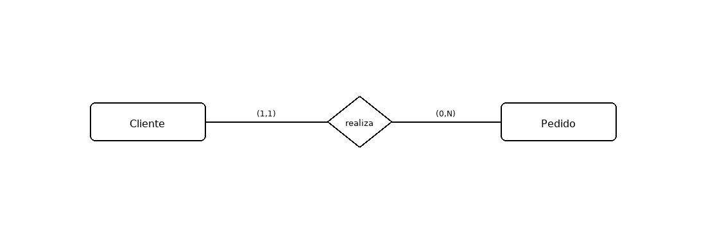
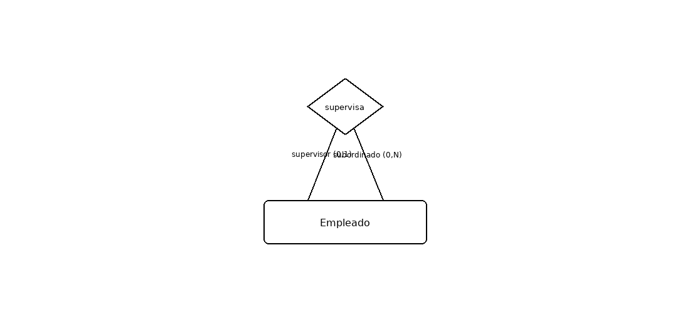
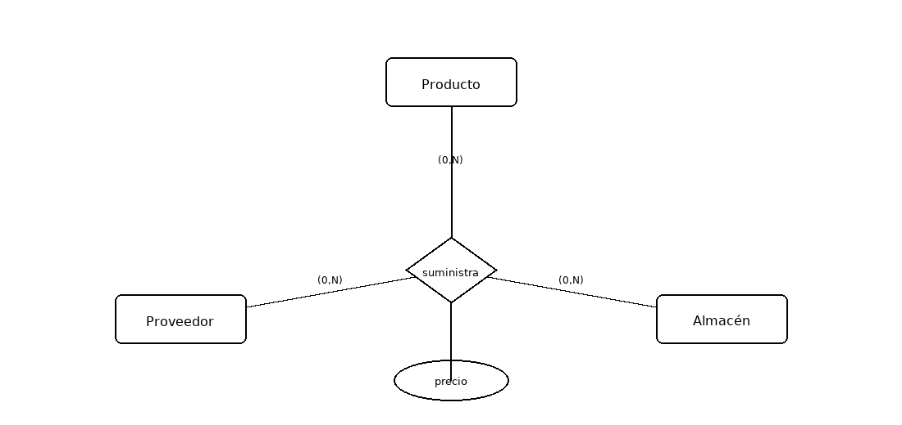
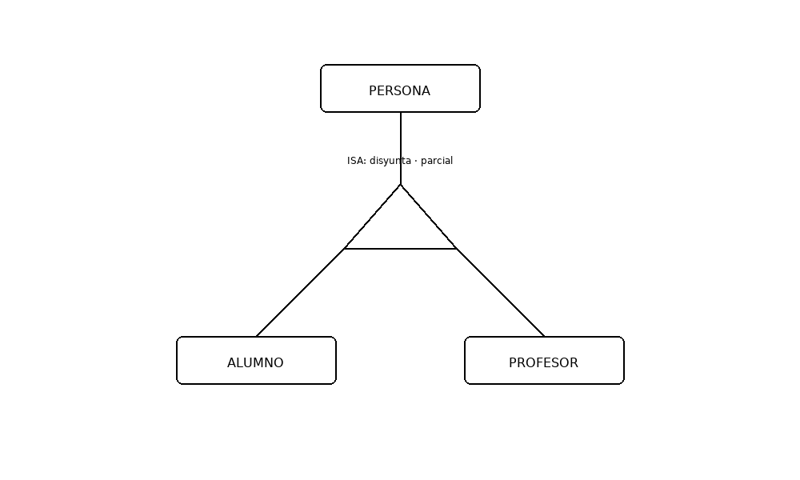
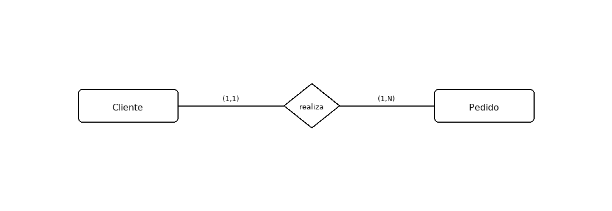
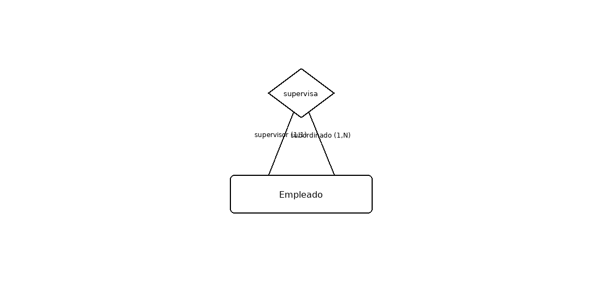
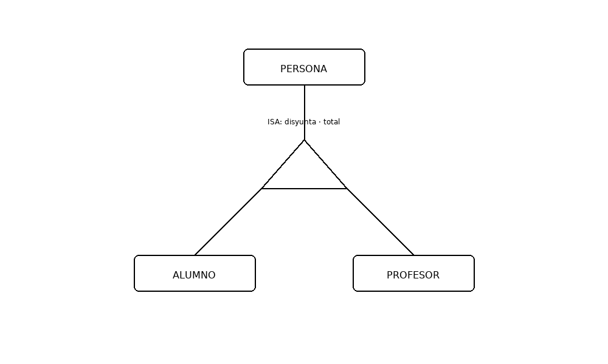

> Fuente: https://dexpositofp.github.io/docencia/BDA/logico.html (descargado el 13/11/2026)

# Diseño lógico de bases de datos

Del modelo conceptual (E/R) al relacional normalizado listo para implementar.

## 1) ¿Para qué sirve el modelo lógico?

El **modelo conceptual (E/R)** capta el *significado* del dominio: entidades, relaciones, cardinalidades y reglas. Es el acuerdo con negocio sobre “qué existe” y “cómo se vincula”, sin hablar de tablas. El **modelo lógico (relacional)** transforma ese significado en un *esquema de tablas* con **claves** y **restricciones** aún independiente de un SGBD concreto.

Aquí decidimos qué tablas habrá, qué columnas contienen, qué columnas forman la PK, qué FKs conectan las tablas y qué *obligatoriedades* (NOT NULL) y *unicidades* (UNIQUE) necesitamos para *hacer cumplir* el conceptual. Después, la **normalización** revisa el esquema para eliminar redundancias y anomalías (inserción, borrado, actualización) preservando el significado y las dependencias funcionales. En resumen: *Conceptual* (qué significa) → *Lógico* (cómo se estructura en tablas) → *Físico/SQL* (cómo se implementa con tipos, índices, DDL).

## 2) Notación intermedia (Demarco / “marco”)

La notación de **marco** es una forma compacta de describir el *esquema relacional lógico* antes de escribir SQL. Sirve para: (1) *comunicar* decisiones (PK, AK, FKs, nulabilidad) sin ruido técnico, (2) *validar* que las participaciones del E/R (mínimos y máximos) están bien trasladadas, y (3) *generar* los `CREATE TABLE` casi mecánicamente.

| Marcador                   | Significado                                                        | Ejemplo                          |
|----------------------------|--------------------------------------------------------------------|----------------------------------|
| `T = c1 + … + cn`          | Tabla *T* con columnas *c1..cn* (orden sugerido: PK → FKs → resto) | `CLIENTE = id + dni + nombre`    |
| `CP(...)`                  | Clave primaria (única, mínima y no nula)                           | `CP(id)`                         |
| `C.Alt(...)`               | Clave alternativa (candidata) — debe ser única y mínima            | `C.Alt(dni)`                     |
| `C.Aj(...)` → `T(col_ref)` | Clave ajena (FK) que referencia PK o AK de *T*                     | `C.Aj(cliente_id) → CLIENTE(id)` |
| `VNN(col)`                 | Valor no nulo (NOT NULL)                                           | `VNN(cliente_id)`                |
| `ASERCIÓN n: …`            | Restricción global (involucra más de una tabla)                    | `ASERCIÓN 1: B[b] ⊆ R[b]`        |

### 2.1 Cómo se lee un marco (paso a paso)

    CLIENTE = id + dni + nombre + fecha_nac
    CP(id)
    C.Alt(dni)
    VNN(nombre)
      

1.  **Cabecera**: la tabla y sus columnas.
2.  **CP**: qué columnas forman la PK (a veces compuesta).
3.  **C.Alt**: candidatas adicionales (se materializan con `UNIQUE`).
4.  **VNN**: columnas obligatorias (NOT NULL).
5.  **C.Aj**: referencias a otras tablas y a qué columna exacta (PK o AK) apuntan.

### 2.2 Equivalencias con SQL (cómo se traduce)

- `CP(a,b)` → `PRIMARY KEY (a,b)`
- `C.Alt(x,y)` → `UNIQUE (x,y)`
- `C.Aj(f) → T(k)` → `FOREIGN KEY (f) REFERENCES T(k)` (+ política de borrado/actualización)
- `VNN(c)` → `c ... NOT NULL`
- `ASERCIÓN` → CHECKs complejos, vistas con `WITH CHECK OPTION` o disparadores (según motor)

**Matiz (MySQL / SQL estándar).** `UNIQUE` permite *varios NULL* por defecto. Si necesitas que una *AK* sea “única y no nula”, combina `VNN` + `UNIQUE`.

### 2.3 Estilo y convenciones de nombres

- **Tablas** en mayúsculas y en *singular*: `CLIENTE`, `PEDIDO`.
- **Columnas** en `snake_case`: `cliente_id`, `fecha_alta`.
- **FKs** con sufijo `_id` y prefijo de la tabla referenciada: `cliente_id`.
- En PK compuestas, **orden estable**: primero la PK del “lado 1”, después la clave parcial/atributo local.

### 2.4 Patrones exprés de mapeo (del E/R al marco)

#### 2.4.1 1:N

    CLIENTE = id + nombre
    CP(id)

    PEDIDO = id + cliente_id + fecha
    CP(id)
    C.Aj(cliente_id) → CLIENTE(id)
    VNN(fecha)                
      

#### 2.4.2 N:M (tabla de relación con atributos)

    PEDIDO     = id + fecha
    CP(id)

    PRODUCTO   = id + nombre + pvp
    CP(id)

    LINEA      = pedido_id + producto_id + unidades + precio_ud
    CP(pedido_id, producto_id)                 
    C.Aj(pedido_id)  → PEDIDO(id)
    C.Aj(producto_id)→ PRODUCTO(id)
    VNN(unidades)     VNN(precio_ud)
      

#### 2.4.3 1:1 (evitar tabla intermedia)

    PERSONA    = id + nombre
    CP(id)

    PASAPORTE  = id + numero + persona_id
    CP(id)
    C.Alt(numero)
    C.Aj(persona_id) → PERSONA(id)
    VNN(persona_id)             
    C.Alt(persona_id)           
      

#### 2.4.4 Atributo multivalorado (n teléfonos / cliente)

    CLIENTE  = id + nombre
    CP(id)

    TEL_CLI  = cliente_id + telefono
    CP(cliente_id, telefono)
    C.Aj(cliente_id) → CLIENTE(id)
      

#### 2.4.5 Entidad débil (PK fuerte + clave parcial)

    PEDIDO = id + fecha
    CP(id)

    LINEA  = pedido_id + pos + producto_id
    CP(pedido_id, pos)          
    C.Aj(pedido_id) → PEDIDO(id)
    C.Aj(producto_id) → PRODUCTO(id)
      

#### 2.4.6 Unaria (reflexiva, con roles)

    EMPLEADO = id + nombre + jefe_id
    CP(id)
    C.Aj(jefe_id) → EMPLEADO(id)    
      

#### 2.4.7 ISA (generalización / especialización)

    PERSONA   = id + nombre
    CP(id)

    ALUMNO    = id + curso
    CP(id)
    C.Aj(id) → PERSONA(id)

    PROFESOR  = id + departamento
    CP(id)
    C.Aj(id) → PERSONA(id)

    /* Si la especialización es disyunta y total: */
    ASERCIÓN 1: PERSONA[id] ⊆ ALUMNO[id] ∪ PROFESOR[id]
    ASERCIÓN 2: ALUMNO[id] ∩ PROFESOR[id] = ∅
      

#### 2.4.8 Ternaria (reglas conjuntas)

    PROVEEDOR = id + nombre
    CP(id)
    PRODUCTO  = id + nombre
    CP(id)
    ALMACEN   = id + ciudad
    CP(id)

    SUMINISTRO = proveedor_id + producto_id + almacen_id + precio
    CP(proveedor_id, producto_id, almacen_id)
    C.Aj(proveedor_id) → PROVEEDOR(id)
    C.Aj(producto_id)  → PRODUCTO(id)
    C.Aj(almacen_id)   → ALMACEN(id)
    VNN(precio)
      

### 2.5 Aserciones típicas (plantillas)

- **Cobertura** (participación total de B en R): `ASERCIÓN: B[b] ⊆ R[b]`
- **Disyunción** (ISA excluyente): `ASERCIÓN: S1[k] ∩ S2[k] = ∅`
- **Totalidad** (ISA total): `ASERCIÓN: S1[k] ∪ S2[k] ⊇ SUP[k]`

### 2.6 Errores frecuentes

- Poner `VNN` en una FK cuando el E/R indica *min=0* (debería admitir NULL).
- Olvidar `C.Alt` para una clave natural relevante (luego aparecen duplicados de negocio).
- Crear tabla de relación para un **1:N** (innecesaria salvo casos especiales).
- No documentar la **política** de las FKs (RESTRICT/NO ACTION, CASCADE, SET NULL, SET DEFAULT).

### 2.7 Mini-ejercicios

1.  Transforma el E/R *Cliente (1,N)–realiza–(1,1) Pedido* + *Pedido (1,N)–incluye–(1,N) Producto* al marco completo.
2.  Haz que la participación de *Pedido* en *incluye* sea *total* y de *Producto* sea *opcional*. ¿Qué cambias (VNN/NULL)?
3.  Introduce la AK natural de *Producto* (p. ej., `ean13`) y refleja la restricción en el marco.

## 3) Restricciones usadas por el SGBD

En el paso lógico nos apoyamos en las restricciones que ofrecen los SGBD para *hacer cumplir* lo decidido en el E/R: **entidad** (claves), **referencia** (foráneas), **dominio** (tipos, rangos) y **reglas semánticas** (aserciones/trigger). Aquí fijamos qué es *obligatorio*, qué es *único* y cómo se comportan las referencias ante borrados y actualizaciones.

### 3.1 Clave primaria (CP)

- **Definición:** *única, mínima y no nula*. En SQL, la PK implica `UNIQUE` + `NOT NULL` sobre sus columnas.
- **Compuestas:** todas las columnas de la PK son no nulas; su *minimalidad* es de diseño (no la comprueba el motor).
- **Elección:** usa clave natural si es estable y sin ambigüedad; si no, una surrogate (y conserva la natural como `C.Alt`).

    CLIENTE = id + dni + nombre
    CP(id)
    C.Alt(dni)        
    VNN(nombre)
      

### 3.2 Claves alternativas (C.Alt)

Una **clave alternativa** (candidata no elegida como PK) se materializa con `UNIQUE`. Hay dos prácticas habituales:

1.  *Única + mínima + no nula* (exigir dato siempre).
2.  *Única + mínima* permitiendo `NULL` (comportamiento por defecto en muchos SGBD: `UNIQUE` admite varios `NULL`).

En estos apuntes seguiremos la opción (2) por defecto: si quieres “*única y además obligatoria*”, añade explícitamente `VNN(col)` junto con `C.Alt(col)`.

    PERSONA = id + nif + nombre
    CP(id)
    C.Alt(nif)        
    VNN(nif)          
      

### 3.3 Claves ajenas (C.Aj) e integridad referencial

- **Referencia:** `C.Aj(x) → T(k)` debe apuntar a una *PK* o a una *AK* (`UNIQUE`) de `T`.
- **Tipos compatibles:** mismo tipo/longitud/unsigned/charset/collation en ambas columnas (o compatible según el motor).
- **Nulabilidad:** mapea la participación mínima del E/R:
  - `min=1` ⇒ `VNN(FK)` (obligatoria).
  - `min=0` ⇒ FK *nullable* (opcional).
- **Política de borrado/actualización:** define el comportamiento: `RESTRICT/NO ACTION` (impide si hay dependientes), `CASCADE` (propaga), `SET NULL` (solo si la FK admite `NULL`).

    PEDIDO = id + cliente_id + fecha
    CP(id)
    C.Aj(cliente_id) → CLIENTE(id)
    VNN(fecha)

      

### 3.4 VNN (NOT NULL), DEFAULT y dominios

- **VNN(col)** marca atributo *obligatorio* (min=1). Sin VNN, el silencio implica “opcional”.
- **DEFAULT:** útil para valores por defecto; evita “abusar” de valores mágicos (0, “desconocido”) para simular `NULL`.
- **Dominios:** tipos adecuados y restricciones de rango/formato (edad ≥ 0, email válido, etc.).

### 3.5 CHECK y aserciones

- **CHECK** valida reglas de *columna/tabla* (ej.: `saldo >= 0`, `fecha_ini <= fecha_fin`).
- **ASERCIÓN** documenta reglas *inter–tabla* (“cobertura”, disyunción/totalidad en ISA, etc.). Si el motor no las soporta, se implementan con *triggers* o lógica de aplicación.

    ASERCIÓN 1: B[b] ⊆ R[b]       
    /* Implementable con trigger que impida INSERT/DELETE que rompan la cobertura */
      

### 3.6 Decidir políticas de FK según el E/R

| Situación                    | Participación  | FK                             | Acción recomendada                            |
|------------------------------|----------------|--------------------------------|-----------------------------------------------|
| 1:N clásico (Pedido→Cliente) | min(N)=1       | FK en N con `VNN`              | `ON DELETE RESTRICT` (o SET NULL si min=0)    |
| N:M (Línea→Pedido,Producto)  | min=0 en ambos | FKs nullable o no según reglas | `ON DELETE CASCADE` desde maestros a relación |
| 1:1 total-total              | min=1 en ambos | FK con `VNN` + `UNIQUE`        | `RESTRICT` o `CASCADE` según semántica        |

**Específicos MySQL (8.0+):**

- **FK** solo con *InnoDB*; la tabla referenciada debe tener *PK o UNIQUE* sobre las columnas destino.
- **UNIQUE** permite varios `NULL` (en índices compuestos, cualquier fila con algún `NULL` no choca).
- **CHECK** se *aplica* a partir de 8.0.16 (antes se ignoraba). Úsalo para dominios.
- **SET DEFAULT** en FKs no está implementado (usa `SET NULL` o *triggers*).
- **DEFERRABLE** (posponer chequeos) no existe: las restricciones se validan de inmediato.
- **Tipos/charset/collation** deben ser compatibles en FK y referenciada (especialmente en `VARCHAR` y `CHAR`).

### 3.7 Mini–guía de mapeo (E/R → restricciones)

- *min=1* ⇒ `VNN(FK)`. *min=0* ⇒ FK nullable.
- *máx=1* en el lado referenciado ⇒ `UNIQUE` (si no es PK) para imponer 1:1.
- 1:N ⇒ FK en el lado N; N:M ⇒ tabla de relación con PK compuesta (y atributos si los hay).
- Débil ⇒ PK = PK(fuerte) + clave parcial; FK hacia la fuerte con `VNN`.
- ISA disyunta/total ⇒ documenta como *ASERCIÓN* (y aplica con checks/triggers si el motor lo permite).

## 4) Mapeo de entidades y atributos

Partimos del **E/R** y, para cada caso, mostramos: (a) el diagrama conceptual de partida y (b) el *marco* (notación lógica) resultante. Primero tratamos casos **sin restricción de existencialidad** (participación mínima 0 donde aplique) y después los mismos patrones **con restricción** (min=1), indicando qué cambia (nulabilidad `VNN`, `UNIQUE`, aserciones).

### 4.1 Sin restricción de existencialidad

#### 4.1.1 Relación binaria 1:N (opcional en N)

<figure class="media-box">

<figcaption><strong>Lectura (convención de clase):</strong> <em>Cliente — (1,1) — realiza — (0,N) — Pedido</em>. Mapeo 1:N colocando la PK del lado 1 como FK en el lado N; como la participación en N es opcional (min=0), la FK <em>puede</em> ser NULL.</figcaption>
</figure>

Como ves en el E/R, *Cliente — (1,1) — realiza — (0,N) — Pedido* indica que cada pedido pertenece a exactamente un cliente y que un cliente puede tener ninguno o muchos pedidos. Para llevarlo a lógico sigo siempre el mismo ritual: (1) la entidad del lado **1** (*Cliente*) conserva su PK tal cual; (2) la entidad del lado **N** (*Pedido*) recibe la PK del lado 1 como **FK** (`cliente_id`); (3) decido la **nulabilidad** de la FK en función del mínimo: aquí es `min=0` en *Pedido*, así que la FK *puede* ser `NULL`; (4) todos los atributos que no sean claves van como columnas normales y, si son obligatorios, marco `VNN`. Resultado: una FK en *PEDIDO* que permite `NULL` y preserva la lectura del E/R.

    CLIENTE = id + dni + nombre
    CP(id)
    C.Alt(dni)

    PEDIDO  = id + cliente_id + fecha
    CP(id)
    C.Aj(cliente_id) → CLIENTE(id)   
    VNN(fecha)
      

#### 4.1.2 Relación unaria (reflexiva) 1:N (opcional)

<figure class="media-box">

<figcaption><strong>Roles:</strong> supervisor (0,1), subordinado (0,N). Sin existencialidad: un empleado puede no tener jefe y un jefe puede no tener subordinados.</figcaption>
</figure>

En una reflexiva trato a la entidad como si fuese dos roles de la misma tabla. La relación *Empleado —supervisa→ Empleado* con *supervisor (0,1)* y *subordinado (0,N)* se mapea añadiendo una **FK auto-referenciada** en *EMPLEADO* (`jefe_dni` → `dni`). La clave está en la **participación mínima**: si un empleado puede no tener jefe (`min=0`), esa FK se deja *nullable*. No creo tabla de relación intermedia porque el patrón es 1:N; solo documentaría una tabla aparte si surgieran atributos propios de la relación y esta se comportara como N:M.

    EMPLEADO = dni + nombre + jefe_dni
    CP(dni)
    C.Aj(jefe_dni) → EMPLEADO(dni)   
      

#### 4.1.3 Relación ternaria (opcional en los tres extremos)

<figure class="media-box">

<figcaption><strong>Proveedor — (0,N) — suministra — (0,N) — Producto — (0,N) — Almacén.</strong> La relación tiene atributo <em>precio</em>. Se traduce a una tabla con tres FKs; sin existencialidad, ninguna es VNN por obligación.</figcaption>
</figure>

Las ternarias se traducen casi siempre a una **tabla de relación** cuya PK compuesta incluye las tres FKs (o, según la semántica, dos de ellas más una `AK`). Procedo así: (1) creo la tabla *SUMINISTRO*; (2) defino las tres FKs hacia *PROVEEDOR*, *PRODUCTO* y *ALMACEN*; (3) añado la PK compuesta en el orden que mejor exprese la unicidad del hecho de negocio; (4) coloco los **atributos de la relación** (p. ej., `precio`) aquí. Si en el E/R ningún extremo tiene `min=1`, ninguna FK es `VNN` por obligación.

    PROVEEDOR = id + nombre
    CP(id)

    PRODUCTO  = id + nombre
    CP(id)

    ALMACEN   = id + ciudad
    CP(id)

    SUMINISTRO = proveedor_id + producto_id + almacen_id + precio
    CP(proveedor_id, producto_id, almacen_id)
    C.Aj(proveedor_id) → PROVEEDOR(id)
    C.Aj(producto_id)  → PRODUCTO(id)
    C.Aj(almacen_id)   → ALMACEN(id)
    VNN(precio)
      

#### 4.1.4 Generalización/Especialización (ISA) — parcial y disyunta

<figure class="media-box">

<figcaption><strong>ISA parcial disyunta:</strong> no todas las personas son alumno o profesor; nadie puede ser ambos a la vez. En el mapeo básico: tabla para <em>PERSONA</em> y tablas para subtipos con FK a la super (sin exigir cobertura).</figcaption>
</figure>

En una ISA parcial disyunta (*PERSONA* → *ALUMNO* \| *PROFESOR*), no todas las personas pertenecen a un subtipo y, además, nadie puede estar en ambos. El mapeo más claro para el alumnado es: una tabla para el supertipo con su PK y una tabla por subtipo con una **FK a la PK del supertipo** (que a su vez es su PK). Como la especialización es *parcial*, no fuerzo cobertura con aserciones; la *disyunción* puedo documentarla como restricción conceptual o, si se desea implementar, con aserciones/triggers más adelante.

    PERSONA  = id + nombre
    CP(id)

    ALUMNO   = id + curso
    CP(id)
    C.Aj(id) → PERSONA(id)

    PROFESOR = id + departamento
    CP(id)
    C.Aj(id) → PERSONA(id)

    /* Disyunción (opcional documentarla como aserción informativa):
       ASERCIÓN: ALUMNO[id] ∩ PROFESOR[id] = ∅  */
      

### 4.2 Con restricción de existencialidad

#### 4.2.1 Binaria 1:N con participación total en N

<figure class="media-box">

<figcaption><strong>Cliente — (1,1) — realiza — (1,N) — Pedido.</strong> Cada <em>Pedido</em> debe pertenecer a exactamente un <em>Cliente</em> (min=1 en N), por tanto la FK será <code>VNN</code>.</figcaption>
</figure>

Aquí la lectura cambia el mínimo del lado N: *Cliente — (1,1) — realiza — (1,N) — Pedido*. El procedimiento es el mismo que en 4.1.1, salvo un detalle decisivo: la FK **debe ser NOT NULL** porque el mínimo es 1; por tanto marco `VNN(cliente_id)`. Además, si el modelo exige que no se puedan borrar clientes con pedidos, elijo `ON DELETE RESTRICT`; si se permite, podría ser `CASCADE` (con cautela).

    CLIENTE = id + dni + nombre
    CP(id)

    PEDIDO  = id + cliente_id + fecha
    CP(id)
    C.Aj(cliente_id) → CLIENTE(id)
    VNN(cliente_id)                       
    VNN(fecha)
    -- Política recomendada:
    -- ON DELETE RESTRICT (o SET NULL si cambias la participación a min=0)
      

#### 4.2.2 Reflexiva con participación total del subordinado

<figure class="media-box">

<figcaption><strong>supervisor (1,1) / subordinado (1,N):</strong> toda persona empleada debe tener un supervisor (min=1). Traducción: <code>VNN(jefe_dni)</code>. El lado de “tiene subordinados” puede seguir siendo opcional (0..N).</figcaption>
</figure>

Si toda persona empleada *debe* tener un supervisor (`min=1` en el rol subordinado), la FK auto-referenciada `jefe_dni` pasa a ser **obligatoria** (`VNN`). La lectura práctica para la clase es: “no existe empleado sin jefe registrado”. El lado de supervisor conserva su máximo N y puede tener cero subordinados; no necesito tabla aparte, basta con la FK obligatoria.

    EMPLEADO = dni + nombre + jefe_dni
    CP(dni)
    C.Aj(jefe_dni) → EMPLEADO(dni)
    VNN(jefe_dni)                         
      

#### 4.2.3 Ternaria con participación total en un extremo

<figure class="media-box">

<figcaption><strong>Total en Producto:</strong> cada <em>Producto</em> debe aparecer en algún <em>Suministro</em> (min=1). Esto suele requerir, además de <code>VNN</code> en las FKs, una <strong>ASERCIÓN de cobertura</strong> si se exige que <em>todos</em> los productos estén relacionados.</figcaption>
</figure>

Cuando un extremo de la ternaria es total, por ejemplo “todo *Producto* participa en algún *Suministro*”, reflejo dos cosas: (1) en la tabla de relación todas las FKs que deban ser obligatorias llevan `VNN`, y (2) si necesito garantizar la **cobertura** del conjunto (que no quede ningún producto sin relacionar), añado una **ASERCIÓN** del tipo `PRODUCTO[id] ⊆ SUMINISTRO[producto_id]`. La PK y los posibles `UNIQUE` se eligen en función de la unicidad del hecho (¿puede haber varios suministros del mismo producto y proveedor en almacenes distintos? ¿con distinta fecha?).

    SUMINISTRO = proveedor_id + producto_id + almacen_id + precio
    CP(proveedor_id, producto_id, almacen_id)
    C.Aj(proveedor_id) → PROVEEDOR(id)
    C.Aj(producto_id)  → PRODUCTO(id)
    C.Aj(almacen_id)   → ALMACEN(id)
    VNN(proveedor_id)  VNN(producto_id)  VNN(almacen_id)  VNN(precio)

    ASERCIÓN 1: PRODUCTO[id] ⊆ SUMINISTRO[producto_id]
      

#### 4.2.4 ISA total disyunta

<figure class="media-box">

<figcaption><strong>Total y disyunta:</strong> toda <em>PERSONA</em> es <em>ALUMNO</em> o <em>PROFESOR</em> (cobertura) y no ambas (disyunción). Se documenta con aserciones (o lógica de aplicación).</figcaption>
</figure>

En la ISA total disyunta imponemos dos ideas: **cobertura** (toda *PERSONA* está en algún subtipo) y **exclusión** (no puede estar en varios). En lógico lo documento con aserciones: `PERSONA[id] ⊆ ALUMNO[id] ∪ PROFESOR[id]` y `ALUMNO[id] ∩ PROFESOR[id] = ∅`. Si el SGBD no soporta aserciones, explico al alumnado que esto se implementará con *checks*, vistas con `WITH CHECK OPTION` o disparadores, pero a nivel lógico basta con dejarlo claramente especificado.

    ASERCIÓN 1: PERSONA[id] ⊆ ALUMNO[id] ∪ PROFESOR[id]
    ASERCIÓN 2: ALUMNO[id] ∩ PROFESOR[id] = ∅
      

**Regla puente.** Del E/R al marco: *min=1 → VNN(FK)*, *min=0 → FK nullable*. Para imponer 1:1, añade `UNIQUE` sobre la FK (si no es PK). Para “cobertura” global usa **ASERCIÓN**.

## 4.3) Repaso: del E/R al modelo lógico

**Idea fuerza:** lee *(min,max)*, decide **dónde va la FK**, fija **nulabilidad (VNN/NULL)**, define **PK/AK**, añade **políticas de FK** y, si hace falta, **aserciones**. Luego revisa normalización.

### Guía rápida (en 8 pasos)

1.  **Leer el E/R completo**: aridad (binaria/unaria/ternaria), roles, *(min,max)* en cada extremo, atributos de la relación y si hay entidad débil o multivalorados.
2.  **Elegir dónde va la FK**:
    - **1:N**: la FK va en el lado **N**.
    - **1:1**: coloca una FK en uno de los lados; si el lado no-PK debe ser único, añade `UNIQUE`.
    - **N:M**: crea **tabla de relación** con FKs a ambos lados (y atributos de la relación, si existen).
    - **Unaria (reflexiva)**: FK auto-referenciada en la propia tabla (p. ej., `jefe_id → EMPLEADO(id)`).
    - **Ternaria**: crea **tabla de relación** con tres FKs (ajusta PK/AK según la semántica).
    - **Débil**: la PK de la débil = PK de la fuerte + *clave parcial*; relación identificadora no genera tabla aparte.
    - **Multivalorado**: crea tabla propia (`BASE + atributo`) con FK a la entidad base; PK compuesta.
    - **ISA**: supertipo con su PK; cada subtipo = tabla con FK (y PK) al supertipo; documenta disyunción/totalidad.
3.  **Fijar nulabilidad** desde los mínimos del E/R:
    - `min = 1` ⇒ la FK es **obligatoria** → `VNN(FK)`.
    - `min = 0` ⇒ la FK **admite NULL**.
    - Para **1:1**, si un lado tiene `max = 1` y no es PK, añade `UNIQUE` a su FK.
4.  **Definir claves**:
    - **PK** en cada tabla (compuesta si procede: relación N:M, débil, multivalorado).
    - **AK (Candidatas)** con `C.Alt(...)` (en SQL: `UNIQUE`); si deben ser obligatorias, añade `VNN`.
    - Preserva la clave natural estable como `C.Alt` si usas surrogate (`id`).
5.  **Política de integridad referencial** para cada FK:
    - `ON DELETE RESTRICT/NO ACTION` si no quieres huérfanos.
    - `ON DELETE CASCADE` si borrar el padre debe borrar dependientes (típico en tablas de relación).
    - `ON DELETE SET NULL` solo si la FK es nullable (mínimo 0).
    - `ON UPDATE CASCADE` suele ser razonable si cambian claves naturales.
6.  **Trasladar atributos**:
    - Atributos simples → columnas; compuestos → varias columnas; *derivados* no se almacenan.
    - Atributos de la **relación** (p. ej., *precio* en N:M o ternaria) van en la **tabla de relación**.
7.  **Normalización express**:
    - **1NF**: sin multivalorados ni grupos repetitivos en la misma tabla.
    - **2NF**: en PK compuesta, evita dependencias parciales.
    - **3NF/BCNF**: elimina dependencias transitivas de no-clave sobre la clave.
8.  **Verificaciones finales**:
    - Tipos y longitudes compatibles en FKs (incluye charset/collation si aplica).
    - Indexa PK, AK y FKs (*rendimiento*).
    - Nombres consistentes (`snake_case`, sufijo `_id` para FKs).
    - Documenta **ASERCIÓN** si necesitas cobertura/disyunción/totalidad.

### Tabla de decisión (resumen)

| Patrón E/R    | FK / Tabla                                | PK                           | Nulabilidad                      | Extras                                       |
|---------------|-------------------------------------------|------------------------------|----------------------------------|----------------------------------------------|
| 1:N           | FK en lado N                              | PK propias; N hereda FK      | min(N)=1 ⇒ VNN(FK); min=0 ⇒ NULL | RESTRICT/SET NULL según reglas               |
| 1:1           | FK en uno de los lados                    | PK propias                   | min=1 ⇒ VNN(FK)                  | Si no es PK, **UNIQUE** en la FK             |
| N:M           | **Tabla de relación**                     | PK = (FKs) o surrogate + AKs | Normalmente VNN en FKs           | Atributos de relación aquí; suele ir CASCADE |
| Unaria 1:N    | FK auto-referenciada                      | PK propia                    | min=1 ⇒ VNN(FK); min=0 ⇒ NULL    | Roles claros (supervisor/subordinado)        |
| Ternaria      | **Tabla de relación**                     | PK compuesta (2 o 3 FKs)     | Según mínimos de cada extremo    | Posibles **ASERCIÓN** de cobertura           |
| Débil         | Sin tabla para la relación identificadora | PK = PK(fuerte)+parcial      | FK a fuerte **VNN**              | Relación identificadora implícita            |
| Multivalorado | **Nueva tabla** (BASE+atrib)              | PK = PK(base)+atributo       | FK a base VNN                    | Evita listas en una sola columna             |
| ISA           | Subtipo con FK→super                      | PK subtipo = PK super        | Según totalidad                  | Disyunción/Totalidad como **ASERCIÓN**       |

### Plantilla de traducción (marco → SQL)

    T = c1 + c2 + ... + fk_x + ...
    CP(c1, ...)
    C.Alt(ak1, ...)
    C.Aj(fk_x) → OTRA_TABLA(k)
    VNN(c_obligatoria)

    -- SQL (esqueleto)
    CREATE TABLE T (
      c1           ...,
      c2           ...,
      fk_x         ... [NOT NULL],    -- si min=1
      ...,
      CONSTRAINT pk_T PRIMARY KEY (c1, ...),
      CONSTRAINT ak_T UNIQUE (ak1, ...),
      CONSTRAINT fk_T_x FOREIGN KEY (fk_x) REFERENCES OTRA_TABLA(k)
        ON DELETE RESTRICT | SET NULL | CASCADE
        ON UPDATE CASCADE
    );
      

### Checklist relámpago

- ¿Cada tabla tiene **PK** correcta (y mínima)?
- ¿Las **FK** están en el lado adecuado y su **VNN/NULL** coincide con *min*?
- ¿Hay **UNIQUE** cuando *max=1* lo exige (1:1)?
- ¿Atributos de la relación se han puesto en la **tabla de relación**?
- ¿Necesitas **ASERCIÓN** de cobertura/disyunción/totalidad?
- ¿3NF/BCNF y sin pérdida? ¿Índices en PK/AK/FK?

## 5) Integridad lógica y políticas

Además de **CP/PK**, **C.Alt/AK**, **C.Aj/FK** y **VNN**, debemos documentar las **políticas de integridad referencial** que gobiernan el comportamiento ante *borrados* y *actualizaciones* de claves en las tablas referenciadas. Estas políticas deben ser coherentes con las **participaciones** del E/R: los *mínimos* (`min=0` / `min=1`) y, cuando aplique, las restricciones globales (cobertura, disyunción/totalidad).

**Resumen rápido.**

- **RESTRICT / NO ACTION**: impide borrar si hay dependientes.
- **CASCADE**: propaga el borrado/actualización a dependientes.
- **SET NULL**: pone la FK a `NULL` (solo si la FK es *nullable*, es decir, `min=0`).
- **SET DEFAULT**: asigna un valor por defecto (depende del motor; en MySQL no está soportado).

### 5.1 ¿Cómo elijo la política según el E/R?

| Patrón E/R                          | Min/Máx relevantes  | FK (nulabilidad)           | Política sugerida (DELETE)               | Notas                                                                        |
|-------------------------------------|---------------------|----------------------------|------------------------------------------|------------------------------------------------------------------------------|
| 1:N (Pedido→Cliente)                | min(N)=1            | **VNN** (obligatoria)      | **RESTRICT**                             | Un Pedido no puede quedar huérfano; primero reasigna o borra el pedido.      |
| 1:N (Pedido→Cliente)                | min(N)=0            | nullable                   | **SET NULL** o RESTRICT                  | Si permites “pedido sin cliente”, usa SET NULL; si no, RESTRICT.             |
| N:M (Línea entre Pedido y Producto) | min=0 en ambos      | FKs **VNN** en la relación | **CASCADE** desde maestros a la relación | Al borrar un Pedido, borra sus Líneas; nunca al revés.                       |
| 1:1 (Persona—Pasaporte)             | máx=1 en ambos      | FK + **UNIQUE**            | RESTRICT o CASCADE                       | Evita SET NULL si la relación es total en ambos lados.                       |
| Débil (Línea depende de Pedido)     | participación total | FK **VNN**                 | **CASCADE** (fuerte→débil)               | Una débil no vive sin su fuerte; borrar el fuerte elimina las débiles.       |
| Unaria (Empleado—jefe)              | min(subordinado)=0  | FK nullable                | **SET NULL** en baja del jefe            | Si borras al jefe, subordinados quedan sin jefe (si el modelo lo permite).   |
| Unaria (Empleado—jefe)              | min(subordinado)=1  | FK **VNN**                 | **RESTRICT**                             | Antes de borrar al jefe, reasigna subordinados (o usa lógica de aplicación). |
| Ternaria (Suministro)               | según extremos      | FKs VNN/nullable según min | **CASCADE** a la tabla de relación       | La cobertura (*todos los productos aparecen*) se expresa con ASERCIÓN.       |

### 5.2 ¿Y con `ON UPDATE`?

**ON UPDATE CASCADE** tiene sentido si tus claves naturales pueden cambiar (p. ej., `dni`, `isbn`). Si usas surrogate (`id` autoincremental) como PK y las FKs apuntan a ella, lo normal es **RESTRICT** (porque esa PK no se actualiza).

### 5.3 Plantillas (marco → SQL)

#### 5.3.1 1:N con min(N)=1 (FK obligatoria)

    CLIENTE = id + nombre
    CP(id)

    PEDIDO  = id + cliente_id + fecha
    CP(id)
    C.Aj(cliente_id) → CLIENTE(id)
    VNN(cliente_id)  VNN(fecha)
      

    -- SQL (ejemplo)
    CREATE TABLE cliente (
      id     INT PRIMARY KEY,
      nombre VARCHAR(60) NOT NULL
    );

    CREATE TABLE pedido (
      id          INT PRIMARY KEY,
      cliente_id  INT NOT NULL,
      fecha       DATE NOT NULL,
      CONSTRAINT fk_pedido_cliente
        FOREIGN KEY (cliente_id) REFERENCES cliente(id)
          ON DELETE RESTRICT
          ON UPDATE RESTRICT
    );
      

#### 5.3.2 1:N con min(N)=0 (FK nullable)

    PEDIDO = id + cliente_id + fecha
    CP(id)
    C.Aj(cliente_id) → CLIENTE(id)   
      

    -- SQL (ejemplo)
    CREATE TABLE pedido (
      id          INT PRIMARY KEY,
      cliente_id  INT NULL,
      fecha       DATE NOT NULL,
      CONSTRAINT fk_pedido_cliente
        FOREIGN KEY (cliente_id) REFERENCES cliente(id)
          ON DELETE SET NULL     -- permitido porque la FK admite NULL
          ON UPDATE RESTRICT
    );
      

#### 5.3.3 N:M (tabla de relación con CASCADE desde maestros)

    PEDIDO    = id + fecha
    CP(id)

    PRODUCTO  = id + nombre + pvp
    CP(id)

    LINEA     = pedido_id + producto_id + unidades
    CP(pedido_id, producto_id)
    C.Aj(pedido_id)   → PEDIDO(id)
    C.Aj(producto_id) → PRODUCTO(id)
    VNN(unidades)
      

    CREATE TABLE linea (
      pedido_id   INT NOT NULL,
      producto_id INT NOT NULL,
      unidades    INT NOT NULL CHECK (unidades > 0),
      PRIMARY KEY (pedido_id, producto_id),
      CONSTRAINT fk_linea_pedido
        FOREIGN KEY (pedido_id) REFERENCES pedido(id)
          ON DELETE CASCADE
          ON UPDATE RESTRICT,
      CONSTRAINT fk_linea_producto
        FOREIGN KEY (producto_id) REFERENCES producto(id)
          ON DELETE CASCADE
          ON UPDATE RESTRICT
    );
      

#### 5.3.4 Débil (CASCADE desde fuerte)

    PEDIDO = id + fecha
    CP(id)

    LINEA  = pedido_id + n_linea + producto_id + precio_ud
    CP(pedido_id, n_linea)
    C.Aj(pedido_id) → PEDIDO(id)
    VNN(precio_ud)
      

    -- SQL (ejemplo)
    CREATE TABLE linea (
      pedido_id INT NOT NULL,
      n_linea   INT NOT NULL,
      producto_id INT NOT NULL,
      precio_ud DECIMAL(10,2) NOT NULL,
      PRIMARY KEY (pedido_id, n_linea),
      CONSTRAINT fk_linea_pedido
        FOREIGN KEY (pedido_id) REFERENCES pedido(id)
          ON DELETE CASCADE   -- la débil desaparece con su fuerte
          ON UPDATE RESTRICT
    );
      

## 6) Normalización (1NF, 2NF, 3NF, BCNF)

La **normalización** es el proceso de *mejorar el esquema lógico* para eliminar redundancias y evitar *anomalías* (inserción, actualización y borrado), manteniendo el significado del modelo. Trabajaremos con **dependencias funcionales (DF)** y claves para justificar cada paso. La meta docente: que el alumnado sea capaz de explicar *por qué* una descomposición es correcta (sin pérdida y —cuando se pueda— preservando DF).

**Esquema mental:** Identifica DF → detecta redundancias → decide una descomposición *sin pérdida* (y preferiblemente con DF preservadas). Lo habitual en grado es llegar a **3FN**; **BCNF** se reserva para casos con DF complejas.

### 6.1 Conceptos básicos

- **Dependencia funcional (DF):** `X → Y` significa que dos filas iguales en *X* deben ser iguales en *Y*. Las DF describen *reglas de negocio* sobre atributos.
- **Superclave:** conjunto de atributos que identifica unívocamente cada fila.
- **Clave candidata:** superclave *mínima*. Elegimos una como *clave primaria*.
- **Atributo primo:** atributo que forma parte de alguna clave candidata.
- **Cierre de atributos:** `X⁺` = todos los atributos implicados por DF partiendo de *X* (sirve para comprobar claves, cobertura y preservación).

    Algoritmo (cierre de X respecto de F):
    1) X⁺ ← X
    2) Mientras exista A→B en F con A ⊆ X⁺ y B ⊄ X⁺, hacer X⁺ ← X⁺ ∪ B
    3) Termina cuando no se puedan añadir atributos
      

### 6.2 Anomalías (por qué normalizar)

Las redundancias producen:

- **Inserción:** no puedes insertar un producto nuevo sin “inventarte” un pedido.
- **Actualización:** cambiar el nombre del cliente en una fila pero olvidarlo en otra → inconsistencia.
- **Borrado:** borrar el único pedido de un cliente elimina también sus datos de cliente.

| pedido_id | fecha      | cliente_id | cliente_nombre | producto_id | producto_nombre | unidades |
|-----------|------------|------------|----------------|-------------|-----------------|----------|
| 1001      | 2025-09-01 | C37        | Ana Ruiz       | P10         | Teclado         | 2        |
| 1001      | 2025-09-01 | C37        | Ana Ruiz       | P20         | Ratón           | 1        |
| 1002      | 2025-09-05 | C44        | Juan Gil       | P10         | Teclado         | 1        |

Ejemplo de tabla mala (todo junto)

Aquí se repiten datos de cliente y de producto en cada línea → redundancia clara.

### 6.3 Primera Forma Normal (1NF)

Una relación está en **1NF** si no contiene *atributos multivalorados* ni *grupos repetitivos*. Es decir, cada celda es atómica. Si hay listas (teléfonos), se separan en otra tabla (ya lo vimos en el mapeo).

    TEL_CLI = cliente_id + telefono
    CP(cliente_id, telefono)
    C.Aj(cliente_id) → CLIENTE(id)
      

### 6.4 Segunda Forma Normal (2NF)

En una tabla con **PK compuesta**, 2NF exige que *no existan dependencias parciales*: ningún atributo no primo debe depender solo de una parte de la PK. Si ocurre, separa.

    Ejemplo: LINEA(pedido_id, producto_id, unidades, fecha_pedido, cliente_id, cliente_nombre)
    PK = (pedido_id, producto_id)
    DF: pedido_id → fecha_pedido, cliente_id, cliente_nombre
        (pedido_id, producto_id) → unidades

    Violación: fecha_pedido y datos de cliente dependen solo de pedido_id (parte de la PK).
    Solución: separar PEDIDO(pedido_id, fecha_pedido, cliente_id, ...) y LINEA(pedido_id, producto_id, unidades).
      

### 6.5 Tercera Forma Normal (3NF)

Una tabla está en **3NF** si está en 2NF y no tiene *dependencias transitivas* de atributos no primos respecto de una clave. Si `cliente_id → cliente_nombre, cliente_ciudad`, y `pedido_id → cliente_id`, entonces `pedido_id → cliente_nombre` es transitiva: *mueve* los datos de cliente a su propia tabla.

    CLIENTE = id + nombre + ciudad
    CP(id)

    PEDIDO = id + fecha + cliente_id
    CP(id)
    C.Aj(cliente_id) → CLIENTE(id)

    LINEA  = pedido_id + producto_id + unidades + precio_ud
    CP(pedido_id, producto_id)
    C.Aj(pedido_id)   → PEDIDO(id)
    C.Aj(producto_id) → PRODUCTO(id)

    PRODUCTO = id + nombre + pvp
    CP(id)
      

### 6.6 Forma Normal de Boyce–Codd (BCNF)

BCNF refuerza 3NF: para toda DF no trivial `X → Y`, **X debe ser superclave**. A veces 3NF deja alguna DF cuyo lado izquierdo no es superclave (pero 3NF la permite si cada atributo de la derecha es primo). Cuando te interesa máxima robustez (y aceptas posibles pérdidas de preservación de DF), apunta a BCNF.

**Observación:** Pasar de 3NF a BCNF puede *romper la preservación* de alguna DF. En FP solemos preferir 3NF por ser un compromiso excelente entre robustez y simplicidad.

### 6.7 Cobertura mínima (para síntesis a 3NF)

La **cobertura mínima** de un conjunto de DF *F* (también llamado *forma canónica*) se obtiene:

1.  Descomponer derechas: cada DF con un solo atributo en la derecha (`X → A`).
2.  Minimizar izquierdas: intenta eliminar atributos redundantes del lado izquierdo.
3.  Eliminar DF redundantes: si `F - {d}` ya implica `d`, elimina `d`.

    Pseudocódigo (muy resumido):
    - Para cada X→Y en F, sustituye por { X→A | A ∈ Y }
    - Para cada DF X→A, para cada atributo z en X:
        si ( (X - {z}) → A ) está implicada por F, entonces quita z de X
    - Para cada DF d en F:
        si (F - {d}) implica d, elimina d
      

### 6.8 Descomposición correcta: sin pérdida y preservación

- **Sin pérdida (lossless join):** en una descomposición binaria `R = R1 ∪ R2`, es sin pérdida si `R1 ∩ R2` es **superclave** de *R1* *o* de *R2*. (Para más de dos, aplica iterativamente o usa el “chase”).
- **Preservación de DF:** el conjunto de DF de *R* debe estar implicado por la unión de las DF proyectadas sobre cada esquema *Ri*. En práctica docente: intenta que cada DF de la cobertura mínima aparezca en alguna tabla.

    Criterio rápido (binario):
    R descompuesta en R1 y R2 es sin pérdida si (R1 ∩ R2) → R1 o (R1 ∩ R2) → R2
      

### 6.9 Algoritmo de síntesis a 3FN (recomendado en aula)

1.  Obtén la **cobertura mínima** de F.
2.  Para cada DF `X → A` en la cobertura mínima, crea una tabla con atributos `X ∪ {A}` (agrupar por mismos *X*).
3.  Si ninguna de las tablas contiene una **clave candidata** de R, añade una tabla con una clave de R.
4.  Elimina tablas redundantes (si una está contenida completamente en otra).

**Ventaja:** garantiza *preservación de DF* y *sin pérdida* (con el paso 3). Es el método más “mecánico” para enseñar y aplicar en ejercicios.

### 6.10 Ejemplo integral: del “todo junto” a 3FN

Partimos de una relación única (mala) con estos atributos:

    R = (pedido_id, fecha, cliente_id, cliente_nombre, cliente_ciudad,
         producto_id, producto_nombre, pvp, unidades, precio_ud)
      

**DF de negocio (resumen):**

- `pedido_id → fecha, cliente_id`
- `cliente_id → cliente_nombre, cliente_ciudad`
- `producto_id → producto_nombre, pvp`
- `(pedido_id, producto_id) → unidades, precio_ud` (precio acordado en la línea)

**Problemas:** hay dependencias parciales y transitivas; redundancia de cliente y producto por línea.

#### Solución (3FN) vía síntesis + sentido común del E/R

    CLIENTE(id, nombre, ciudad)                 -- cliente_id → ...
    PRODUCTO(id, nombre, pvp)                   -- producto_id → ...
    PEDIDO(id, fecha, cliente_id)               -- pedido_id → fecha, cliente_id
      FK cliente_id → CLIENTE(id)   (VNN)

    LINEA(pedido_id, producto_id, unidades, precio_ud) 
      PK (pedido_id, producto_id)
      FK pedido_id   → PEDIDO(id)   (VNN)
      FK producto_id → PRODUCTO(id) (VNN)
      

**Sin pérdida:** la unión natural sobre claves (PK/FK) recompone la información sin duplicidad. **Preservación de DF:** cada DF relevante queda en alguna tabla (o se deriva por claves primarias/foráneas). **1NF, 2NF, 3NF:** cumplidas: no hay multivalorados, sin parciales (PK compuesta solo en LINEA y sus atributos dependen de toda la PK), y sin transitivas (datos de cliente y producto están fuera de PEDIDO/LINEA).

**Precio en la línea:** no lo derives de `PRODUCTO.pvp` si el precio puede variar con el tiempo o por pedido. Mantener `precio_ud` en LINEA evita perder el histórico.

### 6.11 De 3FN/BCNF a SQL (notas prácticas)

- **PK/AK/FK**: tradúcelas como `PRIMARY KEY`, `UNIQUE` y `FOREIGN KEY`. Respeta nulabilidad (VNN/NULL) según los mínimos del E/R.
- **Índices:** además de PK/AK, indexa FKs para rendimiento en joins.
- **CHECK** (dominio): valida rangos y coherencia (`unidades > 0`, fechas, etc.).
- **Políticas de FK:** elige `RESTRICT` / `CASCADE` / `SET NULL` alineado con reglas de negocio.

### 6.12 ¿Normalizar siempre? Denormalización controlada

En sistemas analíticos o de alto rendimiento de lectura, a veces se *denormaliza* para ahorrar joins (vistos/ materializados, columnas derivadas). Hazlo **conscientemente**, documentando la regla que “rompes” y cómo se recalcula el dato para no perder consistencia.

<a href="#" class="backtotop" aria-label="Volver arriba">↑</a>

<a href="#top" class="backtotop" aria-label="Volver arriba">↑</a>

